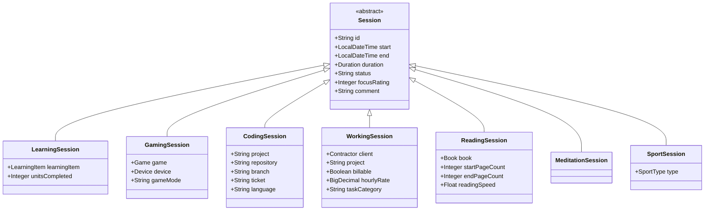

# Architectural Decision Records (ADR)

## ADR 001: Session Hierarchy and Duration Calculation Strategy

### Status
Accepted

### Context
In the SLM codebase, multiple time-tracking sessions existed independently (e.g., `LearningSession`, `GamingSession`, `ReadingSession`, `SportSession`, `MeditationSession`). Each had duplicated fields (`start`, `end`, `duration`, `comment`), redundant repository interfaces, duplicated controller endpoints, and copy-pasted Thymeleaf templates.

We are generalizing `LearningSession` and the session model into an extensible hierarchy supporting at least:
- **Gaming** (`GamingSession`)
- **Coding** (`CodingSession`)
- **Learning** (`LearningSession`)
- **Working** (`WorkingSession`)

Two major architectural decisions needed to be made:
1. **Inheritance Mapping Strategy** in JPA (`InheritanceType.JOINED` vs `@MappedSuperclass` vs `SINGLE_TABLE`).
2. **Duration Calculation Strategy** (Database-computed generated column vs Application-computed domain logic).

---

### Decision 1: Inheritance Strategy — Option A (`InheritanceType.JOINED`)

We adopt **`InheritanceType.JOINED`** with a base entity `Session` and dedicated subclass tables.



#### Rationale & Evaluation
- **Unified Base Table:** All sessions in the SLM codebase (`LearningSession`, `GamingSession`, `CodingSession`, `WorkingSession`, `ReadingSession`, `MeditationSession`, and `SportSession`) inherit from `Session`, sharing `id`, timestamps, `breakDuration`, `duration`, `netDuration`, and notes.
- **Polymorphic Queries:** Allows holistic queries across all activity types (e.g., `SELECT s FROM Session s WHERE s.start BETWEEN :from AND :to`). This makes aggregated dashboards, daily time distributions, and unified timelines straightforward across sport, work, study, and leisure.
- **Normalized Relational Schema:** Each session type maintains its own specific foreign keys and attributes in separate tables (`reading_session`, `learning_session`, `coding_session`, etc.) without polluting the base table with dozens of nullable columns.

---

### Decision 2: Duration Calculation Strategy — Strategy 1 (Database Calculation)

We adopt **Strategy 1: Database-computed generated column** for storing and calculating duration.

#### Database Definition (PostgreSQL)
```sql
break_duration INTERVAL NOT NULL DEFAULT '0 seconds',
duration INTERVAL GENERATED ALWAYS AS (endtime - starttime) STORED,
net_duration INTERVAL GENERATED ALWAYS AS (endtime - starttime - break_duration) STORED
```

#### Entity Mapping (JPA / Hibernate)
```java
@Type(PostgreSQLIntervalType.class)
@Column(name = "break_duration", columnDefinition = "interval")
private Duration breakDuration = Duration.ZERO;

@Type(PostgreSQLIntervalType.class)
@Column(name = "duration", columnDefinition = "interval", insertable = false, updatable = false)
@org.hibernate.annotations.Generated(event = {
    org.hibernate.generator.EventType.INSERT, 
    org.hibernate.generator.EventType.UPDATE
})
private Duration duration;

@Type(PostgreSQLIntervalType.class)
@Column(name = "net_duration", columnDefinition = "interval", insertable = false, updatable = false)
@org.hibernate.annotations.Generated(event = {
    org.hibernate.generator.EventType.INSERT, 
    org.hibernate.generator.EventType.UPDATE
})
private Duration netDuration;
```

#### Detailed Discussion: Database-Only vs. Application-Side

| Strategy | Pros | Cons |
| :--- | :--- | :--- |
| **Strategy 1: Database-Only Calculation**<br>*(PostgreSQL `GENERATED ALWAYS AS`)* | • **Single source of truth at storage level:** Guarantees interval consistency regardless of entry point (direct SQL inserts, migrations, external scripts, batch imports).<br>• **Zero application CPU overhead:** Interval arithmetic is delegated to the database engine.<br>• **Consistent with existing schema:** Matches existing tables in SLM (`sportsession`, `readingsession`, `appointment`, `car_trip`). | • **Hibernate post-insert state:** Without `@Generated(event = ...)`, Hibernate does not automatically populate the generated column into memory on `INSERT`.<br>• **Strictly linear interval:** Cannot dynamically subtract discrete pause intervals without procedural triggers.<br>• **Dialect specificity:** Requires PostgreSQL `INTERVAL` and generated column support. |
| **Strategy 2: Application / Java-Side Calculation**<br>*(JPA Lifecycle Hooks & Domain Methods)* | • **Immediate in-memory consistency:** `session.getDuration()` is immediately populated in memory.<br>• **Pause/break logic:** Can calculate net focus time (`(end - start) - breaks`).<br>• **Database agnostic:** Works identically in H2 or SQLite mock environments. | • **Integrity risk on direct SQL:** Raw SQL updates or external tools could write mismatched start/end and duration values unless accompanied by DB check constraints. |

#### Mitigating Strategy 1's Limitations in JPA
To prevent the common "stale entity in memory" issue where `session.getDuration()` is `null` immediately following `save()`, we:
1. Annotate the field with Hibernate's `@Generated(event = {EventType.INSERT, EventType.UPDATE})` so Hibernate refreshes the column value from the database upon flush/commit.
2. Mark `@Column(insertable = false, updatable = false)` to prevent Hibernate from emitting `duration` in `INSERT` or `UPDATE` DML.

---

### Decision 3: Type Standards in PostgreSQL Schema

Following PostgreSQL best practices and repository standards:
- All variable-length textual fields use PostgreSQL **`TEXT`** rather than arbitrary `VARCHAR(n)`.
- Primary keys for the session hierarchy use PostgreSQL **`TEXT`** (storing UUIDs as canonical 36-character hexadecimal strings), preventing sequence collisions across joined tables and enabling client-side / offline ID generation.

---

### Decision 4: Primary Key Identifier Strategy — Adopting UUIDv7 (RFC 9562)

#### Context: How UUIDs Are Used in the Joined Hierarchy
In `InheritanceType.JOINED`:
- The root `session` table defines `id TEXT PRIMARY KEY`.
- Every child table (`learning_session`, `gaming_session`, `coding_session`, `working_session`) defines:
  ```sql
  id TEXT PRIMARY KEY REFERENCES session(id) ON DELETE CASCADE
  ```
- When a new subclass instance (e.g. `CodingSession`) is persisted, a single UUID is created. It is inserted into `session.id` and simultaneously used as `coding_session.id`.

#### Is it possible to use UUIDv7?
**Yes, absolutely.** Not only is it possible, it is **substantially superior** to standard random UUIDv4 for database primary keys.

#### Comparison: UUIDv7 vs. UUIDv4 vs. BIGSERIAL

| Characteristic | BIGSERIAL (Integer) | UUIDv4 (Random) | UUIDv7 (Time-Ordered, RFC 9562) |
| :--- | :--- | :--- | :--- |
| **B-Tree Index Locality** | Optimal (strictly sequential append) | **Poor (random writes scatter across index pages, causing frequent page splits & cache misses)** | **Optimal (monotonically increasing time prefix appends sequentially)** |
| **Collision Resistance** | N/A (single sequence) | Globally unique | Globally unique (48-bit millisecond timestamp + 74 bits of entropy) |
| **Distributed / Client Generation** | No (requires DB roundtrip) | Yes | Yes (can be generated before insert without database roundtrip) |
| **Sorting** | Numeric | Unordered | **Naturally chronological (`ORDER BY id` == `ORDER BY created_at`)** |
| **Opaque / Security** | Predictable (enumeration risk) | Opaque | Opaque (unguessable random payload) |

#### Structure of UUIDv7 (RFC 9562)
```
 0                   1                   2                   3
 0 1 2 3 4 5 6 7 8 9 0 1 2 3 4 5 6 7 8 9 0 1 2 3 4 5 6 7 8 9 0 1
+-+-+-+-+-+-+-+-+-+-+-+-+-+-+-+-+-+-+-+-+-+-+-+-+-+-+-+-+-+-+-+-+
|                           unix_ts_ms                          |
+-+-+-+-+-+-+-+-+-+-+-+-+-+-+-+-+-+-+-+-+-+-+-+-+-+-+-+-+-+-+-+-+
|          unix_ts_ms           |  ver  |       rand_a          |
+-+-+-+-+-+-+-+-+-+-+-+-+-+-+-+-+-+-+-+-+-+-+-+-+-+-+-+-+-+-+-+-+
|var|                        rand_b                             |
+-+-+-+-+-+-+-+-+-+-+-+-+-+-+-+-+-+-+-+-+-+-+-+-+-+-+-+-+-+-+-+-+
|                            rand_b                             |
+-+-+-+-+-+-+-+-+-+-+-+-+-+-+-+-+-+-+-+-+-+-+-+-+-+-+-+-+-+-+-+-+
```
- **Bits 0–47 (`unix_ts_ms`):** Big-endian 48-bit unsigned integer holding Unix epoch timestamp in milliseconds.
- **Bits 48–51 (`ver`):** UUID version `0111` (version 7).
- **Bits 52–63 (`rand_a`):** 12 bits of pseudo-random data or monotonic sequence counter.
- **Bits 64–65 (`var`):** Variant `10` (RFC 4122/9562 variant).
- **Bits 66–127 (`rand_b`):** 62 bits of cryptographically strong pseudo-random data.

#### Native Java 26+ Implementation for UUIDv7
Java 26 introduced native support for UUIDv7 directly in `java.util.UUID` via:
```java
UUID.ofEpochMillis(long epochMilli)
```
Invoking `java.util.UUID.ofEpochMillis(System.currentTimeMillis())` generates a standard RFC 9562 Version 7 UUID (`version() == 7`) using the system clock and cryptographically secure random bits, completely eliminating the need for third-party libraries or custom generators.

#### Entity Integration:
In the base `Session` entity:
```java
@Id
@Column(name = "id", columnDefinition = "TEXT")
private String id;

@PrePersist
public void prePersist() {
    if (this.id == null) {
        this.id = UUID.ofEpochMillis(System.currentTimeMillis()).toString();
    }
}
```

#### PostgreSQL Database Generation Function (for Migrations/Raw SQL)
To generate UUIDv7 directly in PostgreSQL (e.g. during migration of legacy records without Java intervention):
```sql
CREATE OR REPLACE FUNCTION generate_uuid_v7() RETURNS uuid AS $$
BEGIN
    RETURN uuidv7(); -- Native in PostgreSQL 18+
EXCEPTION WHEN undefined_function THEN
    -- Fallback for PostgreSQL 13-17 using core gen_random_uuid()
    RETURN (
        lpad(to_hex((EXTRACT(EPOCH FROM clock_timestamp()) * 1000)::bigint), 12, '0') ||
        '-7' || substring(replace(gen_random_uuid()::text, '-', '') from 14 for 3) ||
        '-8' || substring(replace(gen_random_uuid()::text, '-', '') from 18 for 3) ||
        '-' || substring(replace(gen_random_uuid()::text, '-', '') from 21 for 12)
    )::uuid;
END;
$$ LANGUAGE plpgsql;
```

---

### Application Version Synchronization

#### Decision:
Use the standard Spring Boot approach (`springBoot { buildInfo() }` and `org.springframework.boot.info.BuildProperties`) to make `build.gradle` the single source of truth for the application version.

#### Implementation:
1. **Gradle Build Info (`build.gradle`):**
   ```groovy
   springBoot {
       buildInfo()
   }
   ```
   Gradle automatically generates `META-INF/build-info.properties` during the build lifecycle (`bootBuildInfo`), populating `build.version`, `build.name`, `build.group`, and `build.time`.
2. **Spring Context Auto-Configuration:**
   Spring Boot automatically creates an instance of `BuildProperties` if `META-INF/build-info.properties` is present on the classpath.
3. **Controller Integration (`ImprintController.java`):**
   Injected via `@Autowired(required = false) BuildProperties buildProperties`, retrieving `buildProperties.getVersion()` dynamically.
4. **Configuration Cleanup:**
   Removed hardcoded `version=...` from `application.properties` to prevent version drift.

---

### Rejection of Java Records for JPA Model Entities

#### Decision:
Model entities in `de.oberamsystems.slm.model` must **not** be converted to Java `record`s.

#### Rationale:
1. **JPA / Hibernate 7 Specification Mandates:** Jakarta Persistence requires entity classes to have a non-private no-arg constructor and be non-final to allow runtime proxy generation (CGLIB/ByteBuddy) for lazy loading and dirty checking. Java `record`s are implicitly `final` and lack parameterless constructors; annotating a record with `@Entity` throws `AnnotationException: An entity cannot be a record`.
2. **Polymorphic Class Hierarchies:** Java records implicitly extend `java.lang.Record` and cannot extend classes. The `Session` hierarchy (`CodingSession`, `GamingSession`, `SportSession`, `ReadingSession`, `MeditationSession`, etc.) depends on `@Inheritance(strategy = InheritanceType.JOINED)`, which is fundamentally incompatible with records.
3. **Spring MVC & Thymeleaf Form Binding:** Web forms and `WebDataBinder` require mutable JavaBean property conventions (`get*` / `set*`) for `@ModelAttribute` binding.

Java records remain reserved for read-only DTOs, query projections, or `@Embeddable` value objects.

---

### Separation of Employer (Work/Income) and Contractor (Contracts/Expenses)

#### Context:
Previously, `WorkingSession` referenced `Contractor` (as `client`) via `contractor_id`. However, in the SLM domain:
- `Contractor` models third-party recurring service providers, telecommunications, insurance carriers, and utilities (e.g. *Vodafone*, *Telekom*, *Allianz*, *Netflix*) associated with outgoing expenses and `Contract` entries.
- `WorkingSession` models billable and salaried professional work performed for employers and consulting clients.

#### Decision:
1. Disentangle work tracking from expense contracts by introducing a dedicated `Employer` (`employer`) entity and table (`employer_id` in `working_session`).
2. Add a dedicated `EmployerController` and UI (`/employers`) accessible via the Spend Management dashboard alongside *Store & Service Vendors* and *Service Contractors*.
3. Versionize database migrations using date-stamped SQL scripts (`migration_YYYY-MM-DD.sql`) while leaving `migrations.sql` untouched as a historical baseline.


