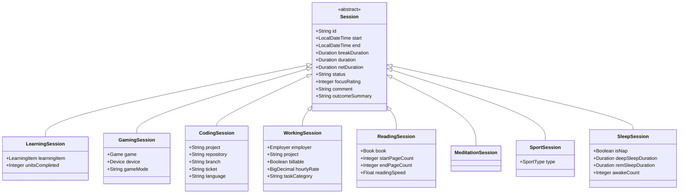

# Architectural Decision Records (ADR)

This document records the architectural and design decisions made for **Simon's Life Manager (SLM)**, capturing context, rationale, trade-offs, and implementation details.

---

## Table of Contents

- [ADR 001: Session Hierarchy, Duration Calculation & Identifier Strategy](#adr-001-session-hierarchy-duration-calculation--identifier-strategy)
- [ADR 002: Rejection of Java Records for JPA Model Entities](#adr-002-rejection-of-java-records-for-jpa-model-entities)
- [ADR 003: Application Version Synchronization via Spring Boot BuildInfo](#adr-003-application-version-synchronization-via-spring-boot-buildinfo)
- [ADR 004: Domain Separation of Employer (Income/Work) and Contractor (Expenses/Contracts)](#adr-004-domain-separation-of-employer-incomework-and-contractor-expensescontracts)
- [ADR 005: PostGIS Spatial Geometry & Automated Route Air Distance Calculation](#adr-005-postgis-spatial-geometry--automated-route-air-distance-calculation)
- [ADR 006: Integration of Healthcare Providers (Doctor) into Spatial Point Architecture](#adr-006-integration-of-healthcare-providers-doctor-into-spatial-point-architecture)
- [ADR 007: Defensive Path Traversal Architecture (CWE-22) & Native Media Preservation for Selfies](#adr-007-defensive-path-traversal-architecture-cwe-22--native-media-preservation-for-selfies)
- [ADR 008: Shared Singleton PostGIS Testcontainers Pattern for Integration Testing](#adr-008-shared-singleton-postgis-testcontainers-pattern-for-integration-testing)
- [ADR 009: Container Cleanup Strategy: Ryuk Watchdog vs. JVM Shutdown Hooks](#adr-009-container-cleanup-strategy-ryuk-watchdog-vs-jvm-shutdown-hooks)
- [ADR 010: Modernization to Jackson 3 BOM Platform (`tools.jackson`)](#adr-010-modernization-to-jackson-3-bom-platform-toolsjackson)
- [ADR 011: Sleep Tracking Unification into Session Architecture & Four Pillars Life Balance Model](#adr-011-sleep-tracking-unification-into-session-architecture--four-pillars-life-balance-model)
- [ADR 012: Decoupling Biological Rest from Net Focused Time & Context-Adaptive KPIs](#adr-012-decoupling-biological-rest-from-net-focused-time--context-adaptive-kpis)
- [ADR 013: Migration to JUnit 6 Testing Platform](#adr-013-migration-to-junit-6-testing-platform)
- [ADR 014: Containerized Production Deployment with PostGIS 18-3.6 & Healthcheck Orchestration](#adr-014-containerized-production-deployment-with-postgis-18-36--healthcheck-orchestration)

---

## ADR 001: Session Hierarchy, Duration Calculation & Identifier Strategy

### Status
Accepted

### Context
In the early SLM codebase, multiple time-tracking activities existed independently (`LearningSession`, `GamingSession`, `ReadingSession`, `SportSession`, `MeditationSession`). Each duplicated core fields (`start`, `end`, `duration`, `comment`), redundant repository interfaces, copy-pasted controller endpoints, and disjoint templates.

We generalized all time-tracking activities into an extensible polymorphic hierarchy supporting work, study, leisure, sport, wellness, and sleep.

Three major architectural decisions were established:
1. **Inheritance Mapping Strategy** in JPA (`InheritanceType.JOINED` vs `@MappedSuperclass` vs `SINGLE_TABLE`).
2. **Duration Calculation Strategy** (Database-computed generated column vs Application-computed domain logic).
3. **Primary Key Identifier Strategy** (UUIDv7 vs UUIDv4 vs BIGSERIAL).

---

### Decision 1: Inheritance Strategy — Option A (`InheritanceType.JOINED`)

We adopt **`InheritanceType.JOINED`** with a base entity `Session` and dedicated subclass tables.



#### Rationale & Evaluation
- **Unified Base Table:** All sessions inherit from `Session`, sharing `id`, timestamps, `breakDuration`, `duration`, `netDuration`, status, and focus ratings.
- **Polymorphic Queries:** Allows holistic queries across all life activities (e.g. `SELECT s FROM Session s WHERE s.start BETWEEN :from AND :to`). This makes aggregated dashboards, daily time distributions, and unified timelines straightforward.
- **Normalized Relational Schema:** Each session type maintains its own foreign keys and attributes in separate tables (`reading_session`, `learning_session`, `coding_session`, `sleep_session`, etc.) without polluting the base table with dozens of nullable columns.

---

### Decision 2: Duration Calculation Strategy — Database Generated Columns

We adopt **Database-computed generated columns** for storing and calculating duration.

#### Database Definition (PostgreSQL)
```sql
break_duration INTERVAL NOT NULL DEFAULT '0 seconds',
duration INTERVAL GENERATED ALWAYS AS (endtime - starttime) STORED,
net_duration INTERVAL GENERATED ALWAYS AS (endtime - starttime - break_duration) STORED
```

#### Entity Mapping (JPA / Hibernate)
```java
@Type(PostgreSQLIntervalType.class)
@Column(name = "break_duration", columnDefinition = "interval")
private Duration breakDuration = Duration.ZERO;

@Type(PostgreSQLIntervalType.class)
@Column(name = "duration", columnDefinition = "interval", insertable = false, updatable = false)
@org.hibernate.annotations.Generated(event = {
    org.hibernate.generator.EventType.INSERT, 
    org.hibernate.generator.EventType.UPDATE
})
private Duration duration;

@Type(PostgreSQLIntervalType.class)
@Column(name = "net_duration", columnDefinition = "interval", insertable = false, updatable = false)
@org.hibernate.annotations.Generated(event = {
    org.hibernate.generator.EventType.INSERT, 
    org.hibernate.generator.EventType.UPDATE
})
private Duration netDuration;
```

#### Trade-offs: Database-Only vs. Application-Side

| Strategy | Pros | Cons |
| :--- | :--- | :--- |
| **Strategy 1: Database Generated Columns**<br>*(PostgreSQL `GENERATED ALWAYS AS`)* | • **Single source of truth at storage level:** Guarantees interval consistency regardless of entry point (direct SQL, migrations, batch imports).<br>• **Zero application CPU overhead:** Interval arithmetic is handled by the database engine.<br>• **Consistent with existing schema:** Matches existing tables in SLM (`appointment`, `car_trip`). | • **Hibernate post-insert state:** Without `@Generated(event = ...)`, Hibernate does not automatically populate the column into memory on `INSERT`.<br>• **Dialect specificity:** Requires PostgreSQL `INTERVAL` and generated column support. |
| **Strategy 2: Application-Side Calculation**<br>*(JPA Lifecycle Hooks)* | • Immediate in-memory consistency without re-fetching. | • Integrity risk on direct SQL or external updates unless paired with DB check constraints. |

**Mitigation:** We annotate generated fields with Hibernate's `@Generated(event = {EventType.INSERT, EventType.UPDATE})` and `@Column(insertable = false, updatable = false)` so Hibernate refreshes the column value upon flush/commit.

---

### Decision 3: Type Standards in PostgreSQL Schema

- All variable-length textual fields use PostgreSQL **`TEXT`** rather than arbitrary `VARCHAR(n)`.
- Primary keys for the session hierarchy use PostgreSQL **`TEXT`** (storing UUIDs as canonical 36-character strings), preventing sequence collisions across joined tables and enabling client-side / offline ID generation.

---

### Decision 4: Primary Key Identifier Strategy — Adopting UUIDv7 (RFC 9562)

In `InheritanceType.JOINED`, the root `session` table defines `id TEXT PRIMARY KEY`, and every child table defines:
```sql
id TEXT PRIMARY KEY REFERENCES session(id) ON DELETE CASCADE
```

We adopt **UUIDv7** (RFC 9562) over UUIDv4 and BIGSERIAL:

| Characteristic | BIGSERIAL (Integer) | UUIDv4 (Random) | UUIDv7 (Time-Ordered, RFC 9562) |
| :--- | :--- | :--- | :--- |
| **B-Tree Index Locality** | Optimal (strictly sequential append) | Poor (random writes cause page splits & cache misses) | **Optimal (monotonically increasing time prefix appends sequentially)** |
| **Collision Resistance** | Single sequence | Globally unique | **Globally unique (48-bit timestamp + 74 bits of entropy)** |
| **Distributed / Offline Generation** | No (requires DB roundtrip) | Yes | **Yes (generated client-side without DB roundtrip)** |
| **Sorting** | Numeric | Unordered | **Naturally chronological (`ORDER BY id` == `ORDER BY created_at`)** |

In Java:
```java
@Id
@Column(name = "id", columnDefinition = "TEXT")
private String id;

@PrePersist
public void prePersist() {
    if (this.id == null) {
        this.id = UUID.ofEpochMillis(System.currentTimeMillis()).toString();
    }
}
```

---

## ADR 002: Rejection of Java Records for JPA Model Entities

### Status
Accepted

### Context
Java records provide concise immutable data carriers. An architectural evaluation was conducted to determine if JPA entity classes in `de.oberamsystems.slm.model` should be refactored into Java records.

### Decision
Model entities in `de.oberamsystems.slm.model` must **not** be converted to Java `record`s.

### Rationale
1. **Jakarta Persistence Specification Constraints:** JPA and Hibernate require entity classes to have a non-private no-arg constructor and to be non-final to allow runtime proxy generation (ByteBuddy) for lazy loading, dirty checking, and relationship hydration. Java records are implicitly `final` and cannot declare parameterless constructors; annotating a record with `@Entity` throws `AnnotationException: An entity cannot be a record`.
2. **Polymorphic Class Hierarchies:** Java records implicitly extend `java.lang.Record` and cannot extend classes. The `Session` hierarchy (`CodingSession`, `GamingSession`, `SportSession`, `ReadingSession`, `MeditationSession`, `SleepSession`) relies fundamentally on `@Inheritance(strategy = InheritanceType.JOINED)`.
3. **Web Form Binding:** Spring MVC and Thymeleaf require mutable JavaBean property conventions (`get*` / `set*`) for `@ModelAttribute` binding with `WebDataBinder`.

Java records remain reserved for read-only DTOs, query projections, or immutable `@Embeddable` value objects.

---

## ADR 003: Application Version Synchronization via Spring Boot BuildInfo

### Status
Accepted

### Context
Previously, version strings were duplicated across `build.gradle`, `application.properties`, and hardcoded controller logic, leading to version drift and manual maintenance overhead.

### Decision
Make `build.gradle` the single source of truth for the application version using Spring Boot's `buildInfo()` task and `BuildProperties`.

### Implementation
1. **Gradle Build Info Configuration (`build.gradle`):**
   ```groovy
   springBoot {
       buildInfo()
   }
   ```
   Gradle automatically generates `META-INF/build-info.properties` during `bootBuildInfo`, capturing `build.version`, `build.name`, `build.group`, and `build.time`.
2. **Spring Context Auto-Configuration:**
   Spring Boot automatically registers a `BuildProperties` bean when `build-info.properties` is present.
3. **Controller Access:**
   Injected into controllers (e.g. [`ImprintController.java`](file:///home/simon/code/eclipse/slm/src/main/java/de/oberamsystems/slm/controller/ImprintController.java)) via `@Autowired(required = false) BuildProperties buildProperties`.
4. **Configuration Cleanup:**
   Removed hardcoded `version=...` from `application.properties`.

---

## ADR 004: Domain Separation of Employer (Income/Work) and Contractor (Expenses/Contracts)

### Status
Accepted

### Context
Previously, `WorkingSession` referenced `Contractor` as `client` via `contractor_id`. However, in the SLM domain:
- `Contractor` models third-party service providers, utilities, telecommunications, and insurers (e.g. *Vodafone*, *Telekom*, *Allianz*, *Netflix*) associated with outgoing recurring expenses and `Contract` entries.
- `WorkingSession` models billable and salaried professional work performed for employers and consulting clients.

### Decision
1. Introduce a dedicated `Employer` (`employer`) entity and table (`employer_id` in `working_session`).
2. Add a dedicated `EmployerController` and view (`/employers`) accessible via the Spend Management dashboard alongside *Vendors* and *Contractors*.
3. Versionize database migrations using date-stamped scripts (`migration_YYYY-MM-DD.sql`).

---

## ADR 005: PostGIS Spatial Geometry & Automated Route Air Distance Calculation

### Status
Accepted (v0.0.2b)

### Context
The `point` table previously stored coordinates as raw `TEXT` strings (often in Degrees-Minutes-Seconds DMS format, e.g. `49°17'04.49"N`, `10°40'53.20"E`). On the `route` table, `air_distance` was manually entered by the user upon route creation. This resulted in manual guesswork, entry errors, and inability to perform spatial queries.

### Decision
1. Enable native **PostGIS 3.6** spatial extensions in PostgreSQL (`CREATE EXTENSION IF NOT EXISTS postgis;`).
2. Store coordinates as standard IEEE double-precision floats (`latitude`, `longitude`) in WGS 84 (`SRID 4326`).
3. Add a computed, stored PostGIS geography column and spatial index:
   ```sql
   geom geography(Point, 4326) GENERATED ALWAYS AS (
       ST_SetSRID(ST_MakePoint(longitude, latitude), 4326)::geography
   ) STORED
   CREATE INDEX IF NOT EXISTS idx_point_geom ON point USING GIST (geom);
   ```
4. Implement database triggers (`trg_route_air_distance`, `trg_point_update_route_air_distance`) using PostGIS geodesic distance calculation:
   ```sql
   ST_Distance(start_geom, end_geom) / 1000.0
   ```
   Air distance is automatically computed in kilometers on insert or update of routes and points, completely eliminating manual entry.

---

## ADR 006: Integration of Healthcare Providers (Doctor) into Spatial Point Architecture

### Status
Accepted (v0.0.2b)

### Context
`Doctor` previously stored arbitrary text addresses and a manual `air_distance REAL` field that had to be manually entered in `doctors.html`. Analysis revealed that these distances represented the geodesic distance from the user's primary residence (`Haus Mama`) to the doctor's practice.

### Decision
1. Unify healthcare provider locations with the spatial `point` architecture by adding `point_id BIGINT REFERENCES point(id)` (practice clinic) and optional `base_point_id BIGINT REFERENCES point(id)` (defaulting to the user's home point with `is_home = TRUE`).
2. Automate doctor air distance calculation using database triggers:
   ```sql
   ST_Distance(origin_geom, practice_geom) / 1000.0
   ```
3. Remove manual distance inputs from the UI while retaining auto-calculated mileage for medical appointment travel duration records.

---

## ADR 007: Defensive Path Traversal Architecture (CWE-22) & Native Media Preservation for Selfies

### Status
Accepted (v0.0.2d)

### Context
The daily selfie upload endpoint (`SelfieController`) allowed users to upload image files. Vulnerability assessment identified risks of directory traversal (CWE-22) via manipulated multipart filenames (e.g., `../../../../etc/passwd`). Furthermore, the form only allowed `.jpg` files, rejecting modern mobile formats like `.heic`.

### Decision
1. Extract file storage and validation into a dedicated, thoroughly tested `SelfieStorageService`.
2. Enforce strict canonical path boundary checks:
   ```java
   Path destination = this.baseDir.resolve(safeFilename).normalize().toAbsolutePath();
   if (!destination.startsWith(this.baseDir)) {
       throw new SecurityException("Directory traversal attempt detected");
   }
   ```
3. Support both `.jpg` (and `.jpeg`) and `.heic` natively without transcoding: raw bytes are preserved exactly on disk.
4. Automatically clean up stale files with different extensions (e.g. replacing `2026-10-18.jpg` when re-uploading `2026-10-18.heic`).

---

## ADR 008: Shared Singleton PostGIS Testcontainers Pattern for Integration Testing

### Status
Accepted (v0.0.2e)

### Context
Unit tests mocked repositories or ran against in-memory schemas, which failed to validate PostgreSQL-specific dialect features, PostGIS spatial triggers, JPA joined inheritance polymorphism, and generated stored columns. Running separate containers per test class caused excessive Docker overhead and slow build times.

### Decision
1. Standardize on Spring Boot Testcontainers with `@ServiceConnection` running the official `postgis/postgis:18-3.6` container image.
2. Implement a **shared singleton container pattern** via an abstract base class:
   ```java
   public abstract class AbstractIntegrationTest {
       @ServiceConnection
       static PostgreSQLContainer<?> postgres = new PostgreSQLContainer<>("postgis/postgis:18-3.6")
               .withDatabaseName("slm_test")
               .withUsername("test")
               .withPassword("test")
               .withInitScript("schema-init.sql");
       static {
           postgres.start();
       }
   }
   ```
3. Maintain an authoritative test initialization schema in [`src/test/resources/schema-init.sql`](file:///home/simon/code/eclipse/slm/src/test/resources/schema-init.sql) consolidating enums, tables, PostGIS extensions, and spatial triggers.
4. Configure Gradle's `test` task to execute both unit tests (`*Test.class`) and integration tests (`*IT.class`).

---

## ADR 009: Container Cleanup Strategy: Ryuk Watchdog vs. JVM Shutdown Hooks

### Status
Accepted (v0.0.2e)

### Context
In Testcontainers, **Ryuk** (`testcontainers/ryuk`) runs as an auxiliary watchdog container attached to `/var/run/docker.sock` to terminate test containers when the JVM exits. Architectural evaluation weighed whether to disable Ryuk in favor of JVM shutdown hooks or keep it active.

### Decision
1. **Retain Ryuk active by default** for local developer workflows. JVM shutdown hooks fail to execute if an IDE terminates a test abruptly (`SIGKILL` / red stop button) or on JVM crash, which would leak running PostgreSQL 18 containers and consume host ports.
2. **Support zero-Ryuk execution** via environment property `TESTCONTAINERS_RYUK_DISABLED=true` or `ryuk.disabled=true` for restricted corporate CI/CD or rootless Podman/Kubernetes environments where socket mounting is restricted.

---

## ADR 010: Modernization to Jackson 3 BOM Platform (`tools.jackson`)

### Status
Accepted (v0.0.2f)

### Context
Jackson 2 (`com.fasterxml.jackson`) reached end-of-life for major architectural innovations. Jackson 3 introduced modular namespace changes (`tools.jackson.core`) with improved record support, stricter typing, and higher performance.

### Decision
1. Adopt the official Jackson 3 BOM platform:
   ```groovy
   implementation enforcedPlatform('tools.jackson:jackson-bom:3.2.3')
   implementation 'tools.jackson.core:jackson-databind'
   implementation 'tools.jackson.core:jackson-core'
   ```
2. Bridge annotations using `com.fasterxml.jackson.core:jackson-annotations:2.22` for full compatibility with Spring Boot 4 and existing serialization rules.

---

## ADR 011: Sleep Tracking Unification into Session Architecture & Four Pillars Life Balance Model

### Status
Accepted (v0.0.2f)

### Context
Sleep was tracked through a legacy, standalone `SleepTime` entity (`sleeptime` table) separate from the polymorphic `Session` hierarchy. This prevented unified queries across the 24-hour day and resulted in disconnected reporting.

### Decision
1. Convert `SleepTime` into joined inheritance:
   ```java
   @Entity
   @Table(name = "sleep_session")
   public class SleepSession extends Session
   ```
2. Establish a **Four Pillars Life Balance Model**:
   - **Productivity**: Coding, Working, Learning, Reading sessions.
   - **Sport**: Dedicated physical training, running, and workouts (distinct from wellness).
   - **Wellness**: Biological restoration, meditation, and sleep sessions.
   - **Leisure**: Recreational gaming sessions.
3. Preserve full backward compatibility for legacy endpoints (`/sleep-times`, `/sleeptime-bb`, `/api/sleeptimes`) via transient compatibility getters/setters (`gotobed`, `getup`, `sleeptime`).

---

## ADR 012: Decoupling Biological Rest from Net Focused Time & Context-Adaptive KPIs

### Status
Accepted (v0.0.2f)

### Context
When viewing "All Sessions" (`type=ALL`) on `/sessions`, all logged durations were summed into `totalNetDuration`. Because sleep accounts for 7–8 hours daily (257h+ in sample datasets), "Net Focused Time" was inflated to 280h+, destroying its meaning as a metric for intentional cognitive deep work.

### Decision
1. Strictly decouple Sleep and Meditation from "Net Focused Time" and "Avg Focus Rating" on `/sessions`:
   - When viewing `ALL` or `PRODUCTIVITY`, `totalNetDuration` only aggregates intentional cognitive sessions (`CodingSession`, `WorkingSession`, `LearningSession`, `ReadingSession`).
   - Sleep quality ratings (1–5) and meditation focus are calculated independently from cognitive focus ratings.
2. Introduce context-adaptive KPI titles that dynamically reflect the active category filter:
   - **All / Productivity**: `Net Focused Time` *(Cognitive focus hours)*, `Avg Focus Rating`.
   - **Sport**: `Active Training Time`, `Avg Workout Intensity`.
   - **Wellness / Sleep**: `Rest & Recovery Time` (or `Sleep Duration`), `Awake / Disruptions`, `Avg Sleep Quality`.
   - **Leisure**: `Recreation Time`, `Avg Game Rating`.
3. Provide total logged hours under `Total Life: Xh Ym` so comprehensive time tracking is preserved without distorting cognitive focus metrics.

---

## ADR 013: Migration to JUnit 6 Testing Platform

### Status
Accepted (v0.0.2f)

### Context
JUnit 6 unified versioning across Platform, Jupiter, and Vintage modules with a native Java 17+ baseline.

### Decision
Enforce the unified JUnit 6 BOM platform across all test configurations:
```groovy
dependencyManagement {
    imports {
        mavenBom 'org.junit:junit-bom:6.1.3'
    }
}
dependencies {
    testImplementation enforcedPlatform('org.junit:junit-bom:6.1.3')
}
```
All Jupiter and Platform components resolve cleanly to version `6.1.3` (`junit-jupiter`, `junit-platform-launcher`, `junit-platform-engine`), operating seamlessly with Spring Boot 4 and Testcontainers.

---

## ADR 014: Containerized Production Deployment with PostGIS 18-3.6 & Healthcheck Orchestration

### Status
Accepted (v0.0.2f)

### Context
The default `docker-compose.yml` previously used standard `postgres`, which lacked PostGIS binaries, causing database initialization errors. Furthermore, the application container started before PostgreSQL was ready, causing connection failures.

### Decision
1. Upgrade database container to `postgis/postgis:18-3.6`.
2. Add automated healthcheck testing database readiness:
   ```yaml
   db:
     image: postgis/postgis:18-3.6
     healthcheck:
       test: ["CMD-SHELL", "pg_isready -U simon -d slm"]
       interval: 3s
       timeout: 3s
       retries: 10
   ```
3. Configure application container dependencies:
   ```yaml
   app:
     depends_on:
       db:
         condition: service_healthy
   ```
4. Update [`init.sql`](file:///home/simon/code/eclipse/slm/init.sql) to include PostGIS extensions, modern polymorphic session tables, and spatial distance calculation triggers.
5. Modernize [`Dockerfile`](file:///home/simon/code/eclipse/slm/Dockerfile) runtime base image to `eclipse-temurin:27-jre` matching Java 27.
