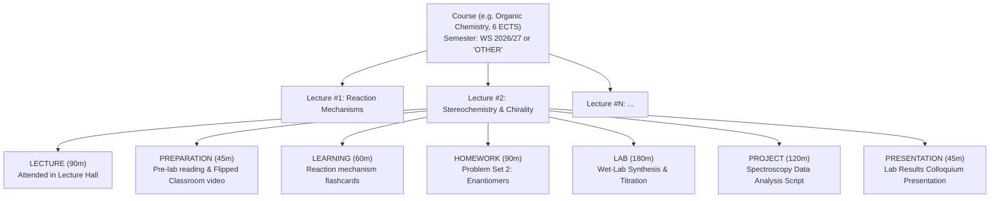

# Architectural Plan: Academic Lecture Activity Types, STEM Lab Support & Domain Boundary Evaluation

## 1. Executive Summary & Objective

In **Simon's Life Manager (SLM)**, university studies and academic tracking are structured around [`Course`](file:///home/simon/code/eclipse/slm/src/main/java/de/oberamsystems/slm/model/Course.java), [`LectureSession`](file:///home/simon/code/eclipse/slm/src/main/java/de/oberamsystems/slm/model/LectureSession.java), and [`LectureNote`](file:///home/simon/code/eclipse/slm/src/main/java/de/oberamsystems/slm/model/LectureNote.java) ([ADR 017](file:///home/simon/code/eclipse/slm/DECISIONS.md#adr-017-university-lectures-academic-tracking--native-uuidv7-markdown-lecture-notes)).

Previously, `LectureSession` represented solely *attending a lecture*. Real-world academic curriculum, however, spans a wider cognitive spectrum consistently anchored to specific lectures or course modules:
1. **Lecture Attendance / Viewing (`LECTURE`)**: Attending lectures in person or streaming recordings.
2. **Preparation (`PREPARATION`)**: Pre-reading lecture slides, reviewing research papers, watching introductory video lectures, or preparing discussion questions—indispensable in **flipped classroom** formats.
3. **Self-Study / Learning (`LEARNING`)**: Post-lecture review, synthesizing lecture material, concept mapping, and flashcard revision.
4. **Homework / Exercises (`HOMEWORK`)**: Working on problem sheets, assignments, and tutorial exercises assigned for a lecture.
5. **Laboratory Work (`LAB`)**: Hands-on laboratory experiments, wet-lab sessions, measurement runs, and practical lab assignments—crucial for **STEM subjects** like Chemistry, Physics, Biology, Materials Science, and Electrical/Computer Engineering.
6. **Project (`PROJECT`)**: Term projects, software implementations, lab milestones, or research deliverables anchored to course topics.
7. **Presentation (`PRESENTATION`)**: Preparing slides, rehearsing, or delivering student talks, seminar presentations, or project defenses tied to a lecture.

### Domain Boundary & Intertwining Evaluation
This plan also evaluates the trade-offs of **intertwining `LearningItem`s and `Course`/`LectureSession`** vs. **maintaining clean domain separation**:
- **Structured, Course-Centric Education** (University degrees, MOOCs on Coursera/edX, and German adult education VHS courses) is best served by `Course` + `LectureSession`, organized by semester (including a dedicated `"OTHER"` / `"CONTINUING_ED"` semester category).
- **Self-Paced / Informal / Gamified Skill Tracking** (e.g. Duolingo daily language practice, LeetCode problem solving, micro-tutorials) is cleanly served by [`LearningItem`](file:///home/simon/code/eclipse/slm/src/main/java/de/oberamsystems/slm/model/LearningItem.java) and [`LearningSession`](file:///home/simon/code/eclipse/slm/src/main/java/de/oberamsystems/slm/model/LearningSession.java).

---

## 2. In-Depth Evaluation: Intertwining LearningItems vs. Clean Domain Separation

### 2.1. Comparison of Architectural Approaches

| Dimension | Approach A: Intertwined Coupling (Foreign Keys & Shared Models) | Approach B: Clean Domain Separation (Recommended) |
| :--- | :--- | :--- |
| **Data Model** | Adds nullable `course_id` and `lecture_number` to `learning_item`, and nullable `learning_item_id` to `lecture_session`. | Zero foreign key pollution. `Course` and `LearningItem` remain distinct, high-cohesion aggregates. |
| **Semantic Clarity** | Muddled: Duolingo language streaks and university organic chemistry lectures compete for the same schema fields. | Crisp: Academic/lecture coursework tracks by `Course` + `lectureNumber`; informal skills track by `LearningItem` + `unitsCompleted`. |
| **Authoritative Progress** | Ambiguous: Does time logged in `LectureSession` count as units in `LearningItem`? Dual source-of-truth hazard. | Clear: `Course` tracks total net hours and ECTS workload; `LearningItem` tracks unit completion (e.g. 5 lessons, 10 exercises). |
| **Lifelong Learning (MOOCs, VHS)** | Forced into either pure university or pure informal items. | **Unified Course Model**: Coursera, edX, and VHS courses are simply modeled as `Course`s with semester `"OTHER"`, `"MOOC"`, or `"VHS"`. |
| **UI Complexity** | Bulky conditional dropdowns, complex form resets, and potential user confusion between sessions. | Intuitive: "+ Log Lecture / Course Activity" for all lecture-based courses; "+ Log Learning" for apps like Duolingo. |

### 2.2. Architectural Pros & Cons

#### Approach A: Intertwining `LearningItem`s and Lectures
- **Pros**:
  - Allows linking a specific paper or book (modeled as a `LearningItem`) directly to a lecture.
- **Cons**:
  - **Violates Domain Separation Principle (ADR 004 precedent)**: In ADR 004, SLM strictly separated `Employer` (income/work) from `Contractor` (expenses/subscriptions) rather than creating a bloated "Company" entity. Similarly, conflating structured academic modules with gamified casual apps (Duolingo) damages domain purity.
  - **Schema Sparsity & High Nullability**: The vast majority of `LearningItem`s (Duolingo, general books, YouTube channels) would have `course_id = NULL`. Most `LectureSession`s would have `learning_item_id = NULL`.
  - **Progress Metric Impedance Mismatch**: University courses measure progress via ECTS workload hours ($ECTS \times 30h$), exam grades, and passed credits. Apps like Duolingo measure progress via arbitrary units (XP, lessons, streak days). Forcing these together causes distorted metrics.

#### Approach B: Clean Domain Separation with "OTHER" Semester for Lifelong Learning (Recommended)
- **Domain 1: Course-Centric Education (`Course` + `LectureSession` + `LectureNote`)**:
  - Covers all structured, multi-lecture curricula:
    - **University Degrees**: Bachelor/Master modules organized by chronological semesters (`WS 2026/27`, `SS 2027`...).
    - **Massive Open Online Courses (MOOCs)**: Coursera, edX, openHPI, Udacity, MIT OpenCourseWare.
    - **Adult & Continuing Education**: Volkshochschulkurse (VHS), vocational certifications, corporate seminars.
  - Handled cleanly via the existing `Course.semester` field: non-university courses use semester labels like **`OTHER`**, **`MOOC`**, or **`VHS`** (e.g. `VHS 2026`, `Coursera`).
  - If a course does not award academic ECTS credits, `ectsCredits` is simply left `NULL` or `0.0`. The system displays total tracked hours and activity breakdown without forcing an ECTS target bar.
  - All 7 academic activity types (`LECTURE`, `PREPARATION`, `LEARNING`, `HOMEWORK`, `LAB`, `PROJECT`, `PRESENTATION`) are fully available across both university and MOOC/VHS courses.
- **Domain 2: Self-Paced / Informal / Gamified Skill Tracking (`LearningItem` + `LearningSession`)**:
  - Dedicated to self-directed, non-lecture learning:
    - Language apps: **Duolingo**, Babbel, Busuu.
    - Coding challenges: LeetCode, Codewars, HackerRank.
    - General books, standalone tutorial videos, documentation.
  - Tracks `unitsCompleted` (e.g., lessons completed, problems solved) and percentage `progress` (0–100%).

---

## 3. The Seven Academic Activity Types (STEM & Flipped Classroom Ready)



### Activity Type Definitions

| Enum Value | Display Label | Description & STEM Context | Icon & Badge Color |
| :--- | :--- | :--- | :--- |
| **`LECTURE`** | Lecture | Attending live lectures, seminar sessions, or watching video lectures. | `bi-mortarboard-fill` / `bg-primary` |
| **`PREPARATION`** | Preparation | Pre-reading slides, watching flipped-classroom videos, pre-lab protocols. | `bi-book-half` / `bg-info text-dark` |
| **`LEARNING`** | Self-Study / Learning | Post-lecture revision, digesting theory, flashcard practice, exam review. | `bi-lightbulb-fill` / `bg-purple text-white` |
| **`HOMEWORK`** | Homework / Exercises | Problem sets, exercise sheets, tutorial assignments. | `bi-pencil-square` / `bg-warning text-dark` |
| **`LAB`** | Laboratory / Practical | Wet-lab experiments, computer science labs, hardware circuits, measurements. | `bi-funnel-fill` / `bg-teal text-white` |
| **`PROJECT`** | Project Work | Software implementations, term projects, research papers, lab milestones. | `bi-code-square` / `bg-success text-white` |
| **`PRESENTATION`** | Presentation | Slide preparation, rehearsals, colloquia, seminar talks, thesis defenses. | `bi-easel-fill` / `bg-danger text-white` |

---

## 4. Database & Schema Specifications

### 4.1. PostgreSQL Enum: `academic_activity_type`
In [`src/main/resources/enums.sql`](file:///home/simon/code/eclipse/slm/src/main/resources/enums.sql):
```sql
CREATE TYPE academic_activity_type AS ENUM (
    'LECTURE',
    'PREPARATION',
    'LEARNING',
    'HOMEWORK',
    'LAB',
    'PROJECT',
    'PRESENTATION'
);
```

### 4.2. Table Alteration: `lecture_session`
In [`src/main/resources/tables.sql`](file:///home/simon/code/eclipse/slm/src/main/resources/tables.sql):
```sql
ALTER TABLE lecture_session
    ADD COLUMN activity_type academic_activity_type NOT NULL DEFAULT 'LECTURE';

CREATE INDEX IF NOT EXISTS idx_lecture_session_activity_type ON lecture_session(activity_type);
```
*(Notice: No foreign key to `learning_item` is added, keeping the schema normalized, crisp, and robust).*

### 4.3. Incremental Migration Script
Create [`src/main/resources/migration_2026-10-23_1.sql`](file:///home/simon/code/eclipse/slm/src/main/resources/) with mandatory transactional DDL:
```sql
BEGIN;

DO $$ BEGIN
    CREATE TYPE academic_activity_type AS ENUM (
        'LECTURE',
        'PREPARATION',
        'LEARNING',
        'HOMEWORK',
        'LAB',
        'PROJECT',
        'PRESENTATION'
    );
EXCEPTION
    WHEN duplicate_object THEN NULL;
END $$;

ALTER TABLE lecture_session
    ADD COLUMN IF NOT EXISTS activity_type academic_activity_type NOT NULL DEFAULT 'LECTURE';

CREATE INDEX IF NOT EXISTS idx_lecture_session_activity_type ON lecture_session(activity_type);

COMMIT;
```

### 4.4. Schema Baseline Synchronization
Synchronize:
- [`src/main/resources/enums.sql`](file:///home/simon/code/eclipse/slm/src/main/resources/enums.sql)
- [`src/main/resources/tables.sql`](file:///home/simon/code/eclipse/slm/src/main/resources/tables.sql)
- [`init.sql`](file:///home/simon/code/eclipse/slm/init.sql)
- [`src/test/resources/schema-init.sql`](file:///home/simon/code/eclipse/slm/src/test/resources/schema-init.sql)

---

## 5. Entity & Model Layer (`de.oberamsystems.slm.model`)

### 5.1. New Enum: `LectureActivityType.java`
```java
package de.oberamsystems.slm.model;

public enum LectureActivityType {
    LECTURE("Lecture", "bi bi-mortarboard-fill", "badge-lecture"),
    PREPARATION("Preparation", "bi bi-book-half", "badge-prep"),
    LEARNING("Self-Study / Learning", "bi bi-lightbulb-fill", "badge-learning"),
    HOMEWORK("Homework / Exercises", "bi bi-pencil-square", "badge-homework"),
    LAB("Laboratory / Practical", "bi bi-funnel-fill", "badge-lab"),
    PROJECT("Project Work", "bi bi-code-square", "badge-project"),
    PRESENTATION("Presentation", "bi bi-easel-fill", "badge-presentation");

    private final String displayName;
    private final String iconClass;
    private final String badgeClass;

    LectureActivityType(String displayName, String iconClass, String badgeClass) {
        this.displayName = displayName;
        this.iconClass = iconClass;
        this.badgeClass = badgeClass;
    }

    public String getDisplayName() { return displayName; }
    public String getIconClass() { return iconClass; }
    public String getBadgeClass() { return badgeClass; }
}
```

### 5.2. Update [`LectureSession.java`](file:///home/simon/code/eclipse/slm/src/main/java/de/oberamsystems/slm/model/LectureSession.java)
```java
@Enumerated(EnumType.STRING)
@JdbcType(value = PostgreSQLEnumJdbcType.class)
@Column(name = "activity_type", nullable = false)
private LectureActivityType activityType = LectureActivityType.LECTURE;
```
- Provide overloaded constructors preserving backwards compatibility:
  ```java
  public LectureSession(Course course, Integer lectureNumber, String topic, String room, LectureActivityType activityType) {
      super();
      this.course = course;
      this.lectureNumber = lectureNumber;
      this.topic = topic;
      this.room = room;
      this.activityType = activityType != null ? activityType : LectureActivityType.LECTURE;
  }
  ```

### 5.3. ECTS Workload Helper in [`Course.java`](file:///home/simon/code/eclipse/slm/src/main/java/de/oberamsystems/slm/model/Course.java)
- Helper `getTargetWorkloadHours()`: returns $\text{ectsCredits} \times 30.0$ if `ectsCredits != null`, otherwise `null`.
- Helper `isAcademicCourse()`: returns true if semester is not `"OTHER"`, `"MOOC"`, or `"VHS"`.

---

## 6. Controller & Application Layer

### 6.1. Update [`AcademicController.java`](file:///home/simon/code/eclipse/slm/src/main/java/de/oberamsystems/slm/controller/AcademicController.java)
In `@GetMapping("/courses/{id}")`:
1. Fetch all `LectureSession` records for the course ordered by `start DESC`.
2. Compute workload analytics:
   - Total Tracked Net Time (`totalNetDuration`).
   - Expected Workload Hours ($ECTS \times 30h$), if `ectsCredits != null`.
   - Percentage completed (e.g. $42.5h / 180.0h = 23.6\%$).
   - Breakdown map by `LectureActivityType`: duration and session count per activity type (`LECTURE`, `PREPARATION`, `LEARNING`, `HOMEWORK`, `LAB`, `PROJECT`, `PRESENTATION`).
3. Pass `activityTypes` enum list (`LectureActivityType.values()`) for the modal form.

In `@GetMapping("/courses")`:
- Group courses into **University Semesters** (sorted chronologically descending) and a dedicated section for **"Other Courses / MOOCs & VHS"** (for courses with semester `"OTHER"`, `"MOOC"`, or `"VHS"`).

### 6.2. Update [`SessionController.java`](file:///home/simon/code/eclipse/slm/src/main/java/de/oberamsystems/slm/controller/SessionController.java)
In `@PostMapping("/sessions/lecture")`:
- Bind `activityType` parameter (defaulting to `LECTURE` if null/empty).
- Populate `LectureActivityType.values()` into reference data for modal form dropdowns.

---

## 7. UI & Template Enhancements

### 7.1. Unified Sessions Hub ([`sessions.html`](file:///home/simon/code/eclipse/slm/src/main/resources/templates/sessions.html))
1. **Modal Form (`#form-lecture`)**:
   - Add **Activity Type** select dropdown with clear labels:
     - 🎓 Lecture (Vorlesung / Video Stream)
     - 📖 Preparation (Flipped Classroom / Pre-Reading)
     - 🧠 Self-Study / Learning (Nachbereitung / Revision)
     - 📝 Homework / Exercises (Übungsblätter / Problem Sets)
     - 🧪 Laboratory / Practical (STEM Lab / Laborpraktikum)
     - 💻 Project Work (Projekt / Software Lab)
     - 🗣️ Presentation (Referat / Verteidigung)
2. **Table & Hero Banner Badges**:
   - Color-coded badges with icons:
     - `<span class="badge bg-primary"><i class="bi bi-mortarboard-fill me-1"></i> Lecture #2</span>`
     - `<span class="badge bg-info text-dark"><i class="bi bi-book-half me-1"></i> Prep #2</span>`
     - `<span class="badge bg-warning text-dark"><i class="bi bi-pencil-square me-1"></i> Homework #2</span>`
     - `<span class="badge" style="background: #0d9488; color: #fff;"><i class="bi bi-funnel-fill me-1"></i> Lab #2</span>`
     - `<span class="badge bg-success"><i class="bi bi-code-square me-1"></i> Project #2</span>`
     - `<span class="badge bg-danger"><i class="bi bi-easel-fill me-1"></i> Presentation #2</span>`

### 7.2. Course Detail Page ([`course-detail.html`](file:///home/simon/code/eclipse/slm/src/main/resources/templates/course-detail.html))
1. **Workload & ECTS Progress Card**:
   - For courses with ECTS:
     ```
     Workload: 42h 30m / 180h 00m (23.6%) [================>                ]
     Lecture: 18h | Prep: 6h | Lab: 9h | Homework: 4h 30m | Project: 5h
     ```
   - For non-ECTS courses (MOOCs, VHS, "OTHER"):
     ```
     Total Course Time: 28h 15m across 14 sessions
     Lecture: 12h | Prep: 4h | Learning: 6h | Project: 6h 15m
     ```
2. **Interactive Activity Filters**:
   - Filter pills above the activity table: `All (14)`, `Lectures (6)`, `Prep (2)`, `Lab (2)`, `Homework (2)`, `Projects (1)`, `Presentations (1)`.
3. **Quick Modal "+ Log Course Activity"**:
   - Direct button on course detail page opening a modal pre-filled with the current course and default lecture room/number.

---

## 8. Model Context Protocol (MCP) Expansion

Update [`McpAcademicTools.java`](file:///home/simon/code/eclipse/slm/src/main/java/de/oberamsystems/slm/mcp/McpAcademicTools.java):
- In `logLectureSession`: accept optional `@ToolParam String activityType` (validating against `LectureActivityType`).
- Output the activity type and badge in tool responses.

---

## 9. Verification & Testing Strategy

### 9.1. Unit Tests
- **`LectureSessionTest`**: Verify default `activityType == LECTURE`, custom `LAB`, `PREPARATION`, and `PROJECT` instantiation.
- **`CourseModelTest`**: Verify target workload calculation ($ECTS \times 30h$) and null safety when `ectsCredits` is null.

### 9.2. Integration Tests (`*IT.java` extending `AbstractIntegrationTest`)
- **`CourseDetailIT.java`**:
  - Test course detail view with multiple sessions spanning `LECTURE`, `PREPARATION`, `LAB`, `HOMEWORK`, and `PROJECT`.
  - Verify activity filtering and workload breakdown calculation against live PostgreSQL PostGIS container.
- **`SessionHierarchyIT.java`**:
  - Verify PostgreSQL joined inheritance for `LectureSession` with `activity_type` enum column.
  - Verify backwards compatibility for existing records defaulting to `LECTURE`.

### 9.3. Live Test Suite Execution
```bash
JAVA_HOME=/usr/lib/jvm/java-21-openjdk ./gradlew test -x jacocoTestReport -x compileAotTestJava
```

---

## 10. Step-by-Step Implementation Roadmap

1. **Phase 1: Database Migration & Schema Synchronization**
   - Create transactional `migration_2026-10-23_1.sql` with `academic_activity_type` enum including `'LAB'`.
   - Synchronize `enums.sql`, `tables.sql`, `init.sql`, and `schema-init.sql`.
2. **Phase 2: Entities & Enums**
   - Create `LectureActivityType.java` with 7 types (including `LAB`).
   - Update `LectureSession.java` with `activityType`.
3. **Phase 3: Controller & Service Layer**
   - Enhance `AcademicController.java` with workload calculations, activity breakdown, and course categorization.
   - Update `SessionController.java` with `activityType` binding.
4. **Phase 4: Frontend UI Enhancements**
   - Update `course-detail.html` with ECTS workload tracker, activity pills, and STEM lab badge styling.
   - Update `sessions.html` with activity type selector and badges.
5. **Phase 5: MCP Tools, Automated Tests & Documentation**
   - Update `McpAcademicTools.java`.
   - Add/update unit and integration tests.
   - Document in `DECISIONS.md` (ADR 027) and `CHANGELOG.md`.
