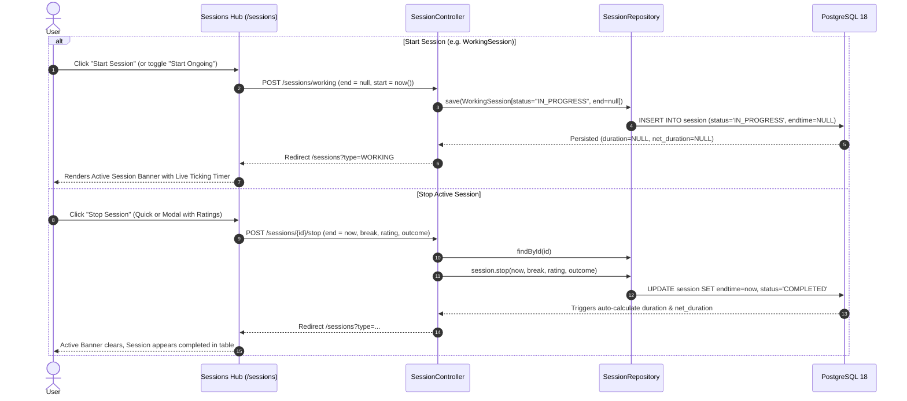

# Architectural Plan: Universal Active Sessions (Start & Stop Later)

## 1. Executive Summary & Objective

In **Simon's Life Manager (SLM)**, sessions across all Four Pillars (Productivity, Sport, Wellness, Leisure) currently require both a start time and an end time upon creation. In real-world time tracking, users often sit down to start an activity (e.g. a client consulting working session, a coding flow session, a gym workout, or a reading session) without knowing in advance when they will finish.

This plan details the design and implementation of **Universal Active Sessions**:
- Users can start any session type with `starttime` set (defaulting to current time) and **`endtime` omitted (`NULL`)**, placing the session in `IN_PROGRESS` status.
- A live **Active Session Hero Banner** with a real-time elapsed timer is displayed at the top of the Sessions Hub.
- A shared, polymorphic **`POST /sessions/{id}/stop`** endpoint allows stopping any active session at any time, stamping `endtime = now()`, recording breaks, focus rating (1–5 stars), outcome summary, and reflections.
- Full compatibility with the existing PostgreSQL 18 generated columns (`duration`, `net_duration`), database triggers, and Spring AI MCP server.

---

## 2. Current State Analysis & Invariants

1. **Database Schema (`session` table)**:
   ```sql
   CREATE TABLE session(
       id UUID PRIMARY KEY DEFAULT uuidv7(),
       session_type TEXT NOT NULL,
       status TEXT NOT NULL DEFAULT 'COMPLETED',
       starttime TIMESTAMP NOT NULL,
       endtime TIMESTAMP, -- ALREADY NULLABLE!
       break_duration INTERVAL NOT NULL DEFAULT '0 seconds',
       duration INTERVAL GENERATED ALWAYS AS (endtime - starttime) STORED,
       net_duration INTERVAL GENERATED ALWAYS AS (endtime - starttime - break_duration) STORED,
       focus_rating SMALLINT CHECK (focus_rating BETWEEN 1 AND 5),
       comment TEXT,
       outcome_summary TEXT
   );
   ```
   - In PostgreSQL, `duration` and `net_duration` are generated columns defined as `endtime - starttime`. When `endtime` is `NULL`, PostgreSQL sets both generated columns to `NULL` without error.
   - `status` already exists with default `'COMPLETED'`. We will use `'IN_PROGRESS'` for active sessions, matching `StatusEnum.IN_PROGRESS`.

2. **Polymorphic Joined Inheritance**:
   - `Session` is the root entity with 9 joined subclasses:
     - **Productivity**: `CodingSession`, `WorkingSession`, `LearningSession`, `ReadingSession`, `LectureSession`
     - **Sport**: `SportSession`
     - **Wellness**: `MeditationSession`, `SleepSession`
     - **Leisure**: `GamingSession`
   - All subclasses inherit `start`, `end`, `status`, `breakDuration`, `focusRating`, `comment`, and `outcomeSummary`.

3. **Trigger Compatibility**:
   - In [`tables.sql`](file:///home/simon/code/eclipse/slm/src/main/resources/tables.sql), `check_sleep_session_duration()` and `check_session_sleep_duration()` already contain `AND NEW.endtime IS NOT NULL` guards, safely ignoring unstopped sleep sessions until completed.

4. **Existing End-Time Null Safety**:
   - In `IndexController.java`:
     ```java
     Duration diff2 = Duration.between(m.getEnd(), LocalDateTime.now());
     Duration diff3 = Duration.between(rs.getEnd(), LocalDateTime.now());
     ```
     `m.getEnd()` and `rs.getEnd()` must be safeguarded with `getEnd() != null` checks to prevent `NullPointerException` if the latest session is active.

---

## 3. Architecture & Design

### 3.1. User Interaction & Workflow



### 3.2. Data Model Enhancements ([`Session.java`](file:///home/simon/code/eclipse/slm/src/main/java/de/oberamsystems/slm/model/Session.java))

Add helper domain methods directly to root `Session`:
```java
public boolean isInProgress() {
    return "IN_PROGRESS".equalsIgnoreCase(this.status) || this.end == null;
}

public void stop(LocalDateTime stopTime, Duration breakDuration, Integer focusRating, String outcomeSummary, String comment) {
    this.end = stopTime != null ? stopTime : LocalDateTime.now().truncatedTo(ChronoUnit.MINUTES);
    this.status = "COMPLETED";
    if (breakDuration != null) this.breakDuration = breakDuration;
    if (focusRating != null && focusRating > 0) this.focusRating = focusRating;
    if (outcomeSummary != null && !outcomeSummary.isBlank()) this.outcomeSummary = outcomeSummary;
    if (comment != null && !comment.isBlank()) this.comment = comment;
}
```

### 3.3. Repository Query Methods ([`SessionRepository.java`](file:///home/simon/code/eclipse/slm/src/main/java/de/oberamsystems/slm/model/SessionRepository.java))

Add specific queries for retrieving active sessions:
```java
List<Session> findByStatusOrderByStartDesc(String status);
List<Session> findByEndIsNullOrderByStartDesc();
Optional<Session> findFirstByEndIsNullOrderByStartDesc();
```

---

## 4. Implementation Steps

### Phase 1: Controller & Backend Logic

1. **Shared Stop Endpoint (`SessionController.java`)**:
   Implement a universal endpoint handling any session subclass:
   ```java
   @PostMapping("/sessions/{id}/stop")
   public String stopSession(
           @PathVariable UUID id,
           @RequestParam(required = false) @DateTimeFormat(iso = DateTimeFormat.ISO.DATE_TIME) LocalDateTime end,
           @RequestParam(required = false, defaultValue = "0") Long breakMinutes,
           @RequestParam(required = false) Integer focusRating,
           @RequestParam(required = false) String outcomeSummary,
           @RequestParam(required = false) String comment,
           @RequestParam(required = false, defaultValue = "ALL") String returnType) {
       
       Session session = sessionRepo.findById(id)
               .orElseThrow(() -> new IllegalArgumentException("Session not found: " + id));
       
       LocalDateTime stopTime = (end != null) ? end : LocalDateTime.now().truncatedTo(ChronoUnit.MINUTES);
       Duration brk = DurationFormatter.fromMinutes(breakMinutes);
       session.stop(stopTime, brk, focusRating, outcomeSummary, comment);
       
       sessionRepo.save(session);
       return "redirect:/sessions?type=" + returnType;
   }
   ```

2. **Relax End Time Constraint Across All Submissions**:
   - Update each submission endpoint in `SessionController.java`:
     - `/sessions/coding`, `/coding-sessions`
     - `/sessions/working`, `/working-sessions`
     - `/sessions/learning`
     - `/sessions/gaming`
     - `/sessions/reading`
     - `/sessions/meditation`
     - `/sessions/sport`
     - `/sessions/lecture`
   - Make `end` optional. When `end == null`:
     - If `start == null`, set `start = LocalDateTime.now().truncatedTo(ChronoUnit.MINUTES)`.
     - Set `status = "IN_PROGRESS"`.
     - Set `end = null`.
   - Update `/sessions/sleep` validation: If `end == null`, allow logging bedtime without wake-up time, defaulting sleep stages to 0 until wake-up.

3. **Quick-Start Convenience Endpoint**:
   `POST /sessions/start`:
   Takes `type` (e.g. `WORKING`, `CODING`, etc.) and optional initial details (e.g. `project`), instantiates the subclass, sets `status = "IN_PROGRESS"`, `start = now()`, and saves.

4. **Populate Active Sessions in Model**:
   In `SessionController.viewSessions(...)`:
   ```java
   List<Session> activeSessions = sessionRepo.findByEndIsNullOrderByStartDesc();
   model.addAttribute("activeSessions", activeSessions);
   model.addAttribute("hasActiveSession", !activeSessions.isEmpty());
   ```

5. **Safeguard `IndexController.java`**:
   Ensure `m.getEnd() != null` and `rs.getEnd() != null` before calling `Duration.between`.

---

### Phase 2: Frontend & UI Components

1. **Active Session Hero Banner ([`sessions.html`](file:///home/simon/code/eclipse/slm/src/main/resources/templates/sessions.html))**:
   Insert a live banner above the KPI cards when `hasActiveSession` is true:
   ```html
   <div th:if="${hasActiveSession}" class="card border-0 shadow-sm mb-4 bg-primary text-white p-3 rounded-4">
       <div class="d-flex justify-content-between align-items-center flex-wrap gap-3">
           <div class="d-flex align-items-center gap-3">
               <div class="spinner-grow text-warning" role="status">
                   <span class="visually-hidden">Active</span>
               </div>
               <div>
                   <span class="badge bg-white text-primary fw-bold text-uppercase" th:text="${activeSessions[0].class.simpleName.replace('Session','')}">WORKING</span>
                   <h4 class="fw-bold mb-0 text-white" id="activeSessionTitle" th:text="${activeSessions[0].class.simpleName == 'WorkingSession' ? activeSessions[0].project : 'Ongoing Session'}">Project</h4>
                   <small class="text-white-50">Started at <span th:text="${#temporals.format(activeSessions[0].start, 'HH:mm')}">14:00</span> &bull; <span id="liveElapsedTimer" th:data-start="${activeSessions[0].start}">00:00:00</span></small>
               </div>
           </div>
           <div class="d-flex gap-2">
               <!-- Quick Stop Button -->
               <form th:action="@{/sessions/{id}/stop(id=${activeSessions[0].id})}" method="post">
                   <input type="hidden" name="returnType" th:value="${activeType}" />
                   <button type="submit" class="btn btn-warning fw-bold px-3 py-2 shadow-sm">
                       <i class="bi bi-stop-circle-fill me-1"></i> Quick Stop
                   </button>
               </form>
               <!-- Modal Stop Button (with ratings & reflections) -->
               <button class="btn btn-light fw-bold px-3 py-2 shadow-sm text-primary" data-bs-toggle="modal" data-bs-target="#stopSessionModal">
                   <i class="bi bi-check-circle-fill me-1"></i> Finish with Review
               </button>
           </div>
       </div>
   </div>
   ```

2. **Table Integration**:
   - In the session rows table:
     - For rows where `s.end == null`:
       - Time Window displays: `Start: 14:00` / `Ongoing` (badge `bg-info-subtle text-info`).
       - Status badge: `<span class="badge rounded-pill bg-primary-subtle text-primary"><span class="spinner-grow spinner-grow-sm me-1"></span>IN_PROGRESS</span>`
       - Action column: Add a quick stop button `<button class="btn btn-sm btn-outline-success">... Stop</button>` alongside the trash icon.

3. **Form Flexibility**:
   - In `sessions.html`, `working-sessions.html`, and `coding-sessions.html`:
     - Remove `required` attribute from `<input type="datetime-local" th:field="*{end}">`.
     - Add a helper checkbox/switch: `[x] Ongoing session (start now, no end time)`.
     - When checked, automatically clears and disables the `end` input field.

4. **JavaScript Live Ticking Timer**:
   - Add a lightweight client-side script that increments `liveElapsedTimer` every second based on `data-start`.

---

### Phase 3: Spring AI MCP Server Integration ([`McpSessionTools.java`](file:///home/simon/code/eclipse/slm/src/main/java/de/oberamsystems/slm/mcp/McpSessionTools.java))

Expose tools for AI assistants and terminal agents:
1. `startSession`:
   - Parameters: `type` (`CODING`, `WORKING`, `SPORT`, `MEDITATION`, etc.), `projectOrTitle`, `notes`.
   - Creates session with `start = now`, `end = null`, `status = "IN_PROGRESS"`.
2. `stopSession`:
   - Parameters: `sessionId` (optional, stops latest active session if null), `breakMinutes`, `focusRating`, `outcomeSummary`.
   - Stamped with `end = now`, `status = "COMPLETED"`.
3. `getActiveSessions`:
   - Returns list of currently running sessions and elapsed minutes.

---

### Phase 4: Verification & Automated Integration Tests

1. **New Integration Tests in [`SessionHubIT.java`](file:///home/simon/code/eclipse/slm/src/test/java/de/oberamsystems/slm/SessionHubIT.java)**:
   - `testStartActiveWorkingSessionWithoutEndTime()`:
     - Submit `POST /sessions/working` with `project = "Cloud Migration"`, `employer = ...`, `start = 2026-10-19T14:00`, `end = ""` (omitted).
     - Assert HTTP 302 to `/sessions?type=WORKING`.
     - Verify database persistence: `status = "IN_PROGRESS"`, `end = null`, `duration = null`, `netDuration = null`.
   - `testStopActiveWorkingSession()`:
     - Submit `POST /sessions/{id}/stop` with `breakMinutes = 15`, `focusRating = 5`, `outcomeSummary = "Completed architecture review"`.
     - Assert HTTP 302.
     - Verify database persistence: `status = "COMPLETED"`, `end` is populated, `duration` and `netDuration` are automatically computed by PostgreSQL.
   - `testPolymorphicActiveSessionsAcrossSubclasses()`:
     - Verify active session workflow on `CodingSession`, `SportSession`, `ReadingSession`.
   - `testActiveSessionRenderingOnSessionsPage()`:
     - Verify `GET /sessions` includes `activeSessions` in model and renders the active session banner and table row.
2. **Full Project Test Suite**:
   - Run `./gradlew test -x jacocoTestReport -x compileAotTestJava -x processTestAot` to verify all 133+ tests pass cleanly.

---

## 5. Version Bump to v0.0.3-rc2 & Living Documentation

1. **Version Bump to `0.0.3-rc2`**:
   - Update [`build.gradle`](file:///home/simon/code/eclipse/slm/build.gradle): `version = '0.0.3-rc2'`.
   - Update [`application.properties`](file:///home/simon/code/eclipse/slm/src/main/resources/application.properties): `spring.ai.mcp.server.version=0.0.3-rc2`.
   - Update [`CHANGELOG.md`](file:///home/simon/code/eclipse/slm/CHANGELOG.md):
     - Add new release section `## [0.0.3-rc2] - 2026-10-19`.
     - Update comparison links at the footer:
       - `[Unreleased]: https://github.com/sidietz/slm/compare/v0.0.3-rc2...HEAD`
       - `[0.0.3-rc2]: https://github.com/sidietz/slm/compare/v0.0.3-rc1...v0.0.3-rc2`
       - `[0.0.3-rc1]: https://github.com/sidietz/slm/compare/v0.0.2i...v0.0.3-rc1`

2. **Living Documentation & ADR**:
   - Document active session feature additions under `### Added` in [`CHANGELOG.md`](file:///home/simon/code/eclipse/slm/CHANGELOG.md) under `[0.0.3-rc2]`.
   - Summarize architectural decisions in **ADR 021: Universal Active Sessions (Start & Stop Later)** in [`DECISIONS.md`](file:///home/simon/code/eclipse/slm/DECISIONS.md) with status `Accepted (v0.0.3-rc2)`.
