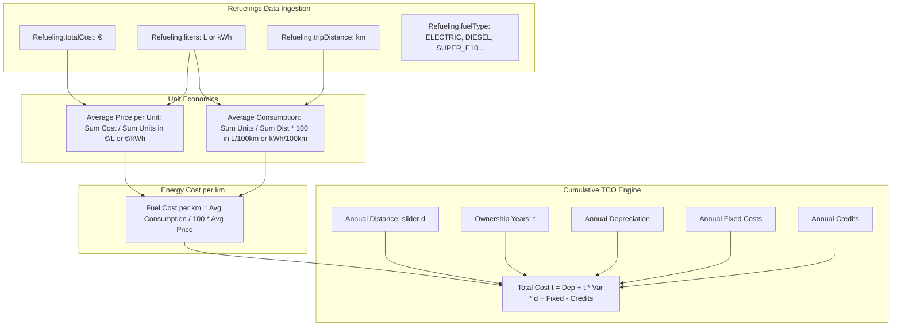

# Plan: Fuel & Energy Economics in Cumulative Vehicle Comparison & TCO Torus Chart Fix

## 1. Problem Analysis & Core Objectives

### Issue 1: Fuel & Energy Cost Divergence in Vehicle Comparison (Electric vs. Combustion)
In multi-year vehicle cost comparisons (Tab 3: Vehicle Comparison), users compare different vehicles—often evaluating whether to switch from a combustion vehicle (Diesel / Petrol) to an Electric Vehicle (EV).
- **The Disparity**: Fuel/energy costs form the single largest variable running cost of vehicle ownership. In real-world driving:
  - **Electric Vehicles (EV)**: Typically consume **$16 - 20\text{ kWh / 100 km}$** at an electricity price of **$0.30 - 0.42\text{ € / kWh}$**, yielding a running energy cost of **$5.00 - 8.40\text{ € / 100 km}$** ($0.050 - 0.084\text{ € / km}$).
  - **Petrol Vehicles (Gas / Super E10)**: Typically consume **$6.5 - 8.5\text{ L / 100 km}$** at a fuel price of **$1.70 - 1.85\text{ € / L}$**, yielding a running fuel cost of **$11.05 - 15.73\text{ € / 100 km}$** ($0.111 - 0.157\text{ € / km}$) — **over 2× more expensive than electric**.
  - **Diesel Vehicles**: Typically consume **$5.0 - 6.5\text{ L / 100 km}$** at a fuel price of **$1.60 - 1.75\text{ € / L}$**, yielding a running fuel cost of **$8.00 - 11.38\text{ € / 100 km}$** ($0.080 - 0.114\text{ € / km}$).
- **The Current Limitation**: Currently, `computeCarCoefficients()` in [`CarExpenseController.java`](file:///home/simon/code/eclipse/slm/src/main/java/de/oberamsystems/slm/controller/CarExpenseController.java) computes a single unweighted ratio (`totalFuelCost / fuelDist`) without decoupling **Average Consumption** from **Average Price per Unit**, and falls back to a flat `0.08` (8c/km) for any car with insufficient mileage. Furthermore, the comparison UI gives no visibility into fuel types, average consumption rates, or unit prices for Car A vs. Car B.

### Issue 2: Visual Appearance Bug (TCO Torus / Donut Chart Not Appearing Properly)
In Tab 2 (Expense Analytics & €/100km), the TCO cost distribution torus (`#tcoDonutChart`) frequently fails to appear or renders collapsed/broken:
- **Root Cause**: On page load, Tab 1 (`LOG`) is active by default. Tab 2 (`#tab-analytics`) is hidden inside a Bootstrap tab pane (`tab-pane fade` with `display: none`).
- In `car-expenses.html`, `bb.generate()` executes during `DOMContentLoaded` against `#tcoDonutChart`. Because its parent container is `display: none`, the DOM element reports dimensions of `0 × 0`.
- Billboard.js / D3 initializes an SVG with 0 width. Unlike Tab 3 (which has a `compTabBtn.addEventListener('shown.bs.tab', ...)` listener), Tab 2 has **no listener** for `shown.bs.tab`. When the user switches to the Analytics tab, the donut chart is never measured, resized, or rendered.
- If a vehicle has zero recorded expenses/fuelings, the chart container remains completely empty without any visual feedback.

---

## 2. Mathematical Model: Decoupling Fuel Consumption & Unit Prices

### The Governing Formula for Variable Fuel/Energy Cost
For any vehicle $i \in \{A, B\}$:

$$\text{Variable Fuel Cost per km}_i = \frac{\text{Average Consumption}_i}{100} \times \text{Average Price per Unit}_i$$

$$\text{Running Fuel Cost}_i(t, d) = t \times d \times \text{Variable Fuel Cost per km}_i$$

Where:
- $t$ is the elapsed ownership duration in years ($1, 2, \dots, 10$).
- $d$ is the annual mileage in km (interactive slider, default $10,000\text{ km}$).



### Decoupling by Fuel Type

| Category | Primary Fuel Types | Unit | Typical Consumption | Typical Unit Price | Running Cost / 100km | Running Cost / km |
|---|---|---|---|---|---|---|
| **Electric (EV)** | `ELECTRIC` | **kWh** | $18.5\text{ kWh/100km}$ | $0.360\text{ €/kWh}$ | **$6.66\text{ €/100km}$** | **$0.0666\text{ €/km}$** |
| **Diesel** | `DIESEL`, `PREMIUM_DIESEL` | **L** | $5.8\text{ L/100km}$ | $1.650\text{ €/L}$ | **$9.57\text{ €/100km}$** | **$0.0957\text{ €/km}$** |
| **Petrol / Gas** | `SUPER_E10`, `SUPER_E5`, `SUPER_PLUS` | **L** | $7.4\text{ L/100km}$ | $1.760\text{ €/L}$ | **$13.02\text{ €/100km}$** | **$0.1302\text{ €/km}$** |
| **Gas (LPG / CNG)** | `LPG`, `CNG` | **L / kg** | $8.0\text{ L/100km}$ | $1.050\text{ €/L}$ | **$8.40\text{ €/100km}$** | **$0.0840\text{ €/km}$** |

### Robust Calculation Hierarchy (Strictly Inferred from Recorded Refuelings)
1. **Tier 1 — Vehicles with Recorded Refuelings**:
   - **Fuel Type Inference**: Inferred **strictly from the vehicle's recorded refuelings** (`refueling.getFuelType()`), **never** guessed from car names or model strings.
     - Group refuelings by `FuelType` to find the dominant fuel type (e.g. `FuelType.ELECTRIC`, `FuelType.DIESEL`, `FuelType.SUPER_E10`, etc.).
     - If `dominantFuelType == FuelType.ELECTRIC`:
       - Unit: **kWh**
       - Unit Label: **€ / kWh**
       - Consumption Unit: **kWh / 100km**
       - Icon: `bi-lightning-charge`
     - If `dominantFuelType` is a combustion type (`DIESEL`, `SUPER_E10`, `SUPER_E5`, `SUPER_PLUS`, `LPG`, `CNG`, etc.):
       - Unit: **L** (or **kg** for CNG)
       - Unit Label: **€ / L**
       - Consumption Unit: **L / 100km**
       - Icon: `bi-fuel-pump` (or `bi-fire` for gas)
   - **Direct Metric Computation from Refuelings**:
     - $\text{Total Units} = \sum \text{liters}$
     - $\text{Total Spend} = \sum \text{totalCost}$
     - $\text{Weighted Avg Price per Unit} = \frac{\text{Total Spend}}{\text{Total Units}}$ (in $€/L$ or $€/kWh$).
     - $\text{Total Distance} = \sum \text{tripDistance}$.
     - $\text{Weighted Avg Consumption} = \begin{cases} \frac{\text{Total Units}}{\text{Total Distance}} \times 100 & \text{if Total Distance} \ge 50\text{ km} \\ \text{average of calculatedConsumption} & \text{if available} \\ \text{Standard baseline for that specific FuelType} & \text{otherwise} \end{cases}$
     - $\text{Variable Fuel Cost per km} = \frac{\text{Weighted Avg Consumption}}{100} \times \text{Weighted Avg Price per Unit}$.

2. **Tier 2 — Vehicles without Recorded Refuelings, but with `price_per_100_km`**:
   - If the vehicle has no refuelings logged yet, but has an explicit manual rate configured in `car.getPricePer100km()` (> 0):
     - $\text{Variable Fuel Cost per km} = \frac{\text{car.getPricePer100km()}}{100}$.
     - Fuel type is displayed as **"Manual Configuration"** (`OTHER`).

3. **Tier 3 — Vehicles without Refuelings and without `price_per_100_km`**:
   - **No Name Guessing**: The system does not attempt to parse names like "i4" or "e-tron".
   - Default baseline represents standard fleet average combustion vehicle (`SUPER_E10`, unit: **L**, $7.2\text{ L/100km}$ @ $1.75\text{ €/L} \implies 0.1260\text{ €/km}$).
   - In the comparison UI, this is transparently flagged with a badge: *"Default baseline (No refuelings recorded yet)"*, encouraging the user to log refuelings or set `pricePer100km`.

---

## 3. Implementation Plan

### Phase 1: Controller & Model Layer ([`CarExpenseController.java`](file:///home/simon/code/eclipse/slm/src/main/java/de/oberamsystems/slm/controller/CarExpenseController.java))
1. **Enhance `CarCoefficients` DTO**:
   - Add fields:
     - `FuelType fuelType`
     - `String fuelUnit` (`"kWh"` or `"L"`)
     - `double avgConsumption` ($L/100km$ or $kWh/100km$)
     - `double avgPricePerUnit` ($€/L$ or $€/kWh$)
     - `double fuelCostPerKm` ($€/km$)
     - `double fuelCostPer100Km` ($€/100km$)
     - `double maintenanceCostPerKm` ($€/km$)
   - Expose getters for all fields so Thymeleaf and client-side JavaScript can inspect and display them.
2. **Refactor `computeCarCoefficients(Car car)`**:
   - Integrate Tier 1, Tier 2, and Tier 3 calculation logic.
   - Accurately determine fuel consumption and unit prices for Electric vs. Combustion cars.
   - Calculate `variableFuelCostPerKm` explicitly from `(avgConsumption / 100.0) * avgPricePerUnit`.
   - Calculate total variable cost as `fuelCostPerKm + maintenanceCostPerKm`.

### Phase 2: Fixing the TCO Torus / Donut Chart ([`car-expenses.html`](file:///home/simon/code/eclipse/slm/src/main/resources/templates/car-expenses.html))
1. **Bootstrap Tab Activation Lifecycle**:
   - Encapsulate donut chart generation into a reusable function `renderTcoDonutChart()`.
   - Attach a listener to `document.getElementById('tab-analytics-btn')` on the `shown.bs.tab` event:
     ```javascript
     const analyticsTabBtn = document.getElementById('tab-analytics-btn');
     if (analyticsTabBtn) {
         analyticsTabBtn.addEventListener('shown.bs.tab', function () {
             if (tcoChart) {
                 tcoChart.resize();
             } else {
                 renderTcoDonutChart();
             }
         });
     }
     ```
   - If the page loads directly with `tab=ANALYTICS`, call `renderTcoDonutChart()` on `DOMContentLoaded`.
2. **Explicit Billboard.js Geometry**:
   - Set explicit size in `bb.generate`:
     ```javascript
     size: { height: 260 },
     donut: {
         title: "TCO Split",
         label: {
             format: function(value, ratio, id) {
                 return (ratio * 100).toFixed(1) + "%";
             }
         }
     }
     ```
3. **Empty-State Graceful Fallback**:
   - If all components (`totalFuelCost`, `realizedDepreciation`, `netOperatingExpenses`) equal 0, render a clean placeholder in `#tcoDonutChart`:
     `<div class="text-center text-muted p-4"><i class="bi bi-pie-chart fs-1 d-block mb-2 text-secondary"></i><span>No expenses or fuel records logged yet for this vehicle</span></div>`.

### Phase 3: Vehicle Comparison UI Enrichment ([`car-expenses.html`](file:///home/simon/code/eclipse/slm/src/main/resources/templates/car-expenses.html))
1. **Side-by-Side Fuel & Energy Efficiency Card**:
   - Add a comparative metrics card in Tab 3 above the chart comparing Car A and Car B:
     - **Fuel Type Badge** with icon (⚡ `Electric (EV)` in cyan/blue vs ⛽ `Diesel` / `Super E10` in amber/secondary).
     - **Avg. Consumption**: $XX.X\text{ kWh/100km}$ vs $X.X\text{ L/100km}$.
     - **Avg. Unit Price**: $X.XX\text{ €/kWh}$ vs $X.XX\text{ €/L}$.
     - **Running Fuel Cost**: $X.XX\text{ €/100km}$ vs $XX.XX\text{ €/100km}$.
     - **Annual Fuel Cost**: Dynamically updated as the slider moves ($d \times \text{fuelCostPerKm}$).
2. **Client-Side Dynamic Coefficient Sync**:
   - Include `coeffA.fuelCostPerKm`, `coeffB.fuelCostPerKm`, and unit prices in client-side JSON context.
   - When the distance slider or preset button is changed, update the annual fuel costs in the efficiency comparison card alongside the 10-year trajectory lines and break-even badge.

### Phase 4: Automated Testing & Verification
1. **Unit Tests in [`CarExpenseModelTest.java`](file:///home/simon/code/eclipse/slm/src/test/java/de/oberamsystems/slm/model/CarExpenseModelTest.java)**:
   - Test fuel cost per km calculation for Electric vs. Diesel/Petrol.
   - Verify calculation of weighted average consumption and weighted average unit prices from refuelings.
2. **Integration Tests in [`CarExpenseIT.java`](file:///home/simon/code/eclipse/slm/src/test/java/de/oberamsystems/slm/CarExpenseIT.java)**:
   - Verify `GET /car-expenses?tab=ANALYTICS` returns populated TCO donut chart data.
   - Verify `GET /car-expenses?tab=COMPARISON` provides distinct fuel coefficients for Electric vs. Combustion cars and that break-even points are accurately computed.
3. **Documentation**:
   - Document the decision in [`DECISIONS.md`](file:///home/simon/code/eclipse/slm/DECISIONS.md) as part of ADR 028.
   - Update [`CHANGELOG.md`](file:///home/simon/code/eclipse/slm/CHANGELOG.md) under `[0.0.3-rc10]`.
