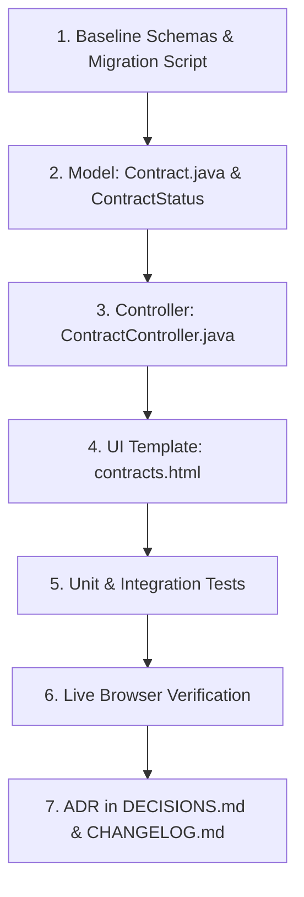

# Implementation Plan: Contract Lifecycle, Auto-Extension, and Semantic Remaining Days

## 1. Context & Motivation

In Simon's Life Manager (SLM), the **`Contract`** entity tracks recurring consumer and business commitments (e.g., fiber internet, mobile phone contracts, electricity/gas utilities, streaming subscriptions, insurances).

### Current Problem
Currently, the contract model calculates remaining days using a raw date subtraction:
```java
@Formula(value = "extract(day FROM end_date - now())")
private int daysRemaining;
```
When a contract's initial minimum term (`end_date`) passes without being cancelled:
1. `daysRemaining` turns **negative** (e.g. `-240 d`).
2. In [`contracts.html`](file:///home/simon/code/eclipse/slm/src/main/resources/templates/contracts.html), this triggers the `< 30` condition (`daysRemaining < 30 ? 'bg-danger-subtle text-danger' : ...`), styling the contract with an alarming **red danger badge**.
3. In reality, under German contract law (BGB § 309 Nr. 9 b) and standard subscription practices, contracts with an initial minimum commitment period (*Mindestvertragslaufzeit*) that are not cancelled do **not** expire or terminate—they **automatically extend** (typically rolling indefinitely with a 1-month notice period, or annual renewal).
4. Labeling the initial minimum term simply as "End Date" is misleading, because it represents the **initial commitment end date**, not the definite termination of the contract.

### Goals
1. **Rephrase "End Date"**: Rename/clarify `end_date` to `initial_end_date` ("Initial End Date" / Mindestvertragslaufzeit) across database, model, and UI.
2. **Model Auto-Extension & Cancellation**: Introduce first-class domain fields for `auto_extension`, `auto_extension_months`, `is_canceled`, `cancellation_date`, and `termination_date`.
3. **Eliminate Negative Remaining Values**: Formulate dynamic contract status calculation so active, auto-extended contracts never display negative days, but instead clearly indicate their rolling auto-extended status (e.g. "Auto-Extended" / "Rolling (1 mo)" or next renewal cycle).
4. **Clean Status Visualization**: Introduce explicit visual badges for Initial Term, Auto-Extended, Canceled (Pending Termination), and Terminated.

---

## 2. Domain Modeling & State Architecture

### 2.1 Contract Lifecycle State Machine

```mermaid
stateDiagram-v2
    [*] --> ACTIVE_INITIAL_TERM: Contract Signed

    state ACTIVE_INITIAL_TERM {
        description: now() <= initialEndDate && !isCanceled
    }

    state ACTIVE_AUTO_EXTENDED {
        description: now() > initialEndDate && autoExtension && !isCanceled
    }

    state CANCELED_PENDING {
        description: isCanceled && now() <= terminationDate
    }

    state TERMINATED {
        description: !isActive || (isCanceled && now() > terminationDate) || (!autoExtension && now() > initialEndDate)
    }

    ACTIVE_INITIAL_TERM --> ACTIVE_AUTO_EXTENDED: initialEndDate passed without cancellation
    ACTIVE_INITIAL_TERM --> CANCELED_PENDING: User submits cancellation notice
    ACTIVE_AUTO_EXTENDED --> CANCELED_PENDING: User submits cancellation notice
    ACTIVE_INITIAL_TERM --> TERMINATED: No auto-extension & initialEndDate passed
    CANCELED_PENDING --> TERMINATED: terminationDate reached
```

### 2.2 Status Matrix & Days Remaining Semantics

| State | Condition | Display Status | Days Remaining (`daysRemaining`) | Badge Style |
| :--- | :--- | :--- | :--- | :--- |
| **Active (Initial Term)** | `isActive && !isCanceled && today <= initialEndDate` | `Active (Initial Term)` | `initialEndDate - today` (positive countdown) | `bg-success-subtle text-success` (or `bg-warning-subtle` if `< 30 d` to notice deadline) |
| **Active (Auto-Extended)** | `isActive && !isCanceled && today > initialEndDate && autoExtension` | `Auto-Extended (Rolling)` | `null` or countdown to next monthly cycle; **never negative** | `bg-primary-subtle text-primary` or `bg-info-subtle text-info` |
| **Canceled (Pending)** | `isActive && isCanceled && today <= terminationDate` | `Canceled (Ending dd.MM.yyyy)` | `terminationDate - today` (countdown to final exit) | `bg-warning-subtle text-warning` |
| **Terminated / Inactive** | `!isActive || today > terminationDate || (!autoExtension && today > initialEndDate)` | `Terminated / Inactive` | `null` or `0 d` (ended) | `bg-secondary-subtle text-secondary` |

---

## 3. Database Schema & Migration Strategy

Following AGENTS.md rules 5 & 6:
- The authoritative baseline files ([`tables.sql`](file:///home/simon/code/eclipse/slm/src/main/resources/tables.sql), [`init.sql`](file:///home/simon/code/eclipse/slm/init.sql), and [`schema-init.sql`](file:///home/simon/code/eclipse/slm/src/test/resources/schema-init.sql)) will be updated first.
- A transactional incremental migration file [`src/main/resources/migration_2026-10-20.sql`](file:///home/simon/code/eclipse/slm/src/main/resources/) enclosed in `BEGIN; ... COMMIT;` will be created for legacy database upgrades.

### 3.1 Updated Schema Baseline (`contract` table)
```sql
CREATE TABLE contract (
    id BIGSERIAL PRIMARY KEY,
    title TEXT NOT NULL,
    contractor_id BIGINT REFERENCES contractor(id),
    fee REAL NOT NULL,
    start_date DATE NOT NULL,
    initial_end_date DATE,
    auto_extension BOOL NOT NULL DEFAULT TRUE,
    auto_extension_months INT NOT NULL DEFAULT 1,
    is_canceled BOOL NOT NULL DEFAULT FALSE,
    cancellation_date DATE,
    termination_date DATE,
    active BOOL NOT NULL DEFAULT TRUE
);
```

### 3.2 Incremental Migration (`migration_2026-10-20.sql`)
```sql
BEGIN;

-- 1. Rename end_date to initial_end_date
ALTER TABLE contract RENAME COLUMN end_date TO initial_end_date;

-- 2. Add auto-extension and cancellation tracking columns
ALTER TABLE contract ADD COLUMN IF NOT EXISTS auto_extension BOOL NOT NULL DEFAULT TRUE;
ALTER TABLE contract ADD COLUMN IF NOT EXISTS auto_extension_months INT NOT NULL DEFAULT 1;
ALTER TABLE contract ADD COLUMN IF NOT EXISTS is_canceled BOOL NOT NULL DEFAULT FALSE;
ALTER TABLE contract ADD COLUMN IF NOT EXISTS cancellation_date DATE;
ALTER TABLE contract ADD COLUMN IF NOT EXISTS termination_date DATE;

-- 3. Populate termination_date for already inactive contracts that had an initial_end_date
UPDATE contract 
SET termination_date = initial_end_date, 
    is_canceled = TRUE 
WHERE active = FALSE AND initial_end_date IS NOT NULL;

COMMIT;
```

---

## 4. Entity Refactoring: [`Contract.java`](file:///home/simon/code/eclipse/slm/src/main/java/de/oberamsystems/slm/model/Contract.java)

### 4.1 Field Additions & Backward Compatibility
- Adheres to **ADR 002**: Must remain a mutable JavaBean with no-arg constructor (never a Java record).
- Rename field `endDate` to `initialEndDate`, mapping to column `initial_end_date`.
- Add backward-compatible alias methods:
  ```java
  public LocalDate getEndDate() { return initialEndDate; }
  public void setEndDate(LocalDate endDate) { this.initialEndDate = endDate; }
  ```
  *(Prevents breaking existing code, tests, or queries).*
- Add new properties:
  - `private boolean autoExtension = true;`
  - `private int autoExtensionMonths = 1;`
  - `private boolean isCanceled = false;`
  - `private LocalDate cancellationDate;`
  - `private LocalDate terminationDate;`

### 4.2 Non-Negative `daysRemaining` & Dynamic Status
Instead of a naive `extract(day FROM end_date - now())`, calculate semantic remaining days:
- Can be computed via SQL `@Formula`:
  ```sql
  @Formula(value = "CASE " +
      "WHEN active = FALSE THEN 0 " +
      "WHEN is_canceled = TRUE AND termination_date IS NOT NULL THEN GREATEST(0, (termination_date - CURRENT_DATE)) " +
      "WHEN is_canceled = TRUE AND initial_end_date IS NOT NULL THEN GREATEST(0, (initial_end_date - CURRENT_DATE)) " +
      "WHEN initial_end_date IS NOT NULL AND initial_end_date >= CURRENT_DATE THEN (initial_end_date - CURRENT_DATE) " +
      "WHEN initial_end_date IS NOT NULL AND initial_end_date < CURRENT_DATE AND auto_extension = TRUE THEN NULL " +
      "WHEN initial_end_date IS NOT NULL AND initial_end_date < CURRENT_DATE AND auto_extension = FALSE THEN 0 " +
      "ELSE NULL END")
  private Integer daysRemaining;
  ```
  *Key benefits of this Formula*:
  1. **Guaranteed non-negative**: Never returns negative integers.
  2. **Returns `NULL` for auto-extended contracts**: Signals to the view that the contract is rolling without an impending end countdown.
  3. **Reflects `terminationDate` when canceled**: Accurately counts down to the confirmed cancellation date.

- Provide Java domain helper methods on `Contract`:
  ```java
  public enum ContractStatus {
      ACTIVE_INITIAL_TERM,
      ACTIVE_AUTO_EXTENDED,
      CANCELED_PENDING,
      TERMINATED
  }

  public ContractStatus getCalculatedStatus() {
      if (!isActive) return ContractStatus.TERMINATED;
      LocalDate today = LocalDate.now();
      if (isCanceled) {
          if (terminationDate != null && today.isAfter(terminationDate)) return ContractStatus.TERMINATED;
          return ContractStatus.CANCELED_PENDING;
      }
      if (initialEndDate != null) {
          if (today.isAfter(initialEndDate)) {
              return autoExtension ? ContractStatus.ACTIVE_AUTO_EXTENDED : ContractStatus.TERMINATED;
          }
          return ContractStatus.ACTIVE_INITIAL_TERM;
      }
      return ContractStatus.ACTIVE_AUTO_EXTENDED;
  }
  ```

---

## 5. UI Modernization: [`contracts.html`](file:///home/simon/code/eclipse/slm/src/main/resources/templates/contracts.html)

### 5.1 Table Header & Rows
- Rephrase table column `End Date` to **`Initial End Date`** (with subtitle or tooltip *"Minimum commitment term"*).
- Add status indicator column or enhance the **`Remaining`** & **`Status`** columns:
  - **Auto-Extended contracts**:
    Display badge: `<span class="badge bg-primary-subtle text-primary rounded-pill"><i class="bi bi-arrow-repeat me-1"></i>Auto-Extended (Rolling)</span>`.
  - **Initial Term contracts**:
    Display days remaining badge:
    - If `daysRemaining > 30`: `bg-secondary-subtle text-secondary` (e.g. `185 d`).
    - If `daysRemaining <= 30`: `bg-warning-subtle text-warning` (e.g. `14 d` - reminder to review/cancel before auto-renewal).
  - **Canceled contracts**:
    Display badge: `<span class="badge bg-danger-subtle text-danger rounded-pill"><i class="bi bi-x-circle me-1"></i>Canceled (Ends dd.MM.yyyy)</span>` with days remaining countdown to `terminationDate`.
  - **Terminated contracts**:
    Display badge: `<span class="badge bg-secondary-subtle text-secondary rounded-pill">Ended</span>`.

### 5.2 Add/Edit Contract Form
Update form labels and add controls:
1. **Initial End Date**: `<label for="initialEndDate" class="form-label">Initial End Date (Mindestlaufzeit)</label>`
2. **Auto-Extension Toggle**:
   ```html
   <div class="mb-3 form-check form-switch">
       <input class="form-check-input" type="checkbox" id="autoExtension" th:field="*{autoExtension}">
       <label class="form-check-label" for="autoExtension">Auto-Extends after Initial End Date</label>
   </div>
   ```
3. **Cancellation Details** (collapsible or toggle):
   - Switch: `isCanceled` ("Mark as Canceled")
   - Date inputs: `cancellationDate` (Notice Date) and `terminationDate` (Effective Termination Date).

---

## 6. Controller Updates: [`ContractController.java`](file:///home/simon/code/eclipse/slm/src/main/java/de/oberamsystems/slm/controller/ContractController.java)

1. Default new contract instance in `GET /contracts`:
   - `startDate`: `LocalDate.now()`
   - `initialEndDate`: `LocalDate.now().plusYears(1)` (or `plusMonths(24)`)
   - `autoExtension`: `true`
   - `autoExtensionMonths`: `1`
   - `isActive`: `true`
   - `isCanceled`: `false`
2. In `POST /contracts`:
   - Bind all fields including `initialEndDate`, `autoExtension`, `isCanceled`, `terminationDate`.
   - If `isCanceled` is checked and `terminationDate` is not set, default `terminationDate` to `initialEndDate` or current period end.

---

## 7. Step-by-Step Implementation Roadmap



1. **Step 1: Baseline Schemas & Migration Script**:
   - Update [`tables.sql`](file:///home/simon/code/eclipse/slm/src/main/resources/tables.sql), [`init.sql`](file:///home/simon/code/eclipse/slm/init.sql), [`schema-init.sql`](file:///home/simon/code/eclipse/slm/src/test/resources/schema-init.sql).
   - Create [`migration_2026-10-20.sql`](file:///home/simon/code/eclipse/slm/src/main/resources/).
2. **Step 2: Update `Contract.java`**:
   - Add fields, `@Formula` fix, enum `ContractStatus`, and backwards-compatible getters.
3. **Step 3: Update `ContractController.java`**:
   - Provide default initialization and binding for new fields.
4. **Step 4: Update `contracts.html`**:
   - Rename "End Date" to "Initial End Date", update badges and form inputs.
5. **Step 5: Automated Testing**:
   - Update `EmployerContractIT.java`, `FinanceManagementIT.java`, and `ContractControllerTest.java`.
   - Add test cases specifically validating that uncanceled contracts past `initialEndDate` do not yield negative days and are marked auto-extended.
   - Run `./gradlew test -x jacocoTestReport -x compileAotTestJava`.
6. **Step 6: Live Browser Verification**:
   - Start application and open `/contracts` via browser subagent.
   - Verify UI display of active, auto-extended, and canceled contracts.
7. **Step 7: Documentation**:
   - Record ADR in [`DECISIONS.md`](file:///home/simon/code/eclipse/slm/DECISIONS.md).
   - Update [`CHANGELOG.md`](file:///home/simon/code/eclipse/slm/CHANGELOG.md).
