# Comprehensive Integration Testing Plan for All Controllers in Simon's Life Manager (SLM)

## 1. Executive Summary & Inventory

### 1.1. Context & Motivation
Simon's Life Manager (SLM) currently defines **33 Spring MVC and REST controllers** governing life balance domains (Productivity, Sport, Wellness, Leisure, Social, Finance, Mobility, and Academics).
While domain entities and selected workflows have dedicated integration tests (e.g., [`SleepSessionUIIT`](file:///home/simon/code/eclipse/slm/src/test/java/de/oberamsystems/slm/SleepSessionUIIT.java), [`CourseDetailIT`](file:///home/simon/code/eclipse/slm/src/test/java/de/oberamsystems/slm/CourseDetailIT.java), [`SelfieControllerIT`](file:///home/simon/code/eclipse/slm/src/test/java/de/oberamsystems/slm/controller/SelfieControllerIT.java), [`DoctorSpatialIT`](file:///home/simon/code/eclipse/slm/src/test/java/de/oberamsystems/slm/DoctorSpatialIT.java), [`RouteSpatialIT`](file:///home/simon/code/eclipse/slm/src/test/java/de/oberamsystems/slm/RouteSpatialIT.java)), most controllers only have unit tests with Mockito mocks ([`src/test/java/de/oberamsystems/slm/controller/*Test.java`](file:///home/simon/code/eclipse/slm/src/test/java/de/oberamsystems/slm/controller/)).

Unit tests with mocks cannot detect:
1. Broken Thymeleaf expressions, template fragment mismatches, or layout attribute discrepancies.
2. Spring Security authorization filters, CSRF token validation failures, and endpoint permission mismatches.
3. Database constraint violations, transactional rollback conflicts, or PostgreSQL trigger failures (e.g. PostGIS geodesic calculations, UUIDv7 generation, duration invariants).
4. Spring MVC WebDataBinder type converters (e.g. `Duration`, `LocalDate`, `LocalDateTime`, `UUID`).

### 1.2. Complete Controller Coverage Matrix

| Controller Class | Primary Endpoints | Existing Test Coverage | Target IT Test Class |
| :--- | :--- | :--- | :--- |
| [`AcademicController`](file:///home/simon/code/eclipse/slm/src/main/java/de/oberamsystems/slm/controller/AcademicController.java) | `/courses`, `/courses/{id}`, `/notes/**` | ✅ [`AcademicIT`](file:///home/simon/code/eclipse/slm/src/test/java/de/oberamsystems/slm/AcademicIT.java), [`CourseDetailIT`](file:///home/simon/code/eclipse/slm/src/test/java/de/oberamsystems/slm/CourseDetailIT.java) | *Covered* |
| [`SelfieController`](file:///home/simon/code/eclipse/slm/src/main/java/de/oberamsystems/slm/controller/SelfieController.java) | `/selfies` (Upload, View) | ✅ [`SelfieControllerIT`](file:///home/simon/code/eclipse/slm/src/test/java/de/oberamsystems/slm/controller/SelfieControllerIT.java) | *Covered* |
| [`SessionController`](file:///home/simon/code/eclipse/slm/src/main/java/de/oberamsystems/slm/controller/SessionController.java) | `/sessions`, `/sessions/{type}`, `/sessions/delete/{id}` | ⚠️ Partial ([`SleepSessionUIIT`](file:///home/simon/code/eclipse/slm/src/test/java/de/oberamsystems/slm/SleepSessionUIIT.java) for sleep only) | `SessionHubIT` |
| [`IndexController`](file:///home/simon/code/eclipse/slm/src/main/java/de/oberamsystems/slm/controller/IndexController.java) | `/`, `/index`, `/index.html` | ❌ Only unit test | `DashboardAndManagementIT` |
| [`ImprintController`](file:///home/simon/code/eclipse/slm/src/main/java/de/oberamsystems/slm/controller/ImprintController.java) | `/imprint` | ❌ Only unit test | `DashboardAndManagementIT` |
| `*ManagementController` (6 controllers: `Activity`, `Book`, `Habit`, `Human`, `Misc`, `Spend`) | `/*-management` | ❌ Only unit test | `DashboardAndManagementIT` |
| [`ActivityController`](file:///home/simon/code/eclipse/slm/src/main/java/de/oberamsystems/slm/controller/ActivityController.java) | `/activities`, `/activity-types`, `/activity` | ❌ Only unit test | `ActivitiesAndMediaIT` |
| [`SportController`](file:///home/simon/code/eclipse/slm/src/main/java/de/oberamsystems/slm/controller/SportController.java) | `/sports`, `/sport-types` | ❌ Only unit test | `ActivitiesAndMediaIT` |
| [`LearningController`](file:///home/simon/code/eclipse/slm/src/main/java/de/oberamsystems/slm/controller/LearningController.java) | `/learning-items` | ❌ Only unit test | `ActivitiesAndMediaIT` |
| [`MeditationController`](file:///home/simon/code/eclipse/slm/src/main/java/de/oberamsystems/slm/controller/MeditationController.java) | `/meditations` | ❌ Only unit test | `ActivitiesAndMediaIT` |
| [`GameController`](file:///home/simon/code/eclipse/slm/src/main/java/de/oberamsystems/slm/controller/GameController.java) | `/games`, `/studios`, `/games/{id}` | ❌ Only unit test | `ActivitiesAndMediaIT` |
| [`BookController`](file:///home/simon/code/eclipse/slm/src/main/java/de/oberamsystems/slm/controller/BookController.java) | `/books`, `/authors`, `/publishers` | ❌ Only unit test | `ActivitiesAndMediaIT` |
| [`DoctorController`](file:///home/simon/code/eclipse/slm/src/main/java/de/oberamsystems/slm/controller/DoctorController.java) | `/doctors`, `/specialities`, `/appointments`, `/doctor/{id}`, `/appointment/{id}` | ⚠️ DB trigger only ([`DoctorSpatialIT`](file:///home/simon/code/eclipse/slm/src/test/java/de/oberamsystems/slm/DoctorSpatialIT.java)) | `DoctorControllerIT` |
| [`HabitController`](file:///home/simon/code/eclipse/slm/src/main/java/de/oberamsystems/slm/controller/HabitController.java) | `/habits`, `/habit-entries`, `/last-done-habit-entries` | ❌ Only unit test | `WellnessAndHabitsIT` |
| [`MoodController`](file:///home/simon/code/eclipse/slm/src/main/java/de/oberamsystems/slm/controller/MoodController.java) | `/moods`, `/mood-bb` | ❌ Only unit test | `WellnessAndHabitsIT` |
| [`MoodRestController`](file:///home/simon/code/eclipse/slm/src/main/java/de/oberamsystems/slm/controller/MoodRestController.java) | `/api/moods` | ❌ Only unit test | `WellnessAndHabitsIT` |
| [`SleepTimeController`](file:///home/simon/code/eclipse/slm/src/main/java/de/oberamsystems/slm/controller/SleepTimeController.java) | `/sleep-times`, `/sleeptime-bb` | ⚠️ Domain/Repo only ([`SleepTimeIT`](file:///home/simon/code/eclipse/slm/src/test/java/de/oberamsystems/slm/SleepTimeIT.java)) | `WellnessAndHabitsIT` |
| [`SleepTimeRestController`](file:///home/simon/code/eclipse/slm/src/main/java/de/oberamsystems/slm/controller/SleepTimeRestController.java) | `/api/sleeptimes` | ❌ Only unit test | `WellnessAndHabitsIT` |
| [`HumanController`](file:///home/simon/code/eclipse/slm/src/main/java/de/oberamsystems/slm/controller/HumanController.java) | `/humans` | ❌ Only unit test | `SocialAndPeopleIT` |
| [`HumanEventController`](file:///home/simon/code/eclipse/slm/src/main/java/de/oberamsystems/slm/controller/HumanEventController.java) | `/human-events`, `/human-events/delete/{id}` | ⚠️ Domain only ([`HumanEventIT`](file:///home/simon/code/eclipse/slm/src/test/java/de/oberamsystems/slm/HumanEventIT.java)) | `SocialAndPeopleIT` |
| [`CalendarEventController`](file:///home/simon/code/eclipse/slm/src/main/java/de/oberamsystems/slm/controller/CalendarEventController.java) | `/events`, `/events/delete/{id}` | ❌ Only unit test | `SocialAndPeopleIT` |
| [`DiaryEntryController`](file:///home/simon/code/eclipse/slm/src/main/java/de/oberamsystems/slm/controller/DiaryEntryController.java) | `/diary` | ❌ Only unit test | `PersonalJournalIT` |
| [`GratitudeController`](file:///home/simon/code/eclipse/slm/src/main/java/de/oberamsystems/slm/controller/GratitudeController.java) | `/gratitudes` | ❌ Only unit test | `PersonalJournalIT` |
| [`EmployerController`](file:///home/simon/code/eclipse/slm/src/main/java/de/oberamsystems/slm/controller/EmployerController.java) | `/employers` | ⚠️ Domain only ([`EmployerContractIT`](file:///home/simon/code/eclipse/slm/src/test/java/de/oberamsystems/slm/EmployerContractIT.java)) | `FinanceManagementIT` |
| [`ContractController`](file:///home/simon/code/eclipse/slm/src/main/java/de/oberamsystems/slm/controller/ContractController.java) | `/contracts`, `/contractors` | ⚠️ Domain only ([`EmployerContractIT`](file:///home/simon/code/eclipse/slm/src/test/java/de/oberamsystems/slm/EmployerContractIT.java)) | `FinanceManagementIT` |
| [`PurchaseController`](file:///home/simon/code/eclipse/slm/src/main/java/de/oberamsystems/slm/controller/PurchaseController.java) | `/purchases`, `/vendors` | ❌ Only unit test | `FinanceManagementIT` |
| [`RouteController`](file:///home/simon/code/eclipse/slm/src/main/java/de/oberamsystems/slm/controller/RouteController.java) | `/routes`, `/points`, `/car-trips`, `/cars`, `/devices` | ⚠️ DB trigger only ([`RouteSpatialIT`](file:///home/simon/code/eclipse/slm/src/test/java/de/oberamsystems/slm/RouteSpatialIT.java)) | `TransitAndMobilityIT` |
| [`TrainTripController2`](file:///home/simon/code/eclipse/slm/src/main/java/de/oberamsystems/slm/controller/TrainTripController2.java) | `/train-trips`, `/train-lines`, `/train-stations` | ❌ Only unit test | `TransitAndMobilityIT` |

---

## 2. Architectural Design & Invariants

All new test classes must adhere to the core guidelines established in [`AGENTS.md`](file:///home/simon/code/eclipse/slm/AGENTS.md):
1. **Inherit from `AbstractIntegrationTest`**:
   - Reuses the shared singleton Testcontainers container (`postgis/postgis:18-3.6`) via `@ServiceConnection`.
   - Never instantiates redundant PostgreSQL containers per class.
2. **Spring Security & MockMvc Setup**:
   - Built via `webAppContextSetup(context).apply(springSecurity()).build()`.
   - All state-mutating requests (`POST`) must include `.with(csrf())`.
   - Verifies that form submissions contain automatically injected `_csrf` hidden tokens.
3. **Hibernate Persistence Context Hygiene**:
   - Because integration test classes use `@Transactional`, tests that verify deletions through controller endpoints must call `entityManager.flush(); entityManager.clear();` prior to performing the delete, and `entityManager.flush(); entityManager.clear();` after the call to ensure dirty checks validate against actual PostgreSQL state.
4. **Execution Protocol**:
   - Tests execute with `./gradlew test -x jacocoTestReport -x compileAotTestJava -x processTestAot`.

---

## 3. Detailed Specification for New Integration Test Classes

### 3.1. `DashboardAndManagementIT`
* **Controllers Tested**:
  - [`IndexController`](file:///home/simon/code/eclipse/slm/src/main/java/de/oberamsystems/slm/controller/IndexController.java)
  - [`ImprintController`](file:///home/simon/code/eclipse/slm/src/main/java/de/oberamsystems/slm/controller/ImprintController.java)
  - 6 Dashboard Management Controllers: `ActivityManagementController`, `BookManagementController`, `HabitManagementController`, `HumanManagementController`, `MiscManagementController`, `SpendManagementController`.
* **Scenarios to Test**:
  1. `testIndexDashboardWithActivitiesMilestonesAndBirthdays()`:
     - Populates a `SportSession`, `MeditationSession`, `ReadingSession`, `Human` with birthday, and `HumanEvent` with upcoming milestone.
     - Performs `GET /`, asserts HTTP 200, view `index`, and verifies rendered summary messages (`msgs`) and upcoming milestones within 30 days.
  2. `testIndexDashboardEmptyState()`:
     - Verifies `GET /index` with empty tables renders gracefully without NPE.
  3. `testAllManagementDashboardsRender()`:
     - Iterates through `/activity-management`, `/book-management`, `/habit-management`, `/human-management`, `/misc-management`, `/spend-management`, `/imprint`.
     - Asserts HTTP 200, correct view names, and expected navigation cards/tiles.

### 3.2. `SessionHubIT`
* **Controller Tested**:
  - [`SessionController`](file:///home/simon/code/eclipse/slm/src/main/java/de/oberamsystems/slm/controller/SessionController.java)
* **Scenarios to Test**:
  1. `testCreateCodingSessionWithBranchAndTicket()`:
     - `POST /sessions/coding` with project, branch, ticket, start, end, break.
     - Asserts 302 redirect to `/sessions?type=CODING`.
     - Verifies native UUIDv7 assigned and record saved in DB and rendered on `/sessions?type=CODING`.
  2. `testCreateWorkingSessionWithEmployer()`:
     - Sets up `Employer`, posts `/sessions/working` with employerId.
     - Asserts 302 redirect to `/sessions?type=WORKING`.
  3. `testCreateLearningSessionWithTopic()`:
     - Sets up `LearningItem`, posts `/sessions/learning` with learningItemId.
     - Asserts 302 redirect to `/sessions?type=LEARNING`.
  4. `testCreateReadingSessionWithBook()`:
     - Sets up `Book`, posts `/sessions/reading` with startPage, endPage, bookId.
     - Asserts 302 redirect to `/sessions?type=READING`.
  5. `testCreateGamingSessionWithGame()`:
     - Sets up `Game`, posts `/sessions/gaming` with gameId.
     - Asserts 302 redirect to `/sessions?type=GAMING`.
  6. `testCreateSportSessionWithActivity()`:
     - Sets up `SportType`, posts `/sessions/sport`.
     - Asserts 302 redirect to `/sessions?type=SPORT`.
  7. `testCreateMeditationSession()`:
     - Posts `/sessions/meditation`.
     - Asserts 302 redirect to `/sessions?type=MEDITATION`.
  8. `testCreateLectureSessionWithCourse()`:
     - Sets up `Course`, posts `/sessions/lecture` with courseId.
     - Asserts 302 redirect to `/sessions?type=LECTURE`.
  9. `testNetFocusedTimeCalculationOnProductivity()`:
     - Posts a Coding session (2h), a Working session (1h), a Meditation session (30m), and a Sleep session (8h).
     - Requests `GET /sessions?type=ALL`.
     - Verifies "Net Focused Time" strictly aggregates only cognitive productivity (3h 00m) and excludes meditation and sleep (ADR 012).
  10. `testDeleteSessionById()`:
      - Posts a session, then calls `POST /sessions/delete/{id}`.
      - Asserts session removed from database.

### 3.3. `ActivitiesAndMediaIT`
* **Controllers Tested**:
  - [`ActivityController`](file:///home/simon/code/eclipse/slm/src/main/java/de/oberamsystems/slm/controller/ActivityController.java)
  - [`SportController`](file:///home/simon/code/eclipse/slm/src/main/java/de/oberamsystems/slm/controller/SportController.java)
  - [`LearningController`](file:///home/simon/code/eclipse/slm/src/main/java/de/oberamsystems/slm/controller/LearningController.java)
  - [`MeditationController`](file:///home/simon/code/eclipse/slm/src/main/java/de/oberamsystems/slm/controller/MeditationController.java)
  - [`GameController`](file:///home/simon/code/eclipse/slm/src/main/java/de/oberamsystems/slm/controller/GameController.java)
  - [`BookController`](file:///home/simon/code/eclipse/slm/src/main/java/de/oberamsystems/slm/controller/BookController.java)
* **Scenarios to Test**:
  1. `testActivitiesAndActivityTypes()`:
     - `POST /activity-types` and `POST /activities`.
     - `GET /activities` and `GET /activity-types`, verifying rendering.
  2. `testSportSessionsAndSportTypes()`:
     - `POST /sport-types` and `POST /sports`.
     - `GET /sports` and `GET /sport-types`.
  3. `testLearningItemsCrud()`:
     - `POST /learning-items` creating an item.
     - `GET /learning-items` asserting rendered item.
     - `POST /learning-items/delete/{id}`.
  4. `testMeditationSessions()`:
     - `POST /meditations` and `GET /meditations`.
  5. `testGamesAndStudios()`:
     - `POST /studios`, `POST /games`.
     - `GET /games`, `GET /studios`.
  6. `testBooksAuthorsAndPublishers()`:
     - `POST /authors`, `POST /publishers`, `POST /books`.
     - `GET /books`, `GET /authors`, `GET /publishers`.

### 3.4. `DoctorControllerIT`
* **Controller Tested**:
  - [`DoctorController`](file:///home/simon/code/eclipse/slm/src/main/java/de/oberamsystems/slm/controller/DoctorController.java)
* **Scenarios to Test**:
  1. `testCreateSpecialityAndDoctorWithPointGeom()`:
     - Sets up `Point` (latitude/longitude), `Speciality`.
     - `POST /doctors` with point and speciality.
     - `GET /doctors`, asserts table contains doctor and linked speciality.
  2. `testCreateAppointmentAndGeodesicAirDistanceCalculation()`:
     - Creates home base `Point` and doctor practice `Point`.
     - `POST /appointments` linking doctor and date.
     - `GET /appointments`, asserts appointments list renders air distance generated by the PostGIS trigger.
  3. `testDoctorDetailAndAppointmentDetailViews()`:
     - `GET /doctor/{id}` and `GET /appointment/{id}`.

### 3.5. `WellnessAndHabitsIT`
* **Controllers Tested**:
  - [`HabitController`](file:///home/simon/code/eclipse/slm/src/main/java/de/oberamsystems/slm/controller/HabitController.java)
  - [`MoodController`](file:///home/simon/code/eclipse/slm/src/main/java/de/oberamsystems/slm/controller/MoodController.java)
  - [`MoodRestController`](file:///home/simon/code/eclipse/slm/src/main/java/de/oberamsystems/slm/controller/MoodRestController.java)
  - [`SleepTimeController`](file:///home/simon/code/eclipse/slm/src/main/java/de/oberamsystems/slm/controller/SleepTimeController.java)
  - [`SleepTimeRestController`](file:///home/simon/code/eclipse/slm/src/main/java/de/oberamsystems/slm/controller/SleepTimeRestController.java)
* **Scenarios to Test**:
  1. `testHabitsAndHabitEntriesLogging()`:
     - `POST /habits` creating a recurring habit.
     - `POST /habit-entries` logging completion.
     - `GET /habits`, `GET /habit-entries`, `GET /last-done-habit-entries`.
  2. `testMoodHtmlAndRestController()`:
     - `POST /moods` via HTML form, `GET /moods`, `GET /mood-bb` (analytics chart).
     - `GET /api/moods` asserting JSON response.
  3. `testSleepTimeHtmlAndRestController()`:
     - `POST /sleep-times` via HTML form, `GET /sleep-times`, `GET /sleeptime-bb`.
     - `GET /api/sleeptimes` asserting JSON response.

### 3.6. `SocialAndPeopleIT`
* **Controllers Tested**:
  - [`HumanController`](file:///home/simon/code/eclipse/slm/src/main/java/de/oberamsystems/slm/controller/HumanController.java)
  - [`HumanEventController`](file:///home/simon/code/eclipse/slm/src/main/java/de/oberamsystems/slm/controller/HumanEventController.java)
  - [`CalendarEventController`](file:///home/simon/code/eclipse/slm/src/main/java/de/oberamsystems/slm/controller/CalendarEventController.java)
* **Scenarios to Test**:
  1. `testHumansCrudAndBirthdayCalculations()`:
     - `POST /humans` creating a person with birthday.
     - `GET /humans` asserting rendered entry and `@Formula` days until birthday.
  2. `testHumanEventsAnniversariesAndMemorials()`:
     - `POST /human-events` creating wedding anniversary / memorial.
     - `GET /human-events` asserting upcoming occurrences and milestone counts.
     - `POST /human-events/delete/{id}`.
  3. `testCalendarEventsCrud()`:
     - `POST /events` creating calendar event with start/end duration.
     - `GET /events`, `POST /events/delete/{id}`.

### 3.7. `PersonalJournalIT`
* **Controllers Tested**:
  - [`DiaryEntryController`](file:///home/simon/code/eclipse/slm/src/main/java/de/oberamsystems/slm/controller/DiaryEntryController.java)
  - [`GratitudeController`](file:///home/simon/code/eclipse/slm/src/main/java/de/oberamsystems/slm/controller/GratitudeController.java)
* **Scenarios to Test**:
  1. `testDiaryEntriesWorkflow()`:
     - `POST /diary` with entry text, date, and mood rating.
     - `GET /diary` asserting entries rendered in chronological order.
  2. `testGratitudesWorkflow()`:
     - `POST /gratitudes` with gratitude item text.
     - `GET /gratitudes` asserting rendered gratitude reflections.

### 3.8. `FinanceManagementIT`
* **Controllers Tested**:
  - [`EmployerController`](file:///home/simon/code/eclipse/slm/src/main/java/de/oberamsystems/slm/controller/EmployerController.java)
  - [`ContractController`](file:///home/simon/code/eclipse/slm/src/main/java/de/oberamsystems/slm/controller/ContractController.java)
  - [`PurchaseController`](file:///home/simon/code/eclipse/slm/src/main/java/de/oberamsystems/slm/controller/PurchaseController.java)
* **Scenarios to Test**:
  1. `testEmployersAndProfessionalIncomeSources()`:
     - `POST /employers` with hourly rate and client details.
     - `GET /employers` asserting table listing.
  2. `testContractsAndContractorsOutgoingExpenses()`:
     - `POST /contractors` creating a utility / subscription service provider.
     - `POST /contracts` linking contract to contractor with cost and billing interval.
     - `GET /contracts`, `GET /contractors`.
  3. `testPurchasesAndVendors()`:
     - `POST /vendors`, `POST /purchases` with price and date.
     - `GET /purchases`, `GET /vendors`.

### 3.9. `TransitAndMobilityIT`
* **Controllers Tested**:
  - [`RouteController`](file:///home/simon/code/eclipse/slm/src/main/java/de/oberamsystems/slm/controller/RouteController.java)
  - [`TrainTripController2`](file:///home/simon/code/eclipse/slm/src/main/java/de/oberamsystems/slm/controller/TrainTripController2.java)
* **Scenarios to Test**:
  1. `testPointsRoutesAndCarTripsWithPostGISTriggers()`:
     - `POST /points` creating start and end points with latitude/longitude geography.
     - `POST /routes` linking points, asserting air distance computed via DB trigger.
     - `POST /cars` and `POST /devices`.
     - `POST /car-trips` linking route, car, and device.
     - `GET /routes`, `GET /points`, `GET /car-trips`, `GET /cars`, `GET /devices`.
  2. `testTrainTripsStationsAndLines()`:
     - `POST /train-stations`, `POST /train-lines`.
     - `POST /train-trips` with ticket cost and travel duration.
     - `GET /train-trips`, `GET /train-lines`, `GET /train-stations`.

---

## 4. Execution Roadmap & Milestones

```mermaid
gantt
    title Controller Integration Testing Roadmap
    dateFormat  X
    axisFormat %s

    section Core & Sessions
    DashboardAndManagementIT :m1, 0, 1
    SessionHubIT             :m2, 1, 2

    section Health & Activities
    ActivitiesAndMediaIT     :m3, 2, 3
    DoctorControllerIT       :m4, 3, 4
    WellnessAndHabitsIT      :m5, 4, 5

    section Social & Finances
    SocialAndPeopleIT        :m6, 5, 6
    PersonalJournalIT        :m7, 6, 7
    FinanceManagementIT      :m8, 7, 8
    TransitAndMobilityIT     :m9, 8, 9

    section Verification
    Full Test Suite & Health :m10, 9, 10
```

1. **Milestone 1**: Author `DashboardAndManagementIT` & `SessionHubIT` (covers core entry points, polymorphic sessions, and dashboards). **[COMPLETED]**
2. **Milestone 2**: Author `ActivitiesAndMediaIT`, `DoctorControllerIT`, and `WellnessAndHabitsIT` (covers physical activity, media tracking, medical appointments, habits, mood, and sleep). **[COMPLETED]**
3. **Milestone 3**: Author `SocialAndPeopleIT`, `PersonalJournalIT`, `FinanceManagementIT`, and `TransitAndMobilityIT` (covers relationships, milestones, diary, finance, and mobility). **[COMPLETED]**
4. **Milestone 4**: Full test suite execution (`./gradlew test -x jacocoTestReport -x compileAotTestJava -x processTestAot`) and documentation update in `CHANGELOG.md` and `DECISIONS.md`. **[COMPLETED - All 131 tests passing]**
