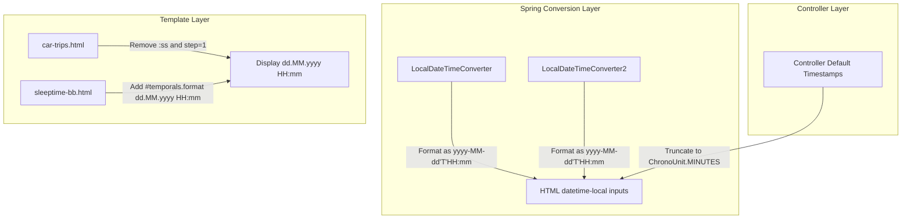

# Plan: Standardize Date & Time Precision to Minutes (`HH:mm`) Across SLM

## 1. Problem Overview & Root Cause Analysis

### Problem Description
In several views—notably **Sleep Times** (`/sleep-times`) and **Car Trips** (`/car-trips`)—the UI presents timestamps with second-level precision (`HH:mm:ss`), while standard views like **Sessions** (`/sessions`, `/working-sessions`, `/coding-sessions`) display time with minute precision (`HH:mm`).

### Root Causes
Investigation revealed three distinct causes across the stack:
1. **Spring Converter Formatting for `<input type="datetime-local">` (`ConversionService`)**:
   - [`LocalDateTimeConverter.java`](file:///home/simon/code/eclipse/slm/src/main/java/de/oberamsystems/slm/mail/LocalDateTimeConverter.java#L22) and [`LocalDateTimeConverter2.java`](file:///home/simon/code/eclipse/slm/src/main/java/de/oberamsystems/slm/mail/LocalDateTimeConverter2.java#L20) format `LocalDateTime` using pattern `"yyy-MM-dd HH:mm:ss"`.
   - When Thymeleaf binds a model field (e.g. `th:field="*{gotobed}"`), Spring renders the `value="..."` attribute as `2026-10-18 12:30:45`.
   - In modern browsers (Chrome/Firefox/Safari), when an `<input type="datetime-local">` has seconds in its value, the browser's native picker switches into seconds mode (`--:--:--` / `HH:mm:ss`). In `sessions.html`, blank/null dates or inputs without seconds render as `HH:mm`.
2. **Explicit Seconds Pattern in HTML Templates**:
   - In [`car-trips.html`](file:///home/simon/code/eclipse/slm/src/main/resources/templates/car-trips.html#L54-L55), the table columns explicitly format with `'dd.MM.yyyy HH:mm:ss'`.
   - In [`car-trips.html`](file:///home/simon/code/eclipse/slm/src/main/resources/templates/car-trips.html#L94-L98), form inputs specify `step="1"`, which instructs the browser to require and display seconds in the input widget.
3. **Unformatted Entity Output in Templates**:
   - In [`sleeptime-bb.html`](file:///home/simon/code/eclipse/slm/src/main/resources/templates/sleeptime-bb.html#L50-L51), timestamps are rendered using raw `${e.gotobed}` and `${e.getup}` instead of `#temporals.format(...)`, falling back to standard ISO `toString()` which outputs seconds if non-zero.
4. **Sub-minute Precision in Controller Defaults**:
   - Controllers initializing default form values (e.g. [`SleepTimeController.java`](file:///home/simon/code/eclipse/slm/src/main/java/de/oberamsystems/slm/controller/SleepTimeController.java#L34-L35)) use `LocalDateTime.now()`, which includes second and sub-second parts.

---

## 2. Proposed Changes



### A. Spring Conversion Layer
Standardize the format pattern in converters to ISO-8601 local date-time without seconds (`yyyy-MM-dd'T'HH:mm`).
- File: [`LocalDateTimeConverter.java`](file:///home/simon/code/eclipse/slm/src/main/java/de/oberamsystems/slm/mail/LocalDateTimeConverter.java)
  ```diff
  - return source.format(DateTimeFormatter.ofPattern("yyy-MM-dd HH:mm:ss"));
  + return source.format(DateTimeFormatter.ofPattern("yyyy-MM-dd'T'HH:mm"));
  ```
- File: [`LocalDateTimeConverter2.java`](file:///home/simon/code/eclipse/slm/src/main/java/de/oberamsystems/slm/mail/LocalDateTimeConverter2.java)
  ```diff
  - return (Object) (((LocalDateTime) source).format(DateTimeFormatter.ofPattern("yyy-MM-dd HH:mm:ss")));
  + return (Object) (((LocalDateTime) source).format(DateTimeFormatter.ofPattern("yyyy-MM-dd'T'HH:mm")));
  ```

### B. Template Adjustments
1. **[`car-trips.html`](file:///home/simon/code/eclipse/slm/src/main/resources/templates/car-trips.html)**:
   - Lines 54-55: Replace `'dd.MM.yyyy HH:mm:ss'` with `'dd.MM.yyyy HH:mm'`.
   - Lines 94 & 98: Remove `step="1"` attribute from `<input type="datetime-local">` so the browser does not display or accept seconds.
   - Also update [`runtime/templates/car-trips.html`](file:///home/simon/code/eclipse/slm/runtime/templates/car-trips.html) lines 33-34 for consistency.
2. **[`sleeptime-bb.html`](file:///home/simon/code/eclipse/slm/src/main/resources/templates/sleeptime-bb.html)**:
   - Lines 50-51: Wrap `${e.gotobed}` and `${e.getup}` with `#temporals.format(..., 'dd.MM.yyyy HH:mm')`.

### C. Controller Initialization Defaults
Ensure all default form timestamps are truncated to minutes so that in-memory model instances don't carry lingering seconds:
- File: [`SleepTimeController.java`](file:///home/simon/code/eclipse/slm/src/main/java/de/oberamsystems/slm/controller/SleepTimeController.java#L34-L35)
  ```diff
  - st.setGotobed(LocalDateTime.now().minusHours(9));
  - st.setGetup(LocalDateTime.now());
  + st.setGotobed(LocalDateTime.now().minusHours(9).truncatedTo(ChronoUnit.MINUTES));
  + st.setGetup(LocalDateTime.now().truncatedTo(ChronoUnit.MINUTES));
  ```
- Also apply `.truncatedTo(ChronoUnit.MINUTES)` across controllers setting initial form timestamps:
  - [`DoctorController.java`](file:///home/simon/code/eclipse/slm/src/main/java/de/oberamsystems/slm/controller/DoctorController.java)
  - [`SportController.java`](file:///home/simon/code/eclipse/slm/src/main/java/de/oberamsystems/slm/controller/SportController.java)
  - [`MeditationController.java`](file:///home/simon/code/eclipse/slm/src/main/java/de/oberamsystems/slm/controller/MeditationController.java)
  - [`ActivityController.java`](file:///home/simon/code/eclipse/slm/src/main/java/de/oberamsystems/slm/controller/ActivityController.java)
  - [`SessionController.java`](file:///home/simon/code/eclipse/slm/src/main/java/de/oberamsystems/slm/controller/SessionController.java)
  - [`TrainTripController2.java`](file:///home/simon/code/eclipse/slm/src/main/java/de/oberamsystems/slm/controller/TrainTripController2.java)
  - [`CalendarEventController.java`](file:///home/simon/code/eclipse/slm/src/main/java/de/oberamsystems/slm/controller/CalendarEventController.java)
  - [`HabitController.java`](file:///home/simon/code/eclipse/slm/src/main/java/de/oberamsystems/slm/controller/HabitController.java)

---

## 3. Verification & Testing Plan

| Verification Step | Target / Command | Expected Result |
| :--- | :--- | :--- |
| **Unit & Integration Tests** | `./gradlew test -x jacocoTestReport -x compileAotTestJava` | All test suites pass cleanly |
| **Browser Check: Sleep Times** | Navigate to `http://localhost:8080/sleep-times` | Form input shows only `HH:mm` (no `:ss`); table shows `dd.MM.yyyy HH:mm` |
| **Browser Check: Sleep Chart** | Navigate to `http://localhost:8080/sleeptime-bb` | Table shows `dd.MM.yyyy HH:mm` (no `:ss` or `T` separator) |
| **Browser Check: Car Trips** | Navigate to `http://localhost:8080/car-trips` | Inputs and table show `HH:mm` precision only |
| **Browser Check: Working Sessions** | Navigate to `http://localhost:8080/working-sessions` | Confirms unchanged clean `HH:mm` format |
