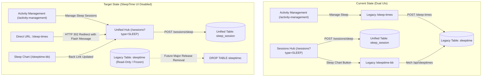

# Architecture & Migration Plan: Disabling the SleepTime UI

## 1. Executive Summary & Problem Diagnosis

### 1.1. Context & Motivation
In early versions of **Simon's Life Manager (SLM)**, sleep was tracked via a standalone entity [`SleepTime`](file:///home/simon/code/eclipse/slm/src/main/java/de/oberamsystems/slm/model/SleepTime.java) mapping to the `sleeptime` database table, managed by [`SleepTimeController`](file:///home/simon/code/eclipse/slm/src/main/java/de/oberamsystems/slm/controller/SleepTimeController.java) at `/sleep-times` and visualized on `/sleeptime-bb`.

With the introduction of the **Four Pillars Life Balance Model** ([ADR 011](file:///home/simon/code/eclipse/slm/DECISIONS.md#adr-011-sleep-tracking-unification-into-session-architecture--four-pillars-life-balance-model)) and **Native UUIDv7 Sessions** ([ADR 018](file:///home/simon/code/eclipse/slm/DECISIONS.md#adr-018-migration-of-polymorphic-session-hierarchy-to-native-postgresql-18-uuidv7)), sleep tracking was elevated to a first-class citizen within the polymorphic session hierarchy:
```java
@Entity
@Table(name = "sleep_session")
@DiscriminatorValue("SLEEP")
public class SleepSession extends Session
```
[`SleepSession`](file:///home/simon/code/eclipse/slm/src/main/java/de/oberamsystems/slm/model/SleepSession.java) provides:
- **Sleep Stages**: Deep sleep, REM sleep, and light sleep breakdown with auto-calculation.
- **Sleep Efficiency**: $\frac{\text{Net Asleep}}{\text{Gross in Bed}} \times 100\%$ via generated database interval columns.
- **Awake Disruptions**: Detailed nighttime wakefulness tracking via `break_duration`.
- **Quality & Notes**: 1–5 star sleep quality ratings, dream logs, and morning reflection notes.
- **24-Hour Life Balance**: Unified querying under the **Wellness** pillar in [`/sessions?type=SLEEP`](file:///home/simon/code/eclipse/slm/src/main/resources/templates/sessions.html).

### 1.2. Problem Statement
The legacy `SleepTime` UI remains active and accessible:
1. **Disjointed Navigation**: [`activity-management.html`](file:///home/simon/code/eclipse/slm/src/main/resources/templates/activity-management.html) still contains a "Sleep Times" card pointing users to `/sleep-times`.
2. **Dual-Writing / Data Fragmentation Risk**: Users can still access [`sleep-times.html`](file:///home/simon/code/eclipse/slm/src/main/resources/templates/sleep-times.html) and submit new records into the legacy `sleeptime` table via `POST /sleep-times`. These records do not benefit from sleep stages, ratings, or polymorphic session queries.
3. **Impediment to Schema Cleanup**: As long as the UI allows creating `SleepTime` entries, the legacy `sleeptime` table cannot be safely dropped.

### 1.3. Goal
**Disable the SleepTime UI now** so that:
- Users can no longer input or discover legacy `SleepTime` records through the UI.
- All sleep tracking is channeled through [`SleepSession`](file:///home/simon/code/eclipse/slm/src/main/java/de/oberamsystems/slm/model/SleepSession.java) at `/sessions?type=SLEEP`.
- Existing database tables (`sleeptime`), entities (`SleepTime`), and repositories (`SleepTimeRepository`) remain intact for backward compatibility until a future major release when they will be cleanly removed via database migration.

---

## 2. Transition Architecture & Flow Comparison



---

## 3. Detailed Implementation Proposals

### 3.1. Hub Navigation Update in [`activity-management.html`](file:///home/simon/code/eclipse/slm/src/main/resources/templates/activity-management.html)
Update the primary sleep management card:
- **Card Title**: `Sleep & Recovery` (or `Sleep Sessions`).
- **Description**: `Track sleep schedules, sleep stages (Deep, REM, Light), sleep quality, and recovery in the Unified Sessions Hub.`
- **Link URL**: `th:href="@{/sessions(type='SLEEP')}"`.
- **Button Label**: `Manage Sleep Sessions`.
- **Icon / Styling**: Retain `bi bi-moon-stars` and `border-primary` theme.

### 3.2. Disabling the Legacy `/sleep-times` Route (User Decision: Read-Only Deprecation View)

Based on user selection and instruction, [`sleep-times.html`](file:///home/simon/code/eclipse/slm/src/main/resources/templates/sleep-times.html) will transition into a **Read-Only Archive View** with the Create form preserved but disabled:
1. **Preserve Create Form Card with Disabled Button & Inputs**:
   - The `<section class="card slm-form-card mb-4">` is **retained**.
   - The submit button is explicitly disabled:
     ```html
     <button type="submit" class="btn btn-secondary px-4 fw-semibold" disabled title="SleepTime creation is disabled. Please use the Sessions Hub.">
         <i class="bi bi-slash-circle me-1"></i> Creation Disabled
     </button>
     ```
   - The datetime input fields (`gotobed`, `getup`) are marked with `disabled` (or `readonly`) to prevent stale edits while showing sample timestamps.
2. **Display Prominent Deprecation Banner**:
   - Add a high-visibility alert banner (`alert alert-warning border-0 shadow-sm d-flex align-items-center justify-content-between flex-wrap gap-3 mb-4`):
     - **Message**: *"Sleep tracking via legacy SleepTime is deprecated and disabled in preparation for future database removal. All ongoing sleep logs, sleep stages, and recovery metrics are managed in the Unified Sessions Hub."*
     - **Call-to-Action Button**: `<a th:href="@{/sessions(type='SLEEP')}" class="btn btn-primary fw-semibold"><i class="bi bi-moon-stars me-1"></i> Open Sleep Sessions Hub</a>`.
3. **Historical Data Table Retained**:
   - The table displaying past records from `sleeptime` is preserved in read-only mode.
4. **Form Submission Interception**:
   - If any external client, script, or browser modification attempts `POST /sleep-times`, [`SleepTimeController.java`](file:///home/simon/code/eclipse/slm/src/main/java/de/oberamsystems/slm/controller/SleepTimeController.java) rejects the write and redirects to `/sleep-times` with a flash error attribute: *"Logging legacy sleep times is disabled. Please create a Sleep Session instead."*

### 3.3. Hardening [`SleepTimeController.java`](file:///home/simon/code/eclipse/slm/src/main/java/de/oberamsystems/slm/controller/SleepTimeController.java)
```java
@Deprecated(since = "0.0.3-rc9", forRemoval = true)
@Controller
public class SleepTimeController {

    @Autowired
    private SleepTimeRepository repo;

    @GetMapping("/sleep-times")
    public String addSleepTimes(Model model) {
        model.addAttribute("sleeptimes", repo.findAll(Sort.by(Sort.Direction.DESC, "gotobed")));
        SleepTime st = new SleepTime();
        st.setGotobed(LocalDateTime.now().minusHours(9).truncatedTo(ChronoUnit.MINUTES));
        st.setGetup(LocalDateTime.now().truncatedTo(ChronoUnit.MINUTES));
        model.addAttribute("sleeptime", st);
        return "sleep-times";
    }

    @PostMapping("/sleep-times")
    public String submitSleepTimes(RedirectAttributes redirectAttributes) {
        redirectAttributes.addFlashAttribute("errorMessage",
                "Logging legacy sleep times is disabled. Please log sleep sessions via the Sessions Hub.");
        return "redirect:/sleep-times";
    }

    @GetMapping("/sleeptime-bb")
    public String sleepTimeC3(Model model) {
        model.addAttribute("sleeptimes", repo.findAll(Sort.by(Sort.Direction.DESC, "gotobed")));
        return "sleeptime-bb";
    }
}
```

### 3.4. Updating [`sleeptime-bb.html`](file:///home/simon/code/eclipse/slm/src/main/resources/templates/sleeptime-bb.html)
The header back-link currently points back to `/sleep-times`:
```html
<header th:replace="~{fragments/layout :: header('Sleep Analytics', 'Visual trend charts and historical sleep durations', 'bi bi-graph-up', 'theme-wellness', '/sleep-times', 'Sleep Times')}"></header>
```
Update to point to the modern Sessions Hub:
```html
<header th:replace="~{fragments/layout :: header('Sleep Analytics', 'Visual trend charts and historical sleep durations', 'bi bi-graph-up', 'theme-wellness', '/sessions?type=SLEEP', 'Sleep Sessions')}"></header>
```
Also add a deprecation alert notice on `sleeptime-bb.html` indicating that this chart reflects legacy historical records, while ongoing sleep tracking takes place on the Sessions Hub.

### 3.5. Deprecation Annotations Across Legacy Java Artifacts
Add `@Deprecated(since = "0.0.3-rc9", forRemoval = true)` and explanatory Javadocs across:
1. [`SleepTime.java`](file:///home/simon/code/eclipse/slm/src/main/java/de/oberamsystems/slm/model/SleepTime.java)
2. [`SleepTimeRepository.java`](file:///home/simon/code/eclipse/slm/src/main/java/de/oberamsystems/slm/model/SleepTimeRepository.java)
3. [`SleepTimeController.java`](file:///home/simon/code/eclipse/slm/src/main/java/de/oberamsystems/slm/controller/SleepTimeController.java)
4. [`SleepTimeRestController.java`](file:///home/simon/code/eclipse/slm/src/main/java/de/oberamsystems/slm/controller/SleepTimeRestController.java)

---

## 4. Roadmap to Full Removal (Later Major Release)

| Phase | Target Version | Scope of Work |
| :--- | :--- | :--- |
| **Phase 1 (This Task)** | **`v0.0.3-rc9`** | **Disable SleepTime UI**: Redirect `/sleep-times` to `/sessions?type=SLEEP`, update `activity-management.html`, deprecate Java classes for removal, keep database schema and repositories intact. |
| **Phase 2 (Major Release)** | **`v1.0.0`** (or next major) | **Complete Code & Schema Removal**: <br>1. Drop database table `sleeptime` via migration script.<br>2. Delete `SleepTime.java`, `SleepTimeRepository.java`, `SleepTimeController.java`, `SleepTimeRestController.java`.<br>3. Delete template files `sleep-times.html` and `sleeptime-bb.html`.<br>4. Clean up `tables.sql`, `init.sql`, and `schema-init.sql`. |

---

## 5. Verification & Test Plan

1. **Integration Tests Updates (`WellnessAndHabitsIT.java`)**:
   - Update `testSleepTimeWebAndRestFlow()`:
     - `GET /sleep-times` expects `status().isOk()`, `view().name("sleep-times")`, and `model().attributeExists("sleeptimes", "sleeptime")` (with `sleeptime` model attribute populated for the read-only form).
     - `POST /sleep-times` expects `status().is3xxRedirection()`, `redirectedUrl("/sleep-times")`, and `flash().attributeExists("errorMessage")`, confirming that any legacy write attempts are rejected without creating new `SleepTime` rows in the database (`assertEquals(0, sleepTimeRepository.count())`).
   - Retain `SleepTimeIT.java` to verify that `SleepTime` entity and JPA mapping remain functional until Phase 2 removal.
2. **Unit Tests Updates (`SleepTimeControllerTest.java`)**:
   - Verify `addSleepTimes` adds `sleeptimes` list and `sleeptime` object and returns `"sleep-times"`.
   - Verify `submitSleepTimes` adds flash error attribute and returns `"redirect:/sleep-times"` without calling `repo.save(...)`.
3. **Regression Check**:
   - Run full test suite:
     ```bash
     JAVA_HOME=/usr/lib/jvm/java-21-openjdk ./gradlew test -x jacocoTestReport -x compileAotTestJava
     ```
4. **Browser / Manual Verification**:
   - Click "Manage Sleep Sessions" on `/activity-management` $\rightarrow$ navigates to `/sessions?type=SLEEP`.
   - Directly navigate to `http://localhost:8080/sleep-times` $\rightarrow$ shows deprecation banner with button to Sessions Hub, the form card with a disabled submit button and disabled inputs, and the table of historical records.
