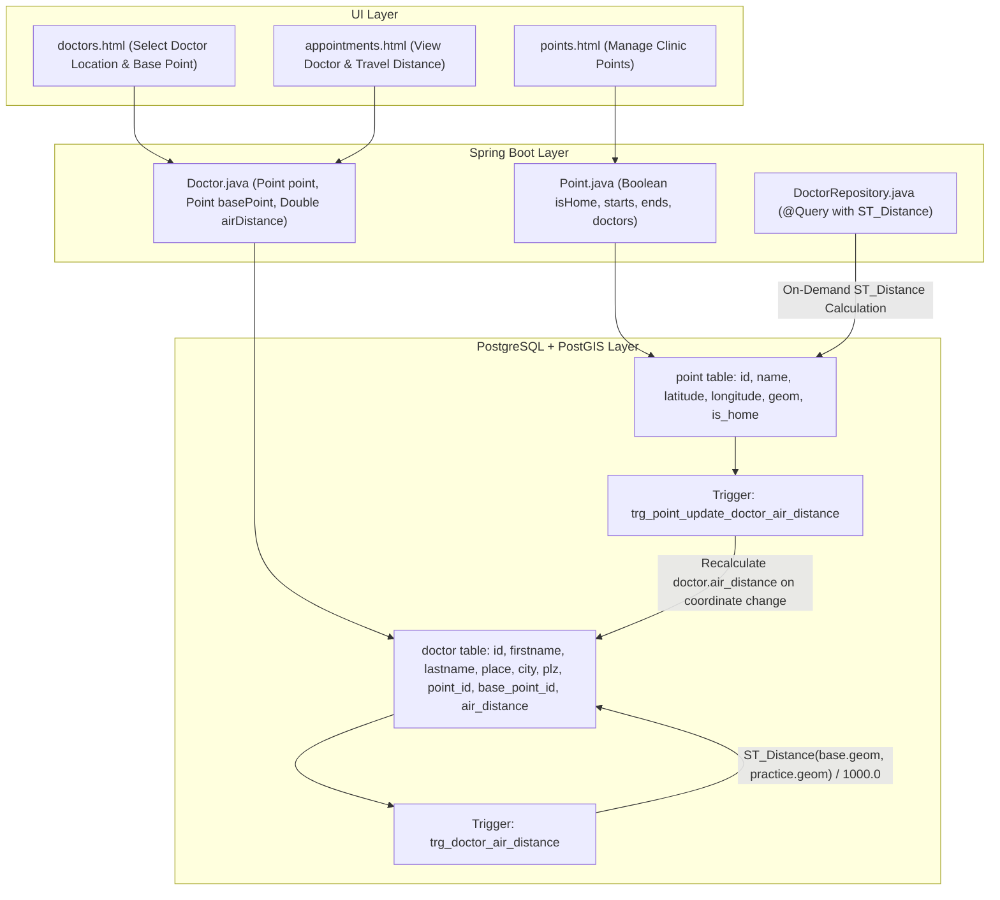

# Plan: Doctor Integration with Geographic Points & PostGIS Air Distance Calculation

## 1. Problem Statement & Analysis

### Current State
In the current application:
- `Doctor` (`doctor` table) contains a manual `air_distance REAL` field:
  ```sql
  CREATE TABLE doctor (
      id BIGSERIAL PRIMARY KEY,
      firstname TEXT,
      lastname TEXT,
      speciality BIGINT NOT NULL REFERENCES speciality(id),
      place TEXT,
      city TEXT,
      plz TEXT,
      air_distance REAL
  );
  ```
- In `Doctor.java`, this is mapped as a primitive `float airDistance`.
- In `doctors.html`, the user is forced to manually enter `airDistance` with `<input type="number" step="0.001" id="airDistance" th:field="*{airDistance}" required>`.
- In the existing live database, the 4 recorded doctors have manual air distances:
  - **Dr. Emaine Aliosman** (`Badstraße 3, Lichtenau`): `1.0 km`
  - **Dr. Ulrich Wilms** (`Draisstraße 2, Ansbach`): `7.5 km`
  - **Dr. Bettina Waßer** (`Neuendettelsau`): `8.58 km`
  - **Dr. Vera Gabriel** (`Feuchtwanger Str. 38, Ansbach`): `8.58 km`

### Geographic Finding
These air distances are precisely the geodesic distances from the user's primary residence / base point:
**`Point #1: Haus Mama` (Königsberger Str. 7, 91586 Lichtenau; Lat: `49.284581`, Lon: `10.681444`)**:
- Distance to Badstraße 3, Lichtenau (~`49.2785, 10.6865`): ~`0.78 km` (rounded to `1 km`)
- Distance to Draisstraße 2, Ansbach (~`49.3087, 10.5847`): ~`7.53 km` (recorded as `7.5 km`)
- Distance to Neuendettelsau (~`49.2850, 10.7880`): ~`8.58 km` (exact match!)
- Distance to Feuchtwanger Str. 38, Ansbach (~`49.2968, 10.5645`): ~`8.58 km` (exact match!)

### Objectives
1. **Integrate Doctors into Geographic Points (`point`)**:
   - Unify locations so a doctor's clinic/practice is a first-class `Point` with coordinates and PostGIS `geography(Point, 4326)` spatial geometry.
   - Avoid duplicate coordinate handling and enable reusability (e.g. creating a `Route` to a doctor's clinic for car trip mileage).
2. **Automate Air Distance via PostGIS**:
   - Eliminate manual data entry of `air_distance` in `doctors.html`.
   - Calculate exact geodesic air distance on the WGS 84 ellipsoid using `ST_Distance(home.geom, doctor_practice.geom) / 1000.0`.
3. **Preserve Compatibility & Clean Migration**:
   - Migrate existing doctor records without data loss by creating corresponding `Point` entries for their clinics.

---

## 2. Architecture & Design Options



### Comparison of Approaches

| Feature | Option A: Doctor References `Point` + Home Base Point (Recommended) | Option B: Doctor Embeds Coordinates Directly (`lat`, `lon`, `geom`) | Option C: Doctor Automatically Creates a `Route` to Home |
| :--- | :--- | :--- | :--- |
| **Point Integration** | **High**: Doctor practice is a reusable `Point`. Available in route planning, travel logs, and maps. | **Low**: Duplicates coordinates in `doctor`; not reusable in `Route` or `CarTrip`. | **Medium**: Creates both a `Point` and a `Route` record for each doctor. |
| **Reference Origin** | Configurable via `base_point_id` (defaults to point marked `is_home = true`, e.g. `Haus Mama`). | Hardcoded or requires home coordinates in doctor table. | Uses route `start_point` as home. |
| **Air Distance Accuracy** | Computed automatically via PostGIS geodesic `ST_Distance` on WGS 84 ellipsoid. | Computed via PostGIS trigger between doctor coordinates and home point. | Stored in route table and referenced by doctor. |
| **Data Normalization** | **Normalized**: Addresses and coordinates live in `point`, doctor profile lives in `doctor`. | Denormalized: Duplicates spatial geometry. | Redundant: Creates unnecessary route entities if only air distance is needed. |
| **Form UX** | Clean dropdown to select practice location (or quick-select from existing clinics). Manual `airDistance` removed. | Must type lat/lon for every doctor. | More complex form with route creation. |

> [!TIP]
> **Recommendation: Option A** provides the cleanest architectural synergy. By marking the primary residence with `is_home = TRUE` in `point`, any doctor linked to a practice `Point` automatically gets its `air_distance` calculated from Home via PostGIS, while still allowing an optional custom `base_point_id` if the user travels from another residence or office.

---

## 3. Database Schema Changes & Migration

### Step 1: Versioned Migration Script (`src/main/resources/migration_2026-10-18_2.sql`)
> [!IMPORTANT]
> The existing `migration_2026-10-18.sql` file will remain completely untouched. This new migration is saved into `src/main/resources/migration_2026-10-18_2.sql`.

1. **Add `is_home` Flag to `point` Table**:
   ```sql
   ALTER TABLE point ADD COLUMN IF NOT EXISTS is_home BOOLEAN DEFAULT FALSE;

   -- Mark 'Haus Mama' as the default home reference point
   UPDATE point SET is_home = TRUE WHERE id = 1 OR name ILIKE '%mama%' OR name ILIKE '%home%';
   ```

2. **Add `point_id` and `base_point_id` Foreign Keys to `doctor`**:
   ```sql
   ALTER TABLE doctor
       ADD COLUMN IF NOT EXISTS point_id BIGINT REFERENCES point(id),
       ADD COLUMN IF NOT EXISTS base_point_id BIGINT REFERENCES point(id);

   -- Alter air_distance to DOUBLE PRECISION to match Route.airDistance
   ALTER TABLE doctor ALTER COLUMN air_distance TYPE DOUBLE PRECISION;
   ```

3. **Migrate Existing 4 Doctors into `point` Records**:
   Insert the doctor practices into `point` with coordinates and link them:
   ```sql
   -- 1. Dr. Emaine Aliosman (Badstraße 3, 91586 Lichtenau)
   INSERT INTO point (name, description, latitude, longitude)
   VALUES ('Praxis Dr. Emaine Aliosman', 'Badstraße 3, 91586 Lichtenau', 49.278500, 10.686500)
   ON CONFLICT DO NOTHING;

   -- 2. Dr. Ulrich Wilms (Draisstraße 2, 91522 Ansbach)
   INSERT INTO point (name, description, latitude, longitude)
   VALUES ('Praxis Dr. Ulrich Wilms', 'Draisstraße 2, 91522 Ansbach', 49.308700, 10.584700)
   ON CONFLICT DO NOTHING;

   -- 3. Dr. Bettina Waßer (Neuendettelsau)
   INSERT INTO point (name, description, latitude, longitude)
   VALUES ('Praxis Dr. Bettina Waßer', 'Neuendettelsau', 49.285000, 10.788000)
   ON CONFLICT DO NOTHING;

   -- 4. Dr. Vera Gabriel (Feuchtwanger Str. 38, 91522 Ansbach)
   INSERT INTO point (name, description, latitude, longitude)
   VALUES ('Praxis Dr. Vera Gabriel', 'Feuchtwanger Str. 38, 91522 Ansbach', 49.296800, 10.564500)
   ON CONFLICT DO NOTHING;

   -- Link existing doctors to their newly created points
   UPDATE doctor SET point_id = (SELECT id FROM point WHERE name = 'Praxis Dr. Emaine Aliosman') WHERE lastname ILIKE '%Aliosman%';
   UPDATE doctor SET point_id = (SELECT id FROM point WHERE name = 'Praxis Dr. Ulrich Wilms') WHERE lastname ILIKE '%Wilms%';
   UPDATE doctor SET point_id = (SELECT id FROM point WHERE name = 'Praxis Dr. Bettina Waßer') WHERE lastname ILIKE '%Waßer%';
   UPDATE doctor SET point_id = (SELECT id FROM point WHERE name = 'Praxis Dr. Vera Gabriel') WHERE lastname ILIKE '%Gabriel%';

   -- Set default base_point_id to Haus Mama (ID 1)
   UPDATE doctor SET base_point_id = 1 WHERE base_point_id IS NULL;
   ```

4. **PostGIS Triggers for Automated Geodesic Distance**:
   ```sql
   CREATE OR REPLACE FUNCTION calculate_doctor_air_distance()
   RETURNS TRIGGER AS $$
   DECLARE
       practice_geom geography;
       origin_geom geography;
       origin_id bigint;
   BEGIN
       -- Determine origin point: use base_point_id if provided, else look up point where is_home = TRUE
       origin_id := NEW.base_point_id;
       IF origin_id IS NULL THEN
           SELECT id INTO origin_id FROM point WHERE is_home = TRUE LIMIT 1;
       END IF;

       IF NEW.point_id IS NOT NULL AND origin_id IS NOT NULL THEN
           SELECT geom INTO practice_geom FROM point WHERE id = NEW.point_id;
           SELECT geom INTO origin_geom FROM point WHERE id = origin_id;

           IF practice_geom IS NOT NULL AND origin_geom IS NOT NULL THEN
               NEW.air_distance := ROUND((ST_Distance(origin_geom, practice_geom) / 1000.0)::numeric, 2);
           END IF;
       END IF;
       RETURN NEW;
   END;
   $$ LANGUAGE plpgsql;

   DROP TRIGGER IF EXISTS trg_doctor_air_distance ON doctor;
   CREATE TRIGGER trg_doctor_air_distance
   BEFORE INSERT OR UPDATE OF point_id, base_point_id ON doctor
   FOR EACH ROW
   EXECUTE FUNCTION calculate_doctor_air_distance();

   -- Recalculate doctor air distances if point coordinates are updated
   CREATE OR REPLACE FUNCTION update_doctor_air_distances_on_point_change()
   RETURNS TRIGGER AS $$
   BEGIN
       UPDATE doctor SET air_distance = air_distance WHERE point_id = NEW.id OR base_point_id = NEW.id;
       RETURN NEW;
   END;
   $$ LANGUAGE plpgsql;

   DROP TRIGGER IF EXISTS trg_point_update_doctor_air_distance ON point;
   CREATE TRIGGER trg_point_update_doctor_air_distance
   AFTER UPDATE OF latitude, longitude ON point
   FOR EACH ROW
   EXECUTE FUNCTION update_doctor_air_distances_on_point_change();

   -- Recalculate existing doctors
   UPDATE doctor SET air_distance = air_distance;
   ```

---

## 4. Java Application Changes

### 1. [`Point.java`](file:///home/simon/code/eclipse/slm/src/main/java/de/oberamsystems/slm/model/Point.java)
- Add `private Boolean isHome = false;` with getter and setter.
- Add `@OneToMany(mappedBy = "point") private List<Doctor> doctors = new ArrayList<>();`.

### 2. [`Doctor.java`](file:///home/simon/code/eclipse/slm/src/main/java/de/oberamsystems/slm/model/Doctor.java)
- Change `private float airDistance;` to `private Double airDistance;`.
- Add:
  ```java
  @ManyToOne
  @JoinColumn(name = "point_id", referencedColumnName = "id")
  private Point point;

  @ManyToOne
  @JoinColumn(name = "base_point_id", referencedColumnName = "id")
  private Point basePoint;
  ```
- Update constructors, getters, and setters (`getPoint()`, `setPoint(Point point)`, `getBasePoint()`, `setBasePoint(Point basePoint)`).

### 3. [`DoctorRepository.java`](file:///home/simon/code/eclipse/slm/src/main/java/de/oberamsystems/slm/model/DoctorRepository.java)
- Add native PostGIS helper method:
  ```java
  @Query(value = "SELECT ROUND((ST_Distance(p1.geom, p2.geom) / 1000.0)::numeric, 2) " +
                 "FROM point p1, point p2 WHERE p1.id = :originId AND p2.id = :practiceId", nativeQuery = true)
  Double calculateAirDistance(@Param("originId") Long originId, @Param("practiceId") Long practiceId);
  ```

### 4. [`DoctorController.java`](file:///home/simon/code/eclipse/slm/src/main/java/de/oberamsystems/slm/controller/DoctorController.java)
- Inject `PointRepository pointRepo`.
- In `addDoctors(Model model)`:
  - Add `model.addAttribute("points", pointRepo.findAll());`.
  - Add `model.addAttribute("homePoint", pointRepo.findByIsHomeTrue().orElse(null));` (or first point as default).
- In `submitDoctors(@ModelAttribute Doctor doc, Model model)`:
  - If `doc.getPoint() != null`, automatically calculate `airDistance` via repository query or let the trigger handle it.
  - If `doc.getBasePoint() == null`, default to the home point.

---

## 5. UI & View Updates

### 1. [`doctors.html`](file:///home/simon/code/eclipse/slm/src/main/resources/templates/doctors.html)
- **Table**:
  - Add **Practice Location** column showing `e.point != null ? e.point.name : '—'` with a link to `/points`.
  - Display `Air Dist` formatted as `${e.airDistance != null ? e.airDistance + ' km' : '—'}`.
- **Form ("Add Doctor")**:
  - Add **Practice Location Point** `<select id="point" th:field="*{point}">` populated with all points from `${points}`.
  - Add optional **Origin Point** `<select id="basePoint" th:field="*{basePoint}">` (pre-selected to Home).
  - Remove manual `airDistance` required number input.
  - Add PostGIS info card explaining that air distance from Home is automatically calculated via geodesic PostGIS distance.

### 2. [`doctor.html`](file:///home/simon/code/eclipse/slm/src/main/resources/templates/doctor.html)
- Update to display the linked point and formatted `airDistance`.

### 3. [`points.html`](file:///home/simon/code/eclipse/slm/src/main/resources/templates/points.html)
- Add a badge or checkbox for `isHome` (`Primary Residence / Home Base`).

---

## 6. Implementation Steps

```
[1] Database Migration
    ├── Create src/main/resources/migration_2026-10-18_2.sql (preserving migration_2026-10-18.sql)
    ├── Add is_home to point table
    ├── Add point_id and base_point_id to doctor table
    ├── Insert clinic points for existing 4 doctors
    ├── Create calculate_doctor_air_distance() trigger
    └── Update tables.sql baseline schema

[2] Java Backend
    ├── Update Point.java (isHome, doctors list)
    ├── Update PointRepository.java (findByIsHomeTrue)
    ├── Update Doctor.java (Point point, Point basePoint, Double airDistance)
    ├── Update DoctorRepository.java (calculateAirDistance native query)
    └── Update DoctorController.java (points model attribute and auto-distance calculation)

[3] Thymeleaf UI
    ├── Update doctors.html (Point dropdown, PostGIS banner, remove manual airDistance)
    ├── Update doctor.html (clean display of point & distance)
    └── Update points.html (Home badge indicator)

[4] Verification
    ├── Run ./gradlew test -x jacocoTestReport -x compileAotTestJava
    ├── Verify existing doctor air distances (1 km, 7.5 km, 8.58 km) via psql
    ├── Restart Spring Boot daemon
    └── Verify in browser via browser_subagent (/doctors and /points)
```

---

## 7. Verification & Testing Plan

| Test Case | Method | Expected Result |
| :--- | :--- | :--- |
| **Existing Doctor Distances** | Query `SELECT firstname, lastname, air_distance FROM doctor;` | Dr. Aliosman ~0.78 km, Dr. Wilms ~7.53 km, Dr. Waßer ~8.58 km, Dr. Gabriel ~8.58 km |
| **Gradle Test Suite** | `./gradlew test -x jacocoTestReport -x compileAotTestJava` | All controller and generic model tests pass without errors |
| **Web UI: Register Doctor with Point** | Navigate to `/doctors`, select Speciality, enter name & address, select Practice Point | Doctor is saved; air distance is auto-calculated and displayed with `km` unit |
| **Point Coordinate Update Trigger** | Update coordinates of a practice point in `/points` | Linked doctor's `air_distance` updates automatically via database trigger |
| **Changelog Documentation** | Update `CHANGELOG.md` | Keep a Changelog entry under `[0.0.2a] - 2026-10-18` |
