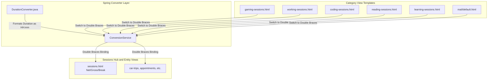

# Plan: Standardize Duration Formatting to `HH:mm` and Fix `PT...` Display

## 1. Problem Overview & Root Cause Analysis

### Problem Description
1. **Raw ISO String in Gaming Sessions**: In the **Gaming Sessions** table (`/gaming-sessions`), the **Net Duration** column displays raw ISO-8601 strings like `PT6H` or `PT1H30M` instead of a user-friendly `HH:mm` time format (e.g. `06:00`).
2. **Second Precision in Sessions Hub**: In the **Sessions Hub** (`/sessions`), Net Duration, Gross Duration, and Break Duration are displayed with second-level precision (`HH:mm:ss`, e.g. `06:00:00` or `Gross: 01:45:00`).

### Root Causes
1. **Single Curly Braces `${...}` vs Double Curly Braces `${{...}}` in Category Templates**:
   - In [`gaming-sessions.html`](file:///home/simon/code/eclipse/slm/src/main/resources/templates/gaming-sessions.html#L114-L116), [`working-sessions.html`](file:///home/simon/code/eclipse/slm/src/main/resources/templates/working-sessions.html#L136-L138), [`coding-sessions.html`](file:///home/simon/code/eclipse/slm/src/main/resources/templates/coding-sessions.html#L129-L131), [`reading-sessions.html`](file:///home/simon/code/eclipse/slm/src/main/resources/templates/reading-sessions.html#L125-L127), and [`learning-sessions.html`](file:///home/simon/code/eclipse/slm/src/main/resources/templates/learning-sessions.html#L103-L105), the templates use single curly braces `th:text="${s.netDuration != null ? s.netDuration : ...}"` and `th:text="${s.breakDuration != null ? s.breakDuration : '0m'}"`.
   - Thymeleaf evaluates single braces by invoking `Duration.toString()`, outputting standard ISO-8601 strings (`PT6H`, `PT15M`, `PT0S`).
   - Using double curly braces `th:text="${{ ... }}"` routes the value through Spring's registered `ConversionService` (`DurationConverter`).
2. **`DurationConverter` Hardcoded Second Precision (`HH:mm:ss`)**:
   - [`DurationConverter.java`](file:///home/simon/code/eclipse/slm/src/main/java/de/oberamsystems/slm/DurationConverter.java#L27) formats `Duration` using:
     ```java
     str = str + String.format("%02d", hours) + ":" + String.format("%02d", minutes) + ":" + String.format("%02d", seconds);
     ```
   - In [`sessions.html`](file:///home/simon/code/eclipse/slm/src/main/resources/templates/sessions.html#L295-L301), double curly braces `${{s.netDuration != null ? s.netDuration : s.duration}}` and `${{s.duration}}` are used, which causes all durations to render with seconds (`HH:mm:ss`).

---

## 2. Proposed Changes



### A. Core Converter Layer
Update [`DurationConverter.java`](file:///home/simon/code/eclipse/slm/src/main/java/de/oberamsystems/slm/DurationConverter.java):
- Remove `seconds` calculation and format string `:ss`.
- Format as `String.format("%02d:%02d", hours, minutes)` (with optional `days + "D "` prefix).
- Add null-safety handling (`if (source == null) return "";`).
- Update unit tests in [`DurationConverterTest.java`](file:///home/simon/code/eclipse/slm/src/test/java/de/oberamsystems/slm/DurationConverterTest.java) to assert `"2D 05:15"` and `"03:05"`.

```diff
--- a/src/main/java/de/oberamsystems/slm/DurationConverter.java
+++ b/src/main/java/de/oberamsystems/slm/DurationConverter.java
@@ -14,14 +14,16 @@ public class DurationConverter implements Converter<Duration, String> {
 	@Override
 	public String convert(Duration source) {
+		if (source == null) {
+			return "";
+		}
 		log.trace(source.toString());
+		Duration abs = source.abs();
+		String str = source.isNegative() ? "-" : "";
+		long days = abs.toDaysPart();
+		int hours = abs.toHoursPart();
+		int minutes = abs.toMinutesPart();
 		
 		if (days != 0) {
-			str = str + String.valueOf(days) + "D ";
+			str = str + days + "D ";
 		}
 		
-		str = str + String.format("%02d", hours) + ":" + String.format("%02d", minutes)+ ":" + String.format("%02d", seconds);
+		str = str + String.format("%02d:%02d", hours, minutes);
 		return str;
 	}
```

### B. Template Adjustments: Convert from `${...}` to `${{...}}`
Enable Spring ConversionService formatting across all session category templates:
1. **[`gaming-sessions.html`](file:///home/simon/code/eclipse/slm/src/main/resources/templates/gaming-sessions.html)**:
   - Line 114: `th:text="${{s.netDuration != null ? s.netDuration : s.duration}}"`
   - Line 116: `th:text="${{s.breakDuration}}"`
2. **[`working-sessions.html`](file:///home/simon/code/eclipse/slm/src/main/resources/templates/working-sessions.html)**:
   - Line 136: `th:text="${{s.netDuration != null ? s.netDuration : s.duration}}"`
   - Line 138: `th:text="${{s.breakDuration}}"`
3. **[`coding-sessions.html`](file:///home/simon/code/eclipse/slm/src/main/resources/templates/coding-sessions.html)**:
   - Line 129: `th:text="${{s.netDuration != null ? s.netDuration : s.duration}}"`
   - Line 131: `th:text="${{s.breakDuration}}"`
4. **[`reading-sessions.html`](file:///home/simon/code/eclipse/slm/src/main/resources/templates/reading-sessions.html)**:
   - Line 125: `th:text="${{e.netDuration != null ? e.netDuration : e.duration}}"`
   - Line 127: `th:text="${{e.breakDuration}}"`
5. **[`learning-sessions.html`](file:///home/simon/code/eclipse/slm/src/main/resources/templates/learning-sessions.html)**:
   - Line 103: `th:text="${{e.netDuration != null ? e.netDuration : e.duration}}"`
   - Line 105: `th:text="${{e.breakDuration}}"`
6. **[`templates/mail/default.html`](file:///home/simon/code/eclipse/slm/src/main/resources/templates/mail/default.html)** and [`runtime/templates/mail/default.html`](file:///home/simon/code/eclipse/slm/runtime/templates/mail/default.html):
   - Line 26: `th:text="${{e.duration}}"`

---

## 3. Verification & Testing Plan

| Verification Step | Target / Command | Expected Result |
| :--- | :--- | :--- |
| **Unit Tests** | `./gradlew test -x jacocoTestReport -x compileAotTestJava` | All test suites (including `DurationConverterTest`) pass cleanly |
| **Browser Check: Gaming Sessions** | Navigate to `http://localhost:8080/sessions?type=GAMING` and `/gaming-sessions` | Net Duration displays as `HH:mm` (e.g. `06:00`), no `PT...` |
| **Browser Check: Sessions Hub** | Navigate to `http://localhost:8080/sessions` | Net Duration, Gross Duration, and Breaks display as `HH:mm` (e.g. `06:00`, `Gross: 06:15`, `00:15`) |
| **Browser Check: Working & Coding** | Navigate to `http://localhost:8080/working-sessions` & `/coding-sessions` | Displays `HH:mm` format consistently |
