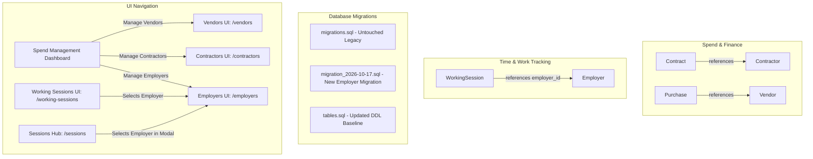

# Implementation Plan: Disentangle Contractor and Introduce Employer

## 1. Context & Motivation

In the current domain model:
- `Contractor` is used for commercial contracts, recurring service providers, utilities, and insurers (e.g., *Vodafone*, *Telekom*, *Allianz*, *Netflix*).
- However, `WorkingSession` previously referenced `Contractor` (as `client`) for billable professional work sessions.
- As requested, professional employment/client tracking should be disentangled from expense/contract tracking by introducing a dedicated **`Employer`** entity, table, controller, and UI, while updating `WorkingSession` to reference `employer` (`employer_id`).
- Migrations are now **versioned**: future migrations will be saved in timestamped SQL files (e.g., `src/main/resources/migration_2026-10-17.sql`), leaving the legacy `migrations.sql` untouched.

---

## 2. Architecture & Data Flow



---

## 3. Step-by-Step Execution Plan

### Step 1: Versioned Database Migration
1. **Create `src/main/resources/migration_2026-10-17.sql`** (leaving `migrations.sql` untouched):
   ```sql
   -- Migration: 2026-10-17 Introduce Employer table and update working_session
   BEGIN;

   CREATE TABLE IF NOT EXISTS employer (
       id BIGSERIAL PRIMARY KEY,
       name TEXT NOT NULL
   );

   ALTER TABLE working_session DROP CONSTRAINT IF EXISTS working_session_contractor_id_fkey;
   DROP INDEX IF EXISTS idx_working_session_contractor;

   ALTER TABLE working_session RENAME COLUMN contractor_id TO employer_id;

   ALTER TABLE working_session 
       ADD CONSTRAINT working_session_employer_id_fkey 
       FOREIGN KEY (employer_id) REFERENCES employer(id) ON DELETE SET NULL;

   CREATE INDEX IF NOT EXISTS idx_working_session_employer ON working_session(employer_id);

   COMMIT;
   ```
2. **Apply migration to local PostgreSQL database:**
   Execute `migration_2026-10-17.sql` on the `slm` database.
3. **Synchronize `src/main/resources/tables.sql`:**
   Add `CREATE TABLE employer (...)` and update `working_session.employer_id` so fresh database setups remain complete.

---

### Step 2: Domain Model & Repository
1. **Create `Employer.java`** in `de.oberamsystems.slm.model`:
   - `@Entity`, `@Table(name = "employer")`
   - Fields: `Long id` (`@Id`, `@GeneratedValue(strategy = GenerationType.IDENTITY)`), `String name`.
   - Default constructor, parameterized constructor, standard getters, and setters.
2. **Create `EmployerRepository.java`** in `de.oberamsystems.slm.model`:
   - `public interface EmployerRepository extends JpaRepository<Employer, Long> {}`
3. **Update `WorkingSession.java`**:
   - Replace `private Contractor client;` with:
     ```java
     @ManyToOne
     @JoinColumn(name = "employer_id", referencedColumnName = "id")
     private Employer employer;
     ```
   - Update constructors and provide `getEmployer()` / `setEmployer(Employer employer)`.
4. **Update `WorkingSessionRepository.java`**:
   - Change finder method to `List<WorkingSession> findByEmployer(Employer employer);`.

---

### Step 3: Controller & Security Configuration
1. **Create `EmployerController.java`** in `de.oberamsystems.slm.controller`:
   - `@GetMapping("/employers")`: Populates `model.addAttribute("employers", employerRepo.findAll())` and an empty `Employer` model attribute, returning `"employers"`.
   - `@PostMapping("/employers")`: Saves `Employer` and redirects to `"/employers"`.
2. **Update `SessionController.java`**:
   - Replace `ContractorRepository contractorRepo` with `EmployerRepository employerRepo`.
   - In `viewWorkingSessions(Model model)`: Populate `model.addAttribute("employers", employerRepo.findAll())`.
   - In `viewSessions(...)`: Populate `model.addAttribute("employers", employerRepo.findAll())`.
3. **Update `SecurityConfig.java`**:
   - Add `"/employers"` to public request matchers in `securityFilterChain`.

---

### Step 4: UI Modernization & Templates
1. **Create `employers.html`** (`src/main/resources/templates/employers.html`):
   - Modernized UI using `fragments/layout.html` (`header`, `standard-head`, `footer`).
   - Displays configured employers table (ID, Name, count badge).
   - "Add Employer" card with form submitting to `th:action="@{/employers}"`.
2. **Update `spend-management.html`**:
   - In the "Commercial Partners & Vendors" section, expand to a 3-column card grid:
     1. **Store & Service Vendors** (`/vendors`) with icon `bi bi-shop`
     2. **Service Contractors** (`/contractors`) with icon `bi bi-building` (telecom, utilities, insurance)
     3. **Employers & Clients** (`/employers`) with icon `bi bi-briefcase` (employment & client billing)
3. **Update `working-sessions.html`**:
   - Form: Label "Employer / Client <span class='text-danger'>*</span>".
   - Select: `th:field="*{employer}"` populated from `${employers}`.
   - Table: Display `${s.employer.name}`.
4. **Update `sessions.html` (Sessions Hub)**:
   - In `#form-working` modal: bind to `th:field="*{employer}"` using `${employers}`.
   - In sessions table: display `${s.employer.name}` for working sessions.

---

### Step 5: Testing & Automated Verification
1. **Unit Tests:**
   - Create `EmployerControllerTest.java` verifying GET `/employers` and POST `/employers`.
   - Update `WorkingSessionTest.java` and `SessionControllerTest.java` to use `Employer`.
2. **Automated Gradle Build:**
   - Run `./gradlew test -x jacocoTestReport` to confirm all unit and controller tests pass.

---

### Step 6: Live Browser Verification
1. Start/restart Spring Boot application (`bootRun`).
2. Use browser subagent to:
   - Navigate to `/spend-management` and confirm the new **Employers & Clients** button.
   - Click through to `/employers` and create an employer (e.g., `Acme Innovations`).
   - Navigate to `/working-sessions`, select `Acme Innovations`, and log a new working session.
   - Verify that the session is displayed in the table with `Acme Innovations`.
   - Capture a screenshot confirming UI appearance and functionality.

---

### Step 7: Documentation
1. Document the separation between `Contractor` (expenses/contracts) and `Employer` (income/work) in `DECISIONS.md`.
2. Update `CHANGELOG.md` under `[Unreleased]`.
