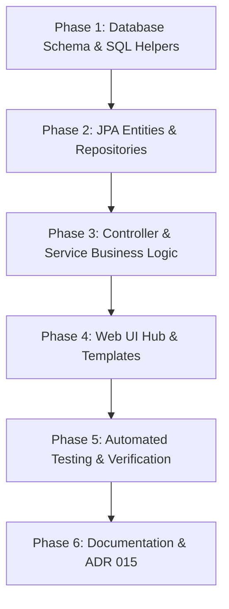

# Implementation Plan: Life Events, Anniversaries & Memorials System

## Executive Summary
Currently, SLM models human dates solely as a single `birthday: DATE` on the `Human` entity, computing `daysUntilBirthday` and `age` via PostgreSQL formula helper functions.
This implementation plan establishes a first-class **Life Events & Anniversaries** architecture supporting:
- 🎂 **Birthdays** (birth date, age milestones)
- 🕯️ **Memorials & Death Dates** (remembering deceased contacts, years since passing, contact deceased status tracking)
- 💍 **Relationship & Wedding Anniversaries** (linking primary and optional secondary partners, anniversary milestone tracking like Silver/Golden wedding)
- 💼 **Career & Work Anniversaries** (workplace start date, years of service)
- ⭐ **Custom Annual Milestones** (graduation, sobriety, house purchase, baptism)

---

## 1. Domain Architecture & Data Model

### 1.1 New Enum: `EventType`
Added to [`src/main/resources/enums.sql`](file:///home/simon/code/eclipse/slm/src/main/resources/enums.sql):
```sql
CREATE TYPE event_type AS ENUM (
    'BIRTHDAY',
    'MEMORIAL',
    'WEDDING_ANNIVERSARY',
    'RELATIONSHIP_ANNIVERSARY',
    'WORK_ANNIVERSARY',
    'CUSTOM'
);
```

Mapped in Java via:
```java
package de.oberamsystems.slm.model;

public enum EventType {
    BIRTHDAY("Birthday", "bi-cake2", "text-primary"),
    MEMORIAL("Memorial / Remembrance", "bi-candle", "text-secondary"),
    WEDDING_ANNIVERSARY("Wedding Anniversary", "bi-heart", "text-danger"),
    RELATIONSHIP_ANNIVERSARY("Relationship Anniversary", "bi-stars", "text-warning"),
    WORK_ANNIVERSARY("Career Milestone", "bi-briefcase", "text-info"),
    CUSTOM("Custom Anniversary", "bi-calendar-event", "text-success");

    private final String displayName;
    private final String iconClass;
    private final String colorClass;
    // Constructor and getters...
}
```

---

### 1.2 Enhancing the `Human` Entity
We extend `Human` with death tracking to distinguish between living contacts and deceased persons:
1. **`death_date DATE`**: Optional date of death / passing.
2. **`is_deceased BOOLEAN`** (formula / derived): `CASE WHEN death_date IS NOT NULL THEN TRUE ELSE FALSE END`.
3. **`ageAtDeath INTEGER`** (formula): `date_part('year', age(death_date, birthday))` when deceased, preserving historic accuracy without ticking up active age indefinitely.
4. **`events` relationship**: `@OneToMany(mappedBy = "human", cascade = CascadeType.ALL, orphanRemoval = true)`.

---

### 1.3 New Entity: `HumanEvent`
Table `human_event` in PostgreSQL:
```sql
CREATE TABLE human_event (
    id BIGSERIAL PRIMARY KEY,
    human_id BIGINT NOT NULL REFERENCES human(id) ON DELETE CASCADE,
    secondary_human_id BIGINT REFERENCES human(id) ON DELETE SET NULL,
    title TEXT NOT NULL,
    event_type event_type NOT NULL DEFAULT 'CUSTOM',
    event_date DATE NOT NULL,
    annual_recurrence BOOLEAN NOT NULL DEFAULT TRUE,
    notes TEXT
);

CREATE INDEX idx_human_event_human ON human_event(human_id);
CREATE INDEX idx_human_event_secondary_human ON human_event(secondary_human_id);
CREATE INDEX idx_human_event_type ON human_event(event_type);
```

Java Entity `HumanEvent.java` (mutable JavaBean adhering to **ADR 002**):
```java
@Entity
@Table(name = "human_event")
public class HumanEvent {

    @Id
    @GeneratedValue(strategy = GenerationType.IDENTITY)
    private Long id;

    @ManyToOne(fetch = FetchType.EAGER)
    @JoinColumn(name = "human_id", nullable = false)
    private Human human;

    @ManyToOne(fetch = FetchType.EAGER)
    @JoinColumn(name = "secondary_human_id")
    private Human secondaryHuman;

    @Column(nullable = false)
    private String title;

    @Enumerated(EnumType.STRING)
    @JdbcType(value = PostgreSQLEnumJdbcType.class)
    @Column(name = "event_type", nullable = false)
    private EventType eventType;

    @Column(name = "event_date", nullable = false)
    @DateTimeFormat(pattern = "yyyy-MM-dd")
    private LocalDate eventDate;

    @Column(name = "annual_recurrence", nullable = false)
    private boolean annualRecurrence = true;

    private String notes;

    @Formula("days_until_annual_occurrence(event_date)")
    private int daysUntilNext;

    @Formula("next_annual_occurrence(event_date)")
    private LocalDate nextOccurrence;

    @Formula("EXTRACT(YEAR FROM next_annual_occurrence(event_date)) - EXTRACT(YEAR FROM event_date)")
    private int yearsElapsed;

    // Standard JavaBeans getters, setters, no-arg constructor
}
```

---

## 2. PostgreSQL Helper Functions

Building on the robust `this_years_birthday(date)` helper function, we add two SQL functions to calculate future occurrences and countdowns across calendar boundaries and leap years:

```sql
-- Computes the exact next occurrence date (this year if today/future; next year if past)
CREATE OR REPLACE FUNCTION next_annual_occurrence(_date date)
  RETURNS date
  LANGUAGE plpgsql STABLE AS
$func$
DECLARE
   cur_date date := current_date;
   cur_year int := EXTRACT(YEAR FROM cur_date);
   this_year_occ date := this_years_birthday(_date);
BEGIN
   IF _date IS NULL THEN
      RETURN NULL;
   END IF;
   IF this_year_occ >= cur_date THEN
      RETURN this_year_occ;
   ELSE
      -- Next year's occurrence
      RETURN this_years_birthday(make_date(cur_year + 1, EXTRACT(MONTH FROM _date)::int, EXTRACT(DAY FROM _date)::int));
   END IF;
END
$func$;

-- Computes days remaining until the next occurrence (0 = today)
CREATE OR REPLACE FUNCTION days_until_annual_occurrence(_date date)
  RETURNS integer
  LANGUAGE sql STABLE AS
$$
  SELECT (next_annual_occurrence(_date) - current_date);
$$;
```

These functions will be registered in `MyFunctionContributor.java` so Hibernate resolves them cleanly in queries and formula annotations.

---

## 3. UI & User Experience Enhancements

### 3.1 Home Dashboard (`/` & `IndexController`)
- **Upcoming Milestones Widget**:
  Replace the single `Next birthday is...` string with an alert stream or card section displaying the top 3-5 upcoming milestones across all event types:
  - 🎂 *"Max Mustermann turns 32 in 5 days (Oct 23)"*
  - 🕯️ *"Grandpa Hans – 5th Memorial Anniversary in 12 days (Oct 30)"*
  - 💍 *"Sarah & Alex – Silver Wedding Anniversary (25 years) in 18 days"*
  - 💼 *"10 years at Company GmbH in 24 days"*

### 3.2 Dedicated Events Hub (`/human-events` or `/events`)
- **Interactive Metric & Filter Header**:
  - Filter pills: `All`, `Birthdays (🎂)`, `Memorials (🕯️)`, `Anniversaries (💍)`, `Work Milestones (💼)`.
  - Time horizon filters: `Next 30 Days`, `Next 90 Days`, `Full Year`.
- **Chronological Milestone Stream**:
  - Countdown badges: "Today! 🎉", "Tomorrow", "In 5 days", "In 2 weeks".
  - Milestone counters: "30th Birthday", "5th Anniversary", "1st Memorial".
  - Action buttons: Edit, Delete, View Contact.
- **Event Modal**:
  - Create/edit events with type selector, primary contact picker, optional secondary contact picker (for couples/weddings), date picker, and personal notes.

### 3.3 Enhanced Contact Directory (`/humans`)
- **Deceased Indicators**: Contacts with `deathDate` display a respectful memorial badge (`🕯️ Deceased: 1945 – 2021`).
- **Milestone Quick View**: Direct badge indicating their next upcoming personal milestone.
- **Manage Events Button**: Modal or sub-table showing all events linked to that contact.

### 3.4 Hub Navigation (`/human-management`)
Add a 3rd feature card to [`human-management.html`](file:///home/simon/code/eclipse/slm/src/main/resources/templates/human-management.html):
- **Anniversaries & Memorials**: *"Track birthdays, remembrance memorials, weddings, and life milestones."* -> Link to `/human-events`.

---

## 4. Database Synchronization & Migration Plan

Following the strict protocol in [`AGENTS.md`](file:///home/simon/code/eclipse/slm/AGENTS.md):

1. **Baseline Reference Schemas**:
   - [`src/main/resources/enums.sql`](file:///home/simon/code/eclipse/slm/src/main/resources/enums.sql): Add `event_type` enum.
   - [`src/main/resources/tables.sql`](file:///home/simon/code/eclipse/slm/src/main/resources/tables.sql):
     - Add `death_date DATE` to table `human`.
     - Add `CREATE TABLE human_event (...)`.
     - Add `next_annual_occurrence()` and `days_until_annual_occurrence()` functions.
   - [`init.sql`](file:///home/simon/code/eclipse/slm/init.sql): Synchronize identically.
   - [`src/test/resources/schema-init.sql`](file:///home/simon/code/eclipse/slm/src/test/resources/schema-init.sql): Synchronize identically for Testcontainers.

2. **Incremental Migration Script**:
   Create [`src/main/resources/migration_2026-10-18_5.sql`](file:///home/simon/code/eclipse/slm/src/main/resources/):
   ```sql
   -- 1. Create event_type enum if not exists
   DO $$ BEGIN
       CREATE TYPE event_type AS ENUM ('BIRTHDAY', 'MEMORIAL', 'WEDDING_ANNIVERSARY', 'RELATIONSHIP_ANNIVERSARY', 'WORK_ANNIVERSARY', 'CUSTOM');
   EXCEPTION WHEN duplicate_object THEN NULL;
   END $$;

   -- 2. Add death_date to human table
   ALTER TABLE human ADD COLUMN IF NOT EXISTS death_date DATE;

   -- 3. Create helper functions
   CREATE OR REPLACE FUNCTION next_annual_occurrence(_date date) ...;
   CREATE OR REPLACE FUNCTION days_until_annual_occurrence(_date date) ...;

   -- 4. Create human_event table
   CREATE TABLE IF NOT EXISTS human_event (...);

   -- 5. Auto-migrate existing human birthdays into human_event
   INSERT INTO human_event (human_id, title, event_type, event_date, annual_recurrence)
   SELECT id, 'Birthday', 'BIRTHDAY'::event_type, birthday, TRUE
   FROM human
   WHERE birthday IS NOT NULL
     AND NOT EXISTS (
         SELECT 1 FROM human_event he 
         WHERE he.human_id = human.id AND he.event_type = 'BIRTHDAY'
     );
   ```

---

## 5. Implementation Phases & Tasks



### Phase 1: Database Schema & SQL Helpers
- [ ] Add `event_type` to `enums.sql`.
- [ ] Add `death_date` column and `human_event` table to `tables.sql`, `init.sql`, and `schema-init.sql`.
- [ ] Add `next_annual_occurrence` and `days_until_annual_occurrence` functions across all schemas.
- [ ] Create `migration_2026-10-18_5.sql` with automatic migration of existing birthdays.
- [ ] Apply migration to local `slm` PostgreSQL database.

### Phase 2: JPA Entities & Repositories
- [ ] Create `EventType` enum in `de.oberamsystems.slm.model`.
- [ ] Update `Human` entity with `deathDate`, `isDeceased`, `ageAtDeath`, and `events` association.
- [ ] Create `HumanEvent` entity with Hibernate formulas for `daysUntilNext`, `nextOccurrence`, `yearsElapsed`.
- [ ] Register new functions in `MyFunctionContributor.java`.
- [ ] Create `HumanEventRepository` with queries:
  - `findAllByOrderByDaysUntilNextAsc()`
  - `findByEventTypeOrderByDaysUntilNextAsc(EventType type)`
  - `findFirstByOrderByDaysUntilNextAsc()`
  - `findByHumanIdOrderByDaysUntilNextAsc(Long humanId)`

### Phase 3: Controller & Service Business Logic
- [ ] Create `HumanEventController` handling `/human-events` (listing, filtering by type, saving, deleting).
- [ ] Update `HumanController` to support `deathDate` and display event counts on `/humans`.
- [ ] Update `IndexController` to aggregate top upcoming milestones (birthdays, memorials, anniversaries) for `/`.

### Phase 4: Web UI Hub & Templates
- [ ] Create `src/main/resources/templates/human-events.html` with modern SLM card aesthetic, filter pills, countdown badges, and event modal.
- [ ] Update `humans.html` with deceased badge styling, death date input in contact form, and link to events.
- [ ] Update `human-management.html` with the new "Anniversaries & Memorials" dashboard card.
- [ ] Update `index.html` to render the upcoming milestone list cleanly.

### Phase 5: Automated Testing & Verification
- [ ] Unit tests for `HumanEvent` and `HumanEventController`.
- [ ] Integration test `HumanEventIT` running against Testcontainers PostGIS:
  - Verifying event creation for birthdays, memorials, and couple wedding anniversaries.
  - Verifying correct calculation of `daysUntilNext` and `yearsElapsed` across year boundaries.
  - Verifying cascade delete when a contact is removed.
- [ ] Run full test suite with `./gradlew test -x jacocoTestReport -x compileAotTestJava`.

### Phase 6: Documentation & Standards
- [ ] Add **ADR 015: Unified Life Events, Anniversaries & Memorials System** to [`DECISIONS.md`](file:///home/simon/code/eclipse/slm/DECISIONS.md).
- [ ] Update [`CHANGELOG.md`](file:///home/simon/code/eclipse/slm/CHANGELOG.md) under `[0.0.2f]`.

---

## 6. Open Design Decisions & Recommendations

1. **Automatic Sync between `Human.birthday`/`death_date` and `HumanEvent`**:
   - *Recommendation*: When a user updates `birthday` or `deathDate` on a `Human`, automatically synchronize or upsert the corresponding `BIRTHDAY` and `MEMORIAL` entries in `human_event`. This guarantees 100% data consistency regardless of whether edits occur via the Contact form or the Event modal.
2. **Deceased Birthday Framing**:
   - *Recommendation*: If a contact has passed away (`deathDate != null`), their birthday milestone in upcoming lists is framed respectfully as *"Would have turned X"* or grouped under Memorials rather than an active birthday alert.
3. **Couple / Partner Anniversaries**:
   - *Recommendation*: `secondary_human_id` enables linking two contacts to one wedding anniversary, automatically showing the anniversary under both contacts' profiles.
