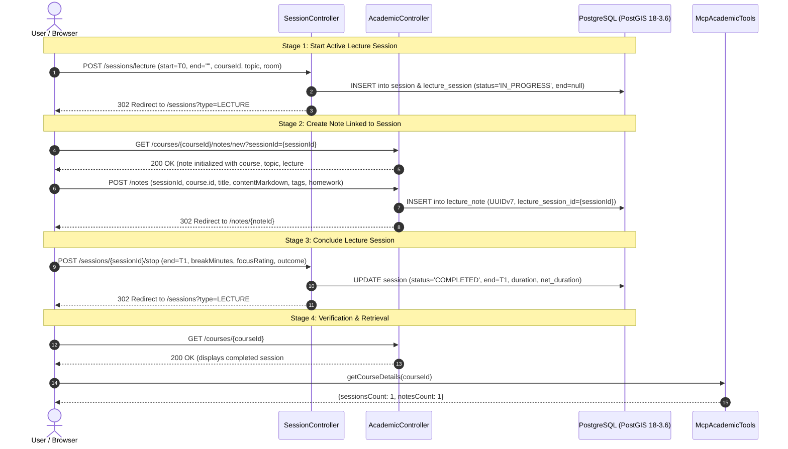

# Integration Test Plan: LectureSession & LectureNote Seamless Interaction

## 1. Overview & Objectives

The goal of this test plan is to rigorously verify with integration tests the complete end-to-end lifecycle and interaction between university courses, ongoing polymorphic lecture sessions, and rich markdown lecture notes in **Simon's Life Manager (SLM)**.

### Target Workflow Under Test
1. **Start Lecture Session**: An active `LectureSession` is started via the Web MVC endpoint without an end datetime (`end == null`), persisting as `status = "IN_PROGRESS"` with a native PostgreSQL 18 UUIDv7.
2. **Note Pre-population**: Navigating to the note creation form for this course with `sessionId` pre-populates course details, lecture number, topic, and session linkage.
3. **Save Lecture Note**: Rich markdown notes (with summary, key concepts, homework actions, and exam relevance rating) are submitted and persisted with a native UUIDv7 and a direct foreign key link to the active `LectureSession`.
4. **End Lecture Session**: The ongoing lecture session is concluded via the `/sessions/{id}/stop` endpoint, setting `end`, duration, net duration, focus rating, outcome summary, and transitioning status to `COMPLETED`.
5. **Cross-Domain Verification**: Assert bidirectional link integrity, repository query methods (`findByLectureSessionId`, `searchNotes`), course detail page rendering, and MCP Academic Tool telemetry.

---

## 2. Technical Architecture & Invariants



### Key Domain Invariants
- **ADR 001 / ADR 018**: Sessions use joined inheritance (`InheritanceType.JOINED`) with native UUIDv7 keys.
- **ADR 017**: `LectureNote` uses native UUIDv7 keys and has an `@OneToOne(optional = true) @JoinColumn(name = "lecture_session_id")` relationship to `LectureSession`.
- **ADR 021**: Active sessions have `status = 'IN_PROGRESS'` when `end == null`. Stopping calculates gross and net duration.
- **ADR 011 / ADR 012**: `LectureSession` is part of the **Productivity** pillar and counts toward Net Focused Time.

---

## 3. Test Specification: `AcademicIT.java`

We will implement `testActiveLectureSessionLifecycleWithLinkedNoteAndStop()` in [`AcademicIT.java`](src/test/java/de/oberamsystems/slm/AcademicIT.java).

### Detailed Test Steps

#### Step 1: Fixture Setup
- Create and persist a `Human` with `category = HumanCategory.LECTURER` (e.g. "Prof. Dr. Barbara Liskov").
- Create and persist a `Course` (e.g., Title: "Distributed Systems & Fault Tolerance", Code: "CS-801", Semester: "WS 2026/27", Lecturer, Default Room: "Audimax 2").

#### Step 2: Start Ongoing `LectureSession`
- Perform `POST /sessions/lecture`:
  - `courseId`: `course.getId()`
  - `lectureNumber`: `1`
  - `topic`: `"Consensus Protocols & State Machine Replication"`
  - `room`: `"Audimax 2"`
  - `start`: `"2026-10-21T09:15"`
  - `end`: `""` (empty string)
  - `breakMinutes`: `"0"`
  - `.with(csrf())`
- **Assertions**:
  - Response status: HTTP 302 Redirect to `/sessions?type=LECTURE`.
  - Fetch saved `LectureSession` by course ID.
  - Assert `session.getId()` is valid UUIDv7 (`version() == 7`).
  - Assert `session.getStatus()` is `"IN_PROGRESS"`.
  - Assert `session.isInProgress()` is `true`.
  - Assert `session.getEnd()` is `null`.
  - Assert `session.getDuration()` and `session.getNetDuration()` are `null`.

#### Step 3: Note Form Pre-population
- Perform `GET /courses/{courseId}/notes/new?sessionId={sessionId}`.
- **Assertions**:
  - Response status: HTTP 200 OK.
  - Model attribute `"note"` contains:
    - `course.id == courseId`
    - `lectureSession.id == sessionId`
    - `lectureNumber == 1`
    - `title == "Consensus Protocols & State Machine Replication"`

#### Step 4: Save `LectureNote` Linked to the Active Session
- Perform `POST /notes`:
  - `sessionId`: `sessionId`
  - `course.id`: `courseId`
  - `title`: `"Lecture 01: SMR, Paxos, and Raft Foundations"`
  - `lectureNumber`: `1`
  - `lectureDate`: `"2026-10-21"`
  - `contentMarkdown`: `"# State Machine Replication\n\n- Deterministic state machines\n- Consensus logs\n- Leader election and heartbeat ticks"`
  - `keyConcepts`: `"SMR, Paxos, Raft, Safety, Liveness"`
  - `summary`: `"Introduced state machine replication principles and quorum consensus guarantees."`
  - `hasHomework`: `"true"`
  - `homeworkTodo`: `"Implement leader heartbeat mechanism in Lab 1"`
  - `examRelevanceRating`: `"5"`
  - `.with(csrf())`
- **Assertions**:
  - Response status: HTTP 302 Redirect to `/notes/{noteId}`.
  - Flush and clear `EntityManager`.
  - Verify `LectureNote` exists in DB with `version() == 7` UUID.
  - Verify direct linkage: `note.getLectureSession().getId().equals(sessionId)`.
  - Verify repository query: `lectureNoteRepository.findByLectureSessionId(sessionId).isPresent()`.
  - Verify search: `lectureNoteRepository.searchNotes("SMR").size() >= 1`.

#### Step 5: Conclude `LectureSession`
- Perform `POST /sessions/{sessionId}/stop`:
  - `end`: `"2026-10-21T10:45"` (90 minutes total elapsed)
  - `breakMinutes`: `"10"` (10 minutes break)
  - `focusRating`: `"5"`
  - `outcomeSummary`: `"Grasped quorum intersection rules and leader election invariants."`
  - `comment`: `"Active participation during professor Q&A on split votes."`
  - `returnType`: `"LECTURE"`
  - `.with(csrf())`
- **Assertions**:
  - Response status: HTTP 302 Redirect to `/sessions?type=LECTURE`.
  - Flush and clear `EntityManager`.
  - Fetch updated `LectureSession`.
  - Assert `session.getStatus()` is `"COMPLETED"`.
  - Assert `session.isInProgress()` is `false`.
  - Assert `session.getEnd()` is `2026-10-21T10:45`.
  - Assert `session.getBreakDuration()` is `PT10M`.
  - Assert `session.getDuration()` is `PT1H30M` (90 minutes).
  - Assert `session.getNetDuration()` is `PT1H20M` (80 minutes).
  - Assert `session.getFocusRating()` is `5`.
  - Assert `session.getOutcomeSummary()` is set.

#### Step 6: End-to-End View & MCP Telemetry Verification
- Perform `GET /courses/{courseId}`:
  - Assert HTTP 200 OK.
  - Model attributes `"sessions"` has size 1 and `"notes"` has size 1.
- Perform `GET /notes/{noteId}`:
  - Assert HTTP 200 OK.
  - Model attribute `"note"` is present and correctly linked.
- Verify `McpAcademicTools`:
  - `mcpAcademicTools.getCourseDetails(courseId)` returns `sessionsCount == 1` and `notesCount == 1`.
  - `mcpAcademicTools.searchLectureNotes("SMR")` finds the note.

---

## 4. Execution & Verification Command

Execute test suite targeting `AcademicIT`:
```bash
./gradlew test --tests de.oberamsystems.slm.AcademicIT -x jacocoTestReport -x compileAotTestJava
```

Followed by full project regression suite:
```bash
./gradlew test -x jacocoTestReport -x compileAotTestJava
```
