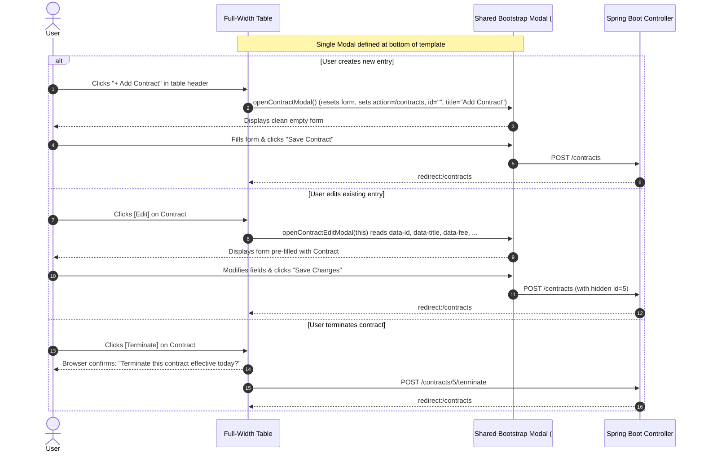
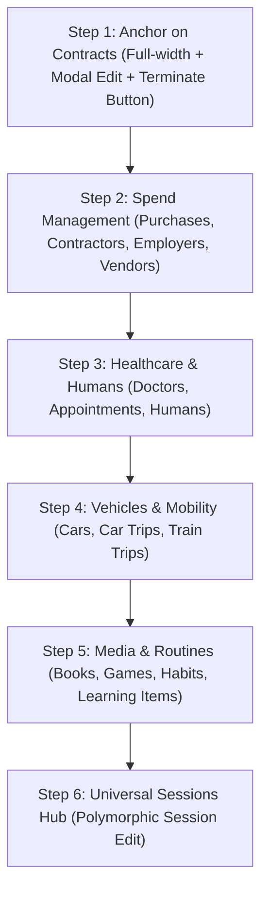

# Architectural Evaluation & Plan: Migrating UI Inputs to Modals for Universal Editing & Consistent UX

## 1. Executive Summary & Recommendation

### The Question
> *Is it reasonable to migrate every UI input to a modal first (before adding edit options) to ensure a consistent UX across the application, keeping in mind actions like contract termination?*

### The Verdict: **YES — Strongly Recommended**
Migrating UI inputs to **Bootstrap 5 Modals** is not only reasonable, but architecturally and aesthetically superior for Simon's Life Manager (SLM). 

Currently, the SLM user interface is divided into two conflicting layout styles:
1. **Modern Modal-Based Screens**: [`sessions.html`](file:///home/simon/code/eclipse/slm/src/main/resources/templates/sessions.html), [`refuelings.html`](file:///home/simon/code/eclipse/slm/src/main/resources/templates/refuelings.html), [`stations.html`](file:///home/simon/code/eclipse/slm/src/main/resources/templates/stations.html), [`course-detail.html`](file:///home/simon/code/eclipse/slm/src/main/resources/templates/course-detail.html), and [`human-events.html`](file:///home/simon/code/eclipse/slm/src/main/resources/templates/human-events.html). These feature spacious, full-width `col-12` data tables with modern KPI headers, opening focused modal dialogs for inputs.
2. **Legacy 2-Column Squeezed Screens**: [`contracts.html`](file:///home/simon/code/eclipse/slm/src/main/resources/templates/contracts.html), [`purchases.html`](file:///home/simon/code/eclipse/slm/src/main/resources/templates/purchases.html), [`books.html`](file:///home/simon/code/eclipse/slm/src/main/resources/templates/books.html), [`habits.html`](file:///home/simon/code/eclipse/slm/src/main/resources/templates/habits.html), [`employers.html`](file:///home/simon/code/eclipse/slm/src/main/resources/templates/employers.html), [`cars.html`](file:///home/simon/code/eclipse/slm/src/main/resources/templates/cars.html), etc. Here, data tables are squeezed into `col-lg-8` (66% width) alongside a permanent side form in `col-lg-4`.

Migrating to a **Modal-First Architecture** unlocks four critical advantages:
1. **Unifies "Add" and "Edit" into a Single Form**: The exact same modal markup serves both creation and editing, eliminating code duplication and UI disparity.
2. **Reclaims 100% Screen Width for Data Tables**: Squeezed tables cause text wrapping and horizontal scrolling on desktop and laptop displays. Full-width tables provide ample room for badges, metrics, and dedicated action buttons (`Edit`, `Terminate`, `Delete`).
3. **Flawless Mobile & Responsive Layout**: On mobile viewports, side forms drop below the table, forcing users to scroll past dozens of rows to find inputs. Modals open as responsive overlays on all screen sizes.
4. **Prevents Rework**: If we build side-form edit logic now, we would have to rewrite it all later when modernizing to modals. Building the modal architecture first establishes the permanent design pattern.

---

## 2. Deep Comparative Analysis: Modals vs. Side-by-Side Forms

| Dimension | Side-by-Side (Current Legacy) | Modal-First (Proposed Target) | Winner & Architectural Impact |
| :--- | :--- | :--- | :--- |
| **Table Screen Real Estate** | Squeezed into `col-lg-8` (~66% width). Columns are cramped; badges wrap or get cut off. | Full-width `col-12` (100% width). Ample room for status badges, dates, KPIs, and action buttons. | 🏆 **Modal**: Far superior readability for multi-column tables like Contracts, Refuelings, and Books. |
| **Create vs. Edit Code Duplication** | Requires dual-state logic in side card (`th:if="${id != null}"`), complex resets, and URL state management (`?id=...`). | **One single modal** handles both Create and Edit. A JavaScript helper updates modal title, action, and fills fields instantly. | 🏆 **Modal**: DRY (Don't Repeat Yourself). One form, one set of inputs, zero duplicate Thymeleaf markup. |
| **Visual Hierarchy & Aesthetics** | Page permanently looks like an administrative data-entry grid with forms competing with data tables. | Clean, data-first visual hierarchy. Tables and KPI cards dominate; inputs appear only on intentional user interaction. | 🏆 **Modal**: Aligns with modern premium web standards and existing hubs (`sessions.html`). |
| **Mobile & Tablet Responsiveness** | Broken on mobile: the form collapses beneath the table, requiring heavy scrolling. | Native responsive overlay dialog on all devices with backdrop blur and sticky buttons. | 🏆 **Modal**: Consistent cross-device usability. |
| **Dedicated Row Actions (e.g. Terminate)** | Cramped action column or awkward placement due to limited horizontal width. | Generous dedicated `Actions` column with clean button groups: `[ Edit ]` and `[ Terminate ]`. | 🏆 **Modal**: Clear, unobstructed action workflows. |
| **Rapid Sequential Data Entry** | Slightly faster for entering 10+ records consecutively without reopening a dialog. | Requires clicking "Add" per entry (or an "Add Another" checkbox in the modal). | ⚖️ **Side-by-Side**: Useful for high-volume data-entry, but SLM is a personal lifestyle tracker with low-frequency logging. |

---

## 3. Technical Architecture for Modal-Based Editing

### 3.1 How Modal Editing Works Without Page Reloads

To keep the application fast, robust, and clean without introducing heavy frontend frameworks, we leverage **Bootstrap 5 Modal API + HTML5 `data-*` attributes with Vanilla JavaScript**:



### 3.2 HTML & JavaScript Implementation Pattern

#### 1. Table Row with `data-*` Attributes:
```html
<td class="text-end pe-3">
    <div class="btn-group btn-group-sm" role="group">
        <!-- Edit Button: launches modal with pre-populated data -->
        <button type="button" 
                class="btn btn-outline-primary" 
                title="Edit Contract"
                th:data-id="${e.id}"
                th:data-title="${e.title}"
                th:data-contractor-id="${e.contractor != null ? e.contractor.id : ''}"
                th:data-fee="${e.fee}"
                th:data-start-date="${e.startDate}"
                th:data-initial-end-date="${e.initialEndDate}"
                th:data-auto-extension="${e.autoExtension}"
                th:data-auto-extension-months="${e.autoExtensionMonths}"
                th:data-is-active="${e.active}"
                th:data-is-canceled="${e.canceled}"
                th:data-termination-date="${e.terminationDate}"
                onclick="populateEditContractModal(this)">
            <i class="bi bi-pencil"></i>
        </button>

        <!-- Terminate Button: dedicated action for active contracts -->
        <form th:if="${e.active and !e.canceled}" 
              th:action="@{'/contracts/' + ${e.id} + '/terminate'}" 
              method="post" 
              class="d-inline"
              onsubmit="return confirm('Terminate this contract effective today?');">
            <button type="submit" 
                    class="btn btn-outline-danger" 
                    title="Terminate Contract">
                <i class="bi bi-x-circle me-1"></i> Terminate
            </button>
        </form>
    </div>
</td>
```

#### 2. The Shared Dual-Purpose Modal:
```html
<div class="modal fade" id="contractModal" tabindex="-1" aria-labelledby="contractModalLabel" aria-hidden="true">
    <div class="modal-dialog modal-lg modal-dialog-centered">
        <div class="modal-content border-0 shadow-lg">
            <div class="modal-header bg-white py-3 border-bottom">
                <h5 class="modal-title fw-bold text-dark" id="contractModalLabel">
                    <i class="bi bi-file-earmark-plus me-2 text-primary"></i>Add Contract
                </h5>
                <button type="button" class="btn-close" data-bs-dismiss="modal" aria-label="Close"></button>
            </div>
            <form id="contractForm" th:action="@{/contracts}" method="post">
                <input type="hidden" id="contractId" name="id" value="">
                <div class="modal-body p-4">
                    <div class="row g-3">
                        <div class="col-md-6">
                            <label class="form-label fw-semibold">Contractor</label>
                            <select id="modalContractor" name="contractor" class="form-select">
                                <option th:each="s : ${contractors}" th:value="${s.id}" th:text="${s.name}"></option>
                            </select>
                        </div>
                        <div class="col-md-6">
                            <label class="form-label fw-semibold">Title <span class="text-danger">*</span></label>
                            <input type="text" id="modalTitle" name="title" class="form-control" required>
                        </div>
                        <div class="col-md-4">
                            <label class="form-label fw-semibold">Fee (€/period) <span class="text-danger">*</span></label>
                            <input type="number" step="0.01" id="modalFee" name="fee" class="form-control" required>
                        </div>
                        <div class="col-md-4">
                            <label class="form-label fw-semibold">Start Date <span class="text-danger">*</span></label>
                            <input type="date" id="modalStartDate" name="startDate" class="form-control" required>
                        </div>
                        <div class="col-md-4">
                            <label class="form-label fw-semibold">Initial End Date <span class="text-danger">*</span></label>
                            <input type="date" id="modalInitialEndDate" name="initialEndDate" class="form-control" required>
                        </div>
                        <!-- Auto-extension switch & months -->
                        <div class="col-md-6">
                            <div class="form-check form-switch mt-2">
                                <input class="form-check-input" type="checkbox" id="modalAutoExtension" name="autoExtension" checked>
                                <label class="form-check-label fw-semibold" for="modalAutoExtension">Auto-Extends after Initial Term</label>
                            </div>
                        </div>
                        <div class="col-md-6">
                            <label class="form-label fw-semibold">Extension Period (Months)</label>
                            <input type="number" id="modalAutoExtensionMonths" name="autoExtensionMonths" class="form-control" min="1" value="1">
                        </div>
                        <!-- Status toggles -->
                        <div class="col-md-6">
                            <div class="form-check form-switch">
                                <input class="form-check-input" type="checkbox" id="modalIsActive" name="isActive" checked>
                                <label class="form-check-label fw-semibold" for="modalIsActive">Currently Active</label>
                            </div>
                        </div>
                        <div class="col-md-6">
                            <div class="form-check form-switch">
                                <input class="form-check-input" type="checkbox" id="modalIsCanceled" name="isCanceled">
                                <label class="form-check-label fw-semibold text-warning-emphasis" for="modalIsCanceled">Mark as Canceled</label>
                            </div>
                        </div>
                        <div class="col-md-12" id="modalTerminationDateGroup">
                            <label class="form-label fw-semibold">Effective Termination Date</label>
                            <input type="date" id="modalTerminationDate" name="terminationDate" class="form-control">
                        </div>
                    </div>
                </div>
                <div class="modal-footer bg-light border-top py-3">
                    <button type="button" class="btn btn-outline-secondary" data-bs-dismiss="modal">Cancel</button>
                    <button type="submit" id="modalSubmitBtn" class="btn btn-primary fw-semibold px-4">
                        <i class="bi bi-plus-circle me-1"></i> Save Contract
                    </button>
                </div>
            </form>
        </div>
    </div>
</div>
```

#### 3. Lightweight Client-Side Controller (Vanilla JS):
```javascript
function openCreateContractModal() {
    document.getElementById('contractForm').reset();
    document.getElementById('contractId').value = '';
    document.getElementById('contractModalLabel').innerHTML = '<i class="bi bi-file-earmark-plus me-2 text-primary"></i>Add Contract';
    document.getElementById('modalSubmitBtn').innerHTML = '<i class="bi bi-plus-circle me-1"></i> Save Contract';
    document.getElementById('modalSubmitBtn').className = 'btn btn-primary fw-semibold px-4';
    document.getElementById('modalAutoExtension').checked = true;
    document.getElementById('modalIsActive').checked = true;
    document.getElementById('modalIsCanceled').checked = false;
    
    // Default dates
    const today = new Date().toISOString().split('T')[0];
    document.getElementById('modalStartDate').value = today;
    
    const modal = new bootstrap.Modal(document.getElementById('contractModal'));
    modal.show();
}

function populateEditContractModal(btn) {
    const ds = btn.dataset;
    document.getElementById('contractId').value = ds.id || '';
    document.getElementById('modalTitle').value = ds.title || '';
    document.getElementById('modalContractor').value = ds.contractorId || '';
    document.getElementById('modalFee').value = ds.fee || '';
    document.getElementById('modalStartDate').value = ds.startDate || '';
    document.getElementById('modalInitialEndDate').value = ds.initialEndDate || '';
    document.getElementById('modalAutoExtension').checked = ds.autoExtension === 'true';
    document.getElementById('modalAutoExtensionMonths').value = ds.autoExtensionMonths || '1';
    document.getElementById('modalIsActive').checked = ds.isActive === 'true';
    document.getElementById('modalIsCanceled').checked = ds.isCanceled === 'true';
    document.getElementById('modalTerminationDate').value = ds.terminationDate || '';

    // Switch Modal UI to "Edit Mode"
    document.getElementById('contractModalLabel').innerHTML = `<i class="bi bi-pencil-square me-2 text-warning"></i>Edit Contract #${ds.id}`;
    document.getElementById('modalSubmitBtn').innerHTML = '<i class="bi bi-check2-circle me-1"></i> Update Contract';
    document.getElementById('modalSubmitBtn').className = 'btn btn-warning fw-semibold px-4';

    const modal = new bootstrap.Modal(document.getElementById('contractModal'));
    modal.show();
}
```

---

## 4. Contract Termination Workflow: Direct Button vs. Modal

In contracts, termination is an important legal and operational milestone. As requested, we provide a **dedicated button next to edit**:

1. **Table Row Presentation**:
   - The table row displays a clean button group:
     - `[ Edit ]` (Blue icon `bi bi-pencil`): Opens the contract in `#contractModal` with all fields editable.
     - `[ Terminate ]` (Red outline `bi bi-x-circle Terminate`): Only displayed on **active, uncanceled** contracts.
2. **Termination Behavior**:
   - Submits to `POST /contracts/{id}/terminate`.
   - Prompts for confirmation via native dialog or quick modal: *"Terminate this contract effective today?"*
   - In [`ContractController.java`](file:///home/simon/code/eclipse/slm/src/main/java/de/oberamsystems/slm/controller/ContractController.java):
     ```java
     @PostMapping("/contracts/{id}/terminate")
     public String terminateContract(@PathVariable Long id) {
         repo.findById(id).ifPresent(c -> {
             c.setActive(false);
             c.setCanceled(true);
             if (c.getTerminationDate() == null) {
                 c.setTerminationDate(LocalDate.now());
             }
             repo.save(c);
         });
         return "redirect:/contracts";
     }
     ```
   - Instantly transitions the contract to `Ended` / `Terminated`, changes the status badge to secondary gray, and hides the `Terminate` button.

---

## 5. Recommended Execution Strategy: Pattern Anchor First

Rather than attempting a massive "big bang" rewrite of 30+ screens simultaneously, we recommend an **Anchor Pattern First** approach:



### Why Anchor on `contracts.html` First?
1. Directly delivers the user's explicit request: **Contract Edit + Contract Terminate button**.
2. Upgrades `contracts.html` from a cramped 66% table to a **100% full-width layout** with spacious columns for Start Date, Initial End Date, Remaining, Status, and Actions.
3. Proves the lightweight Vanilla JS + Bootstrap 5 modal population pattern in live tests and browser inspection.
4. Once verified, this identical pattern can be cloned across the remaining views cleanly and reliably.

---

## 6. Phased Rollout Plan

### Phase 1: Contracts (The Anchor Model)
- **Files**: [`contracts.html`](file:///home/simon/code/eclipse/slm/src/main/resources/templates/contracts.html), [`ContractController.java`](file:///home/simon/code/eclipse/slm/src/main/java/de/oberamsystems/slm/controller/ContractController.java), [`ContractIT.java`](file:///home/simon/code/eclipse/slm/src/test/java/de/oberamsystems/slm/ContractIT.java).
- Transform `contracts.html` to full-width `col-12`.
- Add `"+ Add Contract"` button in the table header.
- Create `#contractModal` supporting both Add and Edit.
- Add `[ Edit ]` and `[ Terminate ]` buttons to each table row.
- Add `POST /contracts/{id}/terminate` and update `POST /contracts` to support ID updates.
- Test with unit & Testcontainers integration tests.

### Phase 2: Spend & Finance Management
- Transform [`purchases.html`](file:///home/simon/code/eclipse/slm/src/main/resources/templates/purchases.html), [`contractors.html`](file:///home/simon/code/eclipse/slm/src/main/resources/templates/contractors.html), [`employers.html`](file:///home/simon/code/eclipse/slm/src/main/resources/templates/employers.html), and [`vendors.html`](file:///home/simon/code/eclipse/slm/src/main/resources/templates/vendors.html) to full-width tables with Add/Edit modals.

### Phase 3: Healthcare & Humans
- Transform [`doctors.html`](file:///home/simon/code/eclipse/slm/src/main/resources/templates/doctors.html) and [`appointments.html`](file:///home/simon/code/eclipse/slm/src/main/resources/templates/appointments.html) to full-width with modals, deprecating standalone `add-doctor` and `add-appointment` sub-pages.
- Add modal editing to [`humans.html`](file:///home/simon/code/eclipse/slm/src/main/resources/templates/humans.html).

### Phase 4: Vehicles & Mobility
- Add Edit modal to [`refuelings.html`](file:///home/simon/code/eclipse/slm/src/main/resources/templates/refuelings.html) (recalculating consumption and cost/liter).
- Transform [`cars.html`](file:///home/simon/code/eclipse/slm/src/main/resources/templates/cars.html), [`car-trips.html`](file:///home/simon/code/eclipse/slm/src/main/resources/templates/car-trips.html), and [`train-trips.html`](file:///home/simon/code/eclipse/slm/src/main/resources/templates/train-trips.html) to full-width modal views.

### Phase 5: Media, Leisure & Habits
- Transform [`books.html`](file:///home/simon/code/eclipse/slm/src/main/resources/templates/books.html), [`authors.html`](file:///home/simon/code/eclipse/slm/src/main/resources/templates/authors.html), [`games.html`](file:///home/simon/code/eclipse/slm/src/main/resources/templates/games.html), and [`habits.html`](file:///home/simon/code/eclipse/slm/src/main/resources/templates/habits.html).

### Phase 6: Universal Sessions Hub
- In [`sessions.html`](file:///home/simon/code/eclipse/slm/src/main/resources/templates/sessions.html), add `[ Edit ]` button to session rows that opens the polymorphic `#sessionModal` in edit mode.

---

## 7. Verification & Safety Guarantees

1. **Gradle Test Rule**: All changes verified with `./gradlew test -x jacocoTestReport -x compileAotTestJava`.
2. **Container Reuse**: Shared singleton PostGIS container preserved across all integration test suites.
3. **Living Documentation**: Update [`DECISIONS.md`](file:///home/simon/code/eclipse/slm/DECISIONS.md) with an ADR on Universal Modal-Based Input Architecture, and update [`CHANGELOG.md`](file:///home/simon/code/eclipse/slm/CHANGELOG.md).
