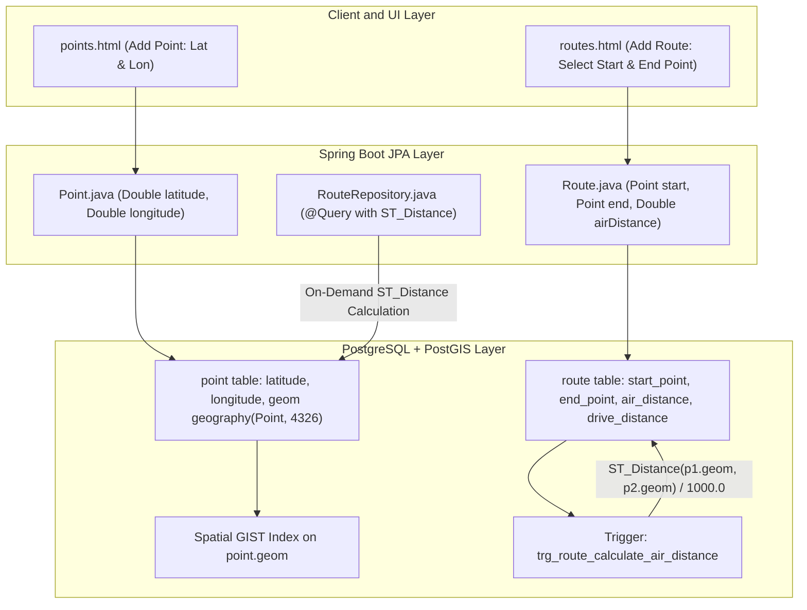

# Plan: PostGIS Spatial Points & Automated Route Air Distance Calculation

## 1. Problem Statement & Objectives

### Current State
- The `point` table currently stores `latitude` and `longitude` as raw `TEXT`:
  ```sql
  CREATE TABLE point (
      id BIGSERIAL PRIMARY KEY,
      name TEXT NOT NULL,
      description TEXT,
      latitude TEXT NOT NULL,
      longitude TEXT NOT NULL
  );
  ```
- Existing rows contain Degrees-Minutes-Seconds (DMS) string notation:
  - `Haus Mama`: Latitude `49°17'04.49"N`, Longitude `10°40'53.20"E`
  - `Aquella Ansbach`: Latitude `49°18'19.84"N`, Longitude `10°33'34.22"E`
- In `route`, `air_distance` is currently a manual entry field:
  - The user must manually look up or guess the air distance when creating a route in `routes.html`.
  - For `Mama -> Aquella`, the user manually entered `9.2` km.
- `Point.java` maps `String latitude` and `String longitude`.

### Objectives
1. **Leverage PostGIS**:
   - Utilize PostgreSQL's native PostGIS extension (already installed: PostGIS 3.6.4 on PostgreSQL 18).
   - Represent coordinates in the standard WGS 84 spatial reference system (`SRID 4326`).
2. **Automated Geodesic Air Distance**:
   - Eliminate manual data entry of `air_distance` for routes.
   - Use PostGIS `ST_Distance(start.geom, end.geom) / 1000.0` over the WGS 84 ellipsoid to compute exact spherical/geodesic distance in kilometers (verifying `Mama -> Aquella` produces `9.17 km`, aligning with the existing `9.2 km`).
3. **Data Migration**:
   - Migrate existing string data (both DMS and decimal formats) cleanly to numeric coordinates and spatial geography points without data loss.

---

## 2. Architecture & Design Options



### Option Comparison

| Feature | Option A: Native PostGIS Generated Column + DB Trigger (Recommended) | Option B: Full Hibernate Spatial with JTS `Geometry` |
| :--- | :--- | :--- |
| **Java Entity Complexity** | **Low**: `Point` has clean `Double latitude`, `Double longitude`. No extra heavy GIS dependencies. | **High**: Requires `hibernate-spatial`, JTS dependencies, and custom web binders for `org.locationtech.jts.geom.Point`. |
| **Database Schema** | `latitude`, `longitude` + `geom geography(Point, 4326) GENERATED ALWAYS AS (ST_SetSRID(ST_MakePoint(longitude, latitude), 4326)::geography) STORED`. | `geom geography(Point, 4326)` mapped directly to JTS Point. |
| **Air Distance Computation** | **Automatic**: PostgreSQL trigger calculates `air_distance = ST_Distance(start.geom, end.geom) / 1000.0` on insert/update. Repository query also available. | Calculated in application service layer or DB trigger. |
| **Performance** | Indexed with PostGIS GIST spatial index; zero calculation latency on reads. | Indexed with PostGIS GIST index; JTS serialization overhead. |
| **Web Form UX** | Clean numeric inputs (`<input type="number" step="0.000001">`) in `points.html`; `airDistance` removed from required input in `routes.html`. | Requires custom coordinate converters for web forms. |

> [!TIP]
> **Recommendation: Option A** is the cleanest, lowest-friction, and most reliable architectural choice. It leverages PostGIS at the database engine level where it performs best, avoids adding heavyweight JTS mapping dependencies to Spring Boot, and provides automatic calculation guarantees via database triggers and generated columns (identical to the pattern already successfully used for `Session.duration` and `Session.netDuration`).

---

## 3. Implementation Steps

### Step 1: Database Migration (`migration_2026-10-18.sql`)
Create a new versioned migration script:
1. Ensure extension is enabled:
   ```sql
   CREATE EXTENSION IF NOT EXISTS postgis;
   ```
2. Create DMS-to-decimal helper function to migrate existing strings (`49°17'04.49"N` -> `49.284581`, `10°40'53.20"E` -> `10.681444`):
   ```sql
   CREATE OR REPLACE FUNCTION parse_dms_to_decimal(coord text) RETURNS double precision AS $$
   DECLARE
       matches text[];
       d double precision;
       m double precision;
       s double precision;
       hemi text;
       dec double precision;
   BEGIN
       IF coord IS NULL OR btrim(coord) = '' THEN
           RETURN NULL;
       END IF;
       -- Check if already numeric decimal
       IF coord ~ '^-?[0-9]+(\.[0-9]+)?$' THEN
           RETURN coord::double precision;
       END IF;
       -- Match DMS format: e.g. 49°17'04.49"N
       matches := regexp_match(coord, '^([0-9]+)[°\s]+([0-9]+)[''\s]+([0-9]+(?:\.[0-9]+)?)\"([NSEW])', 'i');
       IF matches IS NOT NULL THEN
           d := matches[1]::double precision;
           m := matches[2]::double precision;
           s := matches[3]::double precision;
           hemi := upper(matches[4]);
           dec := d + (m / 60.0) + (s / 3600.0);
           IF hemi IN ('S', 'W') THEN
               dec := -dec;
           END IF;
           RETURN dec;
       END IF;
       RETURN NULL;
   END;
   $$ LANGUAGE plpgsql IMMUTABLE;
   ```
3. Alter `point` table:
   ```sql
   -- Convert latitude and longitude columns to double precision
   ALTER TABLE point
       ALTER COLUMN latitude TYPE double precision USING parse_dms_to_decimal(latitude),
       ALTER COLUMN longitude TYPE double precision USING parse_dms_to_decimal(longitude);

   -- Add generated PostGIS geography column (lon, lat order)
   ALTER TABLE point
       ADD COLUMN geom geography(Point, 4326)
       GENERATED ALWAYS AS (ST_SetSRID(ST_MakePoint(longitude, latitude), 4326)::geography) STORED;

   -- Create spatial index
   CREATE INDEX IF NOT EXISTS idx_point_geom ON point USING GIST (geom);
   ```
4. Create Trigger to automatically compute `route.air_distance`:
   ```sql
   CREATE OR REPLACE FUNCTION calculate_route_air_distance()
   RETURNS TRIGGER AS $$
   DECLARE
       start_geom geography;
       end_geom geography;
   BEGIN
       SELECT geom INTO start_geom FROM point WHERE id = NEW.start_point;
       SELECT geom INTO end_geom FROM point WHERE id = NEW.end_point;
       
       IF start_geom IS NOT NULL AND end_geom IS NOT NULL THEN
           NEW.air_distance := ROUND((ST_Distance(start_geom, end_geom) / 1000.0)::numeric, 2);
       END IF;
       RETURN NEW;
   END;
   $$ LANGUAGE plpgsql;

   DROP TRIGGER IF EXISTS trg_route_air_distance ON route;
   CREATE TRIGGER trg_route_air_distance
   BEFORE INSERT OR UPDATE OF start_point, end_point ON route
   FOR EACH ROW
   EXECUTE FUNCTION calculate_route_air_distance();

   -- Recalculate existing routes
   UPDATE route SET air_distance = air_distance;
   ```

---

### Step 2: Java Entity Updates

#### 1. [`Point.java`](file:///home/simon/code/eclipse/slm/src/main/java/de/oberamsystems/slm/model/Point.java)
- Change fields from `String` to `Double`:
  ```diff
  - private String latitude;
  - private String longitude;
  + private Double latitude;
  + private Double longitude;
  ```
- Update getters/setters and constructors.
- Add coordinate helper parser in setter or web binder so if a user pastes a DMS string, it parses cleanly into decimal `Double`.

#### 2. [`Route.java`](file:///home/simon/code/eclipse/slm/src/main/java/de/oberamsystems/slm/model/Route.java)
- Keep `private Double airDistance;`.
- Mark column with `@Column(name = "air_distance", insertable = false, updatable = false)` (or allow fallback setting in application logic).

#### 3. [`RouteRepository.java`](file:///home/simon/code/eclipse/slm/src/main/java/de/oberamsystems/slm/model/RouteRepository.java)
- Add native PostGIS calculation method:
  ```java
  @Query(value = "SELECT ROUND((ST_Distance(p1.geom, p2.geom) / 1000.0)::numeric, 2) " +
                 "FROM point p1, point p2 WHERE p1.id = :startId AND p2.id = :endId", nativeQuery = true)
  Double calculateAirDistance(@Param("startId") Long startId, @Param("endId") Long endId);
  ```

---

### Step 3: Thymeleaf Templates & UI

#### 1. [`points.html`](file:///home/simon/code/eclipse/slm/src/main/resources/templates/points.html)
- Change form inputs to `<input type="number" step="any" ... placeholder="e.g. 48.137154">`.
- Format table columns to display clean coordinate formatting.

#### 2. [`routes.html`](file:///home/simon/code/eclipse/slm/src/main/resources/templates/routes.html)
- Remove `airDistance` from required manual user input in the "Add Route" form.
- The user only selects `Start Point`, `End Point`, and enters `Drive Distance` (and name/description).
- The table displays the PostGIS calculated `Air Distance (km)` automatically.

---

## 4. Verification & Testing Plan

| Verification Step | Target / Method | Expected Result |
| :--- | :--- | :--- |
| **Database Migration Execution** | Run `migration_2026-10-18.sql` via `psql` | Existing rows (`Mama`, `Aquella`) converted to decimal degrees; `geom` column generated; GIST index created |
| **Existing Route Distance Check** | Check `route` table row for `Mama -> Aquella` | `air_distance` calculated as `9.17 km` |
| **Unit & Integration Tests** | `./gradlew test -x jacocoTestReport -x compileAotTestJava` | All test suites compile and pass |
| **Web UI: Create New Point** | Submit new location in `/points` | PostGIS parses coordinates and creates spatial point |
| **Web UI: Create New Route** | Submit route in `/routes` without typing air distance | Route is created and displays auto-calculated air distance in km |
