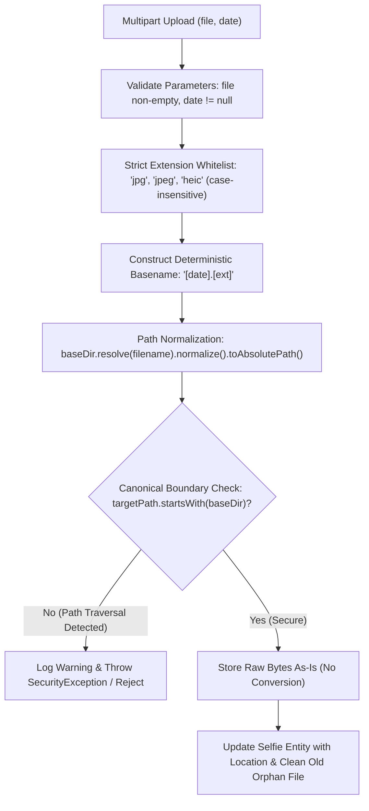

# Architecture Plan: Input Validation, Path Traversal Prevention & Native .jpg / .heic Support for Selfies

## 1. Executive Summary & Objective

In **Simon's Life Manager (SLM)**, the `SelfieController` handles multipart file uploads for daily personal snapshots. The objectives of this plan are:
1. **Completely eliminate any risk of Path Traversal (CWE-22 / OWASP Top 10 A01:2021 & A03:2021)** when validating, storing, and accessing selfie files.
2. **Support both `.jpg` (and `.jpeg`) and `.heic` files natively**:
   - Store files **as they are** without any image transcoding or conversion.
   - Preserve exact raw byte streams on disk.
   - Fix the upload form in `selfies.html` where `accept=".jpg"` currently blocks `.heic` selection.

---

## 2. Threat Modeling & Vulnerability Analysis

### Current Implementation in `SelfieController.java`:
```java
if (file.isEmpty() || (!file.getOriginalFilename().toLowerCase().endsWith(".jpg")) && !file.getOriginalFilename().toLowerCase().endsWith(".heic")) {
    return "redirect:/selfies?error=Invalid file. Only .jpg or .heic files are allowed.";
}

try {
    String uploadDir = System.getProperty("user.dir") + "/selfies";
    File dir = new File(uploadDir);
    if (!dir.exists()) {
        dir.mkdirs();
    }
    
    String suffix = StringUtils.getFilenameExtension(file.getOriginalFilename());
    String filename = date.toString() + "." + suffix;
    Path filepath = Paths.get(uploadDir, filename);
    Files.write(filepath, file.getBytes());

    Selfie selfie = selfieRepository.findByDate(date);
    if (selfie == null) {
        selfie = new Selfie();
    }
    selfie.setDate(date);
    selfie.setLocation(filepath.toString());
    selfieRepository.save(selfie);
```

### Identified Security & Usability Gaps:
1. **Filename & Suffix Traversal Risk**:
   - `file.getOriginalFilename()` can be crafted by an attacker (e.g. `../../../../etc/cron.d/malicious.jpg` or `image.jpg/../../evil.sh`).
   - If `suffix` contains path traversal tokens (`..`, `/`, `\`) or null bytes (`\0`), concatenation `date.toString() + "." + suffix` could traverse outside the designated folder.
2. **Lack of Canonical Boundary Check**:
   - `Paths.get(uploadDir, filename)` never verifies that `filepath.normalize().toAbsolutePath().startsWith(baseDir)`.
3. **UI Restriction in `selfies.html`**:
   - `selfies.html` line 65-66 has `<label for="file">Select .jpg File</label>` and `<input type="file" accept=".jpg">`, blocking users from selecting `.heic` files in desktop and mobile file pickers.
4. **Different-Extension Overwrite Handling**:
   - If an entry for `2026-10-18` was previously uploaded as `2026-10-18.jpg`, and the user re-uploads as `2026-10-18.heic`, both files would remain on disk while the database only references the new one. Old files should be cleanly cleaned up upon replacement.

---

## 3. Defense-in-Depth Security & Storage Architecture



### Core Security & Processing Principles:
1. **Zero Conversion / Raw Byte Storage**:
   - The file is saved directly using `Files.write(targetPath, file.getBytes())`. No transcoding, re-encoding, or ImageIO conversion occurs; `.heic` and `.jpg` remain byte-for-byte identical to the uploaded original.
2. **Strict Extension Whitelisting**:
   - Only `jpg`, `jpeg`, and `heic` are permitted, matched against regex `^[a-zA-Z0-9]{3,4}$`.
   - Extensions are normalized to lowercase for disk storage consistency.
3. **Deterministic Filename Generation**:
   - User-supplied filenames are ignored; the filename is strictly derived from the validated `LocalDate` + normalized extension (`2026-10-18.heic` or `2026-10-18.jpg`).
4. **Canonical Path Confinement**:
   - Verification that `targetPath.normalize().toAbsolutePath().startsWith(baseDir.normalize().toAbsolutePath())`.
   - Immediate rejection if any traversal sequence (`..`, `/`, `\`, `\0`) is detected.
5. **Relative/Clean Path Persistence**:
   - Persist clean relative path or canonical path consistently.
6. **UI Alignment**:
   - Update `selfies.html` input accept attribute to allow `.jpg, .jpeg, .heic, .JPG, .JPEG, .HEIC, image/jpeg, image/heic`.

---

## 4. Component Implementation Details

### 4.1. UI Form Update in `src/main/resources/templates/selfies.html`
Update lines 65–67:
```html
<div class="mb-4">
    <label for="file" class="form-label">Select Photo (.jpg or .heic) <span class="text-danger">*</span></label>
    <input type="file" name="file" id="file" class="form-control" accept=".jpg,.jpeg,.heic,.JPG,.JPEG,.HEIC,image/jpeg,image/heic" required>
    <div class="form-text text-muted small">Supported formats: JPEG (.jpg, .jpeg) and High Efficiency Image (.heic). Images are stored in original quality without conversion.</div>
</div>
```

### 4.2. Storage Service (`SelfieStorageService.java`)
Create a dedicated component `de.oberamsystems.slm.service.SelfieStorageService`:

```java
package de.oberamsystems.slm.service;

import org.slf4j.Logger;
import org.slf4j.LoggerFactory;
import org.springframework.beans.factory.annotation.Value;
import org.springframework.stereotype.Service;
import org.springframework.util.StringUtils;
import org.springframework.web.multipart.MultipartFile;

import jakarta.annotation.PostConstruct;
import java.io.IOException;
import java.nio.file.Files;
import java.nio.file.Path;
import java.nio.file.Paths;
import java.time.LocalDate;
import java.util.Locale;
import java.util.Set;
import java.util.regex.Pattern;

@Service
public class SelfieStorageService {

    private static final Logger log = LoggerFactory.getLogger(SelfieStorageService.class);
    
    // Strict allowed extensions (case-insensitive)
    public static final Set<String> ALLOWED_EXTENSIONS = Set.of("jpg", "jpeg", "heic");
    private static final Pattern EXTENSION_PATTERN = Pattern.compile("^[a-zA-Z0-9]{3,4}$");

    private final Path baseDir;

    public SelfieStorageService(@Value("${slm.selfies.dir:${user.dir}/selfies}") String selfiesDir) {
        this.baseDir = Paths.get(selfiesDir).toAbsolutePath().normalize();
    }

    @PostConstruct
    public void init() throws IOException {
        if (!Files.exists(baseDir)) {
            Files.createDirectories(baseDir);
        }
    }

    public Path getBaseDir() {
        return baseDir;
    }

    public String validateAndExtractExtension(MultipartFile file) {
        if (file == null || file.isEmpty()) {
            throw new IllegalArgumentException("Upload file is empty or missing.");
        }
        String originalFilename = file.getOriginalFilename();
        if (originalFilename == null || originalFilename.isBlank()) {
            throw new IllegalArgumentException("Invalid or missing filename.");
        }

        // Clean path and reject obvious traversal sequences in original filename
        String cleanName = StringUtils.cleanPath(originalFilename);
        if (cleanName.contains("..") || cleanName.contains("/") || cleanName.contains("\\")) {
            log.warn("Path traversal sequence in upload filename: {}", originalFilename);
            throw new SecurityException("Invalid filename: Path traversal characters are not permitted.");
        }

        String ext = StringUtils.getFilenameExtension(cleanName);
        if (ext == null || !EXTENSION_PATTERN.matcher(ext).matches()) {
            throw new IllegalArgumentException("Invalid file extension.");
        }

        String lowerExt = ext.toLowerCase(Locale.ROOT);
        if (!ALLOWED_EXTENSIONS.contains(lowerExt)) {
            throw new IllegalArgumentException("Invalid file format. Only .jpg, .jpeg, or .heic files are allowed.");
        }
        return lowerExt;
    }

    public Path resolveSecurePath(String relativeFilename) {
        if (relativeFilename == null || relativeFilename.isBlank()) {
            throw new IllegalArgumentException("Filename cannot be blank.");
        }

        // Traversal guard
        if (relativeFilename.contains("..") || relativeFilename.contains("/") || 
            relativeFilename.contains("\\") || relativeFilename.contains("\0")) {
            log.warn("Path traversal sequence in relative filename: {}", relativeFilename);
            throw new SecurityException("Path traversal attempt detected: " + relativeFilename);
        }

        Path targetPath = baseDir.resolve(relativeFilename).normalize().toAbsolutePath();
        if (!targetPath.startsWith(baseDir)) {
            log.warn("Resolved path {} escapes base directory {}", targetPath, baseDir);
            throw new SecurityException("Path traversal attempt detected: " + relativeFilename);
        }

        return targetPath;
    }

    /**
     * Stores the raw byte contents of the selfie file as-is without any conversion.
     */
    public Path storeSelfie(MultipartFile file, LocalDate date, String previousLocation) throws IOException {
        if (date == null) {
            throw new IllegalArgumentException("Selfie date cannot be null.");
        }

        String ext = validateAndExtractExtension(file);
        String filename = date.toString() + "." + ext;
        Path targetPath = resolveSecurePath(filename);

        // Clean up previous file if format changed (e.g. from .jpg to .heic)
        if (previousLocation != null && !previousLocation.isBlank()) {
            try {
                Path prevPath = Paths.get(previousLocation).normalize().toAbsolutePath();
                if (prevPath.startsWith(baseDir) && !prevPath.equals(targetPath)) {
                    Files.deleteIfExists(prevPath);
                }
            } catch (Exception e) {
                log.debug("Could not delete previous selfie file: {}", e.getMessage());
            }
        }

        // Write raw bytes untouched
        Files.write(targetPath, file.getBytes());
        return targetPath;
    }
}
```

### 4.3. Controller Integration (`SelfieController.java`)
```java
@Autowired
private SelfieStorageService selfieStorageService;

@PostMapping("/selfies")
public String uploadSelfie(@RequestParam("file") MultipartFile file, 
                           @RequestParam("date") @DateTimeFormat(pattern = "yyyy-MM-dd") LocalDate date) {
    try {
        Selfie selfie = selfieRepository.findByDate(date);
        String previousLocation = selfie != null ? selfie.getLocation() : null;

        Path savedPath = selfieStorageService.storeSelfie(file, date, previousLocation);

        if (selfie == null) {
            selfie = new Selfie();
        }
        selfie.setDate(date);
        selfie.setLocation(savedPath.toString());
        selfieRepository.save(selfie);

        return "redirect:/selfies?success=Selfie uploaded successfully.";
    } catch (IllegalArgumentException e) {
        return "redirect:/selfies?error=" + e.getMessage();
    } catch (SecurityException e) {
        return "redirect:/selfies?error=Security error: Invalid file or path traversal detected.";
    } catch (IOException e) {
        return "redirect:/selfies?error=Failed to upload file.";
    }
}
```

---

## 5. Security & Format Test Plan

| Test Case | Upload File / Extension | Action / Assertion |
| :--- | :--- | :--- |
| **Standard JPG Upload** | `vacation.jpg` (raw bytes `0xFF, 0xD8, ...`) | Stored as `<baseDir>/[date].jpg`, byte contents match 100% untouched |
| **Standard HEIC Upload** | `vacation.heic` (raw bytes `0x00, 0x00, ...`) | Stored as `<baseDir>/[date].heic`, byte contents match 100% untouched |
| **Uppercase Extensions** | `photo.JPG`, `photo.HEIC`, `photo.JPEG` | Accepted, normalized to `.jpg`/`.heic`, raw bytes stored without conversion |
| **Directory Traversal in Filename** | `../../../../etc/passwd.jpg` | Rejected with `SecurityException` |
| **Windows Traversal in Filename** | `..\..\..\boot.ini.heic` | Rejected with `SecurityException` |
| **Embedded Slashes in Suffix** | `test.jpg/../../evil.sh` | Rejected with `SecurityException` / `IllegalArgumentException` |
| **Unsupported Format** | `document.pdf`, `script.sh`, `image.png` | Rejected: Only `.jpg`, `.jpeg`, or `.heic` allowed |
| **Null Byte Injection** | `photo.jpg\0.png` | Rejected with `SecurityException` |
| **Format Replacement** | Upload `.jpg`, then re-upload `.heic` for same date | Old `.jpg` removed from disk; new `.heic` saved cleanly |

---

## 6. Implementation Workflow

1. **Update `selfies.html`**:
   - Change label to `Select Photo (.jpg or .heic)`.
   - Update input accept attribute to `.jpg,.jpeg,.heic,.JPG,.JPEG,.HEIC,image/jpeg,image/heic`.
2. **Implement `SelfieStorageService.java`**:
   - Implement extension validation, zero-conversion raw byte write, and canonical boundary check.
3. **Refactor `SelfieController.java`**:
   - Delegate file operations to `SelfieStorageService`.
4. **Update `SelfieControllerTest.java`**:
   - Add test cases for `.jpg` and `.heic` native uploads.
   - Add test cases for path traversal rejection (`../`, `..\`, embedded slashes, null bytes).
5. **Run Test Verification**:
   - Execute `./gradlew test -x jacocoTestReport -x compileAotTestJava` to confirm all tests compile and pass.
