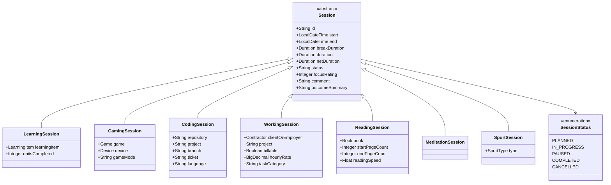

# Architectural Plan: Generalized & Extensible Session Architecture

## 1. Executive Summary & Goals

The goal of this architectural initiative is to replace the current fragmented session models (e.g., [`LearningSession`](file:///home/simon/code/eclipse/slm/src/main/java/de/oberamsystems/slm/model/LearningSession.java), [`GamingSession`](file:///home/simon/code/eclipse/slm/src/main/java/de/oberamsystems/slm/model/GamingSession.java), [`ReadingSession`](file:///home/simon/code/eclipse/slm/src/main/java/de/oberamsystems/slm/model/ReadingSession.java), [`SportSession`](file:///home/simon/code/eclipse/slm/src/main/java/de/oberamsystems/slm/model/SportSession.java)) with a unified, robust, and extensible **Session** domain model.

The new architecture will explicitly support the four target session types:
1. **Learning** (extending and upgrading [`LearningSession`](file:///home/simon/code/eclipse/slm/src/main/java/de/oberamsystems/slm/model/LearningSession.java))
2. **Gaming** (upgrading [`GamingSession`](file:///home/simon/code/eclipse/slm/src/main/java/de/oberamsystems/slm/model/GamingSession.java))
3. **Coding** (new: IDE/project, repository, branch, ticket, language/framework)
4. **Working** (new: client/employer, project, billable flag, hourly rate/contract)

---

## 2. Review & Shortcomings of Current `LearningSession`

| Aspect | Current `LearningSession` Implementation | Issues / Limitations |
| :--- | :--- | :--- |
| **Hierarchy & Code Duplication** | Standalone entity [`LearningSession`](file:///home/simon/code/eclipse/slm/src/main/java/de/oberamsystems/slm/model/LearningSession.java) with no base class. | Identical attributes (`start`, `end`, `duration`, `comment`) and identical CRUD logic are duplicated across 5+ entities and controllers. |
| **Lifecycle & Status** | Binary state: session only exists when already completed (with prefilled end time). | Cannot track active or in-progress sessions in real time. No status (`ACTIVE`, `PAUSED`, `COMPLETED`, `CANCELLED`). |
| **Duration Calculation** | PostgreSQL generated column (`interval`) with `@Column(insertable=false)`. Controller manually calculates duration in memory. | Fragmented logic. In-memory instances or unit tests don't have consistent duration calculation unless manually invoked. |
| **Pauses & Breaks** | None. Single contiguous interval `end - start`. | Real working, coding, or learning sessions have breaks/distractions. Net active time cannot be measured. |
| **Validation** | No validation on entity (`start` can be after `end`, null timestamps permitted). | Database-level corruption or exceptions on negative intervals. No UI feedback. |
| **Service Layer** | Controller talks directly to repository, saves without `@Transactional`. | Lack of transaction boundaries when updating both session and associated item (e.g. [`LearningItem`](file:///home/simon/code/eclipse/slm/src/main/java/de/oberamsystems/slm/model/LearningItem.java)). |
| **Productivity & Context** | Only a free-form `comment` text field. | No productivity/focus rating (1-5), mood rating, tags/categories, or goal accomplishment metrics. |
| **Polymorphic Queries** | Cannot query all user sessions across categories. | Impossible to render a unified timeline or daily/weekly time report across work, coding, and learning. |

---

## 3. Proposed Improvements Over `LearningSession`

### 3.1. Unified Inheritance Strategy
We evaluate two viable JPA patterns:
- **Option A: `InheritanceType.JOINED` (Recommended)**
  - Base entity `Session` mapped to table `session`.
  - Subclasses `LearningSession`, `GamingSession`, `CodingSession`, `WorkingSession` mapped to child tables `learning_session`, `gaming_session`, `coding_session`, `working_session`.
  - **Why Recommended:** Enables **polymorphic queries** (e.g. `sessionRepository.findAllByStartBetween(...)`) to generate holistic time tracking dashboards, weekly reports, and unified calendar integration.
- **Option B: `@MappedSuperclass` (`BaseSession`)**
  - Keeps completely independent tables, sharing Java code and annotations.
  - Less optimal because aggregating time across all sessions requires querying multiple separate repositories.

### 3.2. Session Lifecycle & State Management
Introduce `SessionStatus` enum:
- `PLANNED` (optional upcoming slot)
- `IN_PROGRESS` (active real-time stopwatch session)
- `PAUSED` (temporarily stopped)
- `COMPLETED` (finished, finalized duration)
- `CANCELLED` (abandoned)

Methods on `Session`:
- `start()`: sets `start = LocalDateTime.now()` and status `IN_PROGRESS`.
- `pause()`: pauses active timer, accumulating active duration.
- `resume()`: resumes active timer.
- `finish()`: sets `end = LocalDateTime.now()`, computes net duration, sets status `COMPLETED`.

### 3.3. Duration Calculation: Database-Only vs. Application-Side (Deep Dive)

In the current schema ([`tables.sql`](file:///home/simon/code/eclipse/slm/src/main/resources/tables.sql#L3-L69)), duration is defined as:
```sql
duration INTERVAL GENERATED ALWAYS AS (endtime - starttime) STORED
```
And mapped in Java ([`GamingSession.java`](file:///home/simon/code/eclipse/slm/src/main/java/de/oberamsystems/slm/model/GamingSession.java#L28-L30)) as:
```java
@Type(PostgreSQLIntervalType.class)
@Column(name = "duration", columnDefinition = "interval", insertable = false)
private Duration duration;
```

Below is an in-depth breakdown of why calculating duration **only** in the database causes subtle bugs in JPA/Hibernate, followed by the complete Pros & Cons of both strategies.

#### The Core Technical Problems with DB-Only Calculation in JPA
1. **The "Stale Entity in Memory" Bug (Post-Persist Null Value)**:
   - When calling `sessionRepository.save(session)`, Hibernate executes an `INSERT INTO ...` omitting `duration` because `insertable = false`.
   - The PostgreSQL engine computes and stores the interval.
   - However, **Hibernate does not reload the entity from the database after insert** unless explicitly configured with `@Generated(event = EventType.INSERT)` or followed by an explicit `entityManager.refresh(session)`.
   - **Result:** In the Java memory space (and inside the controller/template response right after saving), `session.getDuration()` is **`null`**!
   - This exact bug is visible when comparing [`LearningController.java`](file:///home/simon/code/eclipse/slm/src/main/java/de/oberamsystems/slm/controller/LearningController.java#L46-L48) (where someone manually patched it with `rs.setDuration(Duration.between(...))` to avoid a null duration in the UI) versus [`GameController.java`](file:///home/simon/code/eclipse/slm/src/main/java/de/oberamsystems/slm/controller/GameController.java#L72) (where `gs.getDuration()` remains `null` on submission).

2. **Database Vendor Lock-In & Test Portability**:
   - `GENERATED ALWAYS AS (endtime - starttime) STORED` with PostgreSQL `INTERVAL` is proprietary syntax.
   - In-memory test databases like H2 or mock environments cannot run `tables.sql` without dialect errors or mock configuration.

3. **Inability to Support Pauses & Breaks**:
   - In simple database calculations, duration is strictly `endtime - starttime`.
   - Real sessions (especially Coding and Working) require tracking pauses, breaks, or Pomodoro interruptions. A database column formula cannot factor in child pause intervals or dynamic pause durations without cumbersome triggers or complex procedural SQL.

4. **Missing or Inconsistent Updates**:
   - Because `@Column(..., insertable = false)` was used without `updatable = false`, Hibernate might try to issue updates under certain merge operations or fail to reflect recalculations on in-memory modifications.

---

#### Strategy Comparison: Pros & Cons

| Strategy | Pros | Cons |
| :--- | :--- | :--- |
| **Strategy 1: Database-Only Calculation**<br>*(Generated Column / DB Trigger)* | • **Single source of truth at storage level:** Guarantees data integrity even if external scripts or direct SQL inserts write to the database.<br>• **Zero application CPU overhead:** Computed on disk/engine. | • **Stale in-memory Java state:** `getDuration()` is `null` immediately after `save()` unless expensive extra `SELECT` queries (`refresh`) are executed.<br>• **Breaks unit tests & domain logic:** In-memory domain unit tests (e.g. `GenericModelTest`, JUnit) will see `null` duration.<br>• **Inflexible for business rules:** Hard to adjust for breaks, pauses, rounded billing intervals (e.g. 15-minute billing increments for `WorkingSession`).<br>• **Engine coupling:** Tied strictly to PostgreSQL syntax. |
| **Strategy 2: Application / Java-Side Calculation**<br>*(JPA Lifecycle Hooks & Domain Methods)* | • **Immediate in-memory consistency:** `session.getDuration()` is always valid before, during, and after persistence.<br>• **Rich business logic:** Supports subtracting breaks (`netDuration = end - start - breakDuration`), rounding for timesheets, etc.<br>• **Database agnostic:** Works identically in PostgreSQL, H2, SQLite, or mock testing.<br>• **No extra database roundtrips:** No need to re-query the database just to display the newly computed duration. | • **External SQL risk:** If someone runs raw SQL updates directly in PostgreSQL without updating `duration`, values could theoretically desynchronize (mitigated by checking constraints). |
| **Strategy 3: Recommended Hybrid Approach**<br>*(Domain Calculation + Java Validation + Stored Column)* | • Combines the best of both: Java entity computes duration via domain methods (`finish()`) and `@PrePersist`/`@PreUpdate`, persisting it to a standard column.<br>• DB check constraint `CHECK (endtime >= starttime)` guarantees integrity at the storage layer.<br>• Full support for `breakDuration` and real-time active tracking. | • Requires maintaining calculation logic in Java (already needed anyway for real-time timer tracking). |

---

### 3.4. Enhanced Metadata & Focus Metrics
Add common fields to `Session`:
- `focusRating` (Integer 1-5 or enum: `DISTRACTED`, `MODERATE`, `DEEP_WORK`)
- `tags` / `labels`
- `energyLevel` / `mood`
- `targetGoal` (what was planned) vs `outcomeSummary` (what was achieved)

---

## 4. Class & Data Model Design

### 4.1. Entity Hierarchy Class Diagram



### 4.2. Database Schema (PostgreSQL DDL)

> [!NOTE]
> Following PostgreSQL standard practices and architectural decisions:
> 1. All text columns use **`TEXT`** (no arbitrary `VARCHAR(n)`).
> 2. Primary key `id` uses **`TEXT`** storing **UUIDv7** (RFC 9562 time-ordered UUIDs) generated via native Java 26+ **`java.util.UUID.ofEpochMillis(System.currentTimeMillis())`**, combining the monotonic B-Tree index performance of sequential integers with global uniqueness.
> 3. Gross duration is calculated at the database level: `GENERATED ALWAYS AS (endtime - starttime) STORED`.
> 4. Net duration (used across all session types) is calculated at the database level: `GENERATED ALWAYS AS (endtime - starttime - break_duration) STORED`.
> 5. Complete migration script with SQL UUIDv7 generation function provided in [`src/main/resources/migrations.sql`](file:///home/simon/code/eclipse/slm/src/main/resources/migrations.sql).

```sql
-- Base table for polymorphic Session (InheritanceType.JOINED)
CREATE TABLE session (
    id TEXT PRIMARY KEY,
    session_type TEXT NOT NULL, -- JPA Joined Inheritance Discriminator ('LEARNING', 'GAMING', 'CODING', 'WORKING', 'READING', 'MEDITATION', 'SPORT')
    status TEXT NOT NULL DEFAULT 'COMPLETED',
    starttime TIMESTAMP NOT NULL,
    endtime TIMESTAMP,
    break_duration INTERVAL NOT NULL DEFAULT '0 seconds',
    duration INTERVAL GENERATED ALWAYS AS (endtime - starttime) STORED,
    net_duration INTERVAL GENERATED ALWAYS AS (endtime - starttime - break_duration) STORED,
    focus_rating SMALLINT CHECK (focus_rating BETWEEN 1 AND 5),
    comment TEXT,
    outcome_summary TEXT
);

-- Subclass tables (JOINED inheritance, FK id references session(id))
CREATE TABLE learning_session (
    id TEXT PRIMARY KEY REFERENCES session(id) ON DELETE CASCADE,
    learning_item_id BIGINT REFERENCES learning_item(id),
    units_completed INTEGER
);

CREATE TABLE gaming_session (
    id TEXT PRIMARY KEY REFERENCES session(id) ON DELETE CASCADE,
    game_id BIGINT NOT NULL REFERENCES game(id),
    device_id BIGINT REFERENCES device(id),
    game_mode TEXT
);

CREATE TABLE coding_session (
    id TEXT PRIMARY KEY REFERENCES session(id) ON DELETE CASCADE,
    project TEXT,
    repository TEXT,
    branch TEXT,
    ticket TEXT,
    language TEXT
);

CREATE TABLE working_session (
    id TEXT PRIMARY KEY REFERENCES session(id) ON DELETE CASCADE,
    contractor_id BIGINT REFERENCES contractor(id),
    project TEXT,
    billable BOOLEAN DEFAULT TRUE,
    hourly_rate NUMERIC(10, 2),
    task_category TEXT
);

CREATE TABLE reading_session (
    id TEXT PRIMARY KEY REFERENCES session(id) ON DELETE CASCADE,
    book_id BIGINT REFERENCES book(id),
    start_page_count INTEGER,
    end_page_count INTEGER,
    reading_speed REAL
);

CREATE TABLE meditation_session (
    id TEXT PRIMARY KEY REFERENCES session(id) ON DELETE CASCADE
);

CREATE TABLE sport_session (
    id TEXT PRIMARY KEY REFERENCES session(id) ON DELETE CASCADE,
    type BIGINT REFERENCES sporttype(id)
);
```

---

## 5. Architectural Components to Implement

### 5.1. Repositories
- `SessionRepository extends JpaRepository<Session, String>`:
  - `findAllByStartBetween(LocalDateTime from, LocalDateTime to)`
  - `findByStatus(SessionStatus status)`
  - `findTotalDurationByTypeBetween(...)`
- Specific repositories for typed queries:
  - `LearningSessionRepository extends JpaRepository<LearningSession, String>`
  - `GamingSessionRepository extends JpaRepository<GamingSession, String>`
  - `CodingSessionRepository extends JpaRepository<CodingSession, String>`
  - `WorkingSessionRepository extends JpaRepository<WorkingSession, String>`
  - `ReadingSessionRepository extends JpaRepository<ReadingSession, String>`
  - `MeditationSessionRepository extends JpaRepository<MeditationSession, String>`
  - `SportSessionRepository extends JpaRepository<SportSession, String>`

### 5.2. Service Layer
- `SessionService`:
  - `startSession(SessionType type, ...)`
  - `pauseSession(Long sessionId)`
  - `resumeSession(Long sessionId)`
  - `completeSession(Long sessionId, ...)`
  - Handles business validation (no overlapping active sessions if desired, `end >= start`, positive duration).
  - Encapsulates `@Transactional` semantics and updates associated entities (e.g. updating `learningItem.setLastUpdated(now)`).

### 5.3. Controllers & Thymeleaf UI
- **Unified Session Dashboard (`/sessions`)**:
  - Filterable by type: All, Gaming, Coding, Learning, Working.
  - Active session widget (timer display with Start / Pause / Stop buttons).
  - Time summary charts / statistics (e.g., breakdown by category this week).
- **Type-specific views/modals**:
  - `/sessions/learning`
  - `/sessions/coding`
  - `/sessions/working`
  - `/sessions/gaming`
  - Dynamic fields based on selected session type.

---

## 6. Testing Strategy & Test Plan

To ensure robustness, backwards compatibility, and test coverage, the following test suites will be implemented:

### 6.1. Entity & Model Unit Tests
- **`SessionModelTest`**:
  - Verify that persisting a new `Session` automatically triggers `@PrePersist` and sets `id` using native `UUID.ofEpochMillis(...)`.
  - Verify that the generated ID is a valid RFC 9562 UUIDv7 (`UUID.fromString(session.getId()).version() == 7`).
  - Test getters and setters for all common fields: `start`, `end`, `breakDuration`, `duration`, `netDuration`, `status`, `focusRating`, `comment`, `outcomeSummary`.
- **`CodingSessionTest`**:
  - Test specific fields: `project`, `repository`, `branch`, `ticket`, `language`.
  - Test full-argument constructor and default constructor.
- **`WorkingSessionTest`**:
  - Test specific fields: `clientOrEmployer`, `project`, `billable`, `hourlyRate`, `taskCategory`.
- **`GamingSessionTest` & `LearningSessionTest`**:
  - Verify updated entities extending `Session`, ensuring ID is `String` (UUIDv7) and relationships (`Game`, `Device`, `LearningItem`) function properly.
- **`GenericModelTest` Integration**:
  - Verify [`GenericModelTest`](file:///home/simon/code/eclipse/slm/src/test/java/de/oberamsystems/slm/GenericModelTest.java) executes cleanly against all new and modified session models without reflection or instantiation errors.

### 6.2. Validation & Boundary Unit Tests
- **Timestamp Ordering:** Test validation ensuring `end` must be strictly equal to or after `start`.
- **Break Duration Boundary:** Test that `breakDuration` cannot exceed gross duration (`end - start`).
- **Focus Rating Boundary:** Test that `focusRating` is restricted between 1 and 5 (or null).

### 6.3. Controller & View Unit Tests
- **`SessionControllerTest`**:
  - Test unified `/sessions` endpoint: returns view `"sessions"` with list of all sessions and empty form models.
  - Test filtering sessions by type (`/sessions?type=CODING`, `/sessions?type=LEARNING`, etc.).
  - Test submission endpoints for creating `CodingSession`, `WorkingSession`, `LearningSession`, and `GamingSession`.
  - Test redirection back to `/sessions` with flash success/error attributes.
- **`LearningControllerTest` & `GameControllerTest`**:
  - Update existing controller tests ([`LearningControllerTest.java`](file:///home/simon/code/eclipse/slm/src/test/java/de/oberamsystems/slm/controller/LearningControllerTest.java) and [`GameControllerTest.java`](file:///home/simon/code/eclipse/slm/src/test/java/de/oberamsystems/slm/controller/GameControllerTest.java)) to ensure compatibility with UUIDv7 String IDs.

---

## 7. Phased Implementation Roadmap

1. **Phase 1: Domain Entities & Model Tests**
   - Create abstract entity `Session` with native `UUID.ofEpochMillis` generation.
   - Refactor existing sessions (`LearningSession`, `GamingSession`, `ReadingSession`, `MeditationSession`, `SportSession`) to extend `Session`.
   - Create new session entities: `CodingSession` and `WorkingSession`.
   - Implement unit tests for all session models and verify [`GenericModelTest`](file:///home/simon/code/eclipse/slm/src/test/java/de/oberamsystems/slm/GenericModelTest.java) executes cleanly.
2. **Phase 2: Repositories & Database Migration**
   - Create and update repository interfaces to extend `JpaRepository<T, String>` (`SessionRepository`, `CodingSessionRepository`, `WorkingSessionRepository`, `ReadingSessionRepository`, `MeditationSessionRepository`, `SportSessionRepository`, `LearningSessionRepository`, `GamingSessionRepository`).
   - Execute and verify [`migrations.sql`](file:///home/simon/code/eclipse/slm/src/main/resources/migrations.sql) schema updates, migrating all existing records across all session tables.
   - Verify polymorphic session queries (`findAllByStartBetween`, `findByStatus`).
3. **Phase 3: Controller, Unified Web Interface & Controller Tests**
   - Create `SessionController` supporting unified dashboard and type-specific tabs.
   - Add Thymeleaf template for unified session tracking.
   - Update existing controllers (`LearningController`, `GameController`, `BookController`, `MeditationController`, `SportController`) to work with String IDs.
   - Update existing controller tests and implement `SessionControllerTest`.
   - Run the complete project test suite `./gradlew test -x jacocoTestReport` to ensure 100% green builds.
