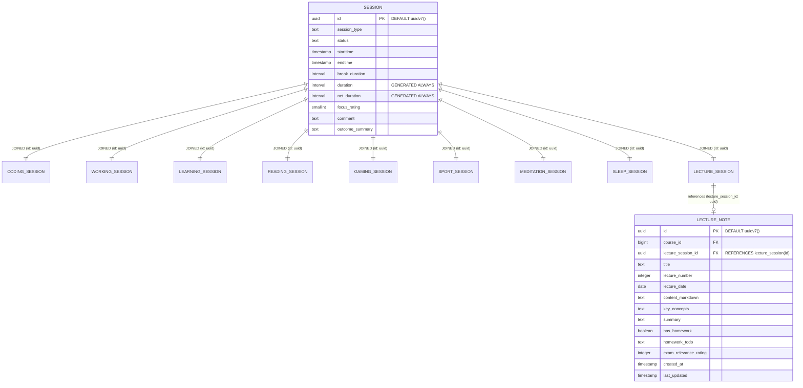

# Architectural Plan: Migration of Session Hierarchy to Native UUIDv7

## 1. Executive Summary & Problem Statement

### 1.1. Context & Inconsistency
Simon's Life Manager (SLM) recently introduced first-class academic tracking and lecture notes ([ADR 017](file:///home/simon/code/eclipse/slm/DECISIONS.md#adr-017-university-courses-lecture-sessions--lecture-notes-architecture)). During this implementation, [`LectureNote`](file:///home/simon/code/eclipse/slm/src/main/java/de/oberamsystems/slm/model/LectureNote.java) was architected using **native PostgreSQL 18 `UUID`** (`DEFAULT uuidv7()`) and Hibernate 7's `@UuidGenerator(style = Style.VERSION_7)` mapping to `java.util.UUID`.

However, the polymorphic [`Session`](file:///home/simon/code/eclipse/slm/src/main/java/de/oberamsystems/slm/model/Session.java) hierarchy—established earlier in [ADR 001](file:///home/simon/code/eclipse/slm/DECISIONS.md#adr-001-session-hierarchy-duration-calculation--identifier-strategy)—stores UUIDv7 values as **canonical 36-character `TEXT` strings** (`id TEXT PRIMARY KEY`) mapped to `java.lang.String` in JPA. Furthermore, foreign key references to sessions (such as `lecture_note.lecture_session_id`) are currently typed as `TEXT REFERENCES lecture_session(id)`.

This creates a split architecture in the codebase:
- **`LectureNote`**: Native `java.util.UUID` entity field, PostgreSQL `uuid` column type, database default `uuidv7()`.
- **`Session` and all 9 subclasses**: `java.lang.String` entity field, PostgreSQL `TEXT` column type, manually generated in Java `@PrePersist` or constructor.

### 1.2. Objectives & Success Criteria
1. **Unify Primary Key Representation**: Migrate `Session.id` and all 9 joined subclass tables to native PostgreSQL `UUID` and `java.util.UUID`.
2. **Standardize Generator Strategy**: Utilize Hibernate 7's `@UuidGenerator(style = Style.VERSION_7)` with `@GeneratedValue` across all session entities, backed by PostgreSQL 18's `DEFAULT uuidv7()`.
3. **Synchronize Foreign Keys**: Migrate `lecture_note.lecture_session_id` from `TEXT` to native `UUID`.
4. **Update Repositories & Controllers**: Transition all 10 session repositories to `JpaRepository<T, UUID>`, update Web endpoints (`SessionController`, `AcademicController`), and Spring AI MCP server tools.
5. **Zero Data Loss Migration**: Provide a non-destructive incremental migration script (`migration_2026-10-19_1.sql`) upgrading existing PostgreSQL databases via `USING id::uuid`.
6. **Authoritative Baselines & Invariant Preservation**: Synchronize `tables.sql`, `init.sql`, and `schema-init.sql`. Maintain all four-pillar life balance invariants, polymorphic joined inheritance, and test coverage.

---

## 2. Technical & Domain Architecture

### 2.1. Entity Hierarchy & Foreign Key Relationship Diagram



### 2.2. Architectural Comparison: `TEXT` vs. Native `UUID`

| Dimension | Legacy Strategy (`TEXT`) | Target Strategy (Native `UUID`) | Benefit / Impact |
| :--- | :--- | :--- | :--- |
| **Storage Footprint** | 36 bytes (ASCII) + 1–4 bytes varlena header | **16 bytes fixed** | >55% reduction in primary key and index size |
| **B-Tree Indexing** | Character-by-character string comparison | **Direct 128-bit integer comparison** | Significantly faster index traversal and cache locality |
| **PostgreSQL 18 Synergy** | Cannot use `DEFAULT uuidv7()` directly | **`DEFAULT uuidv7()` natively supported** | DB-level auto-generation for direct SQL inserts |
| **Hibernate 7 Mapping** | Requires custom `@PrePersist` / manual string generation | **Standard `@UuidGenerator(style = Style.VERSION_7)`** | Standardized, automated UUIDv7 generation |
| **Type Safety** | Permissive: accepts arbitrary strings | **Strict: guarantees valid UUID at DB & Java level** | Prevents malformed identifiers |
| **Foreign Key Consistency** | `lecture_note.lecture_session_id` was `TEXT` | **`UUID` referencing `UUID`** | Referential type integrity |

---

## 3. Detailed Implementation Phases

### Phase 1: Database Schema Baseline Updates & Non-Destructive Migration Script

#### 1.1. Synchronize Authoritative Baseline Schemas
Update the primary key column definition in:
- [`src/main/resources/tables.sql`](file:///home/simon/code/eclipse/slm/src/main/resources/tables.sql)
- [`init.sql`](file:///home/simon/code/eclipse/slm/init.sql)
- [`src/test/resources/schema-init.sql`](file:///home/simon/code/eclipse/slm/src/test/resources/schema-init.sql)

**SQL Definition Changes:**
```sql
-- Root table
CREATE TABLE session(
    id UUID PRIMARY KEY DEFAULT uuidv7(),
    session_type TEXT NOT NULL,
    status TEXT NOT NULL DEFAULT 'COMPLETED',
    starttime TIMESTAMP NOT NULL,
    endtime TIMESTAMP,
    break_duration INTERVAL NOT NULL DEFAULT '0 seconds',
    duration INTERVAL GENERATED ALWAYS AS (endtime - starttime) STORED,
    net_duration INTERVAL GENERATED ALWAYS AS (endtime - starttime - break_duration) STORED,
    focus_rating SMALLINT CHECK (focus_rating BETWEEN 1 AND 5),
    comment TEXT,
    outcome_summary TEXT
);

-- Subclass joined tables (all 9 tables)
CREATE TABLE sport_session(id UUID PRIMARY KEY REFERENCES session(id) ON DELETE CASCADE, type BIGINT REFERENCES sporttype(id));
CREATE TABLE meditation_session(id UUID PRIMARY KEY REFERENCES session(id) ON DELETE CASCADE);
CREATE TABLE reading_session(id UUID PRIMARY KEY REFERENCES session(id) ON DELETE CASCADE, book_id BIGINT REFERENCES book(id), start_page_count INTEGER, end_page_count INTEGER, reading_speed REAL);
CREATE TABLE learning_session(id UUID PRIMARY KEY REFERENCES session(id) ON DELETE CASCADE, learning_item_id BIGINT REFERENCES learning_item(id), units_completed INTEGER);
CREATE TABLE gaming_session(id UUID PRIMARY KEY REFERENCES session(id) ON DELETE CASCADE, game_id BIGINT NOT NULL REFERENCES game(id), device_id BIGINT REFERENCES device(id), game_mode TEXT);
CREATE TABLE coding_session(id UUID PRIMARY KEY REFERENCES session(id) ON DELETE CASCADE, project TEXT, repository TEXT, branch TEXT, ticket TEXT, language TEXT);
CREATE TABLE working_session(id UUID PRIMARY KEY REFERENCES session(id) ON DELETE CASCADE, employer_id BIGINT REFERENCES employer(id), project TEXT, billable BOOLEAN DEFAULT TRUE, hourly_rate NUMERIC(10, 2), task_category TEXT);
CREATE TABLE sleep_session(id UUID PRIMARY KEY REFERENCES session(id) ON DELETE CASCADE, is_nap BOOLEAN DEFAULT FALSE, deep_sleep_duration INTERVAL, rem_sleep_duration INTERVAL, awake_count INTEGER DEFAULT 0);
CREATE TABLE lecture_session (id UUID PRIMARY KEY REFERENCES session(id) ON DELETE CASCADE, course_id BIGINT REFERENCES course(id) ON DELETE SET NULL, lecture_number INTEGER, topic TEXT, room TEXT, recording_url TEXT, slides_url TEXT);

-- Referenced table
CREATE TABLE lecture_note (
    id UUID PRIMARY KEY DEFAULT uuidv7(),
    course_id BIGINT REFERENCES course(id) ON DELETE CASCADE,
    lecture_session_id UUID REFERENCES lecture_session(id) ON DELETE SET NULL,
    title TEXT NOT NULL,
    lecture_number INTEGER,
    lecture_date DATE,
    content_markdown TEXT,
    key_concepts TEXT,
    summary TEXT,
    has_homework BOOLEAN DEFAULT FALSE,
    homework_todo TEXT,
    exam_relevance_rating INTEGER,
    created_at TIMESTAMP,
    last_updated TIMESTAMP
);
```

#### 1.2. Create Incremental Migration Script
Create [`src/main/resources/migration_2026-10-19_1.sql`](file:///home/simon/code/eclipse/slm/src/main/resources/) to migrate existing/legacy databases.

**Migration Protocol:**
In PostgreSQL, altering primary keys that participate in foreign key constraints requires dropping dependent constraints, altering the column types via explicit type coercion (`USING id::uuid`), and restoring foreign key constraints.

```sql
-- Migration 2026-10-19_1: Migrate Session Hierarchy and Related Foreign Keys from TEXT to native UUIDv7

BEGIN;

-- 1. Drop existing foreign key constraints referencing session(id) and lecture_session(id)
ALTER TABLE IF EXISTS lecture_note DROP CONSTRAINT IF EXISTS lecture_note_lecture_session_id_fkey;
ALTER TABLE IF EXISTS sport_session DROP CONSTRAINT IF EXISTS sport_session_id_fkey;
ALTER TABLE IF EXISTS meditation_session DROP CONSTRAINT IF EXISTS meditation_session_id_fkey;
ALTER TABLE IF EXISTS reading_session DROP CONSTRAINT IF EXISTS reading_session_id_fkey;
ALTER TABLE IF EXISTS learning_session DROP CONSTRAINT IF EXISTS learning_session_id_fkey;
ALTER TABLE IF EXISTS gaming_session DROP CONSTRAINT IF EXISTS gaming_session_id_fkey;
ALTER TABLE IF EXISTS coding_session DROP CONSTRAINT IF EXISTS coding_session_id_fkey;
ALTER TABLE IF EXISTS working_session DROP CONSTRAINT IF EXISTS working_session_id_fkey;
ALTER TABLE IF EXISTS sleep_session DROP CONSTRAINT IF EXISTS sleep_session_id_fkey;
ALTER TABLE IF EXISTS lecture_session DROP CONSTRAINT IF EXISTS lecture_session_id_fkey;

-- 2. Alter root session table primary key to UUID and set default to uuidv7()
ALTER TABLE session ALTER COLUMN id TYPE UUID USING id::uuid;
ALTER TABLE session ALTER COLUMN id SET DEFAULT uuidv7();

-- 3. Alter all joined subclass tables primary keys to UUID
ALTER TABLE sport_session ALTER COLUMN id TYPE UUID USING id::uuid;
ALTER TABLE meditation_session ALTER COLUMN id TYPE UUID USING id::uuid;
ALTER TABLE reading_session ALTER COLUMN id TYPE UUID USING id::uuid;
ALTER TABLE learning_session ALTER COLUMN id TYPE UUID USING id::uuid;
ALTER TABLE gaming_session ALTER COLUMN id TYPE UUID USING id::uuid;
ALTER TABLE coding_session ALTER COLUMN id TYPE UUID USING id::uuid;
ALTER TABLE working_session ALTER COLUMN id TYPE UUID USING id::uuid;
ALTER TABLE sleep_session ALTER COLUMN id TYPE UUID USING id::uuid;
ALTER TABLE lecture_session ALTER COLUMN id TYPE UUID USING id::uuid;

-- 4. Alter lecture_note.lecture_session_id foreign key column to UUID
ALTER TABLE lecture_note ALTER COLUMN lecture_session_id TYPE UUID USING lecture_session_id::uuid;

-- 5. Re-create foreign key constraints with ON DELETE rules preserved
ALTER TABLE sport_session ADD CONSTRAINT sport_session_id_fkey FOREIGN KEY (id) REFERENCES session(id) ON DELETE CASCADE;
ALTER TABLE meditation_session ADD CONSTRAINT meditation_session_id_fkey FOREIGN KEY (id) REFERENCES session(id) ON DELETE CASCADE;
ALTER TABLE reading_session ADD CONSTRAINT reading_session_id_fkey FOREIGN KEY (id) REFERENCES session(id) ON DELETE CASCADE;
ALTER TABLE learning_session ADD CONSTRAINT learning_session_id_fkey FOREIGN KEY (id) REFERENCES session(id) ON DELETE CASCADE;
ALTER TABLE gaming_session ADD CONSTRAINT gaming_session_id_fkey FOREIGN KEY (id) REFERENCES session(id) ON DELETE CASCADE;
ALTER TABLE coding_session ADD CONSTRAINT coding_session_id_fkey FOREIGN KEY (id) REFERENCES session(id) ON DELETE CASCADE;
ALTER TABLE working_session ADD CONSTRAINT working_session_id_fkey FOREIGN KEY (id) REFERENCES session(id) ON DELETE CASCADE;
ALTER TABLE sleep_session ADD CONSTRAINT sleep_session_id_fkey FOREIGN KEY (id) REFERENCES session(id) ON DELETE CASCADE;
ALTER TABLE lecture_session ADD CONSTRAINT lecture_session_id_fkey FOREIGN KEY (id) REFERENCES session(id) ON DELETE CASCADE;

ALTER TABLE lecture_note ADD CONSTRAINT lecture_note_lecture_session_id_fkey FOREIGN KEY (lecture_session_id) REFERENCES lecture_session(id) ON DELETE SET NULL;
 
COMMIT;
```

---

### Phase 2: JPA Domain Model Modernization

#### 2.1. Update [`Session.java`](file:///home/simon/code/eclipse/slm/src/main/java/de/oberamsystems/slm/model/Session.java)
- Replace `@Column(name = "id", columnDefinition = "TEXT") private String id;` with:
  ```java
  @Id
  @GeneratedValue
  @UuidGenerator(style = Style.VERSION_7)
  @Column(name = "id", columnDefinition = "uuid")
  private UUID id;
  ```
- Update constructors:
  - Default constructor `public Session() {}`
  - Parameterized constructor: `public Session(UUID id, String status, ...)`
- Update getters/setters:
  - `public UUID getId() { return id; }`
  - `public void setId(UUID id) { this.id = id; }`
- Update `@PrePersist`:
  ```java
  @PrePersist
  public void prePersist() {
      if (this.id == null) {
          this.id = UUID.ofEpochMillis(System.currentTimeMillis());
      }
  }
  ```
  *(Ensures non-Hibernate unit tests retain auto-generation of valid RFC 9562 Version 7 UUIDs).*

#### 2.2. Verify Subclass Entities
Verify that none of the 9 concrete subclasses override `getId()` or declare incompatible `super(...)` calls:
- [`CodingSession.java`](file:///home/simon/code/eclipse/slm/src/main/java/de/oberamsystems/slm/model/CodingSession.java)
- [`WorkingSession.java`](file:///home/simon/code/eclipse/slm/src/main/java/de/oberamsystems/slm/model/WorkingSession.java)
- [`LearningSession.java`](file:///home/simon/code/eclipse/slm/src/main/java/de/oberamsystems/slm/model/LearningSession.java)
- [`ReadingSession.java`](file:///home/simon/code/eclipse/slm/src/main/java/de/oberamsystems/slm/model/ReadingSession.java)
- [`GamingSession.java`](file:///home/simon/code/eclipse/slm/src/main/java/de/oberamsystems/slm/model/GamingSession.java)
- [`SportSession.java`](file:///home/simon/code/eclipse/slm/src/main/java/de/oberamsystems/slm/model/SportSession.java)
- [`MeditationSession.java`](file:///home/simon/code/eclipse/slm/src/main/java/de/oberamsystems/slm/model/MeditationSession.java)
- [`SleepSession.java`](file:///home/simon/code/eclipse/slm/src/main/java/de/oberamsystems/slm/model/SleepSession.java)
- [`LectureSession.java`](file:///home/simon/code/eclipse/slm/src/main/java/de/oberamsystems/slm/model/LectureSession.java)

#### 2.3. Check [`LectureNote.java`](file:///home/simon/code/eclipse/slm/src/main/java/de/oberamsystems/slm/model/LectureNote.java)
The `@OneToOne(optional = true) @JoinColumn(name = "lecture_session_id") private LectureSession lectureSession;` mapping will automatically resolve to the underlying `UUID` target without mapping modifications.

---

### Phase 3: Spring Data JPA Repositories

Update repository interfaces extending `JpaRepository<T, ID>` to declare `UUID` as ID type parameter:

1. [`SessionRepository.java`](file:///home/simon/code/eclipse/slm/src/main/java/de/oberamsystems/slm/model/SessionRepository.java):
   ```java
   public interface SessionRepository extends JpaRepository<Session, UUID>
   ```
2. [`CodingSessionRepository.java`](file:///home/simon/code/eclipse/slm/src/main/java/de/oberamsystems/slm/model/CodingSessionRepository.java):
   ```java
   public interface CodingSessionRepository extends JpaRepository<CodingSession, UUID>
   ```
3. [`WorkingSessionRepository.java`](file:///home/simon/code/eclipse/slm/src/main/java/de/oberamsystems/slm/model/WorkingSessionRepository.java):
   ```java
   public interface WorkingSessionRepository extends JpaRepository<WorkingSession, UUID>
   ```
4. [`LearningSessionRepository.java`](file:///home/simon/code/eclipse/slm/src/main/java/de/oberamsystems/slm/model/LearningSessionRepository.java):
   ```java
   public interface LearningSessionRepository extends JpaRepository<LearningSession, UUID>
   ```
5. [`ReadingSessionRepository.java`](file:///home/simon/code/eclipse/slm/src/main/java/de/oberamsystems/slm/model/ReadingSessionRepository.java):
   ```java
   public interface ReadingSessionRepository extends JpaRepository<ReadingSession, UUID>
   ```
6. [`GamingSessionRepository.java`](file:///home/simon/code/eclipse/slm/src/main/java/de/oberamsystems/slm/model/GamingSessionRepository.java):
   ```java
   public interface GamingSessionRepository extends JpaRepository<GamingSession, UUID>
   ```
7. [`SportSessionRepository.java`](file:///home/simon/code/eclipse/slm/src/main/java/de/oberamsystems/slm/model/SportSessionRepository.java):
   ```java
   public interface SportSessionRepository extends JpaRepository<SportSession, UUID>
   ```
8. [`MeditationSessionRepository.java`](file:///home/simon/code/eclipse/slm/src/main/java/de/oberamsystems/slm/model/MeditationSessionRepository.java):
   ```java
   public interface MeditationSessionRepository extends JpaRepository<MeditationSession, UUID>
   ```
9. [`SleepSessionRepository.java`](file:///home/simon/code/eclipse/slm/src/main/java/de/oberamsystems/slm/model/SleepSessionRepository.java):
   ```java
   public interface SleepSessionRepository extends JpaRepository<SleepSession, UUID>
   ```
10. [`LectureSessionRepository.java`](file:///home/simon/code/eclipse/slm/src/main/java/de/oberamsystems/slm/model/LectureSessionRepository.java):
    ```java
    public interface LectureSessionRepository extends JpaRepository<LectureSession, UUID>
    ```
11. [`LectureNoteRepository.java`](file:///home/simon/code/eclipse/slm/src/main/java/de/oberamsystems/slm/model/LectureNoteRepository.java):
    Update query method parameter:
    ```java
    Optional<LectureNote> findByLectureSessionId(UUID lectureSessionId);
    ```

---

### Phase 4: Web Controllers, Templates & Services

#### 4.1. [`SessionController.java`](file:///home/simon/code/eclipse/slm/src/main/java/de/oberamsystems/slm/controller/SessionController.java)
- Update session deletion endpoint to bind `UUID`:
  ```java
  @PostMapping("/sessions/delete/{id}")
  public String deleteSession(@PathVariable UUID id,
          @RequestParam(required = false, defaultValue = "ALL") String returnType) {
      sessionRepo.deleteById(id);
      return "redirect:/sessions?type=" + returnType;
  }
  ```
  *(Spring MVC automatically uses its built-in `StringToUUIDConverter` to parse path variables seamlessly).*

#### 4.2. [`AcademicController.java`](file:///home/simon/code/eclipse/slm/src/main/java/de/oberamsystems/slm/controller/AcademicController.java)
- In `newNoteForCourse`:
  ```java
  @GetMapping("/courses/{courseId}/notes/new")
  public String newNoteForCourse(@PathVariable Long courseId,
          @RequestParam(required = false) UUID sessionId,
          Model model) {
      ...
      if (sessionId != null) {
          lectureSessionRepo.findById(sessionId).ifPresent(s -> {
              note.setLectureSession(s);
              note.setLectureNumber(s.getLectureNumber());
              if (s.getTopic() != null) {
                  note.setTitle(s.getTopic());
              }
          });
      }
      ...
  }
  ```
- In `saveNote`:
  ```java
  @PostMapping("/notes")
  public String saveNote(@ModelAttribute LectureNote note, @RequestParam(required = false) UUID sessionId) {
      ...
      UUID sid = (sessionId != null) ? sessionId :
              (note.getLectureSession() != null && note.getLectureSession().getId() != null
                      ? note.getLectureSession().getId() : null);
      if (sid != null) {
          lectureSessionRepo.findById(sid).ifPresent(note::setLectureSession);
      } else {
          note.setLectureSession(null);
      }
      ...
  }
  ```

#### 4.3. Thymeleaf Templates Compatibility
- Templates (`sessions.html`, `coding-sessions.html`, `working-sessions.html`, `lecture-note-edit.html`, etc.) render `${s.id}` and `${note.lectureSession.id}`. In Thymeleaf and SpEL, accessing a `UUID` invokes `UUID.toString()`, and equality comparisons (`note.lectureSession.id == s.id`) utilize Java `UUID.equals()`.
- No HTML modifications are required.

---

### Phase 5: Spring AI Model Context Protocol (MCP) Server

#### 5.1. [`McpSessionTools.java`](file:///home/simon/code/eclipse/slm/src/main/java/de/oberamsystems/slm/mcp/McpSessionTools.java)
- In `getRecentSessions()`: `m.put("id", s.getId());` automatically serializes to standard canonical UUID string in JSON via Jackson 3 BOM.
- In `logCodingSession()`: `res.put("id", cs.getId());` returns native `UUID`.
- In `logSleepSession()`: `res.put("id", ss.getId());` returns native `UUID`.

#### 5.2. [`McpAcademicTools.java`](file:///home/simon/code/eclipse/slm/src/main/java/de/oberamsystems/slm/mcp/McpAcademicTools.java)
- In `logLectureSession()`: `res.put("id", ls.getId());` returns native `UUID`.
- In `getCourseDetails()`: `sessions` summaries serialize `s.getId()` directly.

---

### Phase 6: Test Suite Updates & Verification

#### 6.1. Unit Tests
- [`SessionModelTest.java`](file:///home/simon/code/eclipse/slm/src/test/java/de/oberamsystems/slm/model/SessionModelTest.java):
  - Update `testPrePersistGeneratesUuidV7()`: assert `assertInstanceOf(UUID.class, session.getId())` and `assertEquals(7, session.getId().version())`.
  - Update `testSessionFieldsAndDefaults()`: set and assert `UUID.fromString("0192e200-0000-7000-8000-000000000001")`.
- [`SessionControllerTest.java`](file:///home/simon/code/eclipse/slm/src/test/java/de/oberamsystems/slm/controller/SessionControllerTest.java):
  - In `testDeleteSession()`: pass `UUID.fromString("0192e200-0000-7000-8000-000000000001")` and verify `sessionRepo.deleteById(id)`.
- Subclass unit tests ([`CodingSessionTest`](file:///home/simon/code/eclipse/slm/src/test/java/de/oberamsystems/slm/model/CodingSessionTest.java), [`WorkingSessionTest`](file:///home/simon/code/eclipse/slm/src/test/java/de/oberamsystems/slm/model/WorkingSessionTest.java), [`SubclassSessionModelTest`](file:///home/simon/code/eclipse/slm/src/test/java/de/oberamsystems/slm/model/SubclassSessionModelTest.java)):
  - Verify all `assertNotNull(s.getId())` and `assertInstanceOf(UUID.class, s.getId())`.

#### 6.2. Testcontainers Integration Tests
- [`SessionHierarchyIT.java`](file:///home/simon/code/eclipse/slm/src/test/java/de/oberamsystems/slm/SessionHierarchyIT.java):
  - Update `assertTrue(coding.getId().contains("-"))` to:
    ```java
    assertInstanceOf(UUID.class, coding.getId());
    assertEquals(7, coding.getId().version(), "ID must be a native UUIDv7");
    ```
- [`AcademicIT.java`](file:///home/simon/code/eclipse/slm/src/test/java/de/oberamsystems/slm/AcademicIT.java):
  - Update `assertTrue(lectureSession.getId().contains("-"))` to `assertInstanceOf(UUID.class, lectureSession.getId())` and `assertEquals(7, lectureSession.getId().version())`.
  - Verify linking `LectureNote` to `LectureSession` via `UUID`.
- [`SleepTimeIT.java`](file:///home/simon/code/eclipse/slm/src/test/java/de/oberamsystems/slm/SleepTimeIT.java):
  - Verify `Optional<Session> optSession = sessionRepository.findById(ss.getId())` where `ss.getId()` is `UUID`.
- [`McpServerIT.java`](file:///home/simon/code/eclipse/slm/src/test/java/de/oberamsystems/slm/McpServerIT.java):
  - Verify MCP session logging tools return valid UUIDv7 strings in JSON responses.

#### 6.3. Test Command
Per AGENTS.md guidelines (Java 27 bytecode / JaCoCo constraint):
```bash
./gradlew test -x jacocoTestReport -x compileAotTestJava
```

---

### Phase 7: Documentation, Architecture Records & Changelog

1. **Architectural Decision Record (ADR 018)**:
   - Add ADR 018 to [`DECISIONS.md`](file:///home/simon/code/eclipse/slm/DECISIONS.md): *"Migration of Polymorphic Session Hierarchy to Native PostgreSQL 18 UUIDv7"*.
   - Detail the context, decision to eliminate the `TEXT` vs `UUID` split, consequences, and database migration steps.
2. **Changelog**:
   - Update [`CHANGELOG.md`](file:///home/simon/code/eclipse/slm/CHANGELOG.md) under the active version documenting the migration from `String`/`TEXT` to `UUID`/`uuid` across `Session` and all concrete session types.
3. **Repository Guidelines**:
   - Review [`AGENTS.md`](file:///home/simon/code/eclipse/slm/AGENTS.md) Section 7.2 to reflect that `Session` defines `id UUID PRIMARY KEY (UUIDv7)`.

---

## 4. Risk Analysis & Mitigation Matrix

| Risk | Impact | Likelihood | Mitigation Strategy |
| :--- | :--- | :--- | :--- |
| Foreign key constraint violation during `ALTER COLUMN` on legacy databases | High | Low | Drop foreign key constraints before altering column types, alter columns using explicit `USING id::uuid`, and restore constraints in migration script. |
| Incompatible `id` binding in Spring MVC controllers | Medium | Low | Spring Boot 4's built-in `StringToUUIDConverter` natively binds UUID path variables and query parameters. Validated via `SessionControllerTest` and `AcademicIT`. |
| Breaking joined table polymorphism in Hibernate | High | Low | Root `Session` defines `@Id @GeneratedValue @UuidGenerator(style = Style.VERSION_7)`. Subclasses automatically inherit the primary key and foreign key joining on `id`. Verified in `SessionHierarchyIT`. |
| Unsaved entity ID generation in standalone unit tests | Medium | Low | Keep `@PrePersist` in `Session.java` checking `if (this.id == null) { this.id = UUID.ofEpochMillis(System.currentTimeMillis()); }` for test fixtures not using Hibernate's persistence pipeline. |
