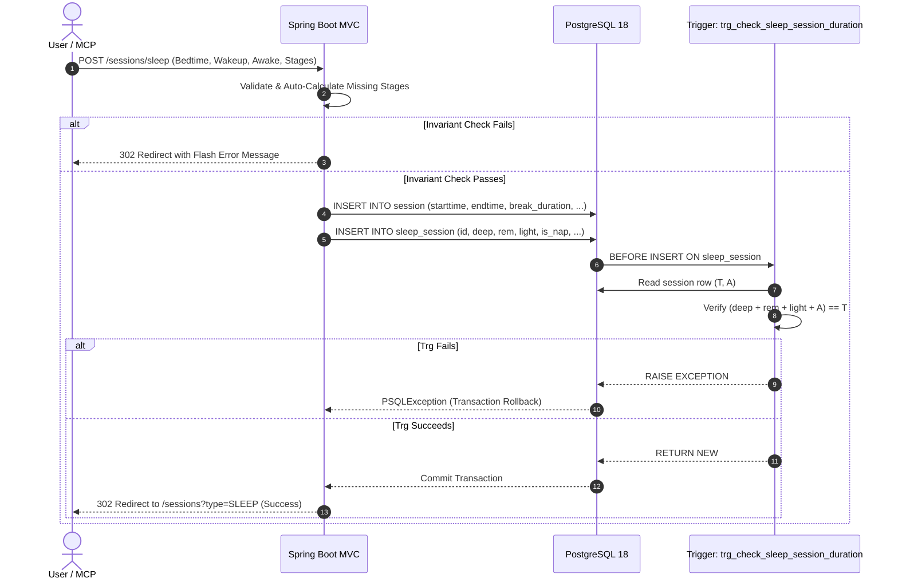

# Architectural Plan: Sleep Stage Durations, Light Sleep & Bidirectional Consistency Validation

## 1. Executive Summary & Problem Statement

### 1.1. Context & Motivation
In Simon's Life Manager (SLM), sleep is a primary restorative practice within the **Wellness** pillar ([ADR 011](file:///home/simon/code/eclipse/slm/DECISIONS.md#adr-011-four-pillars-life-balance-model--wellness-session-domain-separation)).
Currently, the [`SleepSession`](file:///home/simon/code/eclipse/slm/src/main/java/de/oberamsystems/slm/model/SleepSession.java) entity and joined database table `sleep_session` only define:
- `deep_sleep_duration` (`deepSleepMinutes`)
- `rem_sleep_duration` (`remSleepMinutes`)
- `awake_count`
- `break_duration` (inherited from `session`, representing disruptions / awake time)

This creates two domain and data integrity deficiencies:
1. **Missing Light Sleep**: Standard polysomnography and wearable trackers (Apple Watch, Oura, Garmin, Whoop) report sleep broken down into four mutually exclusive segments: **Awake**, **Light Sleep**, **Deep Sleep**, and **REM Sleep**. Currently, light sleep cannot be tracked, leading to incomplete sleep architecture records.
2. **Lack of Sum Invariant & Rigid Form Inputs**:
   - There is no consistency guarantee that `deep + rem + light + awake` equals total gross bedtime duration (`endtime - starttime`). Users could inadvertently enter numbers that contradict their recorded bedtime and wake-up times.
   - Users who do not wear sleep trackers or who only know total sleep time cannot log a simple night of sleep without leaving all stages blank (which leaves durations unrepresented) or manually calculating stages.

### 1.2. Objectives & User Requirements
1. **First-Class Light Sleep**: Add `lightSleepDuration` (`light_sleep_duration INTERVAL`) to `SleepSession` and its database schema.
2. **Graceful Defaulting for Untracked Stages**: When logging via the UI, if Deep Sleep, REM Sleep, and Light Sleep are all left empty/unspecified, automatically assign the entire net sleep duration (`(endtime - starttime) - break_duration`) to **Light Sleep**.
3. **Automatic Deduction of Single Missing Stage**: If exactly one sleep duration (e.g., REM Sleep, Deep Sleep, or Light Sleep) is left empty while the other two are entered, automatically calculate the missing duration from `(endtime - starttime) - break_duration - sum(other stages)`.
4. **Input Validation**: Reject any combination of deep, rem, light, and awake times that does not sum to `endtime - starttime` (wake-up time minus bedtime), providing friendly, actionable error feedback to the user.
5. **Database-Level Constraint Enforcement**: Enforce this sum invariant directly in PostgreSQL 18 via transactional triggers on both `sleep_session` and `session`, preventing inconsistent states from any entry point (UI, API, MCP tools, direct SQL).
6. **Zero-Downtime Transactional Migration**: Author an atomic `migration_2026-10-19_2.sql` enclosed in `BEGIN;` ... `COMMIT;` that backfills existing sleep session records to satisfy the invariant and installs the triggers.

---

## 2. Mathematical Model & Calculation Rules

Let:
- $S = \text{starttime}$ (Bedtime)
- $E = \text{endtime}$ (Wake-up time)
- $T = E - S = \text{total gross duration in bed}$ (must be $> 0$)
- $A = \text{break\_duration}$ (Awake / disruption time, $\ge 0$, defaults to 0)
- $T_{\text{sleep}} = T - A = \text{net sleep time}$ (must be $> 0$)

Sleep stages:
- $D = \text{deepSleepMinutes}$
- $R = \text{remSleepMinutes}$
- $L = \text{lightSleepMinutes}$

The fundamental domain invariant is:
$$D + R + L + A = T \iff D + R + L = T_{\text{sleep}}$$

### Input Resolution Matrix

| Scenario | Input State | Calculation / Action | Outcome |
| :--- | :--- | :--- | :--- |
| **All Stages Empty** | $D = \text{null}, R = \text{null}, L = \text{null}$ | Set $L = T_{\text{sleep}}$, $D = 0$, $R = 0$ | Total sleep defaults to Light Sleep. Invariant holds. |
| **Exactly 1 Missing** | 2 of $\{D, R, L\}$ specified, 1 null | Solve for missing stage: $\text{missing} = T_{\text{sleep}} - \sum(\text{provided})$ | If calculated $\ge 0$, assign value. If $< 0$, reject as validation error. |
| **All 3 Specified** | $D, R, L$ all non-null | Validate: $D + R + L == T_{\text{sleep}}$ | If equal, accept. If unequal, reject with validation error. |
| **2 Stages Missing** | Only 1 of $\{D, R, L\}$ specified | Cannot deduce 2 unknowns | Reject: prompt user to leave all empty or provide at least 2 stages. |

---

## 3. Database Schema & Migration Architecture

### 3.1. Entity-Relationship & Trigger Flow



### 3.2. Cross-Table Constraint Strategy in PostgreSQL
In PostgreSQL joined table inheritance (`InheritanceType.JOINED`), `session` and `sleep_session` are separate physical tables. Standard SQL `CHECK` constraints cannot query other tables.

Therefore, we enforce this constraint using PostgreSQL PL/pgSQL trigger functions:

#### 1. Trigger on `sleep_session`: `trg_check_sleep_session_duration`
Fires `BEFORE INSERT OR UPDATE ON sleep_session FOR EACH ROW`.
- Reads `starttime`, `endtime`, and `break_duration` from the corresponding `session` record.
- Computes $T = \text{endtime} - \text{starttime}$.
- Computes $S = \text{COALESCE}(D, 0) + \text{COALESCE}(R, 0) + \text{COALESCE}(L, 0) + \text{COALESCE}(A, 0)$.
- If $S \ne T$, raises an exception with a descriptive error message and cancels the statement.

#### 2. Trigger on `session`: `trg_check_session_sleep_duration`
Fires `AFTER UPDATE OF starttime, endtime, break_duration ON session FOR EACH ROW WHEN (NEW.session_type = 'SLEEP')`.
- If a sleep session's start, end, or break time is modified on `session`, reads the stages from `sleep_session` and verifies the sum still holds.

### 3.3. Transactional Migration Script (`migration_2026-10-19_2.sql`)
In accordance with `AGENTS.md` Section 6, the migration script must be transactional (`BEGIN;` ... `COMMIT;`) and non-destructive:
1. `ALTER TABLE sleep_session ADD COLUMN IF NOT EXISTS light_sleep_duration INTERVAL;`
2. **Backfill Existing Data**:
   - For all existing rows where `light_sleep_duration IS NULL`, calculate:
     `light_sleep_duration = (s.endtime - s.starttime - s.break_duration) - COALESCE(ss.deep_sleep_duration, '0'::interval) - COALESCE(ss.rem_sleep_duration, '0'::interval)`.
   - This ensures all existing records satisfy the constraint before triggers are installed.
3. Install trigger functions and triggers.
4. Synchronize authoritative baseline files:
   - [`src/main/resources/tables.sql`](file:///home/simon/code/eclipse/slm/src/main/resources/tables.sql)
   - [`init.sql`](file:///home/simon/code/eclipse/slm/init.sql)
   - [`src/test/resources/schema-init.sql`](file:///home/simon/code/eclipse/slm/src/test/resources/schema-init.sql)

---

## 4. Application Implementation Details

### 4.1. JPA Model Updates ([`SleepSession.java`](file:///home/simon/code/eclipse/slm/src/main/java/de/oberamsystems/slm/model/SleepSession.java))
- Add field:
  ```java
  @Type(PostgreSQLIntervalType.class)
  @Column(name = "light_sleep_duration", columnDefinition = "interval")
  private Duration lightSleepDuration;
  ```
- Add getter `getLightSleepDuration()` and setter `setLightSleepDuration(Duration)`.

### 4.2. Web Controller Logic ([`SessionController.java`](file:///home/simon/code/eclipse/slm/src/main/java/de/oberamsystems/slm/controller/SessionController.java))
Update `/sessions/sleep` endpoint:
```java
@PostMapping("/sessions/sleep")
public String submitSleepSession(
        @ModelAttribute SleepSession session,
        @RequestParam(required = false, defaultValue = "0") Long breakMinutes,
        @RequestParam(required = false) Long deepSleepMinutes,
        @RequestParam(required = false) Long remSleepMinutes,
        @RequestParam(required = false) Long lightSleepMinutes,
        RedirectAttributes redirectAttributes)
```

#### Step-by-Step Resolution Algorithm:
1. Validate $S$ and $E$ are present and $E > S$. If not, return error.
2. Calculate total gross minutes: $T = \text{Duration.between}(S, E).\text{toMinutes}()$.
3. Normalize awake time $A = \max(0, \text{breakMinutes})$. If $A \ge T$, return error (awake time cannot equal or exceed time in bed).
4. Calculate net sleep time: $T_{\text{sleep}} = T - A$.
5. Inspect stage inputs ($D, R, L$):
   - **All null / empty**:
     $L = T_{\text{sleep}}$, $D = 0$, $R = 0$.
   - **Exactly one null**:
     - If $D$ is null: $D = T_{\text{sleep}} - R - L$.
     - If $R$ is null: $R = T_{\text{sleep}} - D - L$.
     - If $L$ is null: $L = T_{\text{sleep}} - D - R$.
     - If the calculated stage $< 0$, return error: `"Sleep stages exceed available sleep duration."`
   - **All three non-null**:
     - Check: If $D + R + L \ne T_{\text{sleep}}$, return error:
       `"Sleep stages sum (" + (D + R + L + A) + "m) does not equal total bedtime duration (" + T + "m)."`
   - **Only one non-null (two null)**:
     - Return error:
       `"Please either leave all sleep stages empty (to default to light sleep) or provide at least two sleep stages so the missing duration can be calculated."`
6. Set durations on `session`:
   - `session.setBreakDuration(Duration.ofMinutes(A));`
   - `session.setDeepSleepDuration(Duration.ofMinutes(D));`
   - `session.setRemSleepDuration(Duration.ofMinutes(R));`
   - `session.setLightSleepDuration(Duration.ofMinutes(L));`
7. Save via `sleepSessionRepo.save(session)`.
8. Redirect with success message to `/sessions?type=SLEEP`.

### 4.3. Spring AI MCP Server Tools ([`McpSessionTools.java`](file:///home/simon/code/eclipse/slm/src/main/java/de/oberamsystems/slm/mcp/McpSessionTools.java))
Update `logSleepSession` to accept `lightSleepMinutes`, and if all stages are omitted by the AI agent, automatically assign `lightSleepDuration = (end - start) - breakDuration` so agent calls satisfy the database constraint.

### 4.4. UI & Form Enhancements ([`sessions.html`](file:///home/simon/code/eclipse/slm/src/main/resources/templates/sessions.html))
1. **Sleep Table Details**:
   Render Light Sleep in session row details:
   `Deep: 1h 45m • REM: 1h 30m • Light: 5h 00m`.
2. **Form Inputs**:
   Add `Light Sleep (minutes)` input alongside Deep and REM sleep in `#form-sleep`.
3. **Alert Banner**:
   Add an alert container above the table to render flash error messages:
   ```html
   <div th:if="${errorMessage}" class="alert alert-danger alert-dismissible fade show shadow-sm" role="alert">
       <i class="bi bi-exclamation-triangle-fill me-2"></i>
       <span th:text="${errorMessage}">Validation Error</span>
       <button type="button" class="btn-close" data-bs-dismiss="alert" aria-label="Close"></button>
   </div>
   ```
4. **Client-Side Live Calculation & Feedback**:
   Add dynamic JavaScript in the modal:
   - When bedtime, wake-up time, or any stage input changes, calculate and display live badges:
     - `Total Bedtime: 8h 15m`
     - `Accounted: 6h 45m`
     - `Difference / Auto-calc: 1h 30m`
   - Live hint: *"Leaving REM Sleep empty will automatically set it to 1h 30m"* or *"Leaving all stages empty will default entire 8h 00m to Light Sleep."*

---

## 5. Test Suite & Verification Strategy

### 5.1. Integration Tests ([`SleepSessionUIIT.java`](file:///home/simon/code/eclipse/slm/src/test/java/de/oberamsystems/slm/SleepSessionUIIT.java))
Add dedicated test cases to verify the new functionality end-to-end:
1. `testAddSleepSessionWithAllStagesEmptyDefaultsToLightSleep()`:
   - Bedtime: 22:00, Wakeup: 06:00 (8h), Break: 15m (465m net).
   - Empty deep, rem, light.
   - Asserts: `lightSleepDuration` = 465m, `deepSleepDuration` = 0, `remSleepDuration` = 0.
   - Asserts UI renders `"Light: 07:45"`.
2. `testAddSleepSessionWithMissingRemSleepAutoCalculated()`:
   - Total: 8h (480m), Break: 0m.
   - Deep: 90m, Light: 290m, REM: empty.
   - Asserts: REM automatically calculated as $480 - 90 - 290 = 100\text{m}$.
   - Asserts UI renders `"REM: 01:40"`.
3. `testAddSleepSessionWithMissingDeepSleepAutoCalculated()`:
   - Total: 8h (480m), Break: 0m.
   - REM: 100m, Light: 300m, Deep: empty.
   - Asserts: Deep automatically calculated as $480 - 100 - 300 = 80\text{m}$.
4. `testAddSleepSessionWithMissingLightSleepAutoCalculated()`:
   - Total: 8h (480m), Break: 10m (470m net).
   - Deep: 100m, REM: 90m, Light: empty.
   - Asserts: Light automatically calculated as $470 - 100 - 90 = 280\text{m}$.
5. `testRejectInconsistentSleepStageDurations()`:
   - Total: 8h (480m).
   - Inputs: Deep: 120m, REM: 120m, Light: 120m (Sum 360m $\ne$ 480m).
   - Asserts: Redirected with flash error message, session not saved.
6. `testDatabaseTriggerRejectsDirectInconsistentInsert()`:
   - Directly executes raw SQL attempting to insert mismatched durations into `sleep_session`.
   - Asserts: PostgreSQL trigger raises exception and rolls back.

### 5.2. Existing Test Updates
- Update [`SleepTimeIT.java`](file:///home/simon/code/eclipse/slm/src/test/java/de/oberamsystems/slm/SleepTimeIT.java) test fixtures to assign consistent `lightSleepDuration` so they satisfy the new database trigger.
- Update [`SessionControllerTest.java`](file:///home/simon/code/eclipse/slm/src/test/java/de/oberamsystems/slm/controller/SessionControllerTest.java) to pass `lightSleepMinutes` in mock controller tests.

---

## 6. Implementation Phases & Milestones

```mermaid
gantt
    title Sleep Stage Durations & Validation Implementation
    dateFormat  X
    axisFormat %s

    section Phase 1: Database
    Schema baselines (tables, init, schema-init) :p1a, 0, 1
    Transactional migration script & triggers    :p1b, 1, 2

    section Phase 2: JPA Model
    Update SleepSession.java with lightSleep     :p2, 2, 3

    section Phase 3: Backend Logic
    SessionController calculation & validation   :p3a, 3, 4
    McpSessionTools sleep session auto-calc      :p3b, 4, 5

    section Phase 4: Frontend
    Update sessions.html table & modal inputs    :p4a, 5, 6
    Client-side live calculation & feedback JS   :p4b, 6, 7

    section Phase 5: Testing & Invariants
    Update SleepTimeIT & SessionControllerTest   :p5a, 7, 8
    Comprehensive SleepSessionUIIT test suite    :p5b, 8, 9

    section Phase 6: Documentation
    Update CHANGELOG.md and DECISIONS.md (ADR)   :p6, 9, 10
```



1. **Phase 1: Database Trigger & Schema**:
   - Write transactional migration `migration_2026-10-19_2.sql`.
   - Update `tables.sql`, `init.sql`, and `schema-init.sql`.
   - Apply migration to local development database.
2. **Phase 2: JPA Model**:
   - Update `SleepSession.java` with `lightSleepDuration`.
3. **Phase 3: Controller & Service Logic**:
   - Update `SessionController.java` with auto-calculation, validation, and flash error handling.
   - Update `McpSessionTools.java` for consistency.
4. **Phase 4: Template & JavaScript UI**:
   - Add Light Sleep input in `sessions.html`.
   - Add live stage auto-calculation in JavaScript.
   - Display error alert banner.
5. **Phase 5: Test Updates & Execution**:
   - Update `SleepTimeIT.java` and `SessionControllerTest.java`.
   - Add 6 new UI and database integration tests in `SleepSessionUIIT.java`.
   - Run `./gradlew test -x jacocoTestReport -x compileAotTestJava`.
6. **Phase 6: Living Documentation & Health Verification**:
   - Document ADR 019 in [`DECISIONS.md`](file:///home/simon/code/eclipse/slm/DECISIONS.md).
   - Document feature in [`CHANGELOG.md`](file:///home/simon/code/eclipse/slm/CHANGELOG.md) under `[0.0.2j]`.
   - Verify live bootRun instance.
