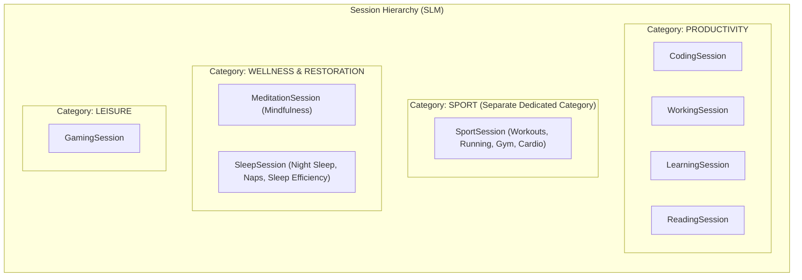

# Architectural Evaluation: Converting `SleepTime` into a `Session` Subclass

## 1. Executive Summary

This evaluation analyzes whether it is **feasible** and **reasonable** to convert the standalone [`SleepTime`](file:///home/simon/code/eclipse/slm/src/main/java/de/oberamsystems/slm/model/SleepTime.java) entity into a polymorphic subclass of [`Session`](file:///home/simon/code/eclipse/slm/src/main/java/de/oberamsystems/slm/model/Session.java) (`SleepSession extends Session`) in **Simon's Life Manager (SLM)**.

### Verdict at a Glance:
* **Feasibility:** **Extremely High (9.5/10)** — Structurally, sleep has `starttime`, `endtime`, `duration`, `break_duration` (time awake), and quality ratings, perfectly matching the existing `InheritanceType.JOINED` table architecture.
* **Reasonableness:** **High (8.5/10)** with **Category Partitioning** — Disentangling sessions into dedicated high-level categories (**`PRODUCTIVITY`**, **`SPORT`**, **`WELLNESS`**, **`LEISURE`**) prevents metric contamination and provides a holistic 24-hour life balance model.

---

## 2. Activity Categorization Model

Separating physical training from restorative health and deliberate work:

### Why `Category.SPORT` Must Be Separate from `Category.WELLNESS`:
1. **Exertion vs. Restoration:**
   - **Sport** represents deliberate physical strain, cardiovascular load, and caloric expenditure.
   - **Wellness (Meditation & Sleep)** represents parasympathetic recovery, nervous system down-regulation, and biological repair. Grouping them obscures the balance between training and recovery.
2. **KPI Precision:**
   - **Sport KPI:** Weekly active training hours, workout frequency, and intensity.
   - **Wellness / Recovery KPI:** Sleep efficiency ($\frac{\text{Net Asleep}}{\text{Gross in Bed}}$), average sleep duration, and meditation consistency.
   - **Productivity KPI:** Focused deep work and study hours (unpolluted by sleep or workouts).
   - **Leisure KPI:** Entertainment/gaming budget.

---

## 3. Structural & Domain Comparison

| Field / Concept | Current `SleepTime` | `Session` Base Class | Fit Analysis |
| :--- | :--- | :--- | :--- |
| **Primary Key** | `Long id` (BIGSERIAL) | `String id` (UUIDv7) | Requires ID migration. UUIDv7 retains chronological sorting. |
| **Start Time** | `gotobed` (TIMESTAMP) | `starttime` (TIMESTAMP) | **100% Match** — Bedtime / sleep start. |
| **End Time** | `standup` (TIMESTAMP) | `endtime` (TIMESTAMP) | **100% Match** — Wake up / get up time. |
| **Gross Duration** | `sleeptime` (`standup - gotobed`) | `duration` (`endtime - starttime`) | **100% Match** — Time in bed (gross rest duration). |
| **Awake Time / Disruptions** | *Not currently modeled* | `break_duration` (INTERVAL) | **Major Value Add** — Time awake during night (latency / disruptions). |
| **Actual Sleep Duration** | *Not currently modeled* | `net_duration` (`duration - break`) | **Major Value Add** — Time asleep = Time in bed minus awake time! |
| **Sleep Quality / Restfulness** | *Not currently modeled* | `focus_rating` (1–5 Stars) | Maps directly to sleep quality (1 = Poor/Exhausted, 5 = Greatly Refreshed). |
| **Dreams / Notes** | *Not currently modeled* | `comment` & `outcome_summary` | Perfect for dream logs, insomnia notes, or sleep hygiene factors. |
| **Session Status** | *Not applicable* | `status` (`IN_PROGRESS`, `COMPLETED`) | Allows real-time sleep tracking ("Sleeping now"). |

---

## 4. Key Advantages of `SleepSession`

### 1. True Sleep Efficiency Computation
In sleep science, a critical metric is **Sleep Efficiency** (Time Asleep vs. Time in Bed):
$$\text{Sleep Efficiency} = \frac{\text{Net Sleep Duration}}{\text{Gross Time in Bed}} \times 100\%$$
Because `Session` already has:
- `duration`: Gross time in bed ($T_{\text{wake}} - T_{\text{bed}}$).
- `break_duration`: Awake time / nighttime restlessness.
- `net_duration`: Generated column calculating actual restorative sleep.

Converting `SleepTime` into `SleepSession` immediately unlocks **first-class sleep efficiency tracking** via existing database generated columns with zero extra schema logic.

### 2. Unified 24-Hour Daily Timeline & Life Balance
With dedicated categories, SLM can visualize a complete, continuous 24-hour day:
$$\text{Sleep (Wellness)} \longrightarrow \text{Work & Code (Productivity)} \longrightarrow \text{Run / Gym (Sport)} \longrightarrow \text{Gaming (Leisure)} \longrightarrow \text{Meditation (Wellness)}$$
Because all activities share the `session` root table, a single query (`findByStartBetween`) retrieves the full daily log without stitching disparate tables.

### 3. Built-in Dream Journal and Quality Rating
`Session` already provides `focus_rating` (1–5 stars) and text columns (`comment`, `outcome_summary`). This immediately gives sleep logs:
- A 1–5 sleep quality rating widget.
- A dream diary / morning awakening notes section.

---

## 5. Potential Pitfalls & Mitigations

### 1. KPI Aggregation on the Sessions Hub (`/sessions`)
* **Risk:** If sleep is blindly summed into `/sessions`, an 8-hour sleep session will inflate "Total Focused Time" from 4 hours to 12 hours.
* **Mitigation (Category Filtering):**
  - KPI Card 1: **Deep Work & Productivity** (`Coding`, `Working`, `Learning`, `Reading`).
  - KPI Card 2: **Athletic & Fitness** (`Sport`).
  - KPI Card 3: **Mindfulness & Rest** (`Meditation`, `Sleep`).
  - KPI Card 4: **Leisure & Play** (`Gaming`).

### 2. Primary Key Migration
- `SleepTime.id` is currently `Long` (`1, 2, 3...`).
- `Session.id` is `UUIDv7` string.
- Existing views ([`sleep-times.html`](file:///home/simon/code/eclipse/slm/src/main/resources/templates/sleep-times.html) and [`sleeptime-bb.html`](file:///home/simon/code/eclipse/slm/src/main/resources/templates/sleeptime-bb.html)) would display index row numbers or date badges instead of raw database IDs.

---

## 6. Architectural Recommendation

| Question | Assessment | Rationale |
| :--- | :---: | :--- |
| **Is it technically feasible?** | **YES** | Standard JPA joined inheritance; clean column alignment. |
| **Is it semantically sound?** | **YES** | When structured with `Category.SPORT` and `Category.WELLNESS`, domain clarity is preserved. |
| **Should we proceed?** | **RECOMMENDED** | If you want sleep efficiency, awake tracking, dream journaling, and a unified 24h timeline. |
