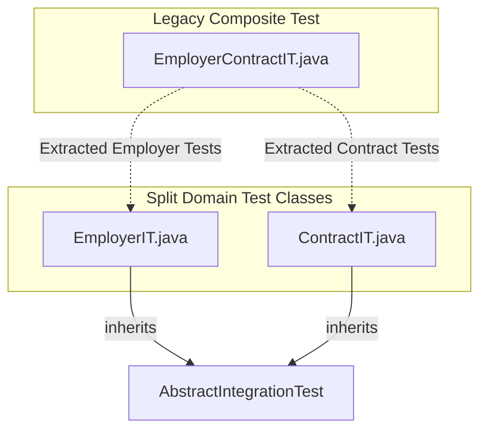

# Implementation Plan: Split EmployerContractIT into EmployerIT and ContractIT

## 1. Context & Motivation

In Simon's Life Manager (SLM), architectural decision **ADR 004** established a strict domain boundary between:
1. **Employment & Professional Income**: Tracked via [`Employer`](file:///home/simon/code/eclipse/slm/src/main/java/de/oberamsystems/slm/model/Employer.java) and referenced by [`WorkingSession`](file:///home/simon/code/eclipse/slm/src/main/java/de/oberamsystems/slm/model/WorkingSession.java).
2. **Commercial Commitments & Expenses**: Tracked via [`Contractor`](file:///home/simon/code/eclipse/slm/src/main/java/de/oberamsystems/slm/model/Contractor.java) and referenced by [`Contract`](file:///home/simon/code/eclipse/slm/src/main/java/de/oberamsystems/slm/model/Contract.java).

Currently, the integration tests for both domains reside in a single composite test file: [`EmployerContractIT.java`](file:///home/simon/code/eclipse/slm/src/test/java/de/oberamsystems/slm/EmployerContractIT.java). This violates single-responsibility testing principles and obscures test failures between unrelated domains.

### Goal
Decouple and split [`EmployerContractIT.java`](file:///home/simon/code/eclipse/slm/src/test/java/de/oberamsystems/slm/EmployerContractIT.java) into two focused, isolated integration test classes:
- **`EmployerIT.java`**: Integration tests for employer persistence and deterministic alphabetical ordering.
- **`ContractIT.java`**: Integration tests for contractors, contracts, lifecycle states, auto-extension, cancellation tracking, and non-negative remaining days formulas.
- Remove the obsolete composite test `EmployerContractIT.java`.

---

## 2. Target Test Structure



### 2.1 `EmployerIT.java`
- **Location**: `src/test/java/de/oberamsystems/slm/EmployerIT.java`
- **Inherits**: `AbstractIntegrationTest` (reusing the shared singleton PostGIS container).
- **Scope**:
  - Tests `EmployerRepository` CRUD and database persistence.
  - Tests deterministic catalog sorting (alphabetically ascending by `name ASC` case-sensitive/insensitive per Section 8 of `AGENTS.md`).

### 2.2 `ContractIT.java`
- **Location**: `src/test/java/de/oberamsystems/slm/ContractIT.java`
- **Inherits**: `AbstractIntegrationTest`.
- **Scope**:
  - Tests `ContractorRepository` and `ContractRepository` linkage.
  - Tests contract lifecycle states:
    1. `ACTIVE_INITIAL_TERM`: Initial term in the future, positive remaining days.
    2. `ACTIVE_AUTO_EXTENDED`: Past initial end date with `autoExtension = true`, uncanceled; non-negative null formula value.
    3. `CANCELED_PENDING`: Canceled with effective termination date in the future; positive countdown.
    4. `TERMINATED`: Inactive contract; 0 remaining days.
  - Evaluates Hibernate `@Formula` via `entityManager.refresh(...)`.

---

## 3. Step-by-Step Implementation Steps

1. **Step 1: Create [`EmployerIT.java`](file:///home/simon/code/eclipse/slm/src/test/java/de/oberamsystems/slm/EmployerIT.java)**:
   - Extract employer repository persistence and sorting assertions into a dedicated test class.

2. **Step 2: Create [`ContractIT.java`](file:///home/simon/code/eclipse/slm/src/test/java/de/oberamsystems/slm/ContractIT.java)**:
   - Extract contractor, contract, auto-extension, cancellation, and `@Formula` verification into a dedicated test class.

3. **Step 3: Remove [`EmployerContractIT.java`](file:///home/simon/code/eclipse/slm/src/test/java/de/oberamsystems/slm/EmployerContractIT.java)**:
   - Delete the redundant combined test file.

4. **Step 4: Execute & Verify Tests**:
   - Run both newly created integration tests:
     ```bash
     ./gradlew test --tests de.oberamsystems.slm.EmployerIT --tests de.oberamsystems.slm.ContractIT -x jacocoTestReport
     ```
   - Run the complete test suite:
     ```bash
     ./gradlew test -x jacocoTestReport
     ```

5. **Step 5: Documentation**:
   - Update [`CHANGELOG.md`](file:///home/simon/code/eclipse/slm/CHANGELOG.md) under `[0.0.3-rc5]`.
