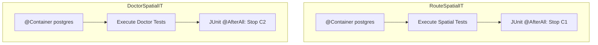
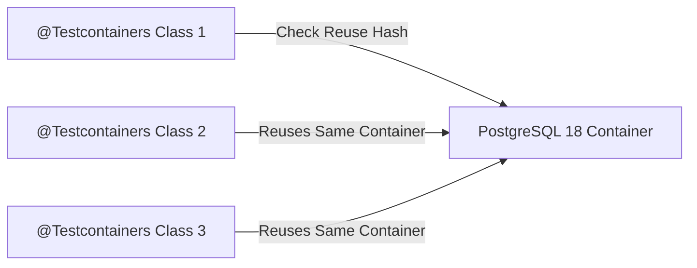

# Architecture Plan: Standard JUnit Testcontainers without Ryuk

## 1. Executive Summary & Objective

The objective is to transition the integration test suite in **Simon's Life Manager (SLM)** to:
1. **Standard JUnit Testcontainers**: Using idiomatic JUnit Jupiter annotations (`@Testcontainers` and `@Container`) instead of manual static initialization (`static { postgres.start(); }`).
2. **Without Ryuk**: Completely disabling the `testcontainers/ryuk` resource reaper container.

This plan details:
- How to disable Ryuk cleanly across all environments (local, Gradle CLI, IDEs, CI).
- The architectural options and trade-offs of standard JUnit Jupiter container lifecycles (`@Testcontainers`).
- Code changes required in [`build.gradle`](file:///home/simon/code/eclipse/slm/build.gradle), [`AbstractIntegrationTest.java`](file:///home/simon/code/eclipse/slm/src/test/java/de/oberamsystems/slm/AbstractIntegrationTest.java), test configuration properties, and the integration test suite (`*IT`).
- Performance and cleanup implications.

---

## 2. Disabling Ryuk

### 2.1. Why Disable Ryuk?
- **Rootless / Restricted Environments:** In rootless Docker, Podman, or Kubernetes CI (Docker-in-Docker), Ryuk requires mounting `/var/run/docker.sock` and elevated privileges, which may fail or be prohibited by security policies.
- **Resource Overhead:** Eliminates the startup time and memory footprint of the auxiliary reaper container.
- **Predictable JUnit Teardown:** Relies strictly on JUnit 5's test lifecycle (`@AfterAll` / JVM shutdown hooks) rather than an external watchdog container.

### 2.2. Configuration Mechanism
Testcontainers checks for Ryuk configuration in several locations. We configure it at two complementary levels for 100% reliability:

1. **Classpath Configuration (`src/test/resources/testcontainers.properties`)**:
   ```properties
   ryuk.disabled=true
   ```
   *Guarantees Ryuk is disabled when running tests from an IDE (Eclipse, IntelliJ, VS Code).*

2. **Gradle Build Task Configuration ([`build.gradle`](file:///home/simon/code/eclipse/slm/build.gradle))**:
   ```groovy
   tasks.named('test') {
       useJUnitPlatform()
       include '**/*Test.class', '**/*IT.class'
       systemProperty 'testcontainers.ryuk.disabled', 'true'
       environment 'TESTCONTAINERS_RYUK_DISABLED', 'true'
       finalizedBy jacocoTestReport
   }
   ```
   *Guarantees Ryuk is disabled during CLI and CI/CD Gradle builds.*

---

## 3. Standard JUnit Jupiter Lifecycle Patterns

In standard JUnit Jupiter Testcontainers, `@Testcontainers` registers the `TestcontainersExtension`, which manages fields annotated with `@Container`.

There are two primary approaches:

### Approach A: Standard Per-Class Container Lifecycle (Canonical JUnit Jupiter)
Every integration test class manages its own container instance via JUnit 5.



#### How it works:
- [`AbstractIntegrationTest`](file:///home/simon/code/eclipse/slm/src/test/java/de/oberamsystems/slm/AbstractIntegrationTest.java) is annotated with `@Testcontainers`.
- `@Container` is placed on `protected static final PostgreSQLContainer<?> postgres`.
- When an `*IT` class executes, JUnit's `TestcontainersExtension` calls `beforeAll` (starting the container) and `afterAll` (stopping the container).
- **Important JUnit 5 inheritance detail:** When `@Container` is declared on a `static` field in a superclass, JUnit 5 stops the container when the first test class completes. To ensure each test class receives a valid running container under standard JUnit 5 management:
  - Either the container is instantiated per test class or restarted via JUnit lifecycle:
  ```java
  @Testcontainers
  @SpringBootTest(webEnvironment = SpringBootTest.WebEnvironment.RANDOM_PORT)
  @ActiveProfiles("test")
  public abstract class AbstractIntegrationTest {

      @Container
      @ServiceConnection
      protected static PostgreSQLContainer<?> postgres = new PostgreSQLContainer<>(POSTGIS_IMAGE)
              .withDatabaseName("slm_test")
              .withUsername("test")
              .withPassword("test")
              .withCopyFileToContainer(MountableFile.forClasspathResource("schema-init.sql"), "/docker-entrypoint-initdb.d/01-init.sql");
  ```

*Pros:* Pure standard JUnit lifecycle; 100% database isolation between test classes (fresh PostgreSQL instance per test class).  
*Cons:* Higher test duration (~8s per test class x 5 classes = ~40-45s total).

---

### Approach B: Standard JUnit with Testcontainers Reusability (`.withReuse(true)`)
Keeps standard `@Testcontainers` annotations while avoiding container restart overhead.



#### How it works:
1. Container is configured with `.withReuse(true)`.
2. `testcontainers.reuse.enable=true` is enabled in `testcontainers.properties`.
3. `@Testcontainers` manages the lifecycle, but Testcontainers keeps the container running between test classes.

*Pros:* Standard JUnit annotations with minimal test execution latency.  
*Cons:* State persists between test classes (requires transactional rollback or table truncation).

---

## 4. Proposed Implementation Steps (Approach A)

### 4.1. Step 1: Create `src/test/resources/testcontainers.properties`
Create the properties file to disable Ryuk globally for all runners (IDE and Gradle):
```properties
ryuk.disabled=true
```

### 4.2. Step 2: Configure [`build.gradle`](file:///home/simon/code/eclipse/slm/build.gradle)
Configure the `test` task to pass system properties and environment variables disabling Ryuk:
```groovy
tasks.named('test') {
	useJUnitPlatform()
	include '**/*Test.class', '**/*IT.class'
	systemProperty 'testcontainers.ryuk.disabled', 'true'
	environment 'TESTCONTAINERS_RYUK_DISABLED', 'true'
	finalizedBy jacocoTestReport
}
```

### 4.3. Step 3: Refactor [`AbstractIntegrationTest.java`](file:///home/simon/code/eclipse/slm/src/test/java/de/oberamsystems/slm/AbstractIntegrationTest.java)
Update [`AbstractIntegrationTest`](file:///home/simon/code/eclipse/slm/src/test/java/de/oberamsystems/slm/AbstractIntegrationTest.java) to use `@Testcontainers` and `@Container`, removing the manual `static { postgres.start(); }` block:
```java
package de.oberamsystems.slm;

import org.springframework.boot.test.context.SpringBootTest;
import org.springframework.boot.testcontainers.service.connection.ServiceConnection;
import org.springframework.test.context.ActiveProfiles;
import org.testcontainers.containers.PostgreSQLContainer;
import org.testcontainers.junit.jupiter.Container;
import org.testcontainers.junit.jupiter.Testcontainers;
import org.testcontainers.utility.DockerImageName;
import org.testcontainers.utility.MountableFile;

@Testcontainers
@SpringBootTest(webEnvironment = SpringBootTest.WebEnvironment.RANDOM_PORT)
@ActiveProfiles("test")
public abstract class AbstractIntegrationTest {

    private static final DockerImageName POSTGIS_IMAGE = DockerImageName
            .parse("postgis/postgis:18-3.6")
            .asCompatibleSubstituteFor("postgres");

    @Container
    @ServiceConnection
    protected static final PostgreSQLContainer<?> postgres = new PostgreSQLContainer<>(POSTGIS_IMAGE)
            .withDatabaseName("slm_test")
            .withUsername("test")
            .withPassword("test")
            .withCopyFileToContainer(
                    MountableFile.forClasspathResource("schema-init.sql"),
                    "/docker-entrypoint-initdb.d/01-init.sql");
}
```

---

## 5. Verification Plan

1. **Verify No Ryuk Container is Started**:
   Run `./gradlew test -x jacocoTestReport -x compileAotTestJava` and inspect running containers via `docker ps -a`:
   - Confirm **no** `testcontainers/ryuk` container is launched.
   - Confirm only `postgis/postgis:18-3.6` runs.
2. **Verify Clean Container Teardown**:
   Confirm all containers terminate when tests complete.
3. **Verify Full Test Suite Passes**:
   Run the full suite across all 5 integration test classes:
   - `RouteSpatialIT`
   - `DoctorSpatialIT`
   - `SessionHierarchyIT`
   - `EmployerContractIT`
   - `SelfieControllerIT`
