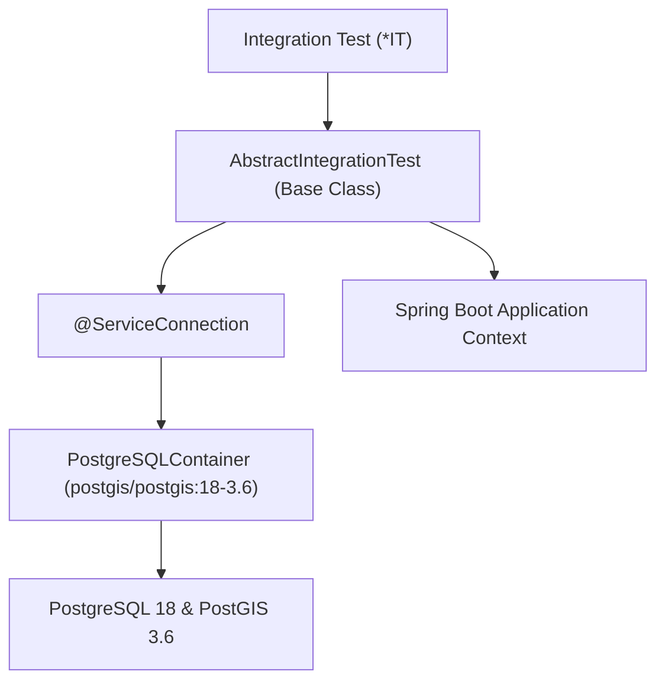

# Architecture Plan: Integration Tests with Spring Testcontainers (Updated)

## 1. Executive Summary & Objective

In **Simon's Life Manager (SLM)**, we are introducing integration tests using **Spring Testcontainers**. Following user guidance:
1. **PostgreSQL 18** will be used for containerized testing via the official PostGIS image: `postgis/postgis:18-3.6`.
2. **Schema Initialization**: `tables.sql` already contains the full, up-to-date schema. The versioned migration files (`migration_*.sql`) are strictly for upgrading legacy databases and must **not** be executed on fresh test containers. Fresh test environments initialize directly from `CREATE EXTENSION postgis`, `enums.sql`, and `tables.sql`.
3. **Naming Convention**: All integration test classes must end with the **`IT`** suffix (e.g. `RouteSpatialIT`, `DoctorSpatialIT`, `SessionHierarchyIT`).
4. **Shared Container Lifecycle**: A shared static container via an abstract base class (`AbstractIntegrationTest`) and Spring Boot `@ServiceConnection` ensures the container spins up once for all integration tests, eliminating test latency.

---

## 2. Technical Stack & Dependencies



### Dependencies in `build.gradle`:
```groovy
dependencies {
    // ... existing dependencies ...
    
    // Testcontainers & Spring Boot Testcontainers integration
    testImplementation 'org.springframework.boot:spring-boot-testcontainers'
    testImplementation 'org.testcontainers:testcontainers'
    testImplementation 'org.testcontainers:junit-jupiter'
    testImplementation 'org.testcontainers:postgresql'
}
```

### Gradle Test Task Configuration:
Ensure the Gradle `test` task picks up both unit tests (`*Test.class`) and integration tests (`*IT.class`):
```groovy
tasks.named('test') {
    useJUnitPlatform()
    include '**/*Test.class', '**/*IT.class'
    finalizedBy jacocoTestReport
}
```

---

## 3. Database Initialization & Schema Strategy

> [!IMPORTANT]
> **Fresh Databases vs. Existing Installations**:
> - `tables.sql` contains the complete, consolidated DDL for all tables (`session`, `point` with PostGIS geography, `route`, `car_trip`, `doctor`, `employer`, etc.).
> - `migration_*.sql` files are ALTER scripts designed only for incrementally upgrading pre-existing production databases.
> - Therefore, test containers initialize directly from `enums.sql` + `tables.sql` (with `CREATE EXTENSION postgis;`). No migration scripts are executed in tests.

### Initialization Execution Order on Test Container:
1. `CREATE EXTENSION IF NOT EXISTS postgis;`
2. `src/main/resources/enums.sql` (Creates custom ENUM types: `book_genre`, `book_type`, `source_type`, `status_type`, `human_category`).
3. `src/main/resources/tables.sql` (Creates all tables with constraints, generated columns, spatial indexes, and triggers).

### Test Configuration (`src/test/resources/application-test.properties`):
```properties
# Disable Hibernate DDL auto to let SQL scripts define the authoritative schema
spring.jpa.hibernate.ddl-auto=none

# Authoritative schema initialization for fresh test database
spring.sql.init.mode=always
spring.sql.init.schema-locations=classpath:schema-init.sql

# Logging
logging.level.org.testcontainers=INFO
logging.level.org.hibernate.SQL=WARN
```

Where `src/test/resources/schema-init.sql` cleanly bundles:
- `CREATE EXTENSION IF NOT EXISTS postgis;`
- Contents of `enums.sql`
- Contents of `tables.sql`
- Air distance trigger functions (`calculate_route_air_distance` and `calculate_doctor_air_distance`)

---

## 4. Shared Container Architecture

### `AbstractIntegrationTest.java`:
```java
package de.oberamsystems.slm;

import org.springframework.boot.test.context.SpringBootTest;
import org.springframework.boot.testcontainers.service.connection.ServiceConnection;
import org.springframework.test.context.ActiveProfiles;
import org.testcontainers.containers.PostgreSQLContainer;
import org.testcontainers.junit.jupiter.Container;
import org.testcontainers.junit.jupiter.Testcontainers;
import org.testcontainers.utility.DockerImageName;

@SpringBootTest(webEnvironment = SpringBootTest.WebEnvironment.RANDOM_PORT)
@ActiveProfiles("test")
@Testcontainers
public abstract class AbstractIntegrationTest {

    // PostgreSQL 18 with PostGIS 3.6
    private static final DockerImageName POSTGIS_18_IMAGE = DockerImageName
            .parse("postgis/postgis:18-3.6")
            .asCompatibleSubstituteFor("postgres");

    @Container
    @ServiceConnection
    protected static final PostgreSQLContainer<?> postgres = new PostgreSQLContainer<>(POSTGIS_18_IMAGE)
            .withDatabaseName("slm_test")
            .withUsername("test")
            .withPassword("test");

    static {
        postgres.start();
    }
}
```

---

## 5. Integration Test Suite Scope (`*IT`)

We will implement 5 targeted integration tests adhering to the `*IT` suffix:

### 5.1. `RouteSpatialIT.java`
- **Objective:** Validate PostGIS 18 spatial calculations (`ST_Distance`) and route air distance trigger.
- **Scenarios:**
  1. Insert two `Point` entities with decimal coordinates (e.g. Frankfurt and Munich).
  2. Call `RouteRepository.calculateAirDistance(p1.getId(), p2.getId())`; assert accurate geodesic distance in km.
  3. Insert a `Route` record; verify the trigger automatically calculates and populates `air_distance`.
  4. Update point coordinates; verify connected routes are automatically recalculated.

### 5.2. `DoctorSpatialIT.java`
- **Objective:** Validate Doctor clinic location linking to `Point`, home base point resolution, and automated air distance computation.
- **Scenarios:**
  1. Create a home base point (`is_home = true`) and a clinic point.
  2. Query `DoctorRepository.calculateAirDistance(homeId, practiceId)`.
  3. Insert a `Doctor` record and verify air distance persistence.

### 5.3. `SessionHierarchyIT.java`
- **Objective:** Validate PostgreSQL 18 storage of JPA Joined Inheritance hierarchy (`session` table) and UUIDv7 IDs.
- **Scenarios:**
  1. Persist multiple session types: `CodingSession`, `GamingSession`, `WorkingSession`, `ReadingSession`, `MeditationSession`, `SportSession`.
  2. Query `SessionRepository.findAll()`; verify all polymorphically map to their concrete subclasses.
  3. Verify `break_duration` and net duration generated column computations.
  4. Verify chronological sorting (`DESC`).

### 5.4. `EmployerContractIT.java`
- **Objective:** Validate the decoupled `Employer` entity, client billing in `WorkingSession`, and commercial `Contract` / `Contractor` relationships.
- **Scenarios:**
  1. Persist `Employer` ("Oberam Systems") and link to multiple `WorkingSession` entries.
  2. Persist `Contractor` and `Contract` with fee calculations.
  3. Verify repository sorting orders (alphabetical ascending for directory, date descending for sessions).

### 5.5. `SelfieControllerIT.java`
- **Objective:** Full Spring MVC integration test using `MockMvc` with the real PostGIS 18 database and `SelfieStorageService`.
- **Scenarios:**
  1. Upload `.jpg` and `.heic` photos via `MockMvc.perform(multipart("/selfies")...)`; verify HTTP 302 and database record creation.
  2. Upload traversal payload (`../../evil.jpg`); verify security rejection and no file created outside `selfies/`.
  3. Upload duplicate date with format switch; verify old format cleanup.

---

## 6. Implementation Workflow

1. **Update `build.gradle`**:
   - Add Testcontainers dependencies (`spring-boot-testcontainers`, `testcontainers:postgresql`, `testcontainers:junit-jupiter`).
   - Configure Gradle `test` task to include `**/*Test.class` and `**/*IT.class`.
2. **Create Test Resources**:
   - Create `src/test/resources/schema-init.sql` combining `CREATE EXTENSION postgis`, `enums.sql`, and `tables.sql` (with triggers).
   - Create `src/test/resources/application-test.properties`.
3. **Implement Base Class & Tests**:
   - Create [`AbstractIntegrationTest.java`](file:///home/simon/code/eclipse/slm/src/test/java/de/oberamsystems/slm/AbstractIntegrationTest.java) configured with `postgis/postgis:18-3.6`.
   - Create [`RouteSpatialIT.java`](file:///home/simon/code/eclipse/slm/src/test/java/de/oberamsystems/slm/RouteSpatialIT.java).
   - Create [`DoctorSpatialIT.java`](file:///home/simon/code/eclipse/slm/src/test/java/de/oberamsystems/slm/DoctorSpatialIT.java).
   - Create [`SessionHierarchyIT.java`](file:///home/simon/code/eclipse/slm/src/test/java/de/oberamsystems/slm/SessionHierarchyIT.java).
   - Create [`EmployerContractIT.java`](file:///home/simon/code/eclipse/slm/src/test/java/de/oberamsystems/slm/EmployerContractIT.java).
   - Create [`SelfieControllerIT.java`](file:///home/simon/code/eclipse/slm/src/test/java/de/oberamsystems/slm/controller/SelfieControllerIT.java).
4. **Verification**:
   - Execute `./gradlew test -x jacocoTestReport -x compileAotTestJava` and confirm all unit tests and integration tests pass cleanly.
