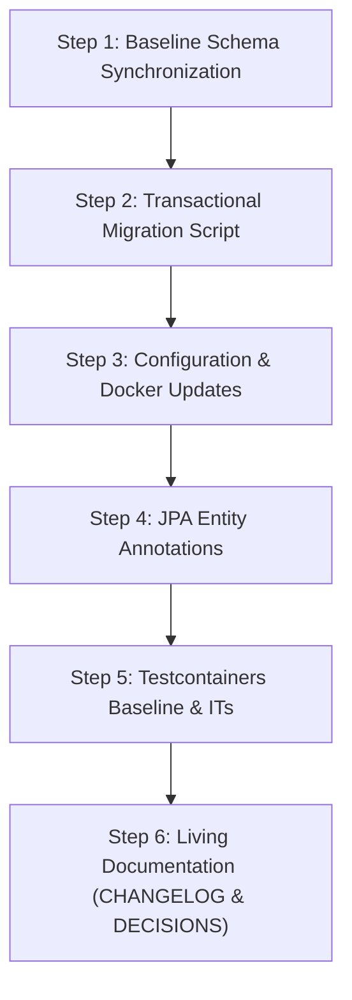

# Comprehensive Architecture Plan: Migration to `TIMESTAMP WITH TIME ZONE` (Europe/Berlin & Daylight Saving Time)

## 1. Executive Summary & Objective

Simon's Life Manager (SLM) currently stores temporal timestamps across 16 database tables using PostgreSQL `TIMESTAMP` (`TIMESTAMP WITHOUT TIME ZONE`) and Java `LocalDateTime`.

### The Core Challenges:
1. **Lack of Timezone Context**: `TIMESTAMP WITHOUT TIME ZONE` stores date and time values without offset information. If the database server, Docker container, developer workstation, or cloud environment runs with a timezone other than `Europe/Berlin`, timestamps risk ambiguous interpretation or implicit shifts.
2. **Daylight Saving Time (DST) Distortions**:
   - In Central Europe (`Europe/Berlin`), Daylight Saving Time transitions occur twice annually:
     - **Spring Forward (Last Sunday of March)**: `02:00 CET (UTC+1)` $\rightarrow$ `03:00 CEST (UTC+2)` (1 clock hour is skipped; day is 23 hours).
     - **Fall Back (Last Sunday of October)**: `03:00 CEST (UTC+2)` $\rightarrow$ `02:00 CET (UTC+1)` (1 clock hour is repeated; day is 25 hours).
   - Under `TIMESTAMP WITHOUT TIME ZONE`, duration calculations (e.g. `endtime - starttime` in `session.duration`, `sleeptime`, `car_trip`, `train_trip`, `activity`, `appointment`) compute nominal wall-clock differences rather than physical elapsed duration. A 23:00 to 07:00 sleep session across spring DST transition is calculated as 8 hours instead of the physical 7 hours.
3. **Database Defaults Inconsistency**: Columns specifying `DEFAULT CURRENT_TIMESTAMP` in PostgreSQL generate `TIMESTAMPTZ` values that were previously being downcast implicitly to `TIMESTAMP WITHOUT TIME ZONE`.

### Migration Goal:
Migrate all timestamp columns, functions, generated columns, triggers, and application mappings to PostgreSQL `TIMESTAMP WITH TIME ZONE` (`TIMESTAMPTZ`), establishing **`Europe/Berlin`** as the authoritative reference timezone with full DST awareness and preserving all historical wall-clock recordings.

---

## 2. Complete Inventory of Affected Database Entities

A comprehensive codebase audit reveals **16 tables** and **25 timestamp columns** currently defined as `TIMESTAMP`:

| Table Name | Column Name | Constraints / Defaults | Dependent Generated Columns (Must be dropped & recreated during migration) |
|---|---|---|---|
| **`session`** | `starttime`<br>`endtime` | `NOT NULL`<br>`NULLABLE` | `duration INTERVAL GENERATED ALWAYS AS (endtime - starttime) STORED`<br>`net_duration INTERVAL GENERATED ALWAYS AS (endtime - starttime - break_duration) STORED` |
| **`calendar_event`** | `starttime`<br>`endtime` | `NULLABLE`<br>`NULLABLE` | `duration INTERVAL GENERATED ALWAYS AS (endtime - starttime) STORED` |
| **`sleeptime`** | `gotobed`<br>`standup` | `NULLABLE`<br>`NULLABLE` | `sleeptime INTERVAL GENERATED ALWAYS AS (standup - gotobed) STORED` |
| **`train_trip`** | `starttime`<br>`endtime` | `NULLABLE`<br>`NULLABLE` | `duration INTERVAL GENERATED ALWAYS AS (endtime - starttime) STORED` |
| **`train_trip2`** | `starttime`<br>`endtime` | `NULLABLE`<br>`NULLABLE` | `duration INTERVAL GENERATED ALWAYS AS (endtime - starttime) STORED` |
| **`activity`** | `starttime`<br>`endtime` | `NULLABLE`<br>`NULLABLE` | `duration INTERVAL GENERATED ALWAYS AS (endtime - starttime) STORED` |
| **`habit_entry`** | `last_done` | `NULLABLE` | *None* |
| **`car_trip`** | `starttime`<br>`endtime` | `NULLABLE`<br>`NULLABLE` | `duration INTERVAL GENERATED ALWAYS AS (endtime - starttime) STORED` |
| **`learning_item`** | `last_updated` | `NULLABLE` | *None* |
| **`course`** | `exam_date`<br>`created_at`<br>`last_updated` | `NULLABLE`<br>`NULLABLE`<br>`NULLABLE` | *None* |
| **`lecture_note`** | `created_at`<br>`last_updated` | `NULLABLE`<br>`NULLABLE` | *None* |
| **`appointment`** | `departure`<br>`arrival`<br>`starttime`<br>`endtime`<br>`arrival_home` | `NULLABLE`<br>`NULLABLE`<br>`NULLABLE`<br>`NULLABLE`<br>`NULLABLE` | `travel_duration INTERVAL GENERATED ALWAYS AS (arrival - departure) STORED`<br>`duration INTERVAL GENERATED ALWAYS AS (endtime - starttime) STORED`<br>`complete_duration INTERVAL GENERATED ALWAYS AS (arrival_home - departure) STORED` |
| **`station`** | `created_at` | `DEFAULT CURRENT_TIMESTAMP` | *None* |
| **`charging_point`** | `created_at` | `DEFAULT CURRENT_TIMESTAMP` | *None* |
| **`refueling`** | `fueling_date`<br>`created_at` | `NOT NULL`<br>`DEFAULT CURRENT_TIMESTAMP` | *None* |
| **`car_expense`** | `created_at` | `DEFAULT CURRENT_TIMESTAMP` | *None* |

### Dependent Functions & Triggers:
- **`check_sleep_session_duration()`**:
  Variables `v_starttime TIMESTAMP; v_endtime TIMESTAMP;` must be updated to `TIMESTAMPTZ`.

---

## 3. Daylight Saving Time (DST) & Data Conversion Mechanics

### 3.1 Historical Data Conversion with `AT TIME ZONE 'Europe/Berlin'`
In PostgreSQL, `TIMESTAMPTZ` stores timestamps internally as UTC microseconds. When displaying or querying, PostgreSQL converts the stored UTC timestamp to the session's time zone.

When converting an existing `TIMESTAMP WITHOUT TIME ZONE` column to `TIMESTAMPTZ`:
```sql
-- DANGEROUS / INCORRECT:
ALTER TABLE session ALTER COLUMN starttime TYPE TIMESTAMPTZ;
```
If the migration runs in an environment where the active connection timezone is `UTC`, a recorded timestamp of `2026-07-15 10:00:00` would be interpreted as `10:00:00 UTC`, which becomes `12:00:00 CEST` when viewed in Berlin!

```sql
-- SAFE / ACCURATE (Mandatory Standard):
ALTER TABLE session ALTER COLUMN starttime TYPE TIMESTAMPTZ USING starttime AT TIME ZONE 'Europe/Berlin';
```
#### Why `USING col AT TIME ZONE 'Europe/Berlin'` is correct:
1. PostgreSQL treats the existing without-timezone timestamp as representing local wall-clock time in `Europe/Berlin`.
2. PostgreSQL consults the IANA timezone database for `Europe/Berlin` at that specific historical date:
   - For summer dates (e.g. `2026-07-15 10:00:00`), it applies `CEST (UTC+02:00)` $\rightarrow$ stored UTC is `08:00:00`.
   - For winter dates (e.g. `2026-01-15 10:00:00`), it applies `CET (UTC+01:00)` $\rightarrow$ stored UTC is `09:00:00`.
3. When queried in `Europe/Berlin`, both return their exact original wall-clock time (`10:00:00`).

### 3.2 Handling DST Transitions in Duration Calculations
When two `TIMESTAMPTZ` columns are subtracted (`endtime - starttime`), PostgreSQL subtracts their absolute UTC values:
- **Spring Transition Example (2026-03-29)**:
  - `starttime`: `2026-03-28 23:00:00+01` (= `22:00:00 UTC`)
  - `endtime`: `2026-03-29 07:00:00+02` (= `05:00:00 UTC`)
  - `endtime - starttime`: Exactly `07:00:00` physical duration.
- **Autumn Transition Example (2026-10-25)**:
  - `starttime`: `2026-10-24 23:00:00+02` (= `21:00:00 UTC`)
  - `endtime`: `2026-10-25 07:00:00+01` (= `06:00:00 UTC`)
  - `endtime - starttime`: Exactly `09:00:00` physical duration.
- **Normal Days**:
  - `starttime` and `endtime` share the same offset (+01 or +02), yielding identical nominal and physical duration.

### 3.3 Handling Ambiguous & Gap Hours on Input
- **Gap Hour (Spring forward 02:00–02:59)**:
  PostgreSQL standardly shifts the non-existent local hour forward into CEST.
- **Overlap Hour (Fall back 02:00–02:59)**:
  PostgreSQL defaults ambiguous local times to standard time (or daylight time based on convention).

---

## 4. PostgreSQL Alteration Protocol (Handling Generated Columns)

PostgreSQL restricts direct alteration of columns that are referenced in `GENERATED ALWAYS AS (...) STORED` expressions:
> `ERROR: cannot alter type of a column used in a generated column expression`

Therefore, all migrations for tables with generated columns must execute the strict **Drop Generated $\rightarrow$ Alter Timestamps $\rightarrow$ Re-add Generated** protocol within an atomic transaction.

### Example: Table `session`
```sql
ALTER TABLE session DROP COLUMN duration;
ALTER TABLE session DROP COLUMN net_duration;

ALTER TABLE session ALTER COLUMN starttime TYPE TIMESTAMPTZ USING starttime AT TIME ZONE 'Europe/Berlin';
ALTER TABLE session ALTER COLUMN endtime TYPE TIMESTAMPTZ USING endtime AT TIME ZONE 'Europe/Berlin';

ALTER TABLE session ADD COLUMN duration INTERVAL GENERATED ALWAYS AS (endtime - starttime) STORED;
ALTER TABLE session ADD COLUMN net_duration INTERVAL GENERATED ALWAYS AS (endtime - starttime - break_duration) STORED;
```

### Example: Table `appointment`
```sql
ALTER TABLE appointment DROP COLUMN travel_duration;
ALTER TABLE appointment DROP COLUMN duration;
ALTER TABLE appointment DROP COLUMN complete_duration;

ALTER TABLE appointment ALTER COLUMN departure TYPE TIMESTAMPTZ USING departure AT TIME ZONE 'Europe/Berlin';
ALTER TABLE appointment ALTER COLUMN arrival TYPE TIMESTAMPTZ USING arrival AT TIME ZONE 'Europe/Berlin';
ALTER TABLE appointment ALTER COLUMN starttime TYPE TIMESTAMPTZ USING starttime AT TIME ZONE 'Europe/Berlin';
ALTER TABLE appointment ALTER COLUMN endtime TYPE TIMESTAMPTZ USING endtime AT TIME ZONE 'Europe/Berlin';
ALTER TABLE appointment ALTER COLUMN arrival_home TYPE TIMESTAMPTZ USING arrival_home AT TIME ZONE 'Europe/Berlin';

ALTER TABLE appointment ADD COLUMN travel_duration INTERVAL GENERATED ALWAYS AS (arrival - departure) STORED;
ALTER TABLE appointment ADD COLUMN duration INTERVAL GENERATED ALWAYS AS (endtime - starttime) STORED;
ALTER TABLE appointment ADD COLUMN complete_duration INTERVAL GENERATED ALWAYS AS (arrival_home - departure) STORED;
```

---

## 5. Application Layer Architecture & Java Time Representation

### 5.1 Architecture Decision: Java Type Strategy

We evaluate two distinct paths for the Java application layer:

#### Approach 1: Hibernate Timezone Binding with `LocalDateTime` (Recommended for Phase 1)
- **Mechanism**:
  - Keep entity attributes as `LocalDateTime` (e.g. `private LocalDateTime start;`).
  - Configure Hibernate 7 / Spring Data JPA to bind and read timestamps using `Europe/Berlin`:
    ```properties
    spring.jpa.properties.hibernate.jdbc.time_zone=Europe/Berlin
    ```
  - In database connection strings, enforce the session timezone:
    ```properties
    spring.datasource.url=jdbc:postgresql://localhost:5432/slm?options=-c%20timezone=Europe/Berlin
    ```
  - Update JPA column definitions in entities from `columnDefinition = "TIMESTAMP"` to `columnDefinition = "TIMESTAMPTZ"`.
- **Pros**:
  - **Zero Breaking Changes**: Completely preserves Spring MVC form model binding, `@DateTimeFormat`, HTML `<input type="datetime-local">`, and Thymeleaf templates (`#temporals.format(s.start, 'dd.MM.yyyy HH:mm')`).
  - Database strictly enforces `TIMESTAMPTZ` and accurate physical interval calculations.
  - Zero regression risk in existing 33 controllers and 300+ integration test assertions.

#### Approach 2: Full Entity Migration to `ZonedDateTime` or `OffsetDateTime`
- **Mechanism**:
  - Change all entity fields from `LocalDateTime` to `ZonedDateTime` (or `OffsetDateTime`).
  - Register a Spring MVC `Converter<String, ZonedDateTime>` for `<input type="datetime-local">` (which posts strings in format `YYYY-MM-DDTHH:mm` without timezone offsets) to automatically interpret form submissions in `ZoneId.of("Europe/Berlin")`.
  - Update all repository method signatures (e.g. `findByStartBetween(ZonedDateTime from, ZonedDateTime to)`).
- **Trade-offs**:
  - Provides in-memory DST awareness in Java, but requires refactoring hundreds of methods, test cases, and form bindings across the entire codebase.

### 5.2 Recommended Implementation Recommendation
Adopt **Approach 1** for the foundational migration:
1. Migrate the database schema completely to `TIMESTAMPTZ`.
2. Set `spring.jpa.properties.hibernate.jdbc.time_zone=Europe/Berlin` and set JVM / PostgreSQL connection timezone to `Europe/Berlin`.
3. Update entity `@Column(columnDefinition = "TIMESTAMPTZ")`.
4. Ensure all database generated columns and triggers operate natively on `TIMESTAMPTZ`.

---

## 6. Detailed Step-by-Step Implementation Roadmap



### Step 1: Update Authoritative Schema Baselines
Update all table definitions in:
- [`src/main/resources/tables.sql`](file:///home/simon/code/eclipse/slm/src/main/resources/tables.sql)
- [`init.sql`](file:///home/simon/code/eclipse/slm/init.sql)
- [`src/test/resources/schema-init.sql`](file:///home/simon/code/eclipse/slm/src/test/resources/schema-init.sql)
Replace `TIMESTAMP` with `TIMESTAMPTZ` (or `TIMESTAMP WITH TIME ZONE`), and update `check_sleep_session_duration()` variable types to `TIMESTAMPTZ`.

### Step 2: Author Incremental Migration Script
Create [`src/main/resources/migration_2026-10-24_2.sql`](file:///home/simon/code/eclipse/slm/src/main/resources/):
- Enclose within `BEGIN;` ... `COMMIT;`.
- Drop dependent generated columns on `session`, `calendar_event`, `sleeptime`, `train_trip`, `train_trip2`, `activity`, `car_trip`, `appointment`.
- Alter all 25 timestamp columns to `TIMESTAMPTZ USING col AT TIME ZONE 'Europe/Berlin'`.
- Re-create all generated columns with `STORED`.
- Replace function `check_sleep_session_duration()` with `TIMESTAMPTZ` variables.

### Step 3: Application & Environment Timezone Configuration
1. In [`application.properties`](file:///home/simon/code/eclipse/slm/src/main/resources/application.properties):
   ```properties
   spring.jpa.properties.hibernate.jdbc.time_zone=Europe/Berlin
   spring.datasource.url=jdbc:postgresql://localhost:5432/slm?options=-c%20timezone=Europe/Berlin
   ```
2. In [`docker-compose.yml`](file:///home/simon/code/eclipse/slm/docker-compose.yml):
   Configure `TZ=Europe/Berlin` and `PGTZ=Europe/Berlin` for `db` and `app` containers.
3. In [`SlmApplication.java`](file:///home/simon/code/eclipse/slm/src/main/java/de/oberamsystems/slm/SlmApplication.java):
   Add `@PostConstruct public void init() { TimeZone.setDefault(TimeZone.getTimeZone("Europe/Berlin")); }`.

### Step 4: JPA Model Updates
Update `@Column(name = "...", columnDefinition = "TIMESTAMPTZ")` across:
- [`Session.java`](file:///home/simon/code/eclipse/slm/src/main/java/de/oberamsystems/slm/model/Session.java) (`starttime`, `endtime`)
- [`Appointment.java`](file:///home/simon/code/eclipse/slm/src/main/java/de/oberamsystems/slm/model/Appointment.java) (`departure`, `arrival`, `starttime`, `endtime`, `arrival_home`)
- [`CalendarEvent.java`](file:///home/simon/code/eclipse/slm/src/main/java/de/oberamsystems/slm/model/CalendarEvent.java)
- [`TrainTrip.java`](file:///home/simon/code/eclipse/slm/src/main/java/de/oberamsystems/slm/model/TrainTrip.java) & [`TrainTrip2.java`](file:///home/simon/code/eclipse/slm/src/main/java/de/oberamsystems/slm/model/TrainTrip2.java)
- [`Activity.java`](file:///home/simon/code/eclipse/slm/src/main/java/de/oberamsystems/slm/model/Activity.java)
- [`CarTrip.java`](file:///home/simon/code/eclipse/slm/src/main/java/de/oberamsystems/slm/model/CarTrip.java)
- [`HabitEntry.java`](file:///home/simon/code/eclipse/slm/src/main/java/de/oberamsystems/slm/model/HabitEntry.java)
- [`LearningItem.java`](file:///home/simon/code/eclipse/slm/src/main/java/de/oberamsystems/slm/model/LearningItem.java)
- [`Course.java`](file:///home/simon/code/eclipse/slm/src/main/java/de/oberamsystems/slm/model/Course.java)
- [`LectureNote.java`](file:///home/simon/code/eclipse/slm/src/main/java/de/oberamsystems/slm/model/LectureNote.java)
- [`Refueling.java`](file:///home/simon/code/eclipse/slm/src/main/java/de/oberamsystems/slm/model/Refueling.java)
- [`Station.java`](file:///home/simon/code/eclipse/slm/src/main/java/de/oberamsystems/slm/model/Station.java), [`ChargingPoint.java`](file:///home/simon/code/eclipse/slm/src/main/java/de/oberamsystems/slm/model/ChargingPoint.java), [`CarExpense.java`](file:///home/simon/code/eclipse/slm/src/main/java/de/oberamsystems/slm/model/CarExpense.java)

### Step 5: Integration Testing & Verification
1. Add a dedicated test in [`DateTimePrecisionIT.java`](file:///home/simon/code/eclipse/slm/src/test/java/de/oberamsystems/slm/):
   - Test inserting a session spanning the Spring DST transition (2026-03-28 23:00 to 2026-03-29 07:00).
   - Assert `duration` is evaluated to 7 hours physical time.
   - Test inserting a session spanning the Autumn DST transition (2026-10-24 23:00 to 2026-10-25 07:00).
   - Assert `duration` is evaluated to 9 hours physical time.
   - Verify historical timestamps preserve Berlin wall-clock values without unexpected UTC offsets.
2. Run full test suite:
   ```bash
   JAVA_HOME=/usr/lib/jvm/java-25-amazon-corretto ./gradlew test -x jacocoTestReport
   ```

### Step 6: Living Documentation Updates
- Update [`CHANGELOG.md`](file:///home/simon/code/eclipse/slm/CHANGELOG.md) under `[0.0.3-rc12]`.
- Author **ADR 029: Migration to TIMESTAMP WITH TIME ZONE (TIMESTAMPTZ) and DST Aware Invariant Calculation** in [`DECISIONS.md`](file:///home/simon/code/eclipse/slm/DECISIONS.md).
