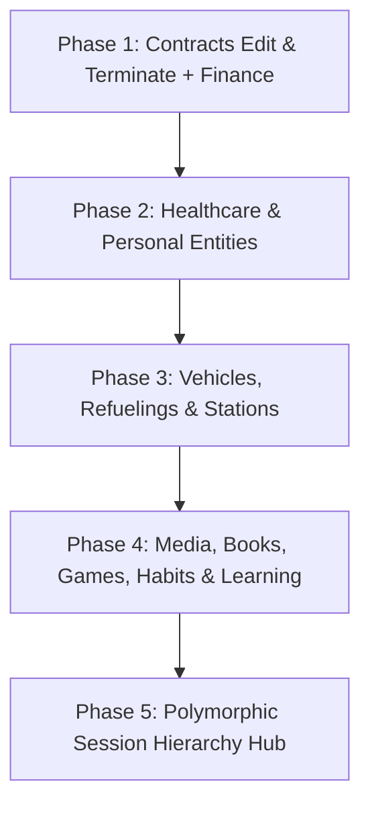

# Implementation Plan: Universal Entity Editing & Contract Termination Action

## 1. Context & Motivation

Simon's Life Manager (SLM) provides comprehensive tracking across personal finance, healthcare, vehicles, time tracking, academics, media, and habits. Currently, most screens follow a simple "List + Add" pattern:
- Users can view existing entries in a table and create new entries via a form.
- However, users **cannot edit/update** existing records if details change, errors occur, or statuses evolve.
- Furthermore, for recurring commercial commitments ([`Contract`](file:///home/simon/code/eclipse/slm/src/main/java/de/oberamsystems/slm/model/Contract.java)), users need not only the ability to edit contract details, but also a dedicated, immediate **"Terminate"** action to end/cancel an active contract directly from the table.

### Goals
1. **Universal Entity Editing**: Provide a consistent, intuitive editing workflow across **all** domain entities in SLM so existing records can be modified and saved.
2. **Dedicated Contract Termination Button**: In [`contracts.html`](file:///home/simon/code/eclipse/slm/src/main/resources/templates/contracts.html), provide two distinct action buttons for each entry:
   - **Edit Button**: Loads the contract into the form for editing.
   - **Terminate Button**: Instantly terminates/cancels the active contract (setting `active = false`, `is_canceled = true`, `termination_date = LocalDate.now()`).
3. **Consistent UI Design System**: Use standardized, accessible action buttons (`bi bi-pencil`, `bi bi-x-circle`), clear edit indicators (card header switches from *"Add..."* to *"Edit #{id}"*), and cancel links to return to clean state.

---

## 2. Architectural Design Patterns for Universal Editing

Across SLM's 60+ views and 35 controllers, entities fall into two primary UI paradigms:

### Pattern A: Side-by-Side Dual-State Form (`?id={id}`)
Used for 2-column layouts where the table lives on the left (`col-lg-8`) and the form lives on the right (`col-lg-4`).

```mermaid
sequenceDiagram
    autonumber
    actor User
    participant Browser
    participant Controller
    participant Repository
    participant Database

    User->>Browser: Clicks "Edit" button on table row (id=42)
    Browser->>Controller: GET /entities?id=42
    Controller->>Repository: findById(42L)
    Repository->>Database: SELECT * FROM entity WHERE id = 42
    Database-->>Repository: Entity(id=42, ...)
    Repository-->>Controller: Optional<Entity>
    Controller-->>Browser: Render page with model.entity = Entity(42)

    Note over Browser: Form displays "Edit Entity #42"<br/>Contains hidden <input type="hidden" name="id" value="42"><br/>Shows "Cancel Edit" button

    User->>Browser: Modifies fields and clicks "Update"
    Browser->>Controller: POST /entities (includes id=42)
    Controller->>Repository: save(entity)
    Repository->>Database: UPDATE entity SET ... WHERE id = 42
    Database-->>Repository: OK
    Controller-->>Browser: redirect:/entities
```



#### Dual-State Form Lifecycle:
1. **Default State (`id == null`)**:
   - Card title: `<i class="bi bi-plus-circle me-2 text-primary"></i>Add {Entity}`
   - Submit button: `Add {Entity}` (Primary blue)
   - Entity model initialized with defaults (e.g. today's date, active=true).
2. **Edit State (`id != null`)**:
   - Card title: `<i class="bi bi-pencil-square me-2 text-warning"></i>Edit {Entity} <span class="badge bg-secondary ms-1">#{id}</span>`
   - Form contains: `<input type="hidden" th:field="*{id}">`
   - Submit button: `Update {Entity}` (Warning yellow/amber)
   - Cancel button: `<a th:href="@{/{entities}}" class="btn btn-link text-muted w-100">Cancel Edit</a>`

### Pattern B: Modal-Based In-Place Editing
Used for complex, multi-tab, or wide views where a side form is not feasible (e.g. Sessions Hub, Refuelings, Appointments, Stations, Human Events):
- Table row contains an "Edit" button that opens a pre-populated Bootstrap 5 modal or loads modal data via asynchronous fetch / server-side modal rendering.
- Submits to `POST /{entity}/{id}/edit` or unified `POST /{entity}` with hidden `id`.

---

## 3. Dedicated Contract Actions (Edit + Terminate)

### 3.1 Contract Table Actions Column
In [`contracts.html`](file:///home/simon/code/eclipse/slm/src/main/resources/templates/contracts.html):
```html
<th class="text-end pe-3" style="width: 140px;">Actions</th>
...
<td class="text-end pe-3">
    <div class="btn-group btn-group-sm" role="group">
        <!-- 1. Edit Button -->
        <a th:href="@{/contracts(id=${e.id})}" 
           class="btn btn-outline-primary" 
           title="Edit Contract">
            <i class="bi bi-pencil"></i>
        </a>

        <!-- 2. Terminate Button (Only active, uncanceled contracts) -->
        <form th:if="${e.active and !e.canceled}" 
              th:action="@{'/contracts/' + ${e.id} + '/terminate'}" 
              method="post" 
              class="d-inline"
              onsubmit="return confirm('Are you sure you want to terminate this contract?');">
            <button type="submit" 
                    class="btn btn-outline-danger" 
                    title="Terminate Contract">
                <i class="bi bi-x-circle me-1"></i> Terminate
            </button>
        </form>
    </div>
</td>
```

### 3.2 Contract Controller Endpoints
In [`ContractController.java`](file:///home/simon/code/eclipse/slm/src/main/java/de/oberamsystems/slm/controller/ContractController.java):
1. **`GET /contracts` (Supporting Edit State)**:
   ```java
   @GetMapping("/contracts")
   public String addContracts(@RequestParam(required = false) Long id, Model model) {
       List<Contract> contracts = repo.findAll(Sort.by(Sort.Direction.DESC, "startDate"));
       float totalPrice = 0;
       for (Contract p : contracts) {
           if (p.isActive()) totalPrice += p.getFee();
       }
       model.addAttribute("contracts", contracts);
       model.addAttribute("totalFee", totalPrice);

       Contract p;
       if (id != null) {
           p = repo.findById(id).orElseGet(this::createNewContractDefault);
       } else {
           p = createNewContractDefault();
       }
       model.addAttribute("contract", p);
       model.addAttribute("contractors", contractorRepo.findAll(Sort.by(Sort.Direction.ASC, "name")));
       return "contracts";
   }
   ```
2. **`POST /contracts/{id}/terminate` (Dedicated Termination Action)**:
   ```java
   @PostMapping("/contracts/{id}/terminate")
   public String terminateContract(@PathVariable Long id) {
       repo.findById(id).ifPresent(c -> {
           c.setActive(false);
           c.setCanceled(true);
           if (c.getTerminationDate() == null) {
               c.setTerminationDate(LocalDate.now());
           }
           repo.save(c);
       });
       return "redirect:/contracts";
   }
   ```
3. **`POST /contracts` (Update & Save)**:
   - When `tt.getId() > 0`, saves the modified entity in place without inserting duplicates.
   - Properly binds `id`, `initialEndDate`, `autoExtension`, `isCanceled`, `terminationDate`.

---

## 4. Phased Implementation Roadmap Across All SLM Entities



### Phase 1: Finance & Commercial Spend (Immediate Priority)
| Entity | View | Controller | Edit Mechanism | Special Actions |
| :--- | :--- | :--- | :--- | :--- |
| **Contract** | `contracts.html` | `ContractController` | `?id={id}` side form | **Dedicated Terminate Button** (`POST /contracts/{id}/terminate`) |
| **Contractor** | `contractors.html` | `ContractController` | `?id={id}` side form | Update contractor name |
| **Purchase** | `purchases.html` | `PurchaseController` | `?id={id}` side form | Update vendor, price, date, title |
| **Vendor** | `vendors.html` | `GameController` | `?id={id}` side form | Update vendor name |
| **Employer** | `employers.html` | `EmployerController` | `?id={id}` side form | Update employer name |

### Phase 2: Healthcare & Humans
| Entity | View | Controller | Edit Mechanism | Special Actions |
| :--- | :--- | :--- | :--- | :--- |
| **Doctor** | `doctors.html`, `add-doctor.html` | `DoctorController` | `/add-doctor?id={id}` | Recalculate PostGIS air distance on location update |
| **Appointment** | `appointments.html`, `add-appointment.html` | `DoctorController` | `/add-appointment?id={id}` | Auto-recalculate travel and visit durations |
| **Speciality** | `specialities.html`, `add-speciality.html` | `DoctorController` | `/add-speciality?id={id}` | Update title |
| **Human** | `humans.html` | `HumanController` | `?id={id}` side form | Update category, birthday, notes |
| **HumanEvent** | `human-events.html` | `HumanEventController` | Edit modal | Update event date, type, notes |

### Phase 3: Vehicles, Refuelings & Mobility
| Entity | View | Controller | Edit Mechanism | Special Actions |
| :--- | :--- | :--- | :--- | :--- |
| **Refueling** | `refuelings.html` | `RefuelingController` | Edit Modal | Recalculate cost/L and consumption (L/100km) upon edit |
| **Car** | `cars.html` | `CarController` / `IndexController` | `?id={id}` side form | Update license plate, fuel type, odometer |
| **Station** | `stations.html` | `StationController` | Edit Modal | Update address, brand, operator, stalls, plug types |
| **CarTrip** | `car-trips.html` | `CarTripController` | `?id={id}` side form | Update trip distance, start/end locations |
| **TrainTrip** | `train-trips.html` | `TrainTripController2` | `?id={id}` side form | Update departure/arrival, line, stations |
| **TrainLine** | `train-lines.html` | `TrainTripController2` | `?id={id}` side form | Update line code, category |
| **TrainStation** | `train-stations.html` | `TrainTripController2` | `?id={id}` side form | Update station name, coordinate point |

### Phase 4: Media, Leisure, Habits & Academics
| Entity | View | Controller | Edit Mechanism | Special Actions |
| :--- | :--- | :--- | :--- | :--- |
| **Book** | `books.html` | `BookController` | `?id={id}` side form | Update author, press, genre, pages |
| **Author** | `authors.html` | `BookController` | `?id={id}` side form | Update author names |
| **Game** | `games.html` | `GameController` | `?id={id}` side form | Update publisher, studio, release date |
| **Publisher / Studio**| `publishers.html`, `studios.html`| `GameController` | `?id={id}` side form | Update company name |
| **Habit** | `habits.html` | `HabitController` | `?id={id}` side form | Update description, target frequency |
| **LearningItem** | `learning-items.html` | `LearningController` | `?id={id}` side form | Update progress %, status |
| **Point** | `points.html` | `RouteController` | `?id={id}` side form | Update coordinates, isHome flag |

### Phase 5: Polymorphic Session Hierarchy (`sessions.html`)
- All 9 session subtypes (`CodingSession`, `WorkingSession`, `LearningSession`, `ReadingSession`, `GamingSession`, `SportSession`, `MeditationSession`, `SleepSession`, `LectureSession`):
  - Add an **Edit** button in the session table actions.
  - Clicking "Edit" opens the unified `#sessionModal` pre-populated with the existing session's values, setting hidden `id` and `action="edit"`.
  - On save, recalculates net focused time, duration, and persists updates.

---

## 5. Security, CSRF & Data Invariant Rules

1. **CSRF Protection**: Every edit form and termination form must include CSRF tokens (`_csrf`).
2. **Identity Integrity**: Hidden ID fields (`<input type="hidden" th:field="*{id}">`) must be validated to prevent accidental cross-entity overwriting.
3. **Database Formula & Generated Columns Safety**:
   - Do not attempt to manually write to PostgreSQL generated columns (e.g. `duration`, `travel_duration`).
   - Allow triggers and `@Formula` expressions to dynamically recalculate on entity update.
4. **Deterministic Sorting Preservation**:
   - Editing an entity must not break Section 8 sorting rules (`AGENTS.md`) — entities will naturally resort according to their updated or existing keys.

---

## 6. Testing & Automated Verification Plan

1. **Unit & Controller Tests**:
   - `ContractControllerTest`: Test `GET /contracts?id={id}` (edit pre-population) and `POST /contracts/{id}/terminate`.
   - Controller tests across all updated controllers.
2. **Integration Tests**:
   - `ContractIT`: Verify full round-trip of editing a contract's fee/title, and terminating a contract via the dedicated termination endpoint.
   - `FinanceManagementIT`: Verify MockMvc GET with ID and POST updates for contracts and contractors.
3. **Automated Gradle Build**:
   ```bash
   ./gradlew test -x jacocoTestReport -x compileAotTestJava
   ```
4. **Documentation**:
   - Document the Universal Entity Editing architecture in [`DECISIONS.md`](file:///home/simon/code/eclipse/slm/DECISIONS.md).
   - Update [`CHANGELOG.md`](file:///home/simon/code/eclipse/slm/CHANGELOG.md).
