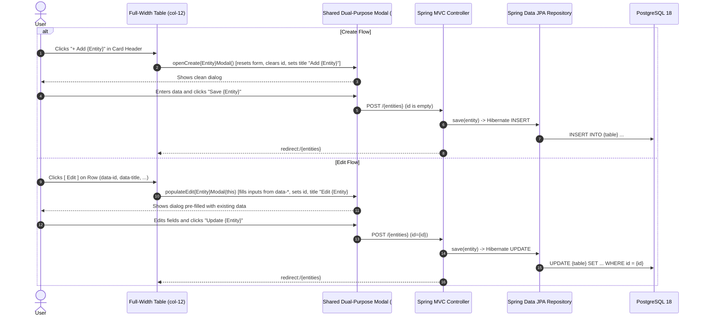
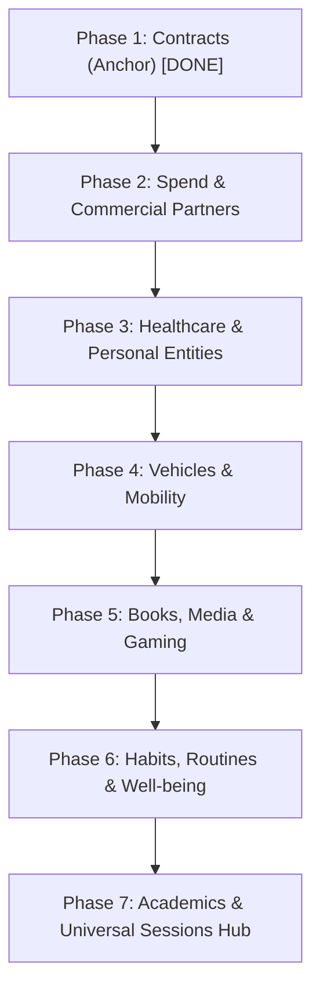

# Master Execution Plan: Universal Modal-First UI Migration & In-Place Entity Editing

## 1. Executive Summary & Goals

### 1.1 Context
Simon's Life Manager (SLM) manages over 35 entity types spanning finance, healthcare, mobility, media, academics, habits, and cognitive/wellness time tracking. Historically, the UI has been divided into two incompatible paradigms:
1. **Modern Modal-Based Screens**: Full-width `col-12` data tables with KPI headers, invoking clean Bootstrap 5 modal overlays (e.g. `sessions.html`, `refuelings.html`, `contracts.html`).
2. **Legacy Squeezed Screens & Separate Add-Pages**: Data tables squeezed into `col-lg-8` alongside a permanent side form in `col-lg-4` (e.g. `purchases.html`, `habits.html`, `books.html`, `cars.html`), or separate sub-pages for record creation (e.g. `doctor.html`, `appointment.html`).

Furthermore, across the majority of views, users have **only been able to create** entities, with **no mechanism to edit or update** existing records.

### 1.2 The Mandate
Migrate **every non-modal input view to a full-width (`col-12`) modal-first architecture** and provide **in-place editing functionality for all entities** across the application:
1. **100% Screen Real Estate**: All data tables reclaim the full desktop width (`col-12`), eliminating horizontal scrollbars and cramped columns.
2. **Unified Dual-Purpose Modals**: Every entity gets a single, lightweight Bootstrap 5 modal serving both **Add (Create)** and **Edit (Update)** without template duplication.
3. **Instantaneous Client-Side Pre-population**: Row `[ Edit ]` buttons populate modal form fields instantaneously via HTML5 `data-*` attributes and Vanilla JavaScript without requiring extra page reloads or asynchronous roundtrips.
4. **Seamless Spring MVC & Hibernate Binding**: Forms submit via standard `POST` containing hidden `<input type="hidden" name="id">`. When `id` is present, `repository.save(entity)` automatically issues an `UPDATE` rather than `INSERT`.
5. **Specialized Actions Preserved & Promoted**: Domain-specific lifecycle actions—such as Contract Termination (`[ Terminate ]` next to edit)—are maintained as dedicated primary buttons.

---

## 2. Standardized Architectural Design Pattern

All entity views follow the proven pattern anchored in [`contracts.html`](file:///home/simon/code/eclipse/slm/src/main/resources/templates/contracts.html) (ADR 023):



### 2.1 The Standard Component Stack
1. **Header Action**:
   ```html
   <button type="button" class="btn btn-primary fw-semibold" onclick="openCreateEntityModal()">
       <i class="bi bi-plus-circle me-1"></i> Add Entity
   </button>
   ```
2. **Table Row Actions Column**:
   ```html
   <td class="text-end pe-3">
       <button type="button" 
               class="btn btn-sm btn-outline-primary" 
               title="Edit"
               th:data-id="${e.id}"
               th:data-field1="${e.field1}"
               ...
               onclick="populateEditEntityModal(this)">
           <i class="bi bi-pencil"></i>
       </button>
   </td>
   ```
3. **Modal Form (`#entityModal`)**:
   - Contains `<input type="hidden" id="modalEntityId" name="id" value="">`.
   - Distinct labels and IDs with `modal` prefix to prevent collision.
   - Dynamic modal title (`#entityModalLabel`) and submit button styling (`btn-primary` for Save, `btn-warning` for Update).
4. **Vanilla JS Controller**:
   - `openCreateEntityModal()`: Resets form, blanks `modalEntityId`, sets labels to "Add Entity", opens modal.
   - `populateEditEntityModal(btn)`: Reads `btn.dataset`, assigns values to inputs, sets labels to "Edit Entity #{id}", opens modal.

---

## 3. Phased Implementation Roadmap

To maintain test stability and clean verification, the migration is organized into **7 domain-focused phases**:



---

### Phase 1: Contracts (The Anchor Model) — COMPLETED
- **Entity**: [`Contract.java`](file:///home/simon/code/eclipse/slm/src/main/java/de/oberamsystems/slm/model/Contract.java)
- **Status**: Completed in `0.0.3-rc6`.
- **Delivered**:
  - Full-width `col-12` layout on [`contracts.html`](file:///home/simon/code/eclipse/slm/src/main/resources/templates/contracts.html).
  - Dual-purpose `#contractModal` with auto-extension and termination fields.
  - Row `[ Edit ]` button pre-filling all fields.
  - Row `[ Terminate ]` button directly ending active contracts via `POST /contracts/{id}/terminate`.
  - Comprehensive unit & integration tests in [`ContractIT.java`](file:///home/simon/code/eclipse/slm/src/test/java/de/oberamsystems/slm/ContractIT.java).

---

### Phase 2: Spend & Commercial Partners
Transform all finance and partner listing views to full-width tables with dual-purpose modals:

1. **Purchases** (`purchases.html`, [`PurchaseController.java`](file:///home/simon/code/eclipse/slm/src/main/java/de/oberamsystems/slm/controller/PurchaseController.java)):
   - Replace 2-column `col-lg-8` / `col-lg-4` layout with full-width `col-12`.
   - Add `+ Add Purchase` button to table header.
   - Create `#purchaseModal` with inputs: `id`, `title`, `vendor` (dropdown), `price`, `purchaseDate`.
   - Add `[ Edit ]` button to table rows pre-filling data attributes.
   - Update `POST /purchases` to persist updates when `id` is present.
2. **Contractors** (`contractors.html`, [`ContractController.java`](file:///home/simon/code/eclipse/slm/src/main/java/de/oberamsystems/slm/controller/ContractController.java)):
   - Replace squeezed form with full-width table and `#contractorModal`.
   - Fields: `id`, `name`.
   - Add `[ Edit ]` button to contractor rows.
3. **Employers** (`employers.html`, [`EmployerController.java`](file:///home/simon/code/eclipse/slm/src/main/java/de/oberamsystems/slm/controller/EmployerController.java)):
   - Replace squeezed form with full-width table and `#employerModal`.
   - Fields: `id`, `name`.
   - Add `[ Edit ]` button to employer rows.
4. **Vendors** (`vendors.html`, [`GameController.java`](file:///home/simon/code/eclipse/slm/src/main/java/de/oberamsystems/slm/controller/GameController.java)):
   - Full-width table, `#vendorModal` (`id`, `name`), row `[ Edit ]` button.

---

### Phase 3: Healthcare & Personal Entities
Consolidate standalone sub-pages into modern single-screen modal hubs:

1. **Doctors** (`doctors.html`, [`DoctorController.java`](file:///home/simon/code/eclipse/slm/src/main/java/de/oberamsystems/slm/controller/DoctorController.java)):
   - Reclaim full `col-12` width on `doctors.html`.
   - Deprecate standalone `doctor.html` / `add-doctor` page.
   - Implement `#doctorModal` supporting: `id`, `firstname`, `lastname`, `speciality`, `street`, `houseNumber`, `plz`, `city`, `phone`, `email`, `website`, `point`.
   - Add `[ Edit ]` button to each doctor row.
2. **Appointments** (`appointments.html`, [`DoctorController.java`](file:///home/simon/code/eclipse/slm/src/main/java/de/oberamsystems/slm/controller/DoctorController.java)):
   - Reclaim full `col-12` width on `appointments.html`.
   - Deprecate standalone `appointment.html` / `add-appointment` page.
   - Implement `#appointmentModal`: `id`, `doctor` (select), `title`, `location`, `departure`, `arrival`, `start`, `end`, `arrivalHome`, `comment`.
   - Add `[ Edit ]` button to appointment rows.
3. **Specialities** (`specialities.html`, [`DoctorController.java`](file:///home/simon/code/eclipse/slm/src/main/java/de/oberamsystems/slm/controller/DoctorController.java)):
   - Full-width table, `#specialityModal` (`id`, `title`), row `[ Edit ]` button; deprecate `speciality.html`.
4. **Humans** (`humans.html`, [`HumanController.java`](file:///home/simon/code/eclipse/slm/src/main/java/de/oberamsystems/slm/controller/HumanController.java)):
   - Replace squeezed `col-lg-8` layout with full-width table.
   - Implement `#humanModal`: `id`, `firstname`, `lastname`, `birthday`, `category`, `notes`.
   - Add `[ Edit ]` button to human rows.
5. **Human Events & Anniversaries** (`human-events.html`, [`HumanController.java`](file:///home/simon/code/eclipse/slm/src/main/java/de/oberamsystems/slm/controller/HumanController.java)):
   - Retain full-width table.
   - Upgrade existing `#eventModal` to dual-purpose Add/Edit.
   - Add `[ Edit ]` button to event rows.

---

### Phase 4: Vehicles & Mobility
Bring full editing capabilities to vehicles, fuelings, and trips:

1. **Refuelings** (`refuelings.html`, [`RefuelingController.java`](file:///home/simon/code/eclipse/slm/src/main/java/de/oberamsystems/slm/controller/RefuelingController.java)):
   - Extend existing `#refuelingModal` to dual-purpose Add/Edit.
   - Add `[ Edit ]` button on each refueling row (`data-id`, `data-car-id`, `data-station-id`, `data-date`, `data-liters`, `data-total-cost`, `data-mileage`, `data-full-tank`).
   - In `RefuelingController.java`, ensure update recalculates price per liter and fuel consumption.
2. **Stations** (`stations.html`, [`StationController.java`](file:///home/simon/code/eclipse/slm/src/main/java/de/oberamsystems/slm/controller/StationController.java)):
   - Extend existing modals for Gas Stations and Charging Stations to support Edit mode.
   - Add `[ Edit ]` button to rows.
3. **Cars** (`cars.html`, [`CarController.java`](file:///home/simon/code/eclipse/slm/src/main/java/de/oberamsystems/slm/controller/CarController.java)):
   - Replace squeezed layout with full-width table.
   - Implement `#carModal`: `id`, `make`, `model`, `licensePlate`, `year`, `fuelType`, `active`.
   - Add `[ Edit ]` button.
4. **Car Trips** (`car-trips.html`, [`CarTripController.java`](file:///home/simon/code/eclipse/slm/src/main/java/de/oberamsystems/slm/controller/CarTripController.java)):
   - Full-width table, `#carTripModal` (`id`, `car`, `start`, `destination`, `distance`, `purpose`, `date`), row `[ Edit ]` button.
5. **Train Trips & Network** (`train-trips.html`, `train-lines.html`, `train-stations.html`, [`TrainTripController2.java`](file:///home/simon/code/eclipse/slm/src/main/java/de/oberamsystems/slm/controller/TrainTripController2.java)):
   - Full-width tables with `#trainTripModal`, `#trainLineModal`, `#trainStationModal`.
   - Row `[ Edit ]` buttons.
6. **Routes & Spatial Points** (`routes.html`, `points.html`, [`RouteController.java`](file:///home/simon/code/eclipse/slm/src/main/java/de/oberamsystems/slm/controller/RouteController.java)):
   - Full-width tables with modals and row `[ Edit ]` buttons.

---

### Phase 5: Books, Media & Gaming
Modernize leisure catalog tracking:

1. **Books** (`books.html`, [`BookController.java`](file:///home/simon/code/eclipse/slm/src/main/java/de/oberamsystems/slm/controller/BookController.java)):
   - Migrate to full-width `col-12`.
   - Implement `#bookModal`: `id`, `title`, `author` (select), `press` (select), `type`, `genre`, `pages`, `rating`.
   - Add `[ Edit ]` button.
2. **Authors & Press** (`authors.html`, `press.html`, [`BookController.java`](file:///home/simon/code/eclipse/slm/src/main/java/de/oberamsystems/slm/controller/BookController.java)):
   - Full-width tables with `#authorModal` and `#pressModal`, row `[ Edit ]` buttons.
3. **Games & Gaming Hardware** (`games.html`, `publishers.html`, `studios.html`, `devices.html`, `manufacturers.html`, [`GameController.java`](file:///home/simon/code/eclipse/slm/src/main/java/de/oberamsystems/slm/controller/GameController.java)):
   - Full-width tables with modals and row `[ Edit ]` buttons.

---

### Phase 6: Habits, Routines & Well-being
Modernize daily routines and reflection logs:

1. **Habits** (`habits.html`, [`HabitController.java`](file:///home/simon/code/eclipse/slm/src/main/java/de/oberamsystems/slm/controller/HabitController.java)):
   - Migrate to full-width table.
   - Implement `#habitModal`: `id`, `name`, `description`, `frequency`, `target`.
   - Add `[ Edit ]` button.
2. **Activities & Activity Types** (`activities.html`, `activity-types.html`, [`ActivityController.java`](file:///home/simon/code/eclipse/slm/src/main/java/de/oberamsystems/slm/controller/ActivityController.java)):
   - Full-width tables with modals and row `[ Edit ]` buttons.
3. **Sports & Sport Types** (`sports.html`, `sport-types.html`, [`SportController.java`](file:///home/simon/code/eclipse/slm/src/main/java/de/oberamsystems/slm/controller/SportController.java)):
   - Full-width tables with modals and row `[ Edit ]` buttons.
4. **Learning Items** (`learning-items.html`, [`LearningController.java`](file:///home/simon/code/eclipse/slm/src/main/java/de/oberamsystems/slm/controller/LearningController.java)):
   - Full-width table, `#learningItemModal`, row `[ Edit ]` button.
5. **Diary & Gratitudes** (`diary.html`, `gratitudes.html`, [`DiaryEntryController.java`](file:///home/simon/code/eclipse/slm/src/main/java/de/oberamsystems/slm/controller/DiaryEntryController.java), [`GratitudeController.java`](file:///home/simon/code/eclipse/slm/src/main/java/de/oberamsystems/slm/controller/GratitudeController.java)):
   - Full-width tables with modals and row `[ Edit ]` buttons.

---

### Phase 7: Academics & Universal Sessions Hub
Complete academic tracking and the polymorphic session hierarchy:

1. **Courses & Course Details** (`courses.html`, `course-detail.html`, [`CourseController.java`](file:///home/simon/code/eclipse/slm/src/main/java/de/oberamsystems/slm/controller/CourseController.java)):
   - Add `[ Edit ]` button to `courses.html` to open `#courseModal` in edit mode (`id`, `title`, `shortCode`, `semester`, `ects`, `instructor`, `color`).
   - In `course-detail.html`, add row `[ Edit ]` buttons to modify appointments, tasks, and exams within their modals.
2. **Universal Sessions Hub** (`sessions.html`, [`SessionController.java`](file:///home/simon/code/eclipse/slm/src/main/java/de/oberamsystems/slm/controller/SessionController.java)):
   - Upgrade the polymorphic `#sessionModal` to support editing across all 9 session types:
     - `CodingSession`
     - `WorkingSession`
     - `LearningSession`
     - `ReadingSession`
     - `GamingSession`
     - `SportSession`
     - `MeditationSession`
     - `SleepSession`
     - `LectureSession`
   - Add `[ Edit ]` button on session table rows with UUIDv7 `data-id` and common + subclass fields.
   - JS switches modal type tab and pre-fills start, end, break duration, and specific references.
   - Controller handles polymorphic update preserving UUIDv7 primary keys.

---

## 4. Verification & Testing Strategy

1. **Gradle Compilation & Test Rule**:
   - Every phase must pass:
     ```bash
     ./gradlew test -x jacocoTestReport -x compileAotTestJava
     ```
2. **Testcontainers Integration Tests**:
   - Retain the shared singleton PostGIS container (`AbstractIntegrationTest`) across all `*IT.java` suites.
   - Add integration tests verifying update persistence for each entity domain (asserting that row count remains 1 and fields are updated).
3. **Living Documentation & ADR**:
   - Record Architectural Decision Record (ADR 024: Universal Modal-First Input and In-Place Editing Architecture) in [`DECISIONS.md`](file:///home/simon/code/eclipse/slm/DECISIONS.md).
   - Document all changes under `[0.0.3-rc6]` in [`CHANGELOG.md`](file:///home/simon/code/eclipse/slm/CHANGELOG.md).
