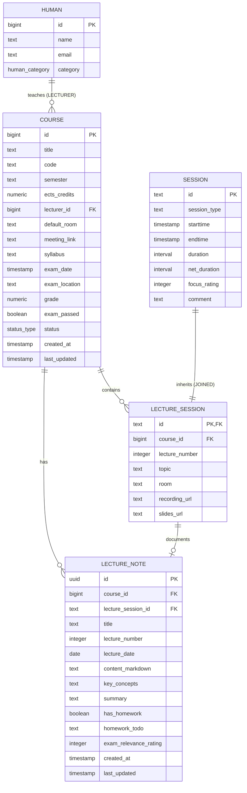

# Architectural Plan: University Courses, Lecture Sessions & Lecture Notes Architecture

## 1. Executive Summary & Goals

This architectural initiative expands Simon's Life Manager (SLM) beyond general learning sessions to first-class academic tracking for university studies. The system introduces:
1. **Academic Course Entity (`Course`)**: Tracks university modules, semester schedules, ECTS credit points, exam dates, room locations/links, and links to professors/lecturers (`Human` entity with `category = 'LECTURER'`).
2. **Polymorphic Lecture Session (`LectureSession extends Session`)**: Joins the polymorphic session hierarchy under the **Productivity** pillar (alongside `CodingSession`, `WorkingSession`, `LearningSession`, `ReadingSession`), contributing to cognitive Net Focused Time.
3. **First-Class Lecture Notes (`LectureNote`)**: Stores rich Markdown lecture notes, key concepts summaries, exam relevance ratings (1–5), and actionable homework/assignments checklist items.
4. **Academic & Notes Hub UI**: Dedicated dashboards for course overview, lecture timelines, and a modern Markdown note-taking interface with real-time preview.
5. **Spring AI MCP Server Integration**: Exposes tools for external AI agents to query courses, log lecture sessions, and fetch/create lecture notes.

---

## 2. Domain & Entity Architecture

### 2.1. Entity Relationship Diagram

---

## 3. Detailed Component Design

### 3.1. Entity Definitions (`de.oberamsystems.slm.model`)

1. **`Course.java`**:
   - `id`: `Long` (`@GeneratedValue(strategy = GenerationType.IDENTITY)`)
   - `title`: `String` (e.g., "Advanced Database Systems", "Operating Systems & Concurrency")
   - `code`: `String` (e.g., "IN2001", "CS-410")
   - `semester`: `String` (e.g., "WS 2026/27", "SS 2027")
   - `ectsCredits`: `BigDecimal` (e.g., `6.0`, `5.0`)
   - `lecturer`: `@ManyToOne @JoinColumn(name = "lecturer_id") Human` (filtered/selectable by `category = LECTURER`)
   - `defaultRoom`: `String` (e.g., "Audimax II, Campus Garching")
   - `meetingLink`: `String` (URL for Zoom/Teams/Webex)
   - `syllabus`: `String` (textual description, topics covered, prerequisites)
   - `examDate`: `LocalDateTime` (`TIMESTAMP`, exact exam date and start time)
   - `examLocation`: `String` (e.g., "Hörsaal 1")
   - `grade`: `BigDecimal` (optional, e.g. `1.3`)
   - `examPassed`: `Boolean`
   - `status`: `@Enumerated(EnumType.STRING) StatusEnum` (`PLANNED`, `IN_PROGRESS`, `COMPLETED`)
   - `createdAt`: `LocalDateTime`
   - `lastUpdated`: `LocalDateTime`

2. **`LectureSession.java` (`extends Session`)**:
   - Inherits all base `Session` attributes (`id` UUIDv7, `starttime`, `endtime`, `breakDuration`, `duration`, `netDuration`, `focusRating`, `comment`, `outcomeSummary`).
   - Annotated with `@DiscriminatorValue("LECTURE")` and mapped to table `lecture_session`.
   - `course`: `@ManyToOne @JoinColumn(name = "course_id") Course`
   - `lectureNumber`: `Integer` (sequential lecture index: 1, 2, 3...)
   - `topic`: `String` (e.g., "B+ Trees & Indexing Strategies")
   - `room`: `String` (defaults to `course.defaultRoom`, overrideable)
   - `recordingUrl`: `String` (video link / stream replay)
   - `slidesUrl`: `String` (link to PDF/slides)

3. **`LectureNote.java`**:
   - `id`: `UUID` (`@Id @GeneratedValue @UuidGenerator(style = Style.VERSION_7) @Column(name = "id", columnDefinition = "uuid")`, native PostgreSQL `UUID` powered by Hibernate 7's RFC 9562 UUIDv7 generator and PostgreSQL 18's `DEFAULT uuidv7()`)
   - `course`: `@ManyToOne @JoinColumn(name = "course_id") Course`
   - `lectureSession`: `@OneToOne(optional = true) @JoinColumn(name = "lecture_session_id") LectureSession`
   - `title`: `String` (e.g., "Lecture 04: Concurrency Control & Strict 2PL")
   - `lectureNumber`: `Integer`
   - `lectureDate`: `LocalDate`
   - `contentMarkdown`: `String` (`columnDefinition = "TEXT"`, rich Markdown content with headers, formulas, code snippets, diagrams)
   - `keyConcepts`: `String` (`columnDefinition = "TEXT"`, comma-separated chips or bullet points)
   - `summary`: `String` (`columnDefinition = "TEXT"`, 2-3 sentence core takeaway)
   - `hasHomework`: `Boolean`
   - `homeworkTodo`: `String` (action items, problem set exercises)
   - `examRelevanceRating`: `Integer` (1 to 5 stars, highlighting critical exam questions/topics)
   - `createdAt`: `LocalDateTime`
   - `lastUpdated`: `LocalDateTime`

---

## 4. Integration with Four Pillars Life Balance Model (ADR 011 & ADR 012)

- **Classification**: `LectureSession` strictly belongs to the **Productivity** pillar:
  - **Productivity**: `CodingSession`, `WorkingSession`, `LearningSession`, `ReadingSession`, and now **`LectureSession`**.
- **Net Focused Time Purity**: Attending university lectures is dedicated cognitive learning. Its `netDuration` directly adds to `totalNetDuration` on `/sessions`.
- **KPI Metrics**:
  - Daily/Weekly Life Balance includes lecture hours in the Productivity total.
  - Average focus rating incorporates the lecture's `focusRating` (1–5).

---

## 5. UI & View Layer Architecture

### 5.1. Navigation & Routes
- `/courses`: Courses & Academics Hub (`courses.html`)
  - Enrolled courses grid with ECTS summary cards, active semester filter pills, exam countdown badges, and "New Course" modal.
- `/courses/{id}`: Course Detail & Syllabus (`course-detail.html`)
  - Course metadata, professor contact badge, lecture schedule timeline, notes list, exam info.
- `/courses/{id}/notes/new` & `/notes/{id}/edit`: Markdown Lecture Notes Editor (`lecture-note-edit.html`)
  - Two-pane modern Markdown editor: Left pane raw Markdown, right pane instant HTML rendered preview (using modern vanilla CSS, code syntax highlighting, and sanitized HTML).
  - Key concepts badge input, exam priority rating selector, homework checkbox & textarea.
- `/notes/{id}`: Read-only rendered view with printable/exportable layout.
- `/sessions`:
  - Added `LECTURE` session pill in the filter bar.
  - "Log Lecture" modal with course dropdown, lecture number, topic, room, and instant button to "Create Note for this Lecture".

---

## 6. MCP Server Integration (`de.oberamsystems.slm.mcp`)

Introduce dedicated [`McpAcademicTools.java`](file:///home/simon/code/eclipse/slm/src/main/java/de/oberamsystems/slm/mcp/McpAcademicTools.java) with tools:
1. `getCourses(semester)`: Lists active courses, credits, lecturer, and upcoming exam dates.
2. `getCourseDetails(courseId)`: Detailed syllabus, scheduled lectures, and notes list.
3. `logLectureSession(courseId, topic, startTime, endTime, rating, comment)`: Logs attendance at a university lecture.
4. `saveLectureNote(courseId, lectureNumber, title, markdownContent, keyConcepts, examRating)`: Records or updates Markdown lecture notes.
5. `searchLectureNotes(query)`: Full-text search across all lecture note contents and key concepts.

---

## 7. Database Synchronization Protocol (AGENTS.md Section 5 & 6)

1. **Authoritative Baselines**:
   - Update [`tables.sql`](file:///home/simon/code/eclipse/slm/src/main/resources/tables.sql): Add `course`, `lecture_session`, and `lecture_note` tables with indexes on `course.lecturer_id`, `lecture_session.course_id`, and `lecture_note.course_id`.
   - Update [`init.sql`](file:///home/simon/code/eclipse/slm/init.sql): Synchronize with `tables.sql`.
   - Update [`schema-init.sql`](file:///home/simon/code/eclipse/slm/src/test/resources/schema-init.sql): Synchronize Testcontainers integration schema.
2. **Incremental Legacy Migration**:
   - Create `src/main/resources/migration_2026-10-18_6.sql` containing non-destructive `CREATE TABLE IF NOT EXISTS course ...`, `lecture_session ...`, and `lecture_note ...` statements.

---

## 8. Step-by-Step Implementation Plan

### Phase 1: Database & Schema Baselines
- [x] Add `course`, `lecture_session`, and `lecture_note` table definitions to [`tables.sql`](file:///home/simon/code/eclipse/slm/src/main/resources/tables.sql), [`init.sql`](file:///home/simon/code/eclipse/slm/init.sql), and [`schema-init.sql`](file:///home/simon/code/eclipse/slm/src/test/resources/schema-init.sql).
- [x] Create incremental migration [`migration_2026-10-18_6.sql`](file:///home/simon/code/eclipse/slm/src/main/resources/migration_2026-10-18_6.sql).

### Phase 2: JPA Domain Model & Repositories
- [x] Create `Course.java` entity with `lecturer` relation to `Human`.
- [x] Create `LectureSession.java extends Session` with `@DiscriminatorValue("LECTURE")`.
- [x] Create `LectureNote.java` entity with UUIDv7, Markdown content, key concepts, and exam relevance.
- [x] Create `CourseRepository` (`<Course, Long>`), `LectureSessionRepository` (`<LectureSession, String>`), and `LectureNoteRepository` (`<LectureNote, UUID>`).

### Phase 3: Sessions Hub & Four Pillars Integration
- [x] Update [`SessionController.java`](file:///home/simon/code/eclipse/slm/src/main/java/de/oberamsystems/slm/controller/SessionController.java) to handle `LectureSession` in Productivity filtering and Net Focused Time calculations.
- [x] Add `submitLectureSession` endpoint and populate courses in model attributes.
- [x] Update `sessions.html` with `LECTURE` category filter and Lecture logging modal.

### Phase 4: Academic Courses & Notes Controller and Views
- [x] Create `AcademicController.java` handling `/courses`, `/courses/{id}`, `/courses/new`, `/courses/{id}/edit`, `/notes/{id}`, and `/notes/{id}/edit`.
- [x] Implement `courses.html` (dashboard of courses, ECTS sum, semester pills).
- [x] Implement `course-detail.html` (course overview, lecture timeline, notes list).
- [x] Implement `lecture-note-edit.html` (interactive two-pane Markdown editor with live preview and key concept tags).
- [x] Implement `lecture-note-view.html` (rendered view with export and navigation).
- [x] Update [`index.html`](file:///home/simon/code/eclipse/slm/src/main/resources/templates/index.html) with Academics card.
- [x] Update [`SecurityConfig.java`](file:///home/simon/code/eclipse/slm/src/main/java/de/oberamsystems/slm/SecurityConfig.java) allowing public access to `/courses/**` and `/notes/**`.

### Phase 5: Spring AI MCP Server Extension
- [x] Create `McpAcademicTools.java` exposing courses, lecture session logging, and note saving tools.
- [x] Register in `McpServerConfig.java`.
- [x] Update `McpSessionTools.java` to support `LectureSession` in daily balance queries.

### Phase 6: Verification & Testing
- [x] Write integration test `AcademicIT.java` extending `AbstractIntegrationTest` verifying:
  - Course creation with linked lecturer `Human`.
  - Polymorphic `LectureSession` persistence and duration calculation.
  - `LectureNote` Markdown persistence and course linkage with native UUIDv7.
  - MCP academic tools execution.
- [x] Run `./gradlew test -x jacocoTestReport -x compileAotTestJava` verifying clean builds.
- [x] Formalize **ADR 017** in [`DECISIONS.md`](file:///home/simon/code/eclipse/slm/DECISIONS.md) and update [`CHANGELOG.md`](file:///home/simon/code/eclipse/slm/CHANGELOG.md).
