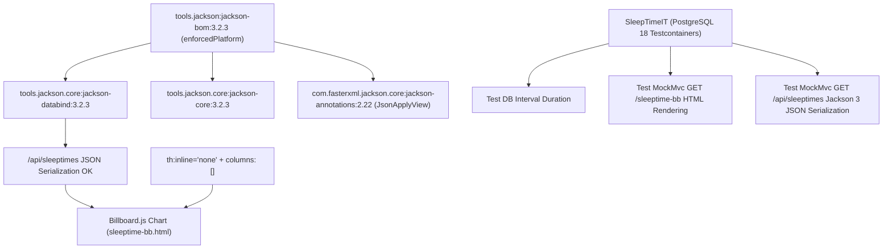

# Architecture Plan: Modernizing and Stabilizing `tools.jackson` (Jackson 3.x) with Integration Tests

## 1. Executive Summary & Objective

The user requested: **"use tools.jackson"** and commented **"Also add integration tests"**.

The application runs on **Spring Boot 4.2.0-M2** (with Spring Framework 7 / Java 27), which natively adopts the new **Jackson 3.x (`tools.jackson`)** ecosystem. However, a dependency version mismatch currently causes a fatal `NoClassDefFoundError: com/fasterxml/jackson/annotation/JsonApplyView` on JSON endpoints like `/api/sleeptimes`, breaking the `/sleeptime-bb` Billboard.js chart.

This updated plan details:
1. How to properly import and manage the **`tools.jackson:jackson-bom:3.2.3`** platform in Gradle.
2. How the Jackson 3.x architecture interacts with `jackson-annotations` (`2.22`).
3. How to fix template inlining and duration parsing in `/sleeptime-bb` and `/mood-bb`.
4. **Full Testcontainers Integration Test Suite (`SleepTimeIT`)** running on PostgreSQL 18, verifying database interval calculation, Thymeleaf template rendering, and REST JSON serialization.

---

## 2. Root Cause & Technical Background of `tools.jackson`

### 2.1. The Jackson 3.x Paradigm
In Jackson 3.x:
- Core modules moved to new Maven coordinates:
  - `tools.jackson.core:jackson-core:3.2.3`
  - `tools.jackson.core:jackson-databind:3.2.3`
  - `tools.jackson:jackson-bom:3.2.3` (the unifying Bill of Materials)
- **Annotations Exception:** By design of the Jackson project, annotations intentionally remain under `com.fasterxml.jackson.core:jackson-annotations`. 
- **The Conflict:** Jackson 3.2.3's `JacksonAnnotationIntrospector` requires `com.fasterxml.jackson.core:jackson-annotations:2.22` (introducing `@JsonApplyView`). But Spring Boot 4.2.0-M2's BOM pinned `jackson-annotations` to `2.21`, downgrading the dependency:
  ```
  com.fasterxml.jackson.core:jackson-annotations:2.22 -> 2.21 (Selected by rule - By constraint)
  ```
  This causes `java.lang.NoClassDefFoundError: com/fasterxml/jackson/annotation/JsonApplyView` during REST serialization.

### 2.2. The Solution: Enforced Platform BOM
By using Gradle's `enforcedPlatform('tools.jackson:jackson-bom:3.2.3')`, Gradle will:
1. Pull all `tools.jackson.core:*` dependencies at version `3.2.3`.
2. Override transitive Spring Boot constraints, guaranteeing `jackson-annotations:2.22` is loaded.
3. Keep the build aligned with modern Jackson 3 standards without manual ad-hoc version overrides.

---

## 3. Implementation Plan



### 3.1. Step 1: Update `build.gradle` for `tools.jackson`

Refactor the dependencies in [`build.gradle`](file:///home/simon/code/eclipse/slm/build.gradle):

```groovy
dependencies {
    // Enforce modern Jackson 3.x platform across all modules
    implementation enforcedPlatform('tools.jackson:jackson-bom:3.2.3')
    implementation 'tools.jackson.core:jackson-databind'
    implementation 'tools.jackson.core:jackson-core'
    implementation 'com.fasterxml.jackson.core:jackson-annotations'
    
    // ... other dependencies
}
```

*Benefits:*
- Eliminates manual version numbers on individual Jackson artifacts.
- Automatically resolves `JsonApplyView` and all transitive Jackson 3 components.

---

### 3.2. Step 2: Fix `/sleeptime-bb` Billboard.js Chart

Update [`src/main/resources/templates/sleeptime-bb.html`](file:///home/simon/code/eclipse/slm/src/main/resources/templates/sleeptime-bb.html):

1. **Disable Thymeleaf Inlining:**
   ```html
   <script th:inline="none">
   ```
2. **Fix Initial Columns:**
   Replace `columns: [[]]` with valid Billboard empty series `columns: []`.
3. **Resilient `parseDuration()` Function:**
   ```javascript
   function parseDuration(rawDuration) {
       if (rawDuration === null || rawDuration === undefined) return 0;
       // If Jackson serialized Duration as numeric seconds (e.g. 28800)
       if (typeof rawDuration === 'number') {
           return +(rawDuration / 3600).toFixed(2);
       }
       let str = String(rawDuration).trim();
       // If serialized as numeric string
       if (!isNaN(str)) {
           return +(Number(str) / 3600).toFixed(2);
       }
       // If serialized as ISO-8601 string (e.g. "PT8H", "PT7H30M")
       if (str.startsWith("PT")) {
           str = str.slice(2);
           if (str.endsWith("S")) str = str.slice(0, -1);
           let hours = 0;
           let minutes = 0;
           if (str.includes("H")) {
               let parts = str.split("H");
               hours = Number(parts[0]) || 0;
               str = parts[1] || "";
           }
           if (str.includes("M")) {
               minutes = Number(str.replace("M", "")) || 0;
           }
           return +(hours + (minutes / 60)).toFixed(2);
       }
       return 0;
   }
   ```
4. **Fix Initial View in [`mood-bb.html`](file:///home/simon/code/eclipse/slm/src/main/resources/templates/mood-bb.html):**
   Add `th:inline="none"` and `columns: []` to prevent identical inlining parser errors on `/mood-bb`.

---

### 3.3. Step 3: Implement `SleepTimeIT` Integration Test

Create [`src/test/java/de/oberamsystems/slm/SleepTimeIT.java`](file:///home/simon/code/eclipse/slm/src/test/java/de/oberamsystems/slm/SleepTimeIT.java) extending [`AbstractIntegrationTest`](file:///home/simon/code/eclipse/slm/src/test/java/de/oberamsystems/slm/AbstractIntegrationTest.java):

```java
package de.oberamsystems.slm;

import de.oberamsystems.slm.model.SleepTime;
import de.oberamsystems.slm.model.SleepTimeRepository;
import jakarta.persistence.EntityManager;
import org.junit.jupiter.api.BeforeEach;
import org.junit.jupiter.api.Test;
import org.springframework.beans.factory.annotation.Autowired;
import org.springframework.http.MediaType;
import org.springframework.test.web.servlet.MockMvc;
import org.springframework.test.web.servlet.setup.MockMvcBuilders;
import org.springframework.transaction.annotation.Transactional;
import org.springframework.web.context.WebApplicationContext;

import java.time.LocalDateTime;

import static org.hamcrest.Matchers.*;
import static org.junit.jupiter.api.Assertions.assertNotNull;
import static org.springframework.test.web.servlet.request.MockMvcRequestBuilders.get;
import static org.springframework.test.web.servlet.result.MockMvcResultMatchers.*;

@Transactional
public class SleepTimeIT extends AbstractIntegrationTest {

    @Autowired
    private WebApplicationContext webApplicationContext;

    @Autowired
    private SleepTimeRepository sleepTimeRepository;

    @Autowired
    private EntityManager entityManager;

    private MockMvc mockMvc;

    @BeforeEach
    public void setup() {
        this.mockMvc = MockMvcBuilders.webAppContextSetup(webApplicationContext).build();
    }

    @Test
    public void testSleepTimeIntervalAndJsonSerializationEndToEnd() throws Exception {
        // 1. Create and persist sleep record
        SleepTime st = new SleepTime();
        st.setGotobed(LocalDateTime.of(2026, 10, 18, 23, 0));
        st.setGetup(LocalDateTime.of(2026, 10, 19, 7, 30));
        st = sleepTimeRepository.saveAndFlush(st);
        entityManager.refresh(st);

        // Verify generated interval in PostgreSQL 18
        assertNotNull(st.getSleeptime(), "PostgreSQL generated interval sleeptime should be calculated");

        // 2. Test GET /api/sleeptimes JSON serialization with Jackson 3 (no NoClassDefFoundError)
        mockMvc.perform(get("/api/sleeptimes")
                        .accept(MediaType.APPLICATION_JSON))
                .andExpect(status().isOk())
                .andExpect(content().contentTypeCompatibleWith(MediaType.APPLICATION_JSON))
                .andExpect(jsonPath("$", not(empty())))
                .andExpect(jsonPath("$[?(@.id == " + st.getId() + ")].gotobed", notNullValue()))
                .andExpect(jsonPath("$[?(@.id == " + st.getId() + ")].getup", notNullValue()))
                .andExpect(jsonPath("$[?(@.id == " + st.getId() + ")].sleeptime", notNullValue()));

        // 3. Test GET /sleeptime-bb template rendering (no Thymeleaf parse exception or stream truncation)
        mockMvc.perform(get("/sleeptime-bb"))
                .andExpect(status().isOk())
                .andExpect(view().name("sleeptime-bb"))
                .andExpect(content().string(containsString("<!DOCTYPE html>")))
                .andExpect(content().string(containsString("<div id=\"chart\"")))
                .andExpect(content().string(containsString("</html>")));
    }
}
```

---

## 4. Verification Plan

1. **Dependency Resolution Check:**
   Run `./gradlew dependencyInsight --dependency jackson-annotations --configuration runtimeClasspath` to verify:
   - `com.fasterxml.jackson.core:jackson-annotations` resolves to `2.22`.
   - `JsonApplyView` is present on the runtime classpath.
2. **Integration Test Suite Execution:**
   Run `./gradlew test -x jacocoTestReport -x compileAotTestJava` verifying that `SleepTimeIT` and all other integration tests pass against the live PostGIS 18 container.
3. **API Endpoint Test:**
   ```bash
   curl -s -i http://localhost:8080/api/sleeptimes
   ```
   Expect HTTP `200 OK` and valid JSON array with sleep records.
4. **Page Rendering Test:**
   ```bash
   curl -s http://localhost:8080/sleeptime-bb | tail -n 10
   ```
   Expect complete HTML ending with `</html>` (no mid-stream truncation).
5. **Live Browser Verification:**
   Navigate to `http://localhost:8080/sleeptime-bb` via browser subagent:
   - Confirm Billboard.js spline chart renders smoothly.
   - Confirm tooltip and hover points show sleep durations in hours.
